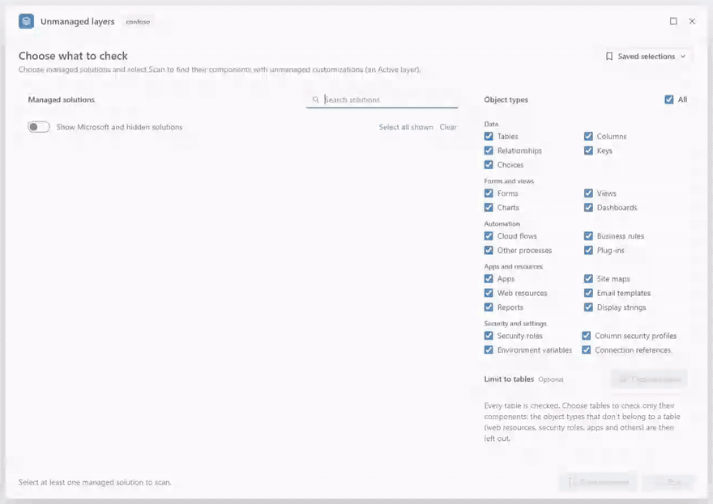

# Unmanaged Layer Scanner

A bookmarklet for Microsoft Dataverse (Dynamics 365 and Power Apps) that finds the components of managed solutions
that have an **unmanaged (Active) layer** on top: the changes made directly in an environment, which hide what later
deployments of the managed solutions bring. It shows what each layer changes, comparing any two layers property by
property, and deletes the unmanaged layer when asked, one component at a time, checked before and after.



The same demo as a [video (MP4)](docs/gallery/UnmanagedLayerScanner-demo.mp4).

| Item | Value |
| --- | --- |
| Tool | A bookmarklet: a favourite whose address is a small program. On the favourites bar it is named *Unmanaged layers*. Version 1.0.0 |
| Runs on | Any page of a Dataverse environment (`https://<org>.crm.dynamics.com`, for example a model-driven app), or the environment's pages in the maker portal ([make.powerapps.com](https://make.powerapps.com)), with your own sign-in. See [Open it](#open-it) |
| Browser | Microsoft Edge, the supported and tested browser. The link unpacks itself with the browser's `DecompressionStream` |
| Link size | About 72,000 characters: the code is compressed inside the link and unpacked by the browser |
| Installs in the environment | Nothing: no solution, no app registration, no server code. The scan only reads; see [Safety](#safety) |
| Documentation | [Technical reference (Word)](docs/UnmanagedLayerScanner%20-%20Technical%20Reference.docx)<br>[Developer guide: how the scanner is built and how to change it](docs/developer-guide.md) (also as [Word](docs/UnmanagedLayerScanner%20-%20Developer%20Guide.docx)) |
| License | [MIT](LICENSE) |

**Why.** Solution Layers Explorer reads the layers of every component of a solution one by one, so checking a whole
environment means tens of thousands of lookups and takes hours. The scanner asks Dataverse once per component type
for the managed components whose top layer is unmanaged, and then reads the layers of those components only. In a
test environment with about 950 tables, 37,000 columns and 517 managed solutions, a full scan took about 30 seconds
and 450 requests; Solution Layers Explorer's way, about 83,000 lookups, was estimated at 1.7 to 3.5 hours.

> **Deleting cannot be undone.** Deleting an unmanaged layer is the same as **Remove active customizations** on the
> Solution layers page: the component goes back to what its managed solutions define, and the changes made directly
> in the environment are gone. Try the scanner in a test environment first, and download the
> [deletion log](#the-deletion-log) after each run.

## Contents

* [Features](#features)
* [Screenshots](#screenshots): [Choosing what to check](#choosing-what-to-check),
  [Results and filters](#results-and-filters), [Details of a component](#details-of-a-component),
  [Deleting layers](#deleting-layers), [Narrow window](#narrow-window)
* [Download](#download)
* [Install](#install): [Drag the button](#drag-the-button),
  [Create the favourite by hand](#create-the-favourite-by-hand), [Run it from the console](#run-it-from-the-console),
  [When bookmarklets are blocked](#when-bookmarklets-are-blocked), [Update to a new version](#update-to-a-new-version)
* [Use](#use)
  * [Open it](#open-it)
  * [Choose what to check](#choose-what-to-check)
  * [Scan and stop](#scan-and-stop)
  * [The results](#the-results): [Type bubbles](#type-bubbles), [Column menus](#column-menus),
    [Which page a row opens](#which-page-a-row-opens), [Banners](#banners)
  * [The details](#the-details): [What changed](#what-changed), [Layers](#layers), [JSON](#json)
  * [Export](#export)
  * [Deleting](#deleting): [Outcomes](#outcomes), [The deletion log](#the-deletion-log)
  * [Keyboard](#keyboard)
* [Environment rules (optional)](#environment-rules-optional)
* [Safety](#safety)
* [Messages](#messages): [Starting](#starting), [Choosing](#choosing), [Scanning and results](#scanning-and-results),
  [Details](#details), [Deleting](#deleting-1)
* [Troubleshooting](#troubleshooting)
* [Limitations](#limitations)
* [How it works](#how-it-works)
* [Comparison with Solution Layers Explorer](#comparison-with-solution-layers-explorer)
* [Repository layout](#repository-layout)
* [Build](#build)
* [License](#license)
* [Developer guide](docs/developer-guide.md): how the scanner is built and how to change it (also as a
  [Word document](docs/UnmanagedLayerScanner%20-%20Developer%20Guide.docx))

## Features

| Screen | What you see |
| --- | --- |
| Choose what to check | Every managed solution of the environment, with a search box and a switch for Microsoft and hidden solutions; the object types, grouped as in the maker portal; an optional limit to some tables; saved selections; **Scan** |
| Choose tables | The environment's tables (display and logical names), searchable, with *Selected only* |
| Scanning | The step being worked on with a percentage, a progress bar, placeholder rows the size of the final ones, and **Stop scan** |
| Results | The number of unmanaged layers, a search box, type bubbles, and a grid of five columns (Type, Name, Table, Managed solution, What changed), each with an Excel-like menu; **Export** |
| Details of a component | Three tabs: **What changed** (any two layers compared property by property), **Layers** (every layer, as on the Solution layers page) and **JSON** (each layer's Changes, All properties and Children) |
| Delete confirmation | One dialog listing every ticked component, in the order they will be deleted |
| Deleting | The row being deleted, how many are done, the time left and **Stop deleting**; when the window is closed, a pill in the corner of the page |
| After deleting | The deleted rows struck through with a green check, a message with the counts and **Download log** |

* **Only what matters.** A component is listed when it belongs to a managed solution you chose and has an unmanaged
  layer on top. Unmanaged solutions, and components that exist only unmanaged, are never listed or checked.
* **Choose the scope.** Any number of managed solutions (Microsoft's hidden base solutions too, such as System, which
  holds the standard tables), some object types only (for example Forms and Views), and optionally some tables only.
  Fewer types or tables make the scan faster.
* **Saved selections.** Name a choice of solutions, types and tables, and pick it again from a menu. The last choice
  is remembered for each environment.
* **Works on the maker portal too.** Started on an environment's Solutions pages in the maker portal, the scanner uses
  the portal's own sign-in; started on a solution's page, that solution is selected.
* **Results you can work with.** A search box, type bubbles (*All*, then each type with its count; types that do not
  fit go under **More**), and on every column an Excel-like menu: sort, search the column's values, tick the values
  to show, each with how many rows have it. Columns can be resized, or fitted to their contents.
* **One click to the Solution layers page.** A click on a row opens the component's solution layers in a new tab, in
  the managed solution it was found in.
* **What changed, in detail.** Any two layers of a component compared property by property: XML laid out one
  attribute per line, JSON indented, web resource content decoded and images shown as images, inline or side by
  side, with unchanged lines folded. The layout never changes a value: two values that differ never look the
  same. Every value has **Copy**, which copies it exactly as stored.
* **Exports.** The rows shown (CSV), every layer of each component (CSV), everything the scan found (JSON), and the
  deletion log (CSV).
* **Careful deleting.** One confirmation for the ticked components; then one component at a time, top to bottom in
  the order shown. Right before each one its layers are read again; right after, the unmanaged layer must be gone and
  every managed layer as before (the same solution, order, publisher and values). Deleting can be stopped, and
  continues when the window is closed.
* **A window that stays out of the way.** It floats over the page: move it by its title bar, resize it from any edge
  or corner, maximize it. Its place and size are remembered. The page around it stays usable.
* **Keyboard and screen readers.** Every control works from the keyboard, with menus, lists and tabs that behave as
  in Fluent (Microsoft's design system, which the window follows); progress and results are announced.
* **Read-only scan.** Every request of the scan, the details and the deletion goes through one function, which refuses
  anything but a read unless a confirmed deletion is running. See [Safety](#safety).
* **Your own sign-in, nothing installed.** The scanner runs in your browser with your own privileges. It installs
  nothing in the environment and sends requests to Dataverse's Web API only (on the maker portal, before it starts, it
  asks the Dataverse addresses the portal holds a sign-in for which one is the open environment).

## Screenshots

The screenshots show a fictitious environment, *contoso*.

### Choosing what to check

**Choose what to check.** Five managed solutions selected, with *Show Microsoft and hidden solutions* on (System,
which holds the standard tables, is ticked at the bottom), every object type, and every table.


**Choose tables.** The search *contoso* finds four tables, and *Project* is ticked: only the components of that table
are then checked.


**Scanning.** The step being worked on and how far the scan is, placeholder rows, and **Stop scan**.


### Results and filters

**The results.** 23 unmanaged layers in the five solutions, scanned in 2.5 s. The type bubbles show the most common
types first, and the nine others are under **More**. Each row shows the type, the name with the schema name under it,
the table, the managed solution and the properties the unmanaged layer changes. The email template has an info icon
instead of a tick box: Dataverse does not allow deleting its unmanaged layer.


**A column's menu**, here *What changed*: sort, search, and every property name with the number of rows that change
it.


**Export**: the rows shown, every layer of each component shown, or everything the scan found.


### Details of a component

**What changed** for a main form: the managed layer of *Contoso Projects 1.3.0.0* (red) against the Active layer
(green). The description is short, so both values are shown one above the other. The form's XML is laid out one
attribute per line and compared line by line, with the changed part of each line marked and the unchanged lines
folded. Three system values that also differ are hidden.


**Side by side**, for a JavaScript web resource: its content is decoded from base64 and compared line by line, the
managed layer on the left and the Active layer on the right.


**An image web resource**: both images are shown, with their sizes.


**A web resource whose content is kept as a file**: the content is one row, *content*. Dataverse gives out only the
file in effect, here the Active layer's, so the Active layer's content is shown, decoded, with **Copy Active**. The
managed layer's file can't be read, so its line says so: its content is not guessed, and the two are not compared
line by line (see [What changed](#what-changed)).


**The Layers tab**: every layer of the component, top first, with its solution, publisher, kind, version, overwrite
time and number of changed properties. Dataverse gives the unmanaged layer no overwrite time, so its row shows when
the component was last changed instead, and by whom where Dataverse records it (*Last changed by &lt;name&gt;*), or for a
form when it was last published (*Last published*). **Compare with Active** and **JSON** open the other tabs on that layer.
In a narrow window the table still fits: Publisher and Version go under the solution's name.


**The JSON tab**: the Active layer's changes, indented and coloured, with **Copy** and **Download**.


**Children as a table**: a security role's privileges with their depth named (Organization, Business unit, Parent:
child business units), above the JSON they come from.


### Deleting layers

**One confirmation** for three ticked components, listed in the order they will be deleted. **Cancel** has the
focus.


**Deleting.** The first component is done and struck through, the second is being deleted; the bottom bar shows the
progress, the time left and **Stop deleting**.


**After deleting.** The three rows are struck through with a green check, the title counts 20, and the message offers
the deletion log.


### Narrow window

**A narrow window.** The object types go to one column and the cards make room. **Back to results** returns to the
last scan's results.


## Download

The files are attached to each release on the [Releases](../../releases) page:

| File | Use |
| --- | --- |
| `Install-unmanaged-layer-scanner.html` | The install page: open it in Edge and drag the **Unmanaged layers** button to the favourites bar. It also holds the link in a box with **Copy**. Most people need only this file (in the repository it is `Install unmanaged layer scanner.html`) |
| `layer-scanner.bookmarklet.txt` | The link itself (it starts with `javascript:`), to paste as the address of a favourite |
| `layer-scanner.min.js` | The scanner's code, minified, to paste into the browser's console where bookmarklets are blocked |
| `UnmanagedLayerScanner-Technical-Reference.docx` | This README as a Word document: installing and using the scanner, step by step with screenshots |
| `UnmanagedLayerScanner-Developer-Guide.docx` | The developer guide as a Word document: how the scanner is built and how to change it |
| `README.txt` | The package in short: what each file is, how to install, and the checksums |
| `SHA256SUMS.txt` | The SHA-256 checksums of the release's files, one line per file |

To check a file against its checksum in PowerShell: `Get-FileHash -Algorithm SHA256 .\layer-scanner.bookmarklet.txt`,
then compare the hash with the line for that file in `SHA256SUMS.txt` (PowerShell prints it in capitals). On macOS or
Linux, `sha256sum -c SHA256SUMS.txt` checks every file it lists at once.

The released files are built from this repository without [environment rules](#environment-rules-optional). To build
them yourself, see [Build](#build).

## Install

### Drag the button

1. Download `Install-unmanaged-layer-scanner.html` from the [Releases](../../releases) page and open it in Edge
   (double-click it, or drag it onto an Edge window). GitHub shows the copy in the repository as source text, so use
   the downloaded file.
2. Show the favourites bar: Ctrl+Shift+B.
3. Drag the blue **Unmanaged layers** button onto the favourites bar.

### Create the favourite by hand

When dragging does not work:

1. Copy the link: **Copy** on the install page, or the whole content of `layer-scanner.bookmarklet.txt`.
2. Add any page to the favourites bar (Ctrl+D, folder *Favourites bar*).
3. Right-click the new favourite, select **Edit**, name it *Unmanaged layers*, replace its URL with the link, then
   **Save**.

Pasting the link into the address bar does not run it: the browser removes the `javascript:` part of pasted text.

### Run it from the console

Without a favourite, the same code runs from the browser's developer tools:

1. Open a page of the environment, or its Solutions page in the maker portal.
2. Press F12 and open **Console**.
3. Paste the whole content of `layer-scanner.min.js` and press Enter. If the console warns about pasting code, follow
   the instruction it gives to allow pasting (in Edge, type *allow pasting*, then paste again).

### When bookmarklets are blocked

Some organizations block bookmarklets with a browser policy: clicking the favourite then does nothing. Use the
console (above), or ask the people who manage your browser.

The link runs the unpacked code with `eval`. If a page forbids that, the link loads the code as a script instead; if
that is refused too, it says "This page does not allow the unmanaged layer scanner to run." Environment pages and the
maker portal allow it.

### Update to a new version

1. Replace the favourite's URL with the new link (right-click it, **Edit**), or drag the new button from the new
   install page and delete the old favourite.
2. Reload the pages where the scanner's window is open. On a page where a window is already open, the favourite
   shows that window again instead of starting the new version.

Saved selections, the last choice, the column widths and the window's place and size are kept. To see which version
runs, point at *Unmanaged layers* in the window's title bar: the tooltip reads "Unmanaged layer scanner 1.0.0".

## Use

### Open it

Click **Unmanaged layers** on the favourites bar:

* **On a page of the environment**: any address ending in `.dynamics.com`, for example
  `https://contoso.crm.dynamics.com/main.aspx`. The scanner uses your browser's session with the environment.
* **In the maker portal**: `make.powerapps.com` with an environment open (the address contains
  `/environments/<id>/`), for example its Solutions page. Wait until the Solutions list has loaded: the scanner uses
  the portal's own sign-in to the environment (see [Safety](#safety)). Started on a solution's page, that solution is
  selected, with every object type and every table, and the bottom bar says "selected because it's open in the maker
  portal".

The window opens over the page. Its title bar shows the environment's name (point at it to see the address) and, with
[environment rules](#environment-rules-optional), a *Production* or *Development* badge.

There is one window per page. Clicking the favourite again shows the same window as you left it; in the maker
portal, on the page of another managed solution, it goes back to the choice with that solution selected. When you
switch to another environment in the maker portal, the next click closes the old window and starts one for the new
environment (not while it is scanning or deleting); download the [deletion log](#the-deletion-log) first, because it
goes with the old window. To close the window, select × or press Esc.

### Choose what to check

**Managed solutions.** Every managed solution of the environment, with its display name, unique name, publisher,
version and installed date; hidden solutions carry a *Hidden* tag. Unmanaged solutions are not listed. Search by name,
unique name or publisher. **Select all shown** ticks the solutions in the list, **Clear** unticks them all.

*Show Microsoft and hidden solutions* is off by default: the list then leaves out hidden solutions and solutions whose
publisher's name contains "Microsoft" or "Dynamics 365", except those already ticked.

**Why System matters.** Standard tables such as Account and Contact, with their standard columns, forms and views,
belong to Microsoft's hidden base solutions, mainly *System*. A standard component changed directly in the
environment has its unmanaged layer on top of System's layer. If you tick only your own solutions, such changes are
not listed. To include them, turn on *Show Microsoft and hidden solutions* and tick *System* too (or select all). In
the [results screenshot](#results-and-filters), the changed column *Job Title* of Contact is found through System.

**Object types.** The types to check, grouped as in the maker portal:

| Group | Types |
| --- | --- |
| Data | Tables, Columns, Relationships, Keys, Choices |
| Forms and views | Forms, Views, Charts, Dashboards |
| Automation | Cloud flows, Business rules, Other processes, Plug-ins |
| Apps and resources | Apps, Site maps, Web resources, Email templates, Reports, Display strings |
| Security and settings | Security roles, Column security profiles, Environment variables, Connection references |
| Everything else | Other: every other component type, for example ribbon customizations, duplicate detection rules and component types added by newer solutions |

**All** ticks or clears every type listed. With some types only, the scan reads only the component types they need,
which is faster.

**Limit to tables (optional).** By default every table is checked. **Choose tables** opens the environment's tables
(display and logical names; private tables are not listed), with a search box, *Selected only*, **Select all shown**
and **Clear**. With tables chosen, only their components are checked: the tables themselves and their columns,
relationships (on either side), keys, forms, dashboards, views, charts, business rules and other processes, of the
object types ticked (under *Other*, only their ribbon customizations). Object types that are not offered for a table
(choices, cloud flows, plug-ins, apps, web resources, security roles and others) are then no longer listed, with a
note; they come back with their ticks when you select **Check all tables**. This is also faster: in a test, one table
took about 9 seconds and 32 requests, against 15 to 25 seconds and about 310 to 330 requests for the same solution with
every table.

**Saved selections.** **Save selection** (bottom) names the current choice of solutions, types and tables; the name
can be up to 60 characters long, and saving under an existing name replaces it (the button then says **Replace**). The
**Saved selections** menu (top right) lists them with what each holds; pick one to fill in the choice (then select
**Scan**), or select its bin icon to remove it (**Undo** in the message puts it back). Applied in an environment that
lacks some of its solutions, a saved selection says which; saving it again there keeps them in it.

Saved selections are kept in this browser: on the maker portal they are shared by every environment, on an
environment's own pages they belong to that environment. The last choice you scanned is remembered for each
environment and filled in next time.

The bottom bar sums up the choice, for example "5 solutions · All object types", and **Scan** starts.

### Scan and stop

While scanning, the title says *Scanning…*, and next to the search box a line names the step and the percentage:

| Step | What it reads |
| --- | --- |
| Reading tables… | The tables, which of the columns the scan needs each table has, and the component type definitions |
| Checking component types (n of m)… | One query per component type: its managed components whose top layer is unmanaged |
| Checking tables, columns and relationships… | The definitions of the tables, columns, keys and relationships found, to keep the managed ones |
| Checking other customized components… | The maker portal's *Customized* flag, for the types the queries above cannot read (global choices and others) |
| Finding which solutions the components are in… | The solution memberships of the components found, 50 at a time |
| Checking the remaining components (n of m)… | The layers of components that have no solution membership row, to place them in a solution |
| Reading what changed (n of m)… | The layers of the components found: the managed layers underneath and what the unmanaged layer changes |

**Stop scan** ends the scan: the reads waiting or on their way end at once, the window goes back to the choice, and
a message says "Scan stopped." Nothing partial is shown.

In a test environment, a scan of every managed solution took about 30 seconds, and a scan of one solution with every
object type 15 to 25 seconds: the time follows the number of component types read, not the number of solutions. A few
object types or one table take less (Forms and Views only: 4 to 8 seconds; one table: about 9 seconds). See
[Safety](#safety) for the load a scan puts on the environment, and
[Performance and scale](docs/developer-guide.md#610-performance-and-scale) in the developer guide for where the
requests go.

### The results

The title gives the number of unmanaged layers. The line under it repeats the scope and adds the time the scan took;
after a filter or a search, "showing *x* of *y*"; after a deletion, how many were deleted. **Change selection** goes
back to the choice, **Scan again** runs the same scope again, **Export** is described [below](#export).

The grid has one row per component:

| Column | Shows |
| --- | --- |
| Type | The type as the maker portal's Objects list names it: *Column*, *Main form*, *Public view*, *Cloud flow*, *Business rule*, *Security role* ... |
| Name | The display name, with the schema or unique name under it. The name is a link to the solution layers page |
| Table | The table's display name with its logical name under it, or "—" for a component without a table |
| Managed solution | The chosen managed solutions that hold the component. Point at it to see the managed layers underneath, top first |
| What changed | The properties the unmanaged layer sets, as many as fit, then *+N* for the others; or *Only status or owner* (a process only switched on or off, or given a new owner), *Only system values* (only values Dataverse sets itself, such as Modified on), *Not read yet* or *Layers could not be read* |

At the end of each row, a document icon opens the [details](#the-details) and an arrow icon opens the solution layers
page. The rows come in the scan's order (by type, then name) until you sort a column. The grid draws up to 2,000 rows;
filter to see others (the line under the title says so).

**Search.** The search box finds rows by type, name, schema name, table, managed solution or changed property, ignoring
case.

#### Type bubbles

Above the grid, *All* and one bubble per type with its count, the most common types first. A click shows only that
type; a second click on it shows all again; Ctrl+click adds or removes a type. Bubbles that do not fit on the row go
under **More (n)**, right after the last one, so the row never runs off the window; a type picked there comes into
view next to *All*. A type whose rows have all been deleted stays pressed, with 0. The bubbles are the Type column's
filter: ticking types in the Type column's menu presses the same bubbles.

#### Column menus

Every column header opens a menu, as in Excel or Dynamics:

* **Sort A to Z** and **Sort Z to A**. The same sort again goes back to the scan's order.
* **Fit to contents** makes the column as wide as its longest value shown (Type, Name, Table and Managed solution).
* **Reset column widths** (shown once widths were changed) puts every column back.
* A **search** of the column's values, then the values, each with how many rows have it, counted among the rows the
  other filters and the search leave. Ticking or clearing a value filters at once; there is no Apply. **Select all**
  ticks or clears every value (while searching, **Select all search results** does the same for every value found,
  also those not listed). Enter in the search keeps only the values found that are ticked, as in Excel, and closes the
  menu. Up to 300 values are listed; search to find the others.
* **Clear filter** and **Done**.

*What changed* lists one value per property, so its menu answers questions such as "which components changed
`formxml`". *Managed solution* lists each solution on its own.

A filtered column shows a filter mark in its header. **Clear filters (n)**, next to the bubbles, clears the column
filters other than the type; the bubbles keep theirs.

**Column widths.** Drag the right edge of the Type, Name, Table or Managed solution header (the edges show when you
point at the headers); double-click an edge to fit the column to its contents. *What changed* takes the room the
others leave, at least 150 pixels; the names it shows are counted again when the window or a column is resized. In a
window too narrow for all columns, the grid scrolls sideways rather than squeezing a column. The widths are
remembered in this browser.

#### Which page a row opens

A click on a row (anywhere but its tick box, *What changed*, a link or a button), on its name or on its arrow icon
opens the component's solution layers page in a new tab. Point at the name to see which solution it opens in.

| Component | Page |
| --- | --- |
| Table | Maker portal: `.../environments/<environment id>/solutions/<solution id>/entities/<table id>/layers` |
| Column, relationship, key, form, view, chart, business rule | Maker portal: `.../solutions/<solution id>/objects/entities/<table id>/<fields, relationships, keys, forms, views, charts or business rules>/<id>/layers` |
| Any other type | Maker portal: `.../solutions/<solution id>/objects/all/<id>/layers` |
| Display strings, plug-in types, plug-in step images, record filters, channel access profiles, and a relationship whose unmanaged layer is only on its cascade settings | The classic Solution layers page of the environment: `https://<org>.crm.dynamics.com/WebResources/msdyn_/solutionlayers/index.html#/componentlayers/<layer name>/<id>` |

The solution in the address is the managed solution the component was found in: one of the chosen solutions whose
component list holds it, or else one that holds its table with all its objects (the first by name). The maker portal
shows a component only in a solution that holds it in one of those two ways. A component found through its layers only
(no solution component row, which happens for a few parts of standard tables) opens in the *Default Solution*, which
holds every component.

A maker portal page takes a few seconds to load. The maker portal shows a relationship's definition only, not its
cascade settings; once the details show that the unmanaged layer is on the cascade settings only, the row opens the
classic page instead. If the environment's id could not be read, every row opens the classic page.
[Links to the solution layers pages](docs/developer-guide.md#7-links-to-the-solution-layers-pages) in the developer
guide explains each address.

#### Banners

Above the grid, when they apply:

* **Some parts couldn't be read, so this list might be incomplete.** (amber) A component type, a step or some
  components could not be read; **Details** lists them. The list might miss components; scan again in a moment. See
  [Messages](#messages).
* **Not checked: &lt;types&gt;.** Your security role cannot read those types (the privileges are named), so they were
  skipped. Everything else was checked. Column and table image configurations are the exception: in some
  environments Dataverse refuses them even to System Administrators who hold the privileges it names, with its own
  security error (0x80040256). That refusal is skipped without a note (and the note then leaves out "Everything else
  was checked"). A role that really lacks those privileges is still told.
* **What changed is shown for &lt;n&gt; components.** The others are not read yet; **Read &lt;n&gt; more** reads the
  next 500. Components flagged only by the solution summary are read first, and the banner says when some of them
  might have no unmanaged layer of their own.

Without rows, the grid says *Nothing to clean up* (no component of the chosen solutions has unmanaged
customizations), *No components match* (with **Clear filters** when a column is filtered) or *All unmanaged layers
deleted*.

### The details

**What changed**, or the document icon at the end of a row, opens the component's details inside the window. The
header shows the name, the type, the schema name, the table and the solutions; the arrows (Alt+Up and Alt+Down) go to
the previous and next component of the grid, in its current order, and "14 of 23" says where you are.
**Solution layers** opens the solution layers page, and **Delete unmanaged layer** deletes this component's unmanaged
layer after the usual [confirmation](#deleting). The back arrow, or Esc, returns to the grid. For a relationship, a
switch chooses between its *Definition* and its *Cascade settings*, which have layers of their own.

The details read every layer of the component with all its data when you open them. The last 20 read are kept (each
part of a relationship counts as one), so going back to them reads nothing (except the current content of a web
resource whose content is kept as a file, see [What changed](#what-changed)); after the component's unmanaged layer
is deleted, or after a new scan, they are read again.

#### What changed

Two layers, compared property by property. By default the Active layer (green) against the managed layer right
under it (red). With more than two layers, each picker offers every layer but the one in the other picker; the swap
icon swaps them.

* **Only differences** (on by default) hides the properties that are the same in both layers.
* **Hide system values** (on by default) hides values Dataverse keeps up to date itself: Modified on, Modified by,
  Created on, Created by, version number, overwrite time, solution ids, component state, managed state, Published on,
  organization and the `...idunique` values. The note at the top counts them.
* Each property has a status: *Changed*, *Only in &lt;layer&gt;* or *Same*. The first three changed properties are
  open; select a property to open or close it.
* **Short values** (one line, up to 200 characters) are shown one above the other, with a **Copy** link at the end of
  each layer's row.
* **Longer values** are compared line by line: removed lines in red, added lines in green, the changed part of each
  line marked, three lines of context around each change, and longer unchanged stretches folded ("36 unchanged
  lines"; select to unfold). **Inline** or **Side by side**.
* **XML** values are indented, one element per line, and an element with several attributes has one attribute per
  line, so a change to one attribute is one changed line. Only the spacing between elements changes: text, text
  mixed with elements, `xml:space="preserve"` and the XML declaration are kept exactly; XML with a DOCTYPE is shown as
  stored.
* **JSON** values are indented without being read and written again, so large numbers and the order of keys stay
  exactly as stored.
* **Numbers are kept as written.** A number in layer data that JavaScript cannot hold exactly as written (a whole
  number above 2^53, as in a relationship's cascade settings; a long fraction; an exponent such as `1e2`; or `1.0`)
  keeps its digits as stored, so it is shown, copied and compared exactly. A number and a text with the same digits
  are never taken for the same value.
* **Web resources**: the content is decoded from base64; XML, XSL, SVG and RESX content is laid out as XML, and images
  (PNG, JPG, GIF, ICO) are shown as images with their sizes. For a web resource whose content Dataverse keeps as a
  file, see below.
* When two different values look the same once laid out, both are shown as stored, with a note. When they differ only
  in type (a number and a text with the same digits), both are shown as JSON, so the text has its quotes. Carriage
  returns are shown (␍), so a difference in line endings alone can be seen.
* **Every value has Copy**: **Copy** at the end of each layer's row for a short value, **Copy &lt;layer&gt;** for a
  longer one. It copies the value exactly as stored (a text web resource's content decoded from base64; an image's as
  base64; a number as written), so it can be pasted back to redo a change by hand.

Lookups are shown as table, id and name; choices as their value; managed properties with "can be changed". A value
above 1,000,000 characters is not compared on the screen, and a difference longer than 3,000 lines shows the first
3,000: copy the values to compare them in another tool.

**Web resources whose content is kept as a file.** A layer can hold a web resource's content in two ways: in the
layer itself (`content`, base64), or as a file of its own, when its data holds `contentfileref`, a reference to that
file, instead. The two layers compared can hold it in different ways: in tests, right after a web resource's content
was saved through the Web API, the Active layer held the content itself while the managed layer held only a file
reference; later, Dataverse kept both as files. The Web API gives out only the file in effect now, through the web
resource itself; the files of the other layers cannot be read. So, when the details of a web resource with a file
reference open, the scanner reads its current content once
(`webresourceset(<id>)?$select=content,contentfileref`).

Whichever way each layer holds it, the content is one property row, `content` (there is no `contentfileref` row). The
top layer, when its file is the one in effect now, gets that file's content (the content in effect is always the top
layer's); a file of any other layer cannot be read.

* **When both layers' content can be read** (held in the layer, or in the top layer's file in effect), it is compared
  like any other web resource content: decoded, XML types laid out, images shown, short values one above the other with
  **Copy** on each layer's row, longer ones line by line. The same content held in different ways is *Same*.
* **When a layer's content is in a file that cannot be read**, the two are never compared line by line, and no
  content is guessed. A sentence says which layer's content can't be read (the texts are under
  [Details](#details)), then each layer has a line. A layer that can be read shows "decoded from base64" (or "its
  content"), **Copy &lt;layer&gt;** and the content: the image, the text, or a note that it is too large to show. A
  layer that cannot be read says why: "its content is kept as a file that Dataverse doesn't give out through the Web
  API", or, when the content in effect could not be read, "its content is kept as a file, and the content in effect
  couldn't be read (&lt;reason&gt;)".
* **When both layers name the same file**, and its content cannot be read, the row is *Same*: "Both layers use the
  same file, so their content is the same."

**Copy** on these rows copies the content as for any web resource: decoded from base64, an image as base64.

#### Layers

Every layer of the component, top first, as on the Solution layers page: order, solution (name and unique name; *Active*
for the unmanaged layer), publisher, *Managed* or *Unmanaged*, the solution's version, the overwrite time and how many
properties the layer changes. The unmanaged layer has no overwrite time: its row shows the last time the component
was saved (*Last changed*; for a form, the last publish, *Last published*), usually the unmanaged change, though a
later import or publish also sets it. For most components (views, charts, processes, web resources, templates,
environment variables, roles and others) it also names the user who saved it last (*Last changed by &lt;name&gt;*; a
long name takes two lines at most, the whole name is in the tooltip); forms, tables, columns and relationships record
no user. Relationships record no date, so theirs shows a
dash. **Compare with Active** opens *What changed* with that layer against the Active layer;
**JSON** opens the layer's data.

#### JSON

The data of one layer, as Dataverse stores it: **Changes** (what the layer sets), **All properties** (the component
as that layer defines it) or **Children** (records inside the component, such as a security role's privileges or a
choice's options). The JSON is indented and coloured. Lists of records in *Children* are also shown as tables, with a
privilege's depth named (User, Business unit, Parent: child business units, Organization). **Copy** copies the text
shown and **Download** saves it as a `.json` file.

### Export

**Export** (top right) offers:

| Option | File | Contents |
| --- | --- | --- |
| Excel (CSV) | `unmanaged-layers-<org>-<time>.csv` | The rows shown (after the search and filters, deleted rows left out, also the rows beyond the 2,000 drawn): type, display name, schema name, table, managed solution, managed layers (top first), what changed, component id and the solution layers page |
| All layers (CSV) | `unmanaged-layers-all-layers-<org>-<time>.csv` | Every layer of each component shown, one line per layer: the component's columns, then the layer's component name, order, solution (unique name and name), publisher, overwrite time, number of changed properties and layer id. A component whose layers were not read has one line, "(layers not read)" |
| Full details (JSON) | `unmanaged-layers-<org>-<time>.json` | Everything the scan found: the scope, the time and number of requests, every component listed with its managed layers and changed properties, the components with an unmanaged layer in solutions you did not choose (`outOfScope`), the parts that could not be read (`typesFailed`), the types not checked (`noAccess`) and the components that turned out to have no unmanaged layer (`cleared`) |
| Deletion log (CSV) | `unmanaged-layers-deleted-<org>-<time>.csv` | After a deletion: every deletion of this session, see [The deletion log](#the-deletion-log) |

`<org>` is the environment's name and `<time>` the time of the export (UTC, year to minute, digits only, for example
`202610151432`). The exports send no request: they use what the scan and the details have already read. The CSV files
open in Excel (UTF-8) with a double-click. A value that starts with `=`, `+`, `-`, `@`, a tab or a carriage return gets
a leading apostrophe, so a spreadsheet program does not run it as a formula.
[Exports](docs/developer-guide.md#11-exports) in the developer guide lists every column.

### Deleting

1. **Tick the components** whose unmanaged layer should go, or open a component's details and select
   **Delete unmanaged layer**. The tick box in the header ticks or clears every row shown that can be ticked (of the
   2,000 drawn at most). Ticks stay when the search or a filter hides a row; the bottom bar counts the ticked rows and
   how many of them the search or filters hide.
2. Select **Delete unmanaged layer** (or **Delete &lt;n&gt; unmanaged layers**) at the bottom right.
3. **One confirmation** lists every component, also those hidden by the search or filters (marked so), in the order
   they will be deleted: top to bottom in the order shown, whatever the sort, then the ticked rows that are hidden, in
   the scan's order. **Cancel** has the focus. In a production environment (see
   [Environment rules](#environment-rules-optional)) the dialog says so in red; on the maker portal it warns when the
   portal's sign-in might end before the last component.
4. **Delete** starts the run. The components are deleted one at a time, and the grid scrolls to follow the one being
   deleted. The bottom bar shows "Deleting 2 of 3: &lt;name&gt; (&lt;type&gt;)", the time left and
   **Stop deleting**.

Up to 100 components can be deleted in one run; above that, the button is disabled and the bar says "You can delete
up to 100 at a time." Dataverse takes about 7 to 9 seconds per component (about 25 seconds for a relationship, which
has two places to clean), measured in a test environment, so a run of 100 takes about 15 minutes.

**For each component**, the scanner:

1. reads its layers again, right before: only a place whose top layer is the Active layer **on top of at least one
   managed layer** is touched. A component with no managed layer underneath is never touched, because removing its
   only layer would delete the component;
2. calls Dataverse's `RemoveActiveCustomizations`, which removes the Active layer only, as **Remove active
   customizations** does on the Solution layers page. When another import or publish holds the lock, it waits 10
   seconds and tries again, up to 5 times;
3. reads the layers again, right after: the Active layer must be gone, and every managed layer must be the same as
   before: the same solution, order and publisher, and the same values (values Dataverse keeps up to date itself, such
   as the overwrite time, are left out of the comparison).

Nothing is published: removing the layer takes effect without it. [Deleting](docs/developer-guide.md#10-deleting) in
the developer guide follows a run step by step.

**While it runs.** **Stop deleting** stops after the component being deleted at that moment; the others are marked
*Not tried* and stay ticked, so one click goes on. Closing the window (× or Esc) only hides it: deleting goes on, and a
pill in the corner of the page shows how far it is ("Deleting unmanaged layers · 5 of 17 · about 1 min left"); select
it to open the window again. Leaving or reloading the page asks for confirmation first. The details, the column menus,
the bubbles, the search and the exports wait until the run ends.

**Types Dataverse does not delete.** Dataverse does not allow removing the unmanaged layer of an email template. Such
rows have an info icon instead of a tick box, which says to undo the change by hand, or to import the managed solution
again with *Overwrite unmanaged customizations*. They stay in the list and the exports. A type that Dataverse refuses
the same way during a run loses its tick box for the rest of the session.

#### Outcomes

At the end, a message gives the counts, with **Download log**. Each row shows its outcome:

| In the row | In the log | Meaning |
| --- | --- | --- |
| Struck through, green check | Deleted | The Active layer is gone, and every managed layer is as before |
| Deleted (not checked) | Deleted, not verified | Dataverse accepted the removal, but the layers could not be read again to check it |
| Partly deleted | Partly deleted | A relationship: one of its two places (definition, cascade settings) was deleted, the other not |
| Not deleted | Failed | The layers could not be read before (nothing was deleted), the Active layer is still there (with Dataverse's reason), or the managed layers changed (the row lists them before and after) |
| Result unknown | Unknown | The call returned an error and the layers could not be read again; or the Active layer is gone but a managed layer's values changed at the same time (another import?); or the run stopped on an error or an expired sign-in during this component. Check its layers |
| Skipped | Skipped | It no longer has an unmanaged layer on top of a managed layer; nothing was called |
| Not tried | Not attempted | You stopped the run (the row stays ticked), or the sign-in expired before it was reached |

The row gives the reason next to its outcome; for a relationship, it names the place ("Definition: ..." or "Cascade
settings: ..."). Deleted rows stay in the grid, struck through, until the next search or filter change; the title
counts the rest. A row with any other outcome can be ticked again. [Outcomes](docs/developer-guide.md#107-outcomes) in
the developer guide shows how each outcome is decided.

#### The deletion log

A CSV file with one line per component of the run, those not tried included: result, type, display name, schema name,
table, managed solution, component id, detail, the unmanaged changes per place (the Active layer's changes as read
right before the removal, as JSON, with each place's result) and the time the run started. Each line is kept as soon
as its component is done, so the log is complete even when a run ends early. The message at the end of a run
downloads that run's log; **Export** → **Deletion log (CSV)** downloads every deletion of the session. Keep it: it is
the only record of what the unmanaged layers held, and it lets you redo a change by hand (it is not an import file:
set the properties again in the maker portal).

**Web resources whose content is kept as a file.** The unmanaged layer's changes then name only its file
(`contentfileref`), which goes with the removal. So, right before the removal, the scanner reads the web resource's
current content (one extra read per such component). When the current file is the unmanaged layer's, the content
is kept in that place's entry of the log as `content` (base64, as Dataverse stores it); otherwise the entry gets
`contentNote`: "the content of the unmanaged layer could not be read before the removal". When the unmanaged layer
holds the content itself, its changes already contain it, and nothing more is read.

The log is kept only in the page's memory, not in the browser's storage. Reloading the page, or clicking the favourite
in another environment of the maker portal, loses it, so download it before you do.

### Keyboard

| Key | Where | What it does |
| --- | --- | --- |
| Esc | Anywhere in the window | Clears a search box that has text; otherwise closes the column menu, an open menu, a dialog or the details; otherwise closes the window (while deleting, it shrinks to the pill). Esc acts on the window only when the focus is in it |
| Alt+Up, Alt+Down | Details | Previous and next component |
| Left, Right | Details tabs | Previous and next tab |
| Up, Down, Home, End | Solution list, table list, menus | Move |
| Space, Enter | Solution list, table list | Tick or untick |
| Enter | A column menu's search | Keeps only the values found |
| Enter | Save selection | Saves |
| Tab, Shift+Tab | The window | Move through the controls; the focus stays inside the window, and inside a dialog while one is open. In a menu, Tab closes it |
| Ctrl+click | A type bubble | Adds or removes the type |
| Double-click | Title bar; a column's edge | Maximizes or restores the window; fits the column to its contents |

Keys pressed in the window do not reach the page, so the app's own shortcuts do not fire. For screen readers, the
progress bar reports how far the scan is, the end of a scan ("Scan finished: 23 unmanaged layers.") and of a deletion
run ("Deleted 3 of 3.") are announced, and lists, menus, tabs and dialogs have their usual roles.

**The window.** Move it by its title bar; resize it from any edge or corner (never smaller than 720 × 560 pixels, or
the page if that is smaller); maximize it with the button or a double-click on the title bar. Dragging a maximized
window restores it under the pointer. Its place and size are remembered in this browser; it is pulled back into view
when the page is resized or the window is opened again.

## Environment rules (optional)

Two rules can be built into your own copy of the scanner, for your own environments:

| Setting | Effect |
| --- | --- |
| `developmentEnvironments` | Deleting is turned off: no **Delete** buttons (in the bottom bar and in the details), the tick boxes are turned off, an amber *Development* badge is in the title bar, and the bottom bar says "Deleting is turned off in development environments." |
| `productionEnvironments` | A red *Production* badge in the title bar, and the delete confirmation says, in red, "You're deleting in the production environment &lt;name&gt;." |

Each value is a regular expression, matched (ignoring case) against the environment's name: the first part of its
Dataverse address, for example `contoso-dev` for `https://contoso-dev.crm.dynamics.com`. The same name is used on the
maker portal. There are no rules by default.

1. Copy `scanner.settings.example.json` to `scanner.settings.json`, next to `build-bookmarklet.mjs`, and change the
   patterns:

   ```json
   {
     "developmentEnvironments": "^contoso-dev\\d*$",
     "productionEnvironments": "^contoso(-preprod)?$"
   }
   ```

   Here `contoso-dev`, `contoso-dev1`, `contoso-dev2` ... are development environments, `contoso` and
   `contoso-preprod` production ones, and `contoso-test` neither. Leave a setting out, or empty, to have no rule. The
   values are JSON strings, so a backslash is written twice (`\d` becomes `\\d`). Anchor the patterns with `^` and `$`:
   without them, `contoso` also matches `contoso-dev` and `contoso-test`. An environment that matches both rules has
   deleting turned off and a *Production* badge.
2. Run `npm run build` (after `npm ci`, see [Build](#build)). It prints the rules it applied, for example "Built with
   your environment rules from scanner.settings.json (developmentEnvironments /^contoso-dev\d*$/i;
   productionEnvironments /^contoso(-preprod)?$/i): for your organization only, do not publish this build." A file
   that names no environment builds without rules and prints "scanner.settings.json names no environment: built
   without environment rules."

   The build stops when the file is not a JSON object ("scanner.settings.json must be a JSON object, as in
   scanner.settings.example.json"), when it holds a setting it does not know ("scanner.settings.json: unknown setting
   &lt;name&gt;. The settings are: developmentEnvironments, productionEnvironments.", or "unknown settings" with
   several names), when a value is not a string ("scanner.settings.json: &lt;setting&gt; must be a regular expression
   written as a string") and when a pattern is not a valid regular expression. A misspelled setting name therefore
   stops the build instead of being ignored, which could leave deleting allowed in a development environment.
3. Install the new link: the old favourite keeps the old code.

`scanner.settings.json` is never published (`.gitignore` leaves it out), and a build made with it is for your own
organization only: do not attach it to a public release. Build your organization's copy in a separate copy of the
folder, so that the files you commit are never built with your rules; the developer guide explains how, in
[Name your development and production environments](docs/developer-guide.md#131-name-your-development-and-production-environments)
and [Environment rules](docs/developer-guide.md#125-environment-rules-scannersettingsjson).

## Safety

**The scan only reads.** Every request to the environment goes through one function, `requestOnce`. It refuses an
address outside the environment's Web API, and anything but a read, and the removal call even as a read, unless a
confirmed deletion is running (`armed` is set only inside `removeLayers`, after the confirmation):

```js
// requestOnce, in layer-scanner.js
const u = new URL(path, API), url = u.href
if (u.origin !== ORIGIN || !u.pathname.startsWith('/api/data/v9.2/')) throw new Error(`Blocked: ${url.slice(0, 80)} is not this environment's Web API.`)
let all
try { all = decodeURIComponent(u.pathname + u.search) } catch { throw new Error(`Blocked: ${url.slice(0, 80)} is not a valid address.`) }
if (u.pathname.includes('//')) throw new Error(`Blocked: ${url.slice(0, 80)} is not a valid address.`)
if ((method !== 'GET' || /RemoveActiveCustomization/i.test(all)) && !(write && armed)) throw new Error('Blocked: the scanner is read-only outside a confirmed removal.')
```

Component ids and layer names are checked before they go into an address. The only requests that do not go through
`requestOnce` are made on the maker portal before the scanner starts: `connectMaker` reads the environment id of the
Dataverse addresses the portal holds a token for, until it finds the open environment (see below). The details read
only layers (and, for a web resource with a layer whose content Dataverse keeps as a file, its current content; and
the full name of the user who saved a component last, when its unmanaged layer names one, once per user), and the
exports read nothing: they use what was already read. In the developer guide,
[The request layer](docs/developer-guide.md#5-the-request-layer) explains every check, and
[Web API requests](docs/developer-guide.md#a2-web-api-requests) lists every request the scanner can send.

**What it shows is treated as text.** Everything read from Dataverse is escaped before it is put on the page. XML is
parsed as XML (which runs no scripts) and only its text is shown; the JSON colouring only colours text the scanner
indented itself; an image web resource is shown only from its base64 content with a fixed image type. Copy and
Download act on a click only. Large values are bounded, so a huge form cannot freeze the page.

**Deleting** is described [above](#deleting): one confirmation, at most 100 components, one at a time, only the Active
layer, never a component without a managed layer underneath, and checks right before and right after each one. It
needs Dataverse privileges that allow customizing the environment; Dataverse refuses the call otherwise.

**The maker portal's sign-in.** On `make.powerapps.com` the page has no session with the environment. The maker
portal keeps its own sign-in to Dataverse, an access token, in the browser's local storage, and renews it while the
portal is used. The scanner borrows that token:

* It first confirms the environment: it asks each Dataverse address the portal holds a token for (the most recently
  used first) for its environment id, and uses only the one whose id is the id in the page address.
* It uses the token of one signed-in account only. When the browser holds tokens of several accounts for the
  environment and none is marked active, it refuses to start.
* It reads the token again for each request, so a token the portal renews is picked up, and sends it only to the
  confirmed environment's Web API.
* The token is never stored, shown, logged or put in an export or the deletion log.
* When the token has less than 30 seconds left, the request stops with "The maker portal's sign-in to this
  environment has expired. Reload the page, then click the bookmark again."

The token is renewed only while the portal page itself is used, so a long deletion run can outlast it: the components
not reached are then left as they are (*Not tried*). The confirmation warns when the sign-in might be too short. Run
large deletions from a page of the environment.
[The maker portal sign-in](docs/developer-guide.md#57-the-maker-portal-sign-in) in the developer guide shows the code.

**Load on the environment.** The scan is designed to be safe in production and in very large environments:

* At most 4 requests at once (Dataverse allows 52 per user), 3 for reading layers.
* Dataverse's page size of 5,000 rows, at most 2,000 pages per query.
* On HTTP 429 (service protection limits), every request pauses for the time Dataverse gives in *Retry-After*.
* Reads are tried again after HTTP 502 and 503 and network errors; after HTTP 500 and 504, usually a server timeout
  on a heavy query, only once, so a heavy query does not load the server again and again. A read with no full answer
  within 5 minutes ends, so a stalled answer cannot keep the scan waiting forever, and it is not sent again, so a
  heavy query does not load the server twice (`CONFIG.readTimeout`). The scan is then incomplete, or, for the first
  reads of a scan (the tables and the component type definitions), ends with "Scan didn't finish". Writes have no time
  limit: their result is checked by reading the layers again.
* Writes are never sent again after a server error or a lost connection: the layers are read instead to see what
  happened.
* Dataverse's service protection limits count per user: if they are reached, only you are throttled, not other
  users.

**Recommendation.** Run the first scans and deletions in a test environment, compare the results with the Solution
layers page for a few components, and keep the deletion logs.

## Messages

The texts below are the ones the scanner shows; &lt;...&gt; marks a value it fills in.
[Messages](docs/developer-guide.md#a5-messages) in the developer guide also lists the messages of the requests
themselves, with their causes.

### Starting

These appear in a browser alert when you click the favourite.

| Message | Meaning and what to do |
| --- | --- |
| "Open the environment (https://&lt;org&gt;.crm.dynamics.com) or its Solutions page in the maker portal (make.powerapps.com) first, then click the bookmark again." | The page is neither a page of a Dataverse environment nor the maker portal |
| "Open an environment in the maker portal (for example its Solutions page), then click the bookmark again." | The maker portal page has no environment in its address, for example its home page |
| "The maker portal has no current sign-in to this environment's data. Wait until the Solutions list has loaded (or reload the page), then click the bookmark again." | No token of the portal fits the environment, or the one found ends within 2 minutes |
| "This browser holds the maker portal sign-in of more than one account for this environment, and the scanner cannot tell which one you are using. ..." | Sign out of the other account, or use a separate browser profile, then reload |
| "The maker portal moved to another environment while the scanner was starting. Click the bookmark again." | You switched environments while it connected |
| "The scanner is still starting. Wait a moment." | A second click while the first one connects |
| "The scanner is still working. Wait until it has finished, then click the bookmark again." | A click in another environment while a scan or a deletion runs |
| "An older version of the scanner is open on this page. Reload the page, then click the bookmark again." | A window of a much older version is open |
| "This page does not allow the unmanaged layer scanner to run." | The page's security policy refuses both ways of running the code. Use a page of the environment |
| "The unmanaged layer scanner could not start: &lt;reason&gt;" | The link could not unpack the code, for example in a browser without `DecompressionStream`. Use Edge |

### Choosing

| Message | Meaning and what to do |
| --- | --- |
| "Couldn't load the managed solutions" | The solution list could not be read; the reason is under it. **Try again** |
| "No managed solutions" | The environment has no managed solution to check |
| "No solutions found" | Nothing matches the search; try another, or show Microsoft and hidden solutions too |
| "Select at least one managed solution to scan." / "Select at least one object type." | **Scan** is available once something is chosen |
| "The solution open in the maker portal isn't managed. Select managed solutions to scan." | Started on the page of an unmanaged solution: unmanaged solutions are not checked |
| "Couldn't load the tables" | In **Choose tables**: the table list could not be read; the reason is under it |
| "&lt;n&gt; solutions in “&lt;name&gt;” aren't installed here: &lt;unique names&gt;." | A saved selection names solutions this environment does not have; the others are applied |
| "This browser didn't allow saving it." | The browser's storage is full or turned off for the site |

### Scanning and results

| Message | Meaning and what to do |
| --- | --- |
| "Scan stopped." | You selected **Stop scan**; nothing partial is shown |
| "Scan didn't finish" with "Your sign-in has expired" | The session ended: "Your session has expired. Reload the page, sign in again and click the bookmark." or, on the maker portal, "The maker portal's sign-in to this environment has expired. Reload the page, then click the bookmark again." |
| "Scan didn't finish" with "Couldn't read the environment" | "Dataverse didn't respond to one of the requests. This is usually temporary, so try again in a moment." **Details** gives the request and the error. **Try again** |
| "Some parts couldn't be read, so this list might be incomplete. Scan again in a moment." | The scan is incomplete; **Details** lists the parts (below). Scan again; if a part keeps failing, its reason says why |
| "Not checked: &lt;types&gt;. Your security role can't read these types (&lt;privileges&gt;), so they were skipped. Everything else was checked." | Dataverse refused to read those component types to your security role. Scanning again does not help; a role with those privileges would. Column and table image configurations refused with Dataverse's own security error (0x80040256, seen in some environments even for System Administrators) are not named here, and the last sentence is then left out |
| "What changed is shown for &lt;n&gt; components. &lt;m&gt; more aren’t read yet." | The layers of the others were not read; **Read &lt;n&gt; more** |
| "...; they were flagged only by the solution summary and might have no unmanaged layer of their own." | Part of the banner above: those rows come from the maker portal's *Customized* flag and are not confirmed yet. Reading them drops the ones without an unmanaged layer |
| "Nothing to clean up" | No component of the chosen solutions (and types and tables) has an unmanaged layer |
| "No components match" | The search or filters hide every row; **Clear filters** |
| *Not read yet* (What changed) | The component's layers are not read yet: **Read &lt;n&gt; more**, or open its details to see its layers |
| *Only system values* (What changed) | The unmanaged layer changes only values Dataverse sets itself, such as Modified on (for example after a save without a change; in tests, also a security role whose privileges were changed, because the privileges were not in its layer data) |
| *Only status or owner* (What changed) | A process that was only switched on or off, or given a new owner |
| *Layers could not be read* | The component's layers could not be read; "(no layers under the name &lt;name&gt;)" when Dataverse has no layers under the layer name the scanner used for its type |
| "&lt;n&gt; selected · You can delete up to 100 at a time." | Untick some rows, or filter, and delete in several runs |

The parts listed under **Details** of the incomplete banner include:

| Part | Meaning |
| --- | --- |
| "&lt;component type&gt;: GET ...: HTTP &lt;status&gt; ..." | One component type could not be read |
| "... no answer within 5 minutes" | A read took longer than 5 minutes and was ended |
| "Solution summary: it returned nothing although it should list the customized components, so global option sets and other types without a table were not checked" | The maker portal's *Customized* data answered nothing |
| "Solutions of &lt;n&gt; components with an unmanaged layer that are in no solution's component list: there are more than 1,000, so they were not checked: ..." | Too many components to place by their layers in one scan; choose fewer types or tables |
| "Solutions of &lt;n&gt; components with an unmanaged layer: they are in no solution's component list and their layers could not be read, so it is not known whether they are in the chosen solutions: ..." | Those components could not be placed in a solution |
| "&lt;n&gt; components flagged only by the solution summary could not be confirmed, because their layers could not be read: ..." | Those rows might not have an unmanaged layer |
| "&lt;n&gt; table, column, relationship or key rows with an unmanaged top layer have no matching definition: ..." | Metadata rows that could not be matched to a table, column, relationship or key |

### Details

| Message | Meaning and what to do |
| --- | --- |
| "Couldn't read the layers" | The reason is under it; **Try again** |
| "No layers" | "Dataverse has no layers for this component under the name &lt;name&gt;." |
| "Only one layer" | The component has one layer, so there is nothing to compare; its data is under **JSON** |
| "Only system values differ" | Clear *Hide system values* to see them |
| "The two layers are the same" | No property differs between the two layers chosen |
| "This value is too large to compare here (&lt;n&gt; characters). Copy it to compare it in another tool." | The value has more than 1,000,000 characters |
| "&lt;n&gt; more lines of this difference aren't shown. Copy the values to compare them in another tool." | The difference has more than 3,000 lines |
| "shown as stored: laid out, the two look the same" / "only the line endings differ (CR shows a Windows line ending)" | Two different values that looked the same once laid out are shown as stored |
| "&lt;layer&gt;'s content can't be read here, so the two can't be compared line by line. &lt;other layer&gt;'s content is shown below. To see the other, look in the solution file that was imported." | A web resource's content (row `content`): one layer's content is in a file (`contentfileref`) that is not the one in effect now; the other layer's content is held in the layer, or is in the file in effect |
| "Neither layer's content can be read here: Dataverse keeps it in files and gives out only the file in effect now, which is neither of these two." | Both layers' content is in files that are not the one in effect now. Without "which is neither of these two": the content in effect could not be read either, or a lower layer names the file in effect (its content is not shown: the content in effect belongs to the top layer) |
| "its content is kept as a file that Dataverse doesn't give out through the Web API" | Next to a layer whose file cannot be read: a lower layer's, or one that is not the file in effect now |
| "its content is kept as a file, and the content in effect couldn't be read (&lt;reason&gt;)" | Next to a layer whose content is in a file, when the details could not read the web resource's current content. Open the details again, or check the sign-in |
| "Both layers use the same file, so their content is the same." | Both layers name the same file, and its content can't be read here (shown when *Only differences* is cleared) |
| "The content is the same in both layers; only the way Dataverse keeps it differs (in the layer, or as a file)." | Both layers' content can be read and is the same once decoded, but one layer holds it in the layer and the other as a file |
| "This content is too large to show here (&lt;n&gt; characters). Copy it to read it in another tool." | A layer's content that can be read has more than 1,000,000 characters (shown when the other layer's content can't be read) |
| "The browser didn't allow copying." | The browser refused the clipboard; select the text instead |

### Deleting

| Message | Meaning and what to do |
| --- | --- |
| "You're deleting in the production environment &lt;name&gt;." | In the confirmation, with a production [environment rule](#environment-rules-optional) |
| "The maker portal sign-in ends in about &lt;n&gt; minutes, which might not be enough. Reload the page to renew it, or delete fewer at a time." | In the confirmation on the maker portal, when the token has less than a minute plus 20 seconds per component left |
| Info icon on a row: "Dataverse does not allow deleting the unmanaged layer of this type. Undo the change by hand, or import the managed solution again with "Overwrite unmanaged customizations"." | Email templates, and any type Dataverse refused during the session |
| "Dataverse does not allow deleting the unmanaged layer of this component type. Undo the change by hand, or import its managed solution again with "Overwrite unmanaged customizations"." | *Not deleted*: Dataverse refused this type during the run. Rows of this type have no tick box for the rest of the session |
| "Deleted &lt;n&gt; unmanaged layers." / "Deleted the unmanaged layer of “&lt;name&gt;”." | Every component was deleted and checked |
| "Done: &lt;n&gt; deleted, &lt;n&gt; couldn't be deleted ... (the reasons are in the rows)." | Some components have another [outcome](#outcomes); each row gives its reason |
| "Stopped: &lt;counts&gt;. The ones not tried are still ticked." | You selected **Stop deleting** |
| "Deleted &lt;n&gt;. Your sign-in expired, so the rest weren't tried. Reload the page and scan again." | The session or the maker portal's sign-in ended during the run |
| "It has no unmanaged layer on top of a managed layer any more." | *Skipped*: someone else removed it, or it changed since the scan |
| "The managed layers changed: before ..., now ..." | *Not deleted*: another import ran at the same time. Check the component's layers and scan again |
| "The unmanaged layer is gone, but the values of a managed layer changed at the same time (another import or change?); check its layers." | *Result unknown* |
| "The layers could not be read again to check." | *Deleted (not checked)*: open the details later to check |
| "Its layers could not be read (...); nothing was deleted." | *Not deleted*: try again later |

## Troubleshooting

For developers and administrators,
[Common problems and their causes](docs/developer-guide.md#153-common-problems-and-their-causes) in the developer guide
adds the build's errors and what to look for in the browser's developer tools.

| Symptom | Cause and fix |
| --- | --- |
| Clicking the favourite does nothing | Bookmarklets are blocked by a browser policy, or the favourite's address is not the whole link (it must start with `javascript:`). Create the favourite again ([Install](#install)), or use the [console](#run-it-from-the-console) |
| An alert says to open the environment first | The page is not a Dataverse page or the maker portal. Open `https://<org>.crm.dynamics.com` or the environment's Solutions page in the maker portal |
| On the maker portal: "The maker portal has no current sign-in to this environment's data" | Wait until the Solutions list has loaded, or reload the page, then click again. Or open a page of the environment itself |
| The old version still shows after an update | A window of the old version is open on the page and the favourite shows it again. Reload the page, then click |
| A change you know of is not listed | Its solution is not chosen (for standard tables, choose *System*, see [Why System matters](#choose-what-to-check)); its object type is not ticked; tables are chosen and it belongs to another table, or to none; or the component exists only unmanaged (not a layer on a managed solution). Components with an unmanaged layer in solutions you did not choose are listed as `outOfScope` in **Export** → **Full details (JSON)** |
| The list says it might be incomplete | Open **Details** in the banner. Scan again in a moment; a part that keeps failing gives its reason |
| A type is "Not checked" | Your security role cannot read that component type. Scan with a role that can, or accept that it was skipped |
| *What changed* says *Not read yet* | The scan reads the layers of up to 500 components (besides those flagged only by the solution summary, up to 1,000). **Read &lt;n&gt; more** in the banner reads 500 more; or open the component's details to see its layers |
| A web resource shows only one layer's content, or none | The other layer's content is kept as a file (its data holds `contentfileref`), and the Web API gives out only the file in effect now, which belongs to the top layer. That content cannot be read; look in the solution file that was imported. When the line says the content in effect couldn't be read, open the details again. See [What changed](#what-changed) |
| *What changed* says *Only system values* | Only values Dataverse sets itself differ. In tests, a security role whose privileges were changed showed this too: the privileges were not in its layer data |
| A row opens the *Default Solution*, or the classic Solution layers page | Expected: see [Which page a row opens](#which-page-a-row-opens) |
| The maker portal page of a component stays empty | Maker pages take a few seconds to load. Opening many of them at once can make some fail; open it on its own and wait |
| No **Delete** button | A [development environment rule](#environment-rules-optional) matches the environment |
| **Delete** is disabled | No row is ticked, more than 100 are ticked, or a scan or a run is in progress |
| An email template cannot be ticked | Dataverse does not allow removing its unmanaged layer by any means the scanner can call. Undo the change by hand, or import the managed solution again with *Overwrite unmanaged customizations* |
| A deletion ends *Not deleted* or *Result unknown* | Another import or publish ran at the same time, or a managed layer changed. Open the details, check the layers, scan again |
| Deleting stopped with "Your sign-in expired" | The session or the maker portal's sign-in ended. Reload the page, scan again and delete the rest; run large deletions from a page of the environment |
| The window is in the way | Move it by its title bar, resize it, or close it with Esc; the favourite opens it again as you left it |
| Esc does nothing | Esc acts on the window only when the focus is in it. Click inside the window first |
| The columns are too wide or too narrow | Any column's menu → **Reset column widths** |
| A saved selection is missing | Saved selections are kept in one browser and profile: on the maker portal for every environment, on an environment's own pages for that environment only. The ones saved on one are not seen on the other |
| A value in the CSV starts with an apostrophe | Values that start with `=`, `+`, `-`, `@`, a tab or a carriage return get one, so the spreadsheet does not run them as formulas |
| The grid shows 2,000 rows only | Up to 2,000 rows are drawn. Filter or search to see others; the exports hold all the rows shown |
| The deletion log is gone | The log is kept only in the page's memory: a reload, or a click on the favourite in another environment of the maker portal, loses it. Download it at the end of each run |

## Limitations

* **Browser.** Microsoft Edge is the supported browser. A page whose security policy enforces Trusted Types would block
  the window; environment pages and the maker portal do not enforce them. The window is in English.
* **Bookmarklets** can be blocked by browser policy; the console is the fallback.
* **What is checked.** Only components of managed solutions with an unmanaged layer on top. Unmanaged solutions and
  unmanaged-only components are not checked, on purpose.
* **Choosing only your own solutions** leaves out the standard tables, forms and views changed directly in the
  environment: they belong to Microsoft's hidden base solutions such as System.
* **Types the layer data cannot show.** Some component types (SDK messages and filters, knowledge article templates,
  image configurations, virtual table data providers and sources, channel access profiles and a few others) are
  found by the query of their type or by the solution summary only; their layers may not be readable, and their *What
  changed* then says *Layers could not be read* (with "no layers under the name ..." when Dataverse returns no layer at
  all). Global choices are found through the solution summary only.
* **Who changed a component** is approximate: the user who saved it last (`modifiedby`), which is usually but not always
  the author of the unmanaged change, and only for the components that record it (views, charts, processes, web
  resources, templates, environment variables, roles and others). Forms, tables, columns and relationships record no
  user. The audit log is not read: auditing cannot be turned on for forms, web resources, plug-ins, site maps or
  connection references, and it only helps where it was on when the change was made.
* **Image configurations.** Where Dataverse refuses to read column and table image configurations with its own
  security error (0x80040256, seen in some environments even for System Administrators), they are skipped without a
  note, so an unmanaged change to an image setting is
  not found there. Where they can be read, they are checked as usual.
* **The solution summary** (`msdyn_solutioncomponentsummaries`, the data behind the maker portal's *Customized* flag)
  is not documented by Microsoft. When it fails, or answers nothing where it should list something (a check query
  tells), the scan is marked incomplete. It cannot be narrowed to the chosen tables. Components it flags are confirmed
  by reading their layers, up to 1,000 per scan; the others stay *Not read yet*.
* **Components without a solution component row** (a few parts of standard tables) are placed in a solution by their
  layers: one or two requests each, up to 1,000 per scan. Above that, the scan is incomplete.
* **Security roles.** In tests, a role's privilege changes were not in its layer data (no changed properties, no
  Children), so the comparison showed only system values for it. Solution Layers Explorer reads the same data.
* **The comparison** is of each layer's *All properties* data. When two values differ by more than 2,000 added or
  removed lines, it shows the whole old value and then the whole new one; values above 1,000,000 characters and
  differences above 3,000 lines are not shown in full (copy them).
* **Web resources whose content Dataverse keeps as a file** (`contentfileref`). Of the files, only the one in effect
  now can be read: the Web API gives out no other layer's file. A layer whose content is in any other file cannot be
  shown or compared line by line; layers whose content is held in the layer, or is the top layer's file in effect, are
  compared as usual. The deletion log keeps the unmanaged layer's content when the layer holds it itself, or when its file is
  the one in effect.
* **The maker portal** mode depends on how the portal keeps its sign-in in the browser, which is not a documented
  interface: a future version of the portal could keep it differently, and the scanner then says it has no sign-in (it
  never guesses). The token is renewed only while the portal is used, so long deletion runs are better made from a
  page of the environment.
* **Links** to the maker portal take a few seconds to load. A relationship's maker page shows its definition only.
* **Deleting.** Email templates cannot have their unmanaged layer removed. At most 100 components per run, one at a
  time, about 8 seconds each. The deletion log holds the Active layer as read right before the removal; a change made
  to the component in the few seconds between that read and the removal is removed too and is not in the log.
* **Grid.** Up to 2,000 rows are drawn at once.
* **Saved selections, column widths and the window's place** are kept in the browser's local storage: not shared
  between people, browsers or profiles.
* **The window** can be moved partly off the page while dragging (at least 160 pixels of its title bar stay
  reachable); it is pulled back fully into view when the page is resized or the window opened again.

## How it works

The scanner runs in the page, with your session, and calls the environment's Web API (`/api/data/v9.2/`). A scan has
four steps, all in `scan`:

1. **One query per component type.** A managed component whose top layer is unmanaged reports the *Active* solution
   in its own `solutionid`. So, for every component type, one query asks for the managed components whose
   `solutionid` is the Active solution's id (`fd140aae-4df4-11dd-bd17-0019b9312238`, the same in every environment).
   Tables, columns, relationships and keys have component tables without an `ismanaged` column; their rows are matched
   to their definitions (100 tables per request) to keep the managed ones. Only the component types the chosen object
   types and tables need are read.
2. **The solution summary** (the maker portal's *Customized* flag) adds the types the queries cannot read, notably
   global choices.
3. **Solution membership.** The solution component rows of the components found, and of the tables their parts are
   on, are read by id, 50 per request. A component is in a solution when the solution lists it, or when it is a part
   (column, relationship, key, form, view, chart) of a table the solution holds with all its objects. Components only
   in solutions you did not choose are counted but not listed. Components in no list are placed by their managed
   layers.
4. **Layers.** `loadDetails` runs `readDetails` for the components listed: every one flagged only by the solution
   summary (up to 1,000), then up to 500 others; the rest are read on request. `readDetails` reads a component's
   layers: the managed layers underneath and the properties the unmanaged layer changes. A component whose layers are
   read and show no unmanaged layer on top of a managed layer is dropped (counted in `cleared`).

The cost follows the number of component types (about 110 to 250) and the number of components that have an
unmanaged layer, not the size of the environment. Deleting calls `removeLayers`, which checks each component before
and after the removal call (see [Deleting](#deleting)).

The scanner relies on these Dataverse facts, each checked in a test environment (how each one was checked is in
[Facts the tool relies on](docs/developer-guide.md#39-facts-the-tool-relies-on-and-how-they-were-verified) in the
developer guide):

| Fact | Used for |
| --- | --- |
| A managed component with an unmanaged top layer has `solutionid` = the Active solution and `ismanaged` = true | Finding components without reading their layers |
| `msdyn_solutioncomponentsummaries` filters on `msdyn_hasactivecustomization` only as text (`eq 'true'`) | The solution summary |
| `msdyn_componentlayers` needs both the component id and the layer name of its type; email templates use `Template`, newer types their definition name | Reading layers |
| A relationship's cascade settings are layered on its *Relationship* component (with the id from the `relationships` table), its definition on *EntityRelationship* (with the metadata id) | Checking both places of a relationship |
| Display strings are not in the Default solution's component list | They are found by their own query |
| `RemoveActiveCustomizations` removes only the Active layer; the managed layers stay | Deleting |
| Email templates cannot have their unmanaged layer removed (error 0x8004f059) | No tick box for them |
| Microsoft's base solutions, such as System, are hidden (`isvisible` false) | The solution list reads hidden solutions too |
| Some parts of standard tables have no solution component row in any solution; their managed layers name the solution | Placing them by their layers |
| The maker portal's layers page loads a component only in a solution that holds it; the Default solution holds every component | The links |

The developer guide explains each part down to the functions that do the work:
[The scan step by step](docs/developer-guide.md#6-the-scan-step-by-step),
[Details and comparison](docs/developer-guide.md#9-details-and-comparison),
[Deleting](docs/developer-guide.md#10-deleting) and
[Building and packaging](docs/developer-guide.md#12-building-and-packaging).

## Comparison with Solution Layers Explorer

[Solution Layers Explorer](https://www.xrmtoolbox.com/) is an XrmToolBox tool for the same job. Where each of its
features is in the scanner:

| Solution Layers Explorer | Unmanaged Layer Scanner |
| --- | --- |
| A solution list (managed; unmanaged and hidden ones on request; filter by name) | Managed solutions with search, Microsoft and hidden solutions on request, several at once. Unmanaged solutions are left out on purpose |
| Component types of the solution with their counts | Object types chosen before the scan; after it, the type bubbles and the Type column's menu, with counts |
| Tables selection for columns, relationships, forms, views and charts | **Limit to tables**, for every type that belongs to a table |
| Items list (name, table), sorted by column | The grid: five columns, each sorted and filtered as in Excel |
| Changes tab (the Active layer's changes) | Details → **JSON** → Changes, for any layer, with Copy and Download |
| All Properties tab | Details → JSON → All properties |
| Children tab | Details → JSON → Children, with lists of records also shown as tables |
| Formatted changes: two layers and one property; XML laid out; JSON indented; web resources decoded; side-by-side line difference | Details → **What changed**: two layers, every differing property at once, each with its status; XML laid out one attribute per line, JSON indented exactly, numbers kept as written, web resources decoded (for content kept as a file, the content in effect now), images shown; inline or side by side; unchanged lines folded; system values hidden on request; properties in one layer only shown too; Copy of every stored value |
| Role privileges and choice values | From Children, as tables |
| Compare with another environment | Not included: it would need a sign-in to a second environment |
| Layer data in the Excel export (publisher, overwrite time, order) | Details → **Layers**, and Export → All layers (CSV) |
| Remove Active layers: selected items, all items of some types, or a list; one confirmation; one at a time; Cancel between items | Tick any rows across types (to tick every row of a type, filter by it and use the header's tick box) and Delete, or Delete from a component's details; one confirmation; one at a time; **Stop deleting** between components; plus the checks before and after each one |
| Export to Excel | Export → Excel (CSV), All layers (CSV), Full details (JSON), Deletion log (CSV) |
| Cancel a running load | **Stop scan** |
| Reads the layers of each component of a solution, one by one | One query per component type, then the layers of the components found only: about half a minute for a large environment instead of hours |

In a test environment, the scanner found the same components as reading the layers of every component one by one
(135 of 135, none wrongly). On a managed test solution with 17 changed components, it found all 17, and Solution
Layers Explorer's way of looking up layers found 14: it missed an email template, a connection reference and a
relationship's cascade settings.

## Repository layout

| Path | Contents |
| --- | --- |
| `layer-scanner.js` | The scanner: the whole product, in one file (sign-in on the maker portal, the Web API client, the scan, the details, the deletion, the exports and the window) |
| `build-bookmarklet.mjs` | The build: minifies the scanner, writes the link and the install page (see [Build](#build)) |
| `layer-scanner.bookmarklet.txt` | The built link |
| `layer-scanner.min.js` | The built, minified scanner, for the console |
| `Install unmanaged layer scanner.html` | The built install page |
| `scanner.settings.example.json` | An example of the optional [environment rules](#environment-rules-optional) |
| `package.json` | The version, and terser, the minifier the build uses |
| `package-lock.json` | The exact versions of terser and its dependencies (11 packages), so `npm ci` installs exactly what built the release |
| `README.md` | This file |
| `CHANGELOG.md` | The changes of each version |
| `LICENSE` | The MIT license |
| `docs/developer-guide.md` | The [developer guide](docs/developer-guide.md): how the scanner is built and how to change it |
| `docs/*.docx` | The technical reference and the developer guide as Word documents |
| `docs/images/` | The screenshots in this README |
| `docs/gallery/` | The demo animation, its video and a thumbnail |
| `.gitignore`, `.gitattributes` | Only the files above are published; `scanner.settings.json` never is |

## Build

Requirements: Node.js 14.13.1 or later (any current LTS version) with npm 7 or later, which reads the lock file's
format. Nothing else: the build runs on any operating system Node.js supports.

```
npm ci
npm run build
```

`npm ci` installs terser, the minifier, with its dependencies exactly as `package-lock.json` lists them (terser
5.51.2, 11 packages in all): what built the release. Use it for release builds; `npm install` works too, but can
update the lock file. `npm run build` runs `node build-bookmarklet.mjs`, which:

1. Writes the version from `package.json` into the code, and the [environment rules](#environment-rules-optional) of
   `scanner.settings.json` if that file exists, and prints the rules it applied.
2. Minifies the code with terser and writes `layer-scanner.min.js`.
3. Compresses it (deflate, then base64) into a short loader that unpacks it with the browser's `DecompressionStream`
   and runs it, and writes the link, `layer-scanner.bookmarklet.txt`.
4. Writes `Install unmanaged layer scanner.html`, with the link as a button to drag, in a box with **Copy**, and the
   version, the build date and the sizes.
5. Prints the size, for example `bookmarklet 1.0.0: 71899 characters (166.6 KB unpacked)`.

**Check the size it prints.** The link must stay under about 100 KB, which is what Edge accepts as a favourite's
address. The build does not stop above that size.

The build stops with an error when `layer-scanner.js` no longer contains a line it replaces
(`const VERSION = '__VERSION__'`, and `developmentEnvironments: null,` and `productionEnvironments: null,` in
`CONFIG`), or when `scanner.settings.json` is not valid JSON, is not a JSON object, names a setting other than
`developmentEnvironments` and `productionEnvironments`, or holds a value that is not a valid regular expression
written as a string (the messages are in [Environment rules](#environment-rules-optional)).

To release a version of your own, raise `version` in `package.json` and build again with `npm ci` and
`npm run build`, in a folder without `scanner.settings.json`: the version appears in the window's tooltip and on the
install page. In the developer guide, [Getting set up](docs/developer-guide.md#2-getting-set-up) gets a build running,
[Customization recipes](docs/developer-guide.md#13-customization-recipes) shows how to change the scanner, and
[Releasing a new version](docs/developer-guide.md#16-releasing-a-new-version) covers the checks, the changelog and the
checksums.

## License

[MIT](LICENSE). Copyright (c) 2026 KV.

The scanner is free to use, modify and share, including commercially. Keep the copyright notice and the license text
with copies of the code. It is provided as is, without warranty.
