# Unmanaged Layer Scanner - Developer guide

This guide explains how the Unmanaged Layer Scanner is built and how to change it. It covers the scanner itself (one
JavaScript file that runs as a bookmarklet in Microsoft Edge), the build that turns it into a link and an install page,
and the Dataverse features it relies on, down to the functions that do the work and the reasons behind each design
decision.

**Who it is for.** Developers who want to understand the code, fix something or adapt the scanner to their own needs,
and administrators who want to know exactly what the scanner reads and changes in an environment before they let it
run there. To install the scanner, scan an environment, read the results or delete layers, read the
[README](../README.md) instead.

**What you need to know.**

* Some JavaScript. The scanner is plain modern JavaScript (async functions, `fetch`, the DOM), with no framework and no
  library at run time.
* How to work with solutions in the maker portal ([make.powerapps.com](https://make.powerapps.com)): managed and
  unmanaged solutions, export and import.
* Nothing about solution layers or the Dataverse Web API: [chapter 3](#3-dataverse-concepts-used-by-the-tool) explains every Dataverse feature the scanner uses,
  and [Appendix B](#appendix-b-glossary) has a glossary.

**How to read it.** Read chapters [1](#1-the-big-picture) and [2](#2-getting-set-up) first: they show the pieces and get a build running. Then go to the chapter
you need:

| You want to ... | Read |
| --- | --- |
| Understand what the scanner is made of, where it runs and how a scan and a deletion work | [1](#1-the-big-picture) |
| Build it, install your build in Edge, set up a test solution and a development loop | [2](#2-getting-set-up) |
| Learn the Dataverse features it relies on: layers, the Active solution, component types, the layer table, the solution summary, solution components, the removal call | [3](#3-dataverse-concepts-used-by-the-tool) |
| Find where something is in `layer-scanner.js`, or what a setting or a constant does | [4](#4-code-architecture) |
| Understand every request: the read-only guard, concurrency, retries, the time limit, Stop, the maker portal sign-in | [5](#5-the-request-layer) |
| Follow a scan step by step, or find out why a component is (or is not) listed | [6](#6-the-scan-step-by-step) |
| Change where a row's link goes | [7](#7-links-to-the-solution-layers-pages) |
| Change the window: the screens, the filters, the columns, the keyboard | [8](#8-the-window) |
| Understand or change the details and the comparison of two layers | [9](#9-details-and-comparison) |
| Understand deleting and the checks around it | [10](#10-deleting) |
| Change an export | [11](#11-exports) |
| Understand the build, the loader, the size limit and the environment rules | [12](#12-building-and-packaging) |
| Make a change: name your environments, change a limit, add a component type, change texts or the look | [13](#13-customization-recipes) |
| Check a change before you ship it | [14](#14-testing-your-changes) |
| Find out why something does not work | [15](#15-debugging-and-troubleshooting) |
| Publish a release of your own | [16](#16-releasing-a-new-version) |
| Look up a setting, a request, a component type, an outcome, a message or a term | [Appendix A](#appendix-a-reference-tables) and [Appendix B](#appendix-b-glossary) |

**Conventions.**

* Code excerpts are copied from the source files. The line above each excerpt names the file and the function or the
  constant. The guide gives no line numbers, because they move with every change: search the file for the name. A
  `// ...` line marks lines left out. The excerpts leave out the indentation that all their lines share (every line of
  `layer-scanner.js` is indented at least two spaces inside its outer function). Long lines are kept as they are in the
  source, so some excerpts scroll sideways.
* Paths are relative to the root of the repository, for example `docs/images/results.png`.
* Names in *italics* are texts as people see them on the screen, for example *Show Microsoft and hidden solutions*.
  **Bold** marks buttons and menu items, for example **Scan**.
* A **finding** is a component that the scan lists: a component of a managed solution with an unmanaged layer on top.
  In the code a finding is an object, usually named `f` ([4.5](#45-state-and-globals)).
* The examples use a fictitious company, Contoso, with the environment `https://contoso.crm.dynamics.com` and a
  development environment `contoso-dev`. The screenshots come from such an environment.
* Measurements come from a test environment with about 950 tables, 37,000 columns and 517 managed solutions. Your
  numbers will differ.
* The guide describes version 1.0.0 (`version` in `package.json`).

## Contents

* [1. The big picture](#1-the-big-picture)
  * [1.1 What the tool consists of](#11-what-the-tool-consists-of)
  * [1.2 What runs where](#12-what-runs-where)
  * [1.3 How a scan works in one page](#13-how-a-scan-works-in-one-page)
  * [1.4 How deleting works in one page](#14-how-deleting-works-in-one-page)
  * [1.5 Repository tour](#15-repository-tour)
* [2. Getting set up](#2-getting-set-up)
  * [2.1 Tools](#21-tools)
  * [2.2 Get the code](#22-get-the-code)
  * [2.3 Install the npm packages](#23-install-the-npm-packages)
  * [2.4 Build](#24-build)
  * [2.5 Install your build in Edge](#25-install-your-build-in-edge)
  * [2.6 The development loop](#26-the-development-loop)
  * [2.7 A test environment and a test solution](#27-a-test-environment-and-a-test-solution)
  * [2.8 Checks before you commit](#28-checks-before-you-commit)
* [3. Dataverse concepts used by the tool](#3-dataverse-concepts-used-by-the-tool)
  * [3.1 Solutions and layers](#31-solutions-and-layers)
  * [3.2 The Active solution and the Default solution](#32-the-active-solution-and-the-default-solution)
  * [3.3 Managed and unmanaged components](#33-managed-and-unmanaged-components)
  * [3.4 Component types and layer names](#34-component-types-and-layer-names)
  * [3.5 `msdyn_componentlayers`](#35-msdyn_componentlayers)
  * [3.6 The solution component summary](#36-the-solution-component-summary)
  * [3.7 Solution components and "with all objects"](#37-solution-components-and-with-all-objects)
  * [3.8 `RemoveActiveCustomizations`](#38-removeactivecustomizations)
  * [3.9 Facts the tool relies on and how they were verified](#39-facts-the-tool-relies-on-and-how-they-were-verified)
* [4. Code architecture](#4-code-architecture)
  * [4.1 One file, many parts: a map of `layer-scanner.js`](#41-one-file-many-parts-a-map-of-layer-scannerjs)
  * [4.2 Start-up and connecting](#42-start-up-and-connecting)
  * [4.3 Settings: `CONFIG`](#43-settings-config)
  * [4.4 Constant tables: `CLASSIC`, `NAMES`, `METADATA`, `GROUPS` and others](#44-constant-tables-classic-names-metadata-groups-and-others)
  * [4.5 State and globals](#45-state-and-globals)
  * [4.6 The test hooks on `window.__layerScanner`](#46-the-test-hooks-on-window__layerscanner)
* [5. The request layer](#5-the-request-layer)
  * [5.1 One function for every request](#51-one-function-for-every-request)
  * [5.2 Read-only by design](#52-read-only-by-design)
  * [5.3 Concurrency](#53-concurrency)
  * [5.4 Retries, throttling and the read time limit](#54-retries-throttling-and-the-read-time-limit)
  * [5.5 Stop](#55-stop)
  * [5.6 Paging and pools](#56-paging-and-pools)
  * [5.7 The maker portal sign-in](#57-the-maker-portal-sign-in)
* [6. The scan step by step](#6-the-scan-step-by-step)
  * [6.1 Inputs and the result object](#61-inputs-and-the-result-object)
  * [6.2 Step 1: one sweep per component type](#62-step-1-one-sweep-per-component-type)
  * [6.3 Tables, columns, relationships and keys](#63-tables-columns-relationships-and-keys)
  * [6.4 Step 2: the solution summary](#64-step-2-the-solution-summary)
  * [6.5 Object types and tables](#65-object-types-and-tables)
  * [6.6 Step 3: which managed solutions hold each component](#66-step-3-which-managed-solutions-hold-each-component)
  * [6.7 Components placed by their layers](#67-components-placed-by-their-layers)
  * [6.8 Step 4: confirming and reading the details](#68-step-4-confirming-and-reading-the-details)
  * [6.9 Complete or INCOMPLETE](#69-complete-or-incomplete)
  * [6.10 Performance and scale](#610-performance-and-scale)
* [7. Links to the solution layers pages](#7-links-to-the-solution-layers-pages)
  * [7.1 Maker portal addresses](#71-maker-portal-addresses)
  * [7.2 Which solution goes in the address](#72-which-solution-goes-in-the-address)
  * [7.3 The classic page](#73-the-classic-page)
* [8. The window](#8-the-window)
  * [8.1 Shadow DOM and styles](#81-shadow-dom-and-styles)
  * [8.2 Views and rendering](#82-views-and-rendering)
  * [8.3 The choice screen and saved selections](#83-the-choice-screen-and-saved-selections)
  * [8.4 The table picker](#84-the-table-picker)
  * [8.5 Results: search, type bubbles and column menus](#85-results-search-type-bubbles-and-column-menus)
  * [8.6 Column widths](#86-column-widths)
  * [8.7 Moving, resizing and maximizing](#87-moving-resizing-and-maximizing)
  * [8.8 Keyboard and accessibility](#88-keyboard-and-accessibility)
  * [8.9 Toasts, dialogs and the deleting pill](#89-toasts-dialogs-and-the-deleting-pill)
* [9. Details and comparison](#9-details-and-comparison)
  * [9.1 Reading every layer](#91-reading-every-layer)
  * [9.2 Comparing two layers](#92-comparing-two-layers)
  * [9.3 Showing a value: `valueView`](#93-showing-a-value-valueview)
  * [9.4 XML laid out without loss: `prettyXml`](#94-xml-laid-out-without-loss-prettyxml)
  * [9.5 JSON indented without loss: `indentJson` and exact numbers](#95-json-indented-without-loss-indentjson-and-exact-numbers)
  * [9.6 When two values look the same](#96-when-two-values-look-the-same)
  * [9.7 The line difference: `diffLines`, folds and side by side](#97-the-line-difference-difflines-folds-and-side-by-side)
  * [9.8 Layers and JSON tabs, Children tables](#98-layers-and-json-tabs-children-tables)
  * [9.9 Copy and Download](#99-copy-and-download)
  * [9.10 Limits that keep the page responsive](#910-limits-that-keep-the-page-responsive)
  * [9.11 Web resource content kept as a file: `contentfileref`](#911-web-resource-content-kept-as-a-file-contentfileref)
* [10. Deleting](#10-deleting)
  * [10.1 From ticks to a run](#101-from-ticks-to-a-run)
  * [10.2 The confirmation](#102-the-confirmation)
  * [10.3 `removeLayers`](#103-removelayers)
  * [10.4 Before each place](#104-before-each-place)
  * [10.5 The call: `removePlace`](#105-the-call-removeplace)
  * [10.6 After each place: the checks](#106-after-each-place-the-checks)
  * [10.7 Outcomes](#107-outcomes)
  * [10.8 Stop, sign-in expiry and leaving the page](#108-stop-sign-in-expiry-and-leaving-the-page)
  * [10.9 The deletion log](#109-the-deletion-log)
  * [10.10 Types Dataverse will not delete](#1010-types-dataverse-will-not-delete)
* [11. Exports](#11-exports)
  * [11.1 Excel (CSV)](#111-excel-csv)
  * [11.2 All layers (CSV)](#112-all-layers-csv)
  * [11.3 Full details (JSON)](#113-full-details-json)
  * [11.4 Deletion log (CSV)](#114-deletion-log-csv)
  * [11.5 Keeping spreadsheets safe](#115-keeping-spreadsheets-safe)
* [12. Building and packaging](#12-building-and-packaging)
  * [12.1 `build-bookmarklet.mjs` step by step](#121-build-bookmarkletmjs-step-by-step)
  * [12.2 The loader and the size limit](#122-the-loader-and-the-size-limit)
  * [12.3 eval, blob and the page's script policy](#123-eval-blob-and-the-pages-script-policy)
  * [12.4 The version](#124-the-version)
  * [12.5 Environment rules: `scanner.settings.json`](#125-environment-rules-scannersettingsjson)
  * [12.6 The install page](#126-the-install-page)
* [13. Customization recipes](#13-customization-recipes)
  * [13.1 Name your development and production environments](#131-name-your-development-and-production-environments)
  * [13.2 Change limits and timings](#132-change-limits-and-timings)
  * [13.3 Add a component type](#133-add-a-component-type)
  * [13.4 Change texts](#134-change-texts)
  * [13.5 Change the look](#135-change-the-look)
  * [13.6 Change which object types are offered](#136-change-which-object-types-are-offered)
* [14. Testing your changes](#14-testing-your-changes)
  * [14.1 A test solution of your own](#141-a-test-solution-of-your-own)
  * [14.2 Scan checks](#142-scan-checks)
  * [14.3 Details checks](#143-details-checks)
  * [14.4 Deleting checks](#144-deleting-checks)
  * [14.5 Window and keyboard checks](#145-window-and-keyboard-checks)
  * [14.6 The maker portal](#146-the-maker-portal)
  * [14.7 Large environments and throttling](#147-large-environments-and-throttling)
* [15. Debugging and troubleshooting](#15-debugging-and-troubleshooting)
  * [15.1 The browser console and `window.__layerScanner`](#151-the-browser-console-and-window__layerscanner)
  * [15.2 The network requests to look at](#152-the-network-requests-to-look-at)
  * [15.3 Common problems and their causes](#153-common-problems-and-their-causes)
  * [15.4 Running the code without the favourite](#154-running-the-code-without-the-favourite)
  * [15.5 Starting again](#155-starting-again)
  * [15.6 Reporting a problem](#156-reporting-a-problem)
* [16. Releasing a new version](#16-releasing-a-new-version)
  * [16.1 Version numbers](#161-version-numbers)
  * [16.2 Build and test](#162-build-and-test)
  * [16.3 Check the link size](#163-check-the-link-size)
  * [16.4 Check that no local settings were used](#164-check-that-no-local-settings-were-used)
  * [16.5 The changelog](#165-the-changelog)
  * [16.6 Tag and publish](#166-tag-and-publish)
  * [16.7 Checksums](#167-checksums)
* [Appendix A. Reference tables](#appendix-a-reference-tables)
  * [A.1 `CONFIG`](#a1-config)
  * [A.2 Web API requests](#a2-web-api-requests)
  * [A.3 Component types](#a3-component-types)
  * [A.4 Outcomes](#a4-outcomes)
  * [A.5 Messages](#a5-messages)
* [Appendix B. Glossary](#appendix-b-glossary)

---

## 1. The big picture

This chapter explains what the scanner is made of, where each part runs, and how a scan and a deletion work, in one
page each. Read it first: every later chapter refers back to it.

### 1.1 What the tool consists of

**The problem it solves.** In Dataverse, the components that a managed solution installs (tables, columns, forms,
views, cloud flows, web resources and many more) can still be changed directly in the environment. Dataverse keeps
such a change in an **unmanaged layer**, also called the **Active** layer, on top of the component's managed layers,
and what the unmanaged layer sets wins: changes that a later version of the managed solution brings to the same
properties do not take effect. These layers are easy to create by accident and hard to find, because the maker portal
shows them one component at a time, on each component's *Solution layers* page. [Chapter 3](#3-dataverse-concepts-used-by-the-tool) explains layers in detail.

**What the scanner does.** For the managed solutions you choose, it:

1. finds every component that has an unmanaged layer on top (a scan of every managed solution of the test environment
   takes about 30 seconds);
2. shows what each unmanaged layer changes, and compares any two layers of a component property by property;
3. opens each component's solution layers page in the maker portal (for a few types, the environment's classic
   *Solution layers* page);
4. exports the results as CSV or JSON;
5. deletes the unmanaged layer of the components you tick, with one confirmation, one component at a time, with a
   check before and after each one.

**What "unmanaged layer" means here.** Always: a **managed component with an unmanaged layer on top**. Components that
exist only as unmanaged components (made in the environment, or in an unmanaged solution) are never listed or checked,
and unmanaged solutions are not offered. Removing the only layer of such a component would delete the component.

The repository has four parts:

| Part | What it is | Source | Published? |
| --- | --- | --- | --- |
| **The scanner** | One JavaScript file: an `async` function that runs in the page, draws its own window, reads Dataverse through the Web API with the user's own sign-in, and removes unmanaged layers when asked. No library, no framework | `layer-scanner.js` | Yes |
| **The build** | A Node.js script that minifies the scanner with terser, compresses it, and writes the link, the minified code and the install page ([chapter 12](#12-building-and-packaging)) | `build-bookmarklet.mjs`, `package.json` | Yes |
| **The built files** | `layer-scanner.bookmarklet.txt`: the `javascript:` link. `layer-scanner.min.js`: the minified scanner, which can also be pasted into the browser console. `Install unmanaged layer scanner.html`: a page with the link as a button to drag to the favourites bar | Written by the build | Yes, so that people can install the scanner without building it |
| **Environment rules** (optional) | `scanner.settings.json`: regular expressions that name your development environments (deleting is turned off there) and your production environments (named in red in the confirmation). Read at build time only ([12.5](#125-environment-rules-scannersettingsjson)) | `scanner.settings.example.json` shows the format | Only the example. Your own file is never published |

**Nothing is installed in the environment.** No solution, no web resource, no plug-in, no app registration. The
scanner runs in a browser tab, as the signed-in user, with that user's privileges. Clicking the favourite starts it;
reloading the page ends it.

**Where it runs.** Microsoft Edge, on two kinds of page:

* any page of a Dataverse environment, for example `https://contoso.crm.dynamics.com/main.aspx?...` (the scanner
  accepts any address under `.dynamics.com`);
* the environment's pages in the maker portal, `https://make.powerapps.com/environments/<environment id>/...`, for
  example its Solutions page (`make.preview.powerapps.com` works too).

The scanner was built and tested in Edge only. Edge accepts favourites of about 100 KB, which is why the build
compresses the code ([12.2](#122-the-loader-and-the-size-limit)).

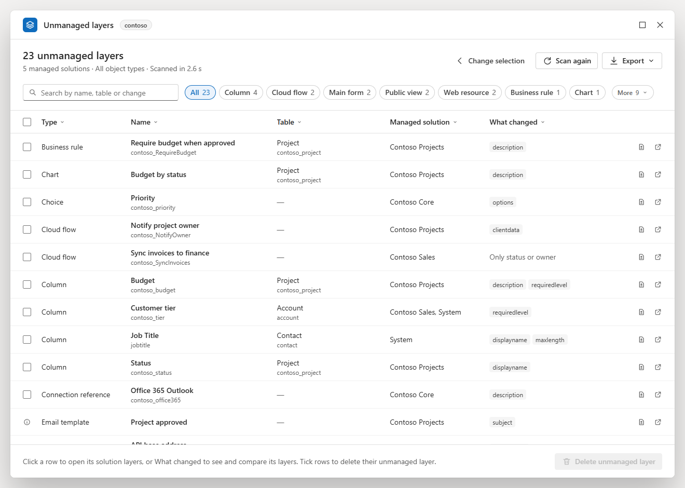

*The results of a scan of five managed solutions in the Contoso environment: 23 unmanaged layers. Above the grid, the
search box and the type bubbles (All 23, Column 4, Cloud flow 2, Main form 2, Public view 2, Web resource 2, Business
rule 1, Chart 1, and More 9 for the types that do not fit). For each component, its type, its name and schema name,
its table, the managed solution it was found in and the properties its unmanaged layer changes. The email template has
an information icon instead of a tick box: Dataverse does not delete the unmanaged layer of that type ([10.10](#1010-types-dataverse-will-not-delete)).*

A short animation of the scanner at work is in [`docs/gallery/`](gallery/) (GIF and MP4).

### 1.2 What runs where

| Piece | Runs in | Talks to | Runs as |
| --- | --- | --- | --- |
| The scanner, started on an environment page | The user's browser tab at `https://<org>.crm.dynamics.com` | The environment's Web API (same origin), with the browser's session cookie | The signed-in user, with that user's privileges |
| The scanner, started on the maker portal | The user's browser tab at `https://make.powerapps.com` | The environment's Web API (another origin, which Dataverse allows for the maker portal), with the maker portal's own access token for that environment ([5.7](#57-the-maker-portal-sign-in)) | The account the maker portal is signed in with |
| The links of the rows | New browser tabs: the component's solution layers page in the maker portal, or the classic *Solution layers* page of the environment ([chapter 7](#7-links-to-the-solution-layers-pages)) | The maker portal or the environment | The user |
| The build | The developer's computer, Node.js | Local files only | |

What the scanner sends and keeps:

* **Requests.** Every request to Dataverse goes through one function, `requestOnce` ([5.1](#51-one-function-for-every-request)). It accepts only addresses
  under the environment's own `/api/data/v9.2/`, and only reads (`GET`), except while a deletion the user confirmed is
  running ([5.2](#52-read-only-by-design)). On the maker portal there is one more kind of request, before anything else: to find the environment's
  address, `connectMaker` asks the Dataverse environments that the maker portal holds a sign-in for (each with its own
  token) for their environment id, starting with the one the page called last, until it finds the environment in the
  page address ([5.7](#57-the-maker-portal-sign-in)).
* **Writes.** Only `RemoveActiveCustomizations` (or `RemoveActiveCustomization` on older environments), one place of
  one component at a time, during a confirmed deletion ([chapter 10](#10-deleting)). The scanner never publishes, imports or changes
  records.
* **Files.** The exports and the deletion log are made in the browser and saved as downloads ([chapter 11](#11-exports)). Nothing is
  uploaded.
* **Browser storage.** The last choice, the saved selections, the column widths and the window's place and size, in the
  browser's local storage for the site ([8.3](#83-the-choice-screen-and-saved-selections)). Results, details and logs stay in memory and are gone when the page is
  reloaded.
* **Nothing else.** No telemetry, no other server, no script loaded from the internet.

### 1.3 How a scan works in one page

The obvious way to find unmanaged layers is to read the layers of every component, one by one, as Solution Layers
Explorer, a tool for XrmToolBox, does for the components of one solution. Done with the right layer names ([3.4](#34-component-types-and-layer-names)), that
is exact, but slow: in the test environment, reading the layers of all of its about 83,000 components took about 45
minutes, with four batches of 200 lookups running at a time. The scanner works the other way round: it asks each kind
of component for the rows whose top layer is unmanaged, and reads layers only for those.

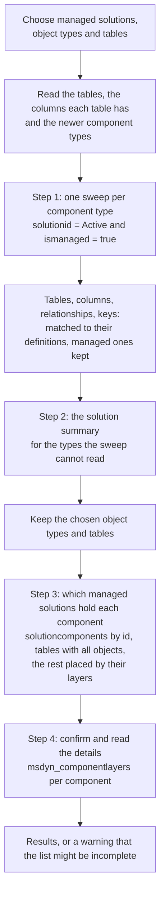

1. **Choose.** The choice screen ([8.3](#83-the-choice-screen-and-saved-selections)) lists every managed solution (`listManagedSolutions`); Microsoft's solutions and
   hidden ones are shown on request. You can also limit the scan to some object types and to some tables. **Scan**
   calls `runScan`, which calls `scan`.
2. **Read what the environment has.** Three requests at once: the tables (`EntityDefinitions`), which of 15 columns
   (`ismanaged`, `solutionid`, and the columns that give names and kinds) each table has, and the newer component types
   (`solutioncomponentdefinitions`).
3. **Step 1: one sweep per component type** ([6.2](#62-step-1-one-sweep-per-component-type)). For each component type, one query of its table for the rows that
   are managed and whose top layer belongs to the Active solution:
   `?$filter=solutionid eq fd140aae-4df4-11dd-bd17-0019b9312238 and ismanaged eq true`. Tables, columns, relationships
   and keys are read from their own component tables and matched to their definitions, to keep the managed ones ([6.3](#63-tables-columns-relationships-and-keys)).
4. **Step 2: the solution summary** ([6.4](#64-step-2-the-solution-summary)). One query of `msdyn_solutioncomponentsummaries`, the table behind the maker
   portal's lists of solution objects, for the components it flags as managed and customized. It covers the types the
   sweep cannot read, such as global choices.
5. **Object types and tables** ([6.5](#65-object-types-and-tables)). Findings of object types that were not chosen, or not on the chosen tables, are
   dropped.
6. **Step 3: which managed solutions hold each component** ([6.6](#66-step-3-which-managed-solutions-hold-each-component)). The `solutioncomponents` rows of the findings are
   read by id, 50 ids per request. A component is in a solution when it has a row there, or when it is a part of a
   table that the solution holds "with all objects" ([3.7](#37-solution-components-and-with-all-objects)). Components that are in no solution's list are placed by
   reading their layers ([6.7](#67-components-placed-by-their-layers)). Only components in a chosen solution are kept.
7. **Step 4: confirm and read the details** ([6.8](#68-step-4-confirming-and-reading-the-details)). The layers of the findings are read from `msdyn_componentlayers`
   ([3.5](#35-msdyn_componentlayers)): the managed layers underneath and the properties the unmanaged layer changes.
   Components found only by the summary are read first, all of them up to 1,000, because the summary also flags a table
   when only one of its parts is customized; then up to 500 others. A component whose layers show no unmanaged layer on
   top of a managed one is dropped.
8. **Result** ([6.9](#69-complete-or-incomplete)). If any part could not be read, a warning banner says the list might be incomplete and shows what
   is missing: the scanner never presents a partial list as complete. **Stop scan** ends every pending read at once and
   goes back to the choice screen; nothing partial is shown ([5.5](#55-stop)).

In the test environment, a scan of all 517 managed solutions took about 30 seconds and about 450 requests, and found
152 components. The cost follows the number of component types (about 110 sweeps there) and the number of findings,
not the number of components in the environment ([6.10](#610-performance-and-scale)).

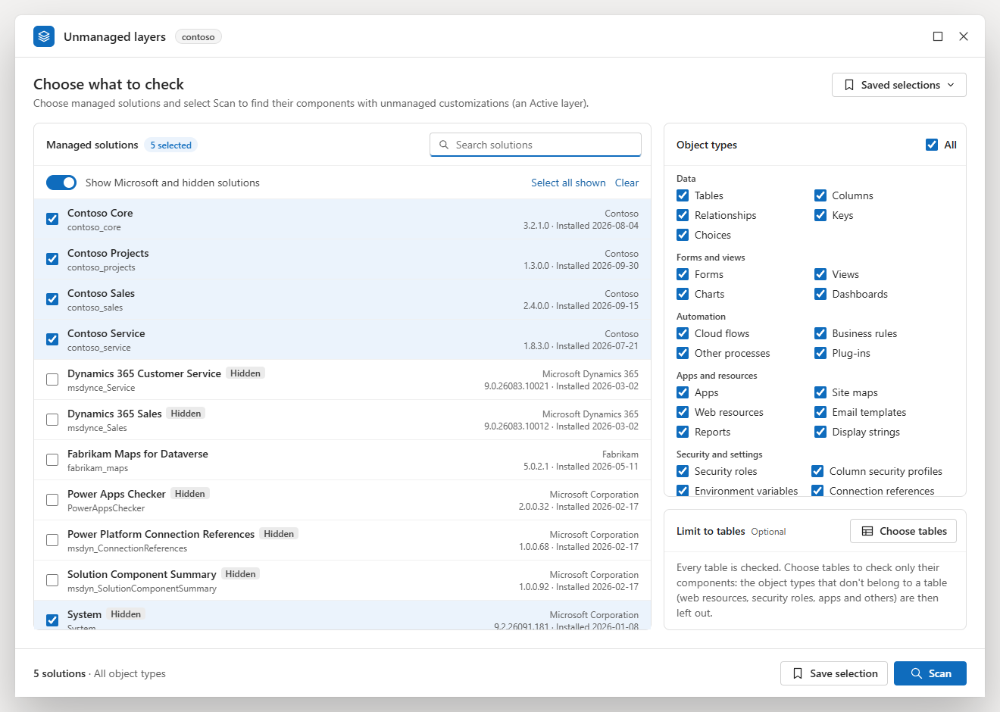

*The choice screen. Left, the managed solutions, with Show Microsoft and hidden solutions turned on: four Contoso
solutions and System (a hidden Microsoft solution that holds the standard tables) are selected. Right, the object
types, all ticked, in groups (Data, Forms and views, Automation, Apps and resources, Security and settings, and
Everything else further down), and under them the optional table limit. The bar at the bottom says what will be
scanned: 5 solutions, all object types.*

### 1.4 How deleting works in one page

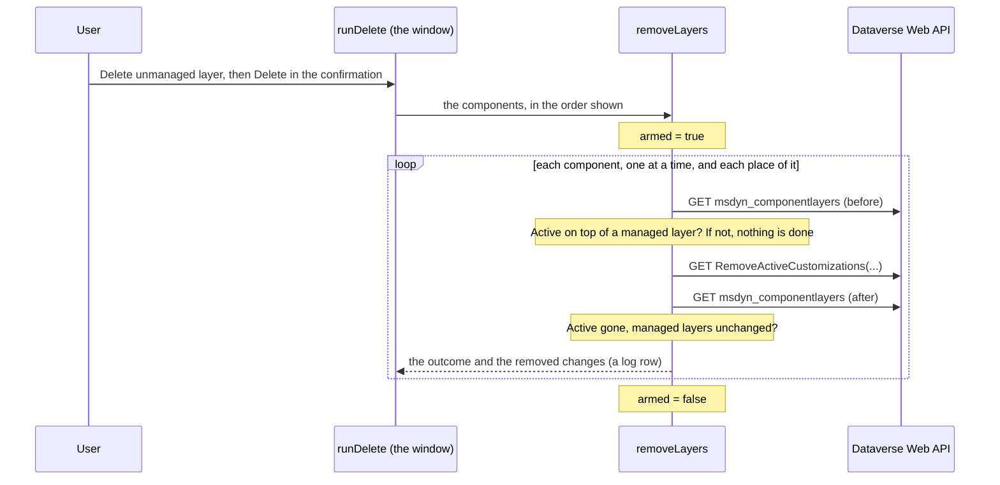

1. **Tick and confirm.** Tick rows (or open a component's details) and select **Delete unmanaged layer** (**Delete
   *n* unmanaged layers** when several rows are ticked).
   `confirmDelete` shows one confirmation that lists every component that will be deleted, in the order it will be
   deleted: top to bottom as the rows are shown, then any ticked rows that a search or a filter hides. **Cancel** has
   the focus. A run takes at most 100 components (`CONFIG.maxRemovePerRun`). With environment rules ([12.5](#125-environment-rules-scannersettingsjson)), deleting is
   not offered at all in development environments, and the confirmation names a production environment in red.
2. **Run.** **Delete** calls `runDelete`, which calls `removeLayers`. `removeLayers` sets `armed`, the only state in
   which `requestOnce` lets a write through ([5.2](#52-read-only-by-design)), and works through the components one at a time.
3. **Before each place.** A component has one place, or two for a relationship: its definition and its cascade
   settings ([3.4](#34-component-types-and-layer-names)). Right before a place is touched, its layers are read again. Only a place whose top layer is the
   Active layer, with at least one managed layer under it, is touched. A place without a managed layer is never
   touched, because removing its only layer would delete the component. The managed layers are recorded.
4. **The call.** `removePlace` calls `RemoveActiveCustomizations` ([3.8](#38-removeactivecustomizations)), as **Remove active customizations** on the
   maker portal's *Solution layers* page does. When another import or publish holds the lock, it waits 10 seconds and
   tries again, up to 5 times.
5. **After each place.** The layers are read again. The Active layer must be gone, and the managed layers must be
   exactly as before: the same solutions, order and publishers, and the same values (system values such as the
   overwrite time left out). The row then shows the outcome: a deleted row is struck through, with a check mark in
   place of its tick box; any other outcome is shown in its *What changed* cell, with the reason: *Not deleted*,
   *Skipped*, *Not tried*, *Deleted (not checked)*, *Partly deleted* or *Result unknown* ([10.7](#107-outcomes)).
6. **Log.** As soon as a component is done, a row goes into the deletion log with what the unmanaged layer held (its
   `msdyn_changes`), so that a change can be made again by hand if it was needed. The log can be downloaded from the
   message at the end or from **Export** ([11.4](#114-deletion-log-csv)).
7. **End.** `armed` is set back to `false` in a `finally` block, whatever happened.

The scanner does not publish: the removal took effect without publishing in every test, and publishing a table would
also publish other people's unpublished changes to it.

**Time.** Dataverse takes 7 to 9 seconds per removal (a relationship, with two places, about 25 seconds), and does the
removals one after the other even when they are sent together: for 17 test components, one at a time took 161
seconds, four at a time 147 seconds and eight at a time 136 seconds, each call waiting longer. The scanner sends one
at a time (`CONFIG.deleteConcurrency`), as Solution Layers Explorer does. While a run goes on, the window can be
closed: a pill in the corner of the page shows how far it is ([8.9](#89-toasts-dialogs-and-the-deleting-pill)), and leaving the page asks for a confirmation.
**Stop deleting** ends the run after the component being deleted at that moment ([10.8](#108-stop-sign-in-expiry-and-leaving-the-page)).

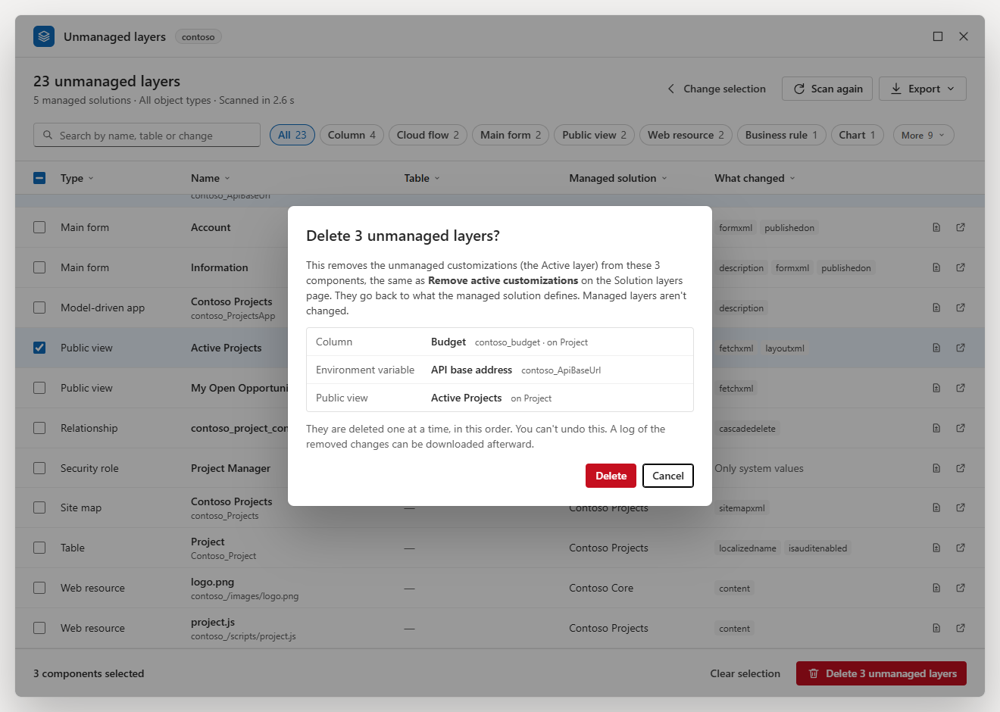

*The confirmation for three ticked components: a column (Budget, `contoso_budget`, on Project), an environment variable
(API base address, `contoso_ApiBaseUrl`) and a public view (Active Projects, on Project), listed in the order they will
be deleted. The text says what happens (the same as Remove active customizations on the Solution layers page; managed
layers are not changed) and that it cannot be undone. **Cancel** has the focus.*

### 1.5 Repository tour

Every file and folder that is published, with one line each. The repository's `.gitignore` works as a list of what is
published: its first rule, `/*`, ignores everything, and each `!` rule after it publishes one name. A new file stays
on your computer until you add it to that list. Paths marked *not committed* exist only on your computer.

| Path | What it is |
| --- | --- |
| [`.gitignore`](../.gitignore) | The list of published files (see above). Everything else in the folder, such as local settings, test results and working notes, is ignored |
| [`.gitattributes`](../.gitattributes) | LF line endings for text files; PNG, GIF and DOCX files as binary. The built link and the minified code are one long line each |
| [`LICENSE`](../LICENSE) | The MIT license |
| [`README.md`](../README.md) | The documentation for people who use the scanner: install, scan, results, details, deleting, exports, troubleshooting |
| [`CHANGELOG.md`](../CHANGELOG.md) | The changes in each version |
| [`package.json`](../package.json) | Name, version (the scanner's version comes from here, [12.4](#124-the-version)), the `build` script and the one development package, `terser` |
| [`package-lock.json`](../package-lock.json) | The exact versions of the build's packages: terser 5.51.2 and the packages it needs, 11 in all. `npm ci` installs exactly these ([2.3](#23-install-the-npm-packages)) |
| **[`layer-scanner.js`](../layer-scanner.js)** | **The scanner**: the whole product in one file ([chapter 4](#4-code-architecture) has a map) |
| [`build-bookmarklet.mjs`](../build-bookmarklet.mjs) | The build: writes the version and the optional environment rules in, minifies, compresses, and writes the three built files ([chapter 12](#12-building-and-packaging)) |
| [`layer-scanner.bookmarklet.txt`](../layer-scanner.bookmarklet.txt) | Built: the `javascript:` link, one line of about 69 KB |
| [`layer-scanner.min.js`](../layer-scanner.min.js) | Built: the minified scanner, about 165 KB; can be pasted into the browser console |
| [`Install unmanaged layer scanner.html`](../Install%20unmanaged%20layer%20scanner.html) | Built: the install page, with the link as a button to drag to the favourites bar |
| [`scanner.settings.example.json`](../scanner.settings.example.json) | An example of the optional environment rules ([12.5](#125-environment-rules-scannersettingsjson)) |
| `scanner.settings.json` | *Not committed.* Your own environment rules, if you use any. A build made with it is for your organization only |
| **[`docs/`](./)** | **Documentation** |
| `docs/developer-guide.md` | This guide |
| [`docs/images/`](images/) | Screenshots used by the README and this guide |
| [`docs/gallery/`](gallery/) | The demo as GIF and MP4, and a thumbnail |
| `node_modules/` | *Not committed.* The npm packages of the build (terser and the packages it needs), installed by `npm ci` |

---

## 2. Getting set up

This chapter takes you from an empty computer to a working build, your build installed in Edge, a test solution of
your own, and a development loop.

### 2.1 Tools

| Tool | Version | What it is used for |
| --- | --- | --- |
| **Node.js** | 14.13.1 or later (any current LTS version); version 1.0.0 was built with Node.js 22 | Runs the build, `build-bookmarklet.mjs`, and npm. The build is an ES module that uses `await` at the top level (Node.js 14.8 or later) and imports Node's own modules as `node:fs`, `node:zlib` and so on (Node.js 14.13.1 or later); terser 5 itself needs Node.js 10 |
| **npm** | The one that comes with Node.js; `npm ci` needs npm 7 or later (Node.js 15 and later come with it), because the lock file has `lockfileVersion` 3 | Installs terser, the only package the build needs, and the packages terser needs |
| **Git** | Any recent version | Getting the code and keeping track of your changes |
| **An editor** | Visual Studio Code is a good choice | Editing |
| **Microsoft Edge** | A current version | Running and testing the scanner, with its developer tools (F12) |
| **A Dataverse environment for testing** | One where you are System Administrator or System Customizer | Building a test solution and testing your changes ([2.7](#27-a-test-environment-and-a-test-solution)). Never test deleting in production |

The scanner needs no build to run: the build only minifies it, writes the version in and packs it into a link. The
repository has no bundler, no TypeScript, no test framework and no lint configuration. The build calls only Node.js,
so it runs on any operating system; the commands in this guide are written for PowerShell on Windows and are the same
in other shells.

### 2.2 Get the code

```powershell
git clone https://github.com/<owner>/UnmanagedLayerScanner.git
cd UnmanagedLayerScanner
```

Replace `<owner>` with the account that publishes the repository, or with your own for a fork.

### 2.3 Install the npm packages

```powershell
npm ci
```

`package.json` lists one development package, `terser` (`^5.51.2`), the minifier. `package-lock.json`, published with
it ([1.5](#15-repository-tour)), holds the exact versions: terser 5.51.2 and the packages it needs, 11 packages in all (`lockfileVersion` 3).
`npm ci` installs exactly these into `node_modules/` (it empties the folder first) and never changes the lock file, so
a build gets the same packages that built the release. Use it for every release build ([16.2](#162-build-and-test)). `npm install` works too and keeps
the locked versions while they satisfy `package.json`, but it may rewrite `package-lock.json`: commit such a change
only on purpose. Nothing from `node_modules/` ends up in the scanner: terser only runs at build time.

### 2.4 Build

```powershell
npm run build
```

`npm run build` runs `node build-bookmarklet.mjs`, the `build` script of `package.json`. The script finds its files
from its own folder, so `node <path>/build-bookmarklet.mjs` works from any folder too. Without `scanner.settings.json`
it prints one line, for example:

```text
bookmarklet 1.0.0: 71063 characters (164.9 KB unpacked)
```

The first number is the length of the link; the second the size of the minified code that the link carries
compressed. Each build writes three files, all of them published:

| File | What it is |
| --- | --- |
| `layer-scanner.min.js` | The scanner minified with terser, with the version from `package.json` written in (about 165 KB). It can also be pasted into the browser console |
| `layer-scanner.bookmarklet.txt` | The link: `javascript:` followed by a small loader that carries the minified code compressed (deflate, then base64) and unpacks it in the browser (about 69 KB) |
| `Install unmanaged layer scanner.html` | The install page: the link as a button to drag to the favourites bar, the same link in a text box with **Copy**, short instructions, and the version, the build date and the size |

The build stops with an error when:

* `layer-scanner.js` no longer contains a line that the build replaces. The message is
  "layer-scanner.js no longer contains: ..." followed by the line. The build always replaces
  `const VERSION = '__VERSION__'`, and, when environment rules are set, `developmentEnvironments: null,` and
  `productionEnvironments: null,` in `CONFIG`. Keep these lines exactly as they are.
* `scanner.settings.json` exists and is not valid JSON, or is not a JSON object ("scanner.settings.json must be a JSON
  object, as in scanner.settings.example.json").
* `scanner.settings.json` names a setting other than the two rules, for example a misspelled one: "scanner.settings.json:
  unknown setting developmentEnvironment. The settings are: developmentEnvironments, productionEnvironments." (with
  several, "unknown settings" and the names separated by commas). A misspelled name would otherwise be ignored and
  leave deleting allowed in a development environment.
* One of its two values is not a string ("scanner.settings.json: ... must be a regular expression written as a
  string") or not a valid regular expression. An empty or `null` value is skipped.

When `scanner.settings.json` sets at least one rule, the build also prints the rules it applied, for example "Built
with your environment rules from scanner.settings.json (developmentEnvironments /^contoso-dev\d*$/i;
productionEnvironments /^contoso(-preprod)?$/i): for your organization only, do not publish this build." A
`scanner.settings.json` that sets no rule (both values empty or `null`, or `{}`) prints "scanner.settings.json names no
environment: built without environment rules." ([12.5](#125-environment-rules-scannersettingsjson)). [Chapter 12](#12-building-and-packaging) explains every step of the build.

### 2.5 Install your build in Edge

1. Open `Install unmanaged layer scanner.html` in Edge: double-click it, or drag it onto an Edge window.
2. Show the favourites bar: **Ctrl+Shift+B**.
3. Drag the **Unmanaged layers** button onto the favourites bar.

If dragging does not work, create a favourite named *Unmanaged layers* and paste the link from the text box on the
page as its URL (**Copy** copies it).

A favourite keeps the link it was made with. After each build, replace it: edit the favourite and paste the new link,
or delete it and drag the button again. To see which version a favourite runs, point at the title *Unmanaged layers*
in the scanner's window: its tooltip shows "Unmanaged layer scanner" and the version.

To use it, open a page of the environment (for example `https://contoso.crm.dynamics.com`) or the environment's
Solutions page in the maker portal, and click the favourite. Clicking it outside Dataverse only shows an alert: "Open
the environment (https://&lt;org&gt;.crm.dynamics.com) or its Solutions page in the maker portal (make.powerapps.com)
first, then click the bookmark again."

**Without the favourites bar.** `layer-scanner.min.js` is the same code without the loader. Paste it into the console
of the developer tools (F12, **Console**) on a page of the environment and press Enter: the window opens as it does
from the favourite. Use this where a browser policy blocks `javascript:` favourites.

### 2.6 The development loop

The quickest loop needs no build at all: `layer-scanner.js` is a complete script by itself.

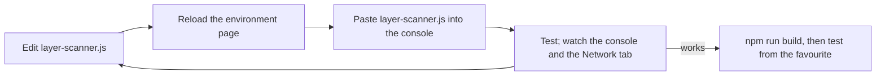

1. **Edit** `layer-scanner.js`.
2. **Reload** the environment page (F5). A scanner that is already open on the page would show its own window again
   instead of starting your new code ([4.2](#42-start-up-and-connecting)), and a reload removes it. Without a reload, run
   `window.__layerScanner.destroy()` in the console first. It returns `false`, and removes nothing, while the scanner
   is busy (loading the solutions, scanning, reading more details with **Read N more**, or deleting).
3. **Run** it: open the console (F12, **Console**), paste the whole of `layer-scanner.js` and press Enter. Edge may ask
   you to type *allow pasting* the first time.
4. **Test** ([chapter 14](#14-testing-your-changes)). Errors appear in the console. The scanner's requests are in the **Network** tab: filter on
   `api/data/v9.2`.
5. **Build** when the change works (`npm run build`), replace your favourite ([2.5](#25-install-your-build-in-edge)) and test once more from the
   favourite: the loader, the minified code and the size limit only come into play there ([chapter 12](#12-building-and-packaging)).

Apart from being minified, a build differs from the source in two ways only: the source shows its version as
`__VERSION__`, and it has no environment rules, because those come from `scanner.settings.json` at build time ([12.5](#125-environment-rules-scannersettingsjson)).

**On the maker portal.** Test there too: open the environment's Solutions page at
[make.powerapps.com](https://make.powerapps.com), wait until the list of solutions has loaded, then paste the code or
click the favourite. On the maker portal the scanner signs in with the maker portal's token ([5.7](#57-the-maker-portal-sign-in)), a different path
from an environment page. Started on a managed solution's own page, it selects that solution ([8.3](#83-the-choice-screen-and-saved-selections)).

### 2.7 A test environment and a test solution

Scanning only reads ([5.2](#52-read-only-by-design)). Deleting cannot be undone, so test it only on components made for testing, in an
environment where you are allowed to make changes. The other unmanaged layers in an environment may be someone's work
in progress.

The scanner needs managed components with unmanaged layers. A managed solution of your own gives you both, and its
prefix makes its components easy to tell apart:

1. **Make an unmanaged solution.** In a development or trial environment, in the maker portal, go to **Solutions** >
   **New solution**. Give it a publisher of its own with a short prefix, for example `tst`, so that every component
   you create is named `tst_...`.
2. **Add components to it**, created new in that solution, of the types you want to test (the table below suggests a
   set). **Publish all customizations**.
3. **Export it as managed.** Select the solution, **Export solution**, choose **Managed**, and keep the `.zip` file.
4. **Delete the unmanaged components**, then the solution. Delete the tables first (their columns, relationships,
   keys, forms, views, charts and business rules go with them), then the other components, then the solution. Deleting
   only the solution would leave its components in the environment as unmanaged components; the managed import must
   create them afresh.
5. **Import the managed file.** **Solutions** > **Import solution** > **Browse**, select the `.zip`, **Next**,
   **Import**. The solution list now shows it as managed. Its components now have a managed layer and no unmanaged
   layer.
6. **Customize some of its components** directly in the environment, as in the table below, then **Publish all
   customizations**. Every change made in the environment goes into the Active layer, whichever unmanaged solution, if
   any, you make it in. Keep a list of what you changed.
7. **Scan** with only your test solution chosen. Every component you changed is listed; the others are not.

With a second environment you can skip step 4: import the managed file there instead, and customize it there.

| Component | A change that adds an unmanaged layer | What it lets you test |
| --- | --- | --- |
| A table with a few columns | Change a column's display name or description; make another column required | The most common case; the table limit ([8.4](#84-the-table-picker)) |
| A relationship between two of your tables | Change what happens to the related rows when a row is deleted | A component with two places: the change is on its cascade settings ([3.4](#34-component-types-and-layer-names)), and the row opens the classic page ([7.3](#73-the-classic-page)) |
| The table's main form | Move a field, or change the form's description | The XML comparison of `formxml` ([9.4](#94-xml-laid-out-without-loss-prettyxml)) |
| A view | Add a column, or change its filter | The XML comparison of `fetchxml` and `layoutxml` |
| A chart and a business rule | Change their descriptions | Types whose links go to a table's page in the maker portal ([7.1](#71-maker-portal-addresses)) |
| A global choice | Change the label of a value (adding a value adds no unmanaged layer, [3.9](#39-facts-the-tool-relies-on-and-how-they-were-verified)) | A type that only the solution summary finds ([6.4](#64-step-2-the-solution-summary)) |
| A JavaScript web resource and an image web resource | Upload new content | Decoded content and images in the comparison ([9.3](#93-showing-a-value-valueview)); content that Dataverse keeps as a file ([9.11](#911-web-resource-content-kept-as-a-file-contentfileref)) |
| An environment variable | Change its default value | |
| A cloud flow | Edit it and save it (turning it off or on adds no unmanaged layer, [3.9](#39-facts-the-tool-relies-on-and-how-they-were-verified)) | Processes, which the scan names by their kind ([6.2](#62-step-1-one-sweep-per-component-type)) |
| A security role | Change a privilege | A role's privileges are not in its layer data, so the comparison shows only system values ([3.9](#39-facts-the-tool-relies-on-and-how-they-were-verified)) |
| An email template | Change its subject | A type whose unmanaged layer Dataverse does not delete: the row has no tick box ([10.10](#1010-types-dataverse-will-not-delete)) |
| A model-driven app and its site map | Change the app's description; add a subarea to the site map | |

After a delete test, make the same changes again, from your list. The deletion log ([11.4](#114-deletion-log-csv)) also holds every removed
change: the Active layer's `msdyn_changes` of each component. When you no longer need the test solution, delete it
from **Solutions**: deleting a managed solution uninstalls it and removes its components.

### 2.8 Checks before you commit

```powershell
node --check layer-scanner.js
node --check build-bookmarklet.mjs
npm run build
```

* `node --check` reads a file without running it and reports syntax errors.
* `npm run build` must end with its `bookmarklet ...` line. Look at the size it prints: the link must stay well under
  about 100 KB, the most an Edge favourite holds. Version 1.0.0 is 71,063 characters, about 69 KB.
* The build you commit must be made **without** environment rules: no "Built with your environment rules" line. A build
  with rules carries the names of your environments and is for your organization only ([12.5](#125-environment-rules-scannersettingsjson)). Move
  `scanner.settings.json` out of the folder, build, and commit that build.
* Commit the three built files together with `layer-scanner.js`, so that the published link always runs the published
  source.
* Test the change ([chapter 14](#14-testing-your-changes)), on an environment page and on the maker portal, from the built link.
* For a release, raise the version ([chapter 16](#16-releasing-a-new-version)).

---

## 3. Dataverse concepts used by the tool

This chapter explains the parts of Dataverse that the scanner relies on, and shows where each one appears in the code.
Several of them are not documented, or behave in ways the documentation does not mention; [3.9](#39-facts-the-tool-relies-on-and-how-they-were-verified) lists each such fact and
how it was checked.

### 3.1 Solutions and layers

A **solution** is a package of **components** (tables, columns, forms, views, processes, web resources and so on) that
carries customizations from one environment to another. There are two kinds:

* An **unmanaged** solution is a container, used in development. Its components can be changed freely, and deleting
  the solution leaves them in place.
* A **managed** solution is what you import into test and production. Its components belong to it: they can be changed
  only as far as their managed properties allow, and uninstalling the solution removes them.

A component can be in several solutions. Dataverse keeps one **layer** of the component for each managed solution that
contains it, and stacks them: standard components that come with Dataverse have the layer of the System solution at
the bottom; above it come the layers of the managed solutions that contain the component, in the order the solutions
were installed. Each layer has a number, its **order**, higher meaning higher in the stack.

When anyone changes the component in the environment itself (in the maker portal, in a designer, through the Web API,
or by importing an unmanaged solution), the change goes into none of the managed layers. It goes into a layer of its
own on top of the stack: the **unmanaged layer**, which belongs to a special solution named **Active** ([3.2](#32-the-active-solution-and-the-default-solution)). A
component has at most one unmanaged layer.

For most component types the top layer wins: the component is what its top layer defines. For a few types, such as
forms, site maps, ribbons and model-driven apps, Dataverse merges the changes of the layers instead. Either way, what
the unmanaged layer sets wins over the managed layers, including over what a later version of a managed solution
brings for the same properties. That is why unmanaged layers on managed components cause hard-to-find problems, and
why the scanner exists.
**Removing the unmanaged layer** ([3.8](#38-removeactivecustomizations)) brings the component back to what its managed layers define, without changing
them.

The maker portal shows the stack of one component at a time on its *Solution layers* page (**See solution layers**).
The scanner reads the same data from the table `msdyn_componentlayers` ([3.5](#35-msdyn_componentlayers)) and shows it in a component's details
([chapter 9](#9-details-and-comparison)).

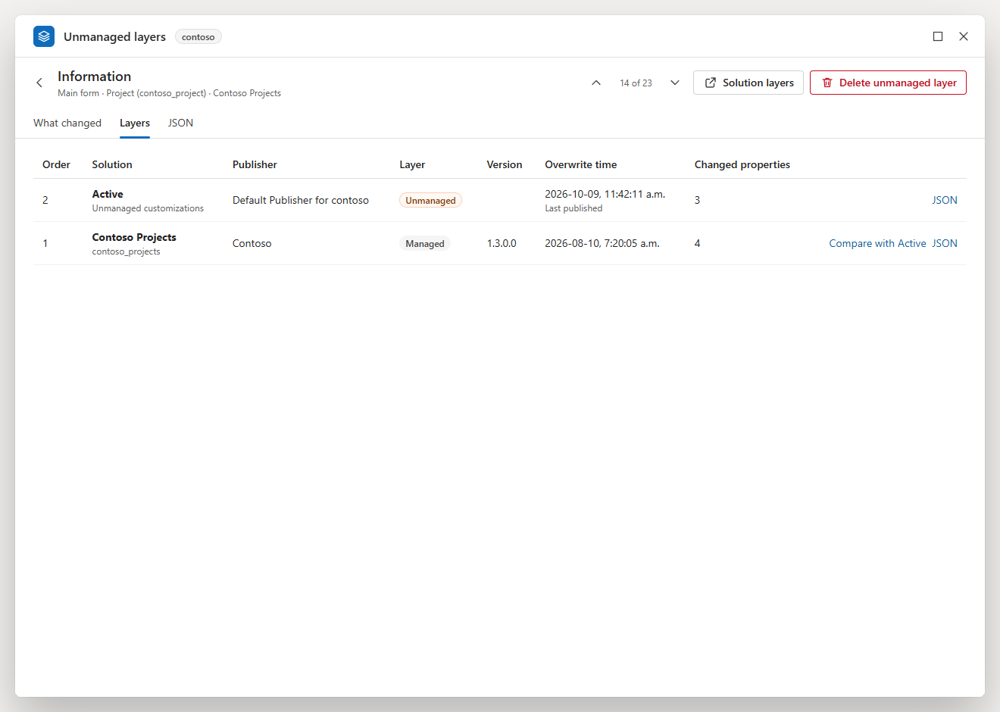

*The Layers tab of a component's details ([9.8](#98-layers-and-json-tabs-children-tables)): the main form Information of the Project table, found in Contoso
Projects. Top first: the unmanaged layer (order 2, the Active solution, publisher Default Publisher for contoso, no
overwrite time but last published on 2026-10-09, 3 changed properties), on top of the managed layer of Contoso Projects (order 1, `contoso_projects`,
publisher Contoso, version 1.3.0.0, overwritten on 2026-08-10, 4 changed properties). **Compare with Active** compares
that layer with the unmanaged one.*

### 3.2 The Active solution and the Default solution

Two solutions exist in every environment, with the same ids everywhere. Both are unmanaged.

`layer-scanner.js`, the solution ids (in the settings part):

```js
const ACTIVE = 'fd140aae-4df4-11dd-bd17-0019b9312238'    // the unmanaged ("Active") layer, same id everywhere
const DEFAULT = 'fd140aaf-4df4-11dd-bd17-0019b9312238'
```

| Solution | What it is | How the scanner uses it |
| --- | --- | --- |
| **Active** (`ACTIVE`) | Owns the unmanaged layer of every component. In `msdyn_componentlayers`, the unmanaged layer is the row whose `msdyn_solutionname` is `Active` | The sweep asks each component table for the rows whose `solutionid` is `ACTIVE` ([3.3](#33-managed-and-unmanaged-components)). The details, the deleting checks and the exports find the unmanaged layer by the name `Active` |
| **Default Solution** (`DEFAULT`) | Lists (almost) every component of the environment, managed or not. Display strings are an exception ([3.9](#39-facts-the-tool-relies-on-and-how-they-were-verified)) | The solution summary is asked for the Default solution's components ([3.6](#36-the-solution-component-summary)). A component that is in no solution's component list opens in the Default solution in the maker portal ([7.2](#72-which-solution-goes-in-the-address)) |

Rows of unmanaged solutions in `solutioncomponents` (the Default solution, Active, and your own unmanaged solutions)
are ignored when the scanner decides which managed solutions hold a component ([3.7](#37-solution-components-and-with-all-objects)).

### 3.3 Managed and unmanaged components

Each kind of component has a table of its own, for example `systemform` for forms or `webresource` for web resources.
Its rows have two columns that matter here:

* `ismanaged`: `true` when the component came from a managed solution, so that it has at least one managed layer;
* `solutionid`: the solution of the component's **top** layer.

When an unmanaged layer is on top of a managed component, `solutionid` is the Active solution while `ismanaged` stays
`true`. That pair is exactly what the scanner looks for:

| The component | `ismanaged` | `solutionid` | Listed? |
| --- | --- | --- | --- |
| Managed, no unmanaged layer | `true` | A managed solution | No |
| Managed, with an unmanaged layer on top | `true` | Active | **Yes** |
| Unmanaged only (created in the environment or in an unmanaged solution) | `false` | Active | No: its only layer is the unmanaged one, and removing it would delete the component |

`layer-scanner.js`, `scan`, the query of the sweep (step 1, [6.2](#62-step-1-one-sweep-per-component-type)):

```js
const extra = TYPE_FILTER[code] ? ` and ${TYPE_FILTER[code]}` : ''
for (const r of await getAll(`${t.EntitySetName}?$select=${sel}&$filter=solutionid eq ${ACTIVE} and ismanaged eq true${extra}`)) {
```

One query per component type therefore finds every managed component of that type with an unmanaged layer on top,
however many components the table has. Compared with reading every component's layers one by one in the test
environment, it found the same 135 components and nothing else ([3.9](#39-facts-the-tool-relies-on-and-how-they-were-verified)).

Two kinds of rows are not components of their own: Dataverse copies every security role into each business unit (the
copies have a parent role), and keeps an activation copy of a classic process next to its definition (`type` 1 is the
definition). An extra filter, `TYPE_FILTER`, leaves them out of the sweep ([6.2](#62-step-1-one-sweep-per-component-type)).

**Tables, columns, relationships and keys** are different. Their component tables (`entities`, `attributes`,
`relationships`, `entitykeys`) have a `solutionid` column but no `ismanaged`. The scanner reads the rows whose
`solutionid` is Active, and takes the managed flag from the metadata: `IsManaged` of the table, column and key
definitions (`EntityDefinitions`) and of the relationship definitions (`RelationshipDefinitions`).

`layer-scanner.js`, `scan`, the metadata rows and the managed check ([6.3](#63-tables-columns-relationships-and-keys)):

```js
for (const r of await getAll(`${set}?$select=${pk},${nm}&$filter=solutionid eq ${ACTIVE}`)) metaRows.push({ code, id: lc(r[pk]), name: r[nm] })
// ...
if (isManaged !== true) continue   // unmanaged-only components are not layers on managed solutions
```

A few metadata rows have no definition at all: hidden columns whose names end in `dsc`, and the two internal halves of
a many-to-many relationship (named like the relationship, with `One` or `Two` at the end). The scanner counts them in a
note. Any other row without a definition makes the scan incomplete ([6.9](#69-complete-or-incomplete)).

### 3.4 Component types and layer names

Every component has a **type number**, the `componenttype` of `solutioncomponents`: 1 for a table, 2 for a column, 26
for a view, 60 for a form, and so on. Types come from two sources:

* **Classic types** have fixed numbers. The scanner has them in its table `CLASSIC` (49 types, [4.4](#44-constant-tables-classic-names-metadata-groups-and-others)): for each number,
  the component table, the layer name and the name the maker portal shows.
* **Newer types**, made with Dataverse's solution component framework (for example connection references), are
  described in the table `solutioncomponentdefinitions`: their number, their `name` and their table
  (`primaryentityname`). The scanner reads that table at the start of each scan and adds the types it does not know.

`layer-scanner.js`, `scan`, the newer types:

```js
for (const d of defs) {
  if (!kindOf.has(d.solutioncomponenttype)) kindOf.set(d.solutioncomponenttype, d.name)
  if (!types.has(d.solutioncomponenttype) && d.primaryentityname) {
    const t = tables.get(d.primaryentityname)
    types.set(d.solutioncomponenttype, { table: d.primaryentityname, kind: d.name, label: sentence((t && label(t.DisplayName)) || d.name) })
  }
}
```

A newer type is labelled with its table's display name in sentence case, as the maker portal writes it ("Connection
Reference" becomes "Connection reference"; `sentence` keeps acronyms).

**Layer names.** `msdyn_componentlayers` does not know type numbers: it finds a component by its id and its **layer
name** (`msdyn_solutioncomponentname`). In the code the layer name is the finding's `kind`. For a classic type it is
the second entry of `CLASSIC`; for a newer type, the definition's `name`. A few examples:

| Type | Number | Layer name (`kind`) | Shown as |
| --- | --- | --- | --- |
| Table | 1 | `Entity` | Table |
| Column | 2 | `Attribute` | Column |
| Global choice | 9 | `OptionSet` | Choice |
| Relationship | 10 | `EntityRelationship`, and `Relationship` for its cascade settings | Relationship |
| Security role | 20 | `Role` | Security role |
| View | 26 | `SavedQuery` | Public view, Lookup view and so on (by its `querytype`) |
| Process | 29 | `Workflow` | Business rule, Cloud flow, Action and so on (by its `category`) |
| Email template | 36 | `Template` | Email template |
| Form | 60 | `SystemForm` | Main form, Quick create form, Dashboard and so on (by its `type`) |
| Web resource | 61 | `WebResource` | Web resource |
| Environment variable | 380 | `EnvironmentVariableDefinition` | Environment variable |
| Connection reference | read from the environment | `connectionreference` | Connection reference |

The layer names were checked one by one; two of them are not what one would guess ([3.9](#39-facts-the-tool-relies-on-and-how-they-were-verified)). An email template's layer is
named `Template`, not `EmailTemplate`. A **relationship** is two components: its definition, layer name
`EntityRelationship`, found by the relationship's metadata id; and its own settings, such as what happens to related
rows on delete (its cascade settings), layer name `Relationship`, found by the id of its row in the `relationships`
table.

The scanner calls each (id, layer name) pair of a component a **place**. Most components have one place; a relationship
has two, and both are checked, read and, when deleting, removed. The scan keeps a relationship's second place in the
finding's `alt` ([6.3](#63-tables-columns-relationships-and-keys)), and `places` returns every place of a finding:

`layer-scanner.js`, `places`:

```js
const places = (f) => [...(f.alt || []), { id: f.id, kind: f.kind }]
```

### 3.5 `msdyn_componentlayers`

`msdyn_componentlayers` is a virtual table: it holds no rows of its own, and returns the layers of one component when
asked for them. The query gives both the component's id, as a quoted string, and its layer name ([3.9](#39-facts-the-tool-relies-on-and-how-they-were-verified)).

`layer-scanner.js`, `getLayers`:

```js
// Layers of one component, top first. ($select is honoured by some versions only; the rest is ignored.)
// ...
async function getLayers(id, kind) {
  placeOk(id, kind)
  const rows = await getAll(`msdyn_componentlayers?$filter=(msdyn_componentid eq '${id}' and msdyn_solutioncomponentname eq '${kind}')&$select=msdyn_solutionname,msdyn_order,msdyn_name,msdyn_solutioncomponentname,msdyn_changes,msdyn_componentlayerid,msdyn_publishername,msdyn_overwritetime`)
  return rows.sort((a, b) => b.msdyn_order - a.msdyn_order)
}
```

`placeOk` first checks that the id is a GUID and the layer name a plain name, before either goes into the address
([5.2](#52-read-only-by-design)). `getLayers` serves the scan and the checks around a removal. The details of a component read every column, with
`fullLayers` ([9.1](#91-reading-every-layer)), because they also need `msdyn_componentjson` and `msdyn_children`.

| Column | Holds | Used for |
| --- | --- | --- |
| `msdyn_componentid` | The component's id | The filter |
| `msdyn_solutioncomponentname` | The layer name | The filter; a removal uses the value of the Active row ([10.5](#105-the-call-removeplace)) |
| `msdyn_solutionname` | The unique name of the layer's solution; `Active` for the unmanaged layer | Finding the unmanaged layer; the managed layers underneath |
| `msdyn_order` | The layer's place in the stack, higher on top | Sorting, top first; the checks around a removal |
| `msdyn_name` | The component's name in this layer | A name for a component that has none otherwise |
| `msdyn_changes` | JSON: the properties this layer sets | *What changed*, the **Changes** view of the JSON tab, the deletion log, the check after a removal |
| `msdyn_componentjson` | JSON: all the component's properties as this layer defines them | The comparison of two layers ([9.2](#92-comparing-two-layers)), **All properties** |
| `msdyn_children` | JSON: the component's child records in this layer, if any | **Children** ([9.8](#98-layers-and-json-tabs-children-tables)) |
| `msdyn_publishername` | The publisher of the layer's solution | The Layers tab, the all-layers export, the check after a removal |
| `msdyn_overwritetime` | When the layer was last written; 1900-01-01 for the Active layer | The Layers tab (for the Active layer, its last change instead, `activeWhen`), the all-layers export |
| `msdyn_componentlayerid` | The row's id | The all-layers export |

There is no column for the solution's version: the version in the Layers tab comes from the list of managed solutions.

`msdyn_changes` and `msdyn_componentjson` hold the component as a Dataverse entity in JSON, with an `Attributes` list of
`{ "Key": ..., "Value": ... }` pairs. A value is a string, a number, a boolean, a lookup (`Id`, `LogicalName`, `Name`),
a choice (`Value`) or a managed property (`Value`, `CanBeChanged`). Some numbers in this data cannot be held by a
JavaScript number exactly as written: whole numbers above 2^53 (such as a relationship's cascade mask), long
fractions, and numbers written with an exponent (`1e2`) or a trailing zero (`1.0`). The scanner parses the data with
`exactNumbers`, which keeps each such number as written ([9.5](#95-json-indented-without-loss-indentjson-and-exact-numbers)).

**A web resource's content kept as a file.** Dataverse can keep a web resource's content as a file instead of in the
layer data, and each layer holds it one way or the other. A layer that keeps it as a file has `contentfileref`, a
reference to its own file, in its `msdyn_componentjson` instead of `content`; when that layer is the unmanaged one, its
`msdyn_changes` names only its file. The two layers of one web resource can differ: in the test environment, right
after a web resource's content was saved through the Web API, the Active layer held the content in the layer while the
managed layer under it held only a file reference; Dataverse later moved both to files. The Web API gives out only the
file in effect now, through the web resource itself (`webresourceset(<id>)?$select=content,contentfileref`); the files
of the other layers cannot be read (`fileattachments` refuses Retrieve and has no readable body). [9.11](#911-web-resource-content-kept-as-a-file-contentfileref) explains what the details show for such a web resource, and [10.4](#104-before-each-place) how
deleting keeps its content in the log.

**Cost.** One request per place, more when the answer has several pages; a form's layers can reach about 0.5 MB. That
is why the scanner reads layers only for the components it has already found (step 4) and for the components it must
place ([6.7](#67-components-placed-by-their-layers)), never for every component. Some component types have no data in this table at all (for example SDK
messages, and image configurations); for those the scan relies on the sweep and the summary, and their *What changed*
says *Layers could not be read (no layers under the name ...)*.

### 3.6 The solution component summary

`msdyn_solutioncomponentsummaries` is another virtual table: the one behind the maker portal's lists of a solution's
objects. Asked for the Default solution, it lists the environment's components, and for each one whether it is managed
and whether it has unmanaged customizations, the maker portal's *Customized* flag.

`layer-scanner.js`, `scan`, step 2 ([6.4](#64-step-2-the-solution-summary)):

```js
const summaryRows = await getAll(`msdyn_solutioncomponentsummaries?$filter=(msdyn_solutionid eq ${DEFAULT}) and (msdyn_hasactivecustomization eq 'true') and (msdyn_ismanaged eq 'true')&$select=msdyn_componenttype,msdyn_componenttypename,msdyn_objectid,msdyn_name,msdyn_displayname,msdyn_primaryentityname`)
```

**Why it is needed.** Some types cannot be swept, because their definitions are not rows of a component table with
`solutionid` and `ismanaged`. The most important are global choices (type 9): `CLASSIC` has no table for them. The
summary finds them.

**What to know about it.**

* The flags are compared as strings: `msdyn_hasactivecustomization eq 'true'`. `eq true` fails with error 0x80060888.
* It flags a table when only one of its parts (for example a form) is customized, and it lists columns only when asked
  for one table at a time. So a component that only the summary flags is not trusted as it is: its layers are read
  before it is listed, for up to 1,000 such components, whatever the details setting ([6.8](#68-step-4-confirming-and-reading-the-details)).
* It ignores a filter on `msdyn_primaryentityname`, so it cannot be narrowed to the chosen tables.
* It is not documented and might be missing or empty in some environment. When it answers nothing although it should
  (the sweep found types that it always flags, or it does not even list a table of the Default solution), the scan is
  marked incomplete.
* `msdyn_componenttypename` gives a layer name for a type number the scanner does not know; such a finding is marked
  `kindGuessed`.
* It costs one query, about 4 seconds in the test environment, plus one short read for each form or process that only
  the summary found, to learn its kind ([6.4](#64-step-2-the-solution-summary)).

### 3.7 Solution components and "with all objects"

`solutioncomponents` has one row for each component that a solution lists: `objectid` (the component's id),
`componenttype`, `rootcomponentbehavior` and `_solutionid_value` (the solution). The scanner reads the rows of its
findings, and of the tables their parts are on, by id, 50 ids per request, with the Web API function
`Microsoft.Dynamics.CRM.In`, and keeps only rows in managed solutions.

`layer-scanner.js`, `scan`, step 3 ([6.6](#66-step-3-which-managed-solutions-hold-each-component)):

```js
for (const c of await getAll(`solutioncomponents?$select=objectid,componenttype,rootcomponentbehavior,_solutionid_value&$filter=Microsoft.Dynamics.CRM.In(PropertyName='objectid',PropertyValues=[${list}])`)) {
  const sol = lc(c._solutionid_value)
  if (!managedById.has(sol)) continue   // rows in unmanaged solutions (Default, Active and others) do not count
```

Fifty ids make addresses of about 2,500 characters. Reading by id gave the same membership as reading each solution's
whole component list, and costs requests in proportion to the findings, not to the size of the solutions.

**"With all objects".** A solution can hold a table in three ways, given by the table row's `rootcomponentbehavior`:

| `rootcomponentbehavior` | Meaning | What the solution holds |
| --- | --- | --- |
| 0 | Include subcomponents (*Include all objects* in the maker portal) | The table and all its parts: columns, relationships, keys, forms, views, charts |
| 1 | Do not include subcomponents | The table, and only the parts that have rows of their own |
| 2 | Include as a shell only | The table as a shell, and only the parts that have rows of their own |

So a column, relationship, key, view, chart or form (`TABLE_PARTS`, [4.4](#44-constant-tables-classic-names-metadata-groups-and-others)) belongs to a solution either through a row of
its own, or because the solution holds its table with behaviour 0. `solsOf` applies exactly this rule to each finding
([6.6](#66-step-3-which-managed-solutions-hold-each-component)).

**Parts with no row anywhere.** A few parts of standard tables, such as some hidden name columns, some display strings
and a view, are in a managed solution without a row in any solution's component list. For those, their managed layers
name their solutions (`msdyn_solutionname`), and the scanner places them by reading their layers ([6.7](#67-components-placed-by-their-layers)). In the test
environment there were 12 such components, all in System.

**Hidden solutions.** Microsoft's base solutions, such as System, are hidden (`isvisible` is false): only 6 of the 517
managed solutions of the test environment are visible. Many standard tables, forms and views belong only to them, so
`listManagedSolutions` reads hidden solutions too, and the choice screen shows them on request ([8.3](#83-the-choice-screen-and-saved-selections)).

### 3.8 `RemoveActiveCustomizations`

`RemoveActiveCustomizations` is the Web API function behind **Remove active customizations** on the maker portal's
*Solution layers* page; Solution Layers Explorer calls it too. It removes the unmanaged layer of one component, given
its layer name and its id. The managed layers stay as they are, so the component goes back to what they define. There
is no bulk version: one call per place.

`layer-scanner.js`, `removePlace`, the call ([10.5](#105-the-call-removeplace) shows the whole function):

```js
await write('GET', `RemoveActiveCustomizations(SolutionComponentName='${place.name}',ComponentId=${place.id})`)
```

What to know about it:

* **It is a `GET` that changes data.** A function call in the Web API is a `GET`, so a read-only guard that looked only
  at the method would let it through. `requestOnce` blocks any request whose decoded address contains
  `RemoveActiveCustomization`, whatever its method, unless a confirmed removal is running ([5.2](#52-read-only-by-design) shows the guard).
* **Older environments** answer "Resource not found for the segment 'RemoveActiveCustomizations'". The scanner then
  uses the older action, `RemoveActiveCustomization` (a `POST`), with the same effect.
* **Locks.** While another import or publish runs, the call fails with a customization lock (0x8004F077). The scanner
  waits 10 seconds and tries again, up to 5 times.
* **Types it does not support.** For email templates the call fails with 0x8004f059 ("not supported for components of
  type"), and so does the older action. No API removes that layer: the change must be undone by hand, or the managed
  solution imported again with *Overwrite unmanaged customizations*. The scanner gives such rows no tick box ([10.10](#1010-types-dataverse-will-not-delete)).
* **No publishing.** In every test the removal took effect without publishing.
* **Time.** 7 to 9 seconds per call, done one after the other by Dataverse even when calls are sent together ([1.4](#14-how-deleting-works-in-one-page)).

### 3.9 Facts the tool relies on and how they were verified

The scanner depends on the facts below. Most of them are not in Microsoft's documentation; each was checked in test
environments, mostly against a managed test solution built for the purpose ([2.7](#27-a-test-environment-and-a-test-solution)). If Dataverse changes one of them,
the part of the scanner named in the last column is the one to look at.

| Fact | How it was verified | Relied on by |
| --- | --- | --- |
| The Active solution is `fd140aae-4df4-11dd-bd17-0019b9312238` and the Default solution `fd140aaf-4df4-11dd-bd17-0019b9312238`, in every environment | Read in test environments | `ACTIVE`, `DEFAULT` |
| A managed component whose top layer is unmanaged has `solutionid` = Active and `ismanaged` = true | The layers of all about 83,000 components of a test environment read one by one: the same 135 components found, no other; 17 of 17 on a managed test solution | The sweep ([6.2](#62-step-1-one-sweep-per-component-type)) |
| `msdyn_hasactivecustomization` filters only as a string (`eq 'true'`) | `eq true` returns error 0x80060888 | The summary ([6.4](#64-step-2-the-solution-summary)) |
| The summary flags a table when one of its parts, such as a form, is customized; it lists columns only when asked per table | Tested | Confirming summary-only findings ([6.8](#68-step-4-confirming-and-reading-the-details)) |
| The summary ignores a filter on `msdyn_primaryentityname` | The same rows with and without it | The table limit ([6.5](#65-object-types-and-tables)) |
| `msdyn_componentlayers` needs both the component id (quoted) and the layer name | Tested | `getLayers`, `fullLayers` |
| An email template's layer name is `Template` (`EmailTemplate` returns nothing) | Tested | `CLASSIC` |
| A relationship's cascade settings are layered on `Relationship` with the id of its `relationships` row; its definition on `EntityRelationship` with its metadata id | Tested on a test relationship | `places` ([3.4](#34-component-types-and-layer-names)) |
| Newer component types are found by their definition's name, not by their number | Tested with a connection reference | `kindOf` |
| Display strings (type 22) are not in the Default solution's component list | Found by checking all 99 component types used by any solution | The sweep reads them (type 22 is in `CLASSIC`) |
| Reading `solutioncomponents` by id with `In` gives the same membership as reading each solution's whole component list | Cross-checked on 7 solutions, System among them | Step 3 ([6.6](#66-step-3-which-managed-solutions-hold-each-component)) |
| Some parts of standard tables have no `solutioncomponents` row in any solution, and their managed layers name their solution | 12 in a test environment, all in System; with all managed solutions chosen, the scan gives the same 152 components as the whole environment | Placing by layers ([6.7](#67-components-placed-by-their-layers)) |
| Microsoft's base solutions are hidden (`isvisible` false) | Only 6 of 517 managed solutions visible in a test environment | `listManagedSolutions` |
| `RemoveActiveCustomizations` removes only the Active layer; the managed layers stay | 16 of 16 components of the test solution, managed layers compared before and after | `removePlace`, the checks ([10.6](#106-after-each-place-the-checks)) |
| No API removes an email template's unmanaged layer (error 0x8004f059, from the function and from the older action) | Tested | `undeletable` ([10.10](#1010-types-dataverse-will-not-delete)) |
| Dataverse does removals one after the other, 7 to 9 seconds each | 17 components: 161 s one at a time, 147 s four at a time, 136 s eight at a time | `CONFIG.deleteConcurrency` |
| The unmanaged layer's overwrite time is always 1900-01-01. Its data (`msdyn_componentjson`) holds the component's `modifiedon`, a form's `publishedon` instead, a relationship's neither; table and column layers write these times without a zone, in UTC | 152 of 152 unmanaged layers in the demo; the zone checked against the layers' own overwrite times | `activeWhen`: the Layers tab shows the last change ([9.8](#98-layers-and-json-tabs-children-tables)) |
| After a removal, Dataverse resets the overwrite time of the layer that comes on top | Seen in removal tests | `LAYER_SYSTEM`: the check after a removal leaves system values out ([10.6](#106-after-each-place-the-checks)) |
| Turning a managed cloud flow off, or adding a value to a managed global choice, adds no unmanaged layer | Tested | Nothing: such changes are not findings |
| A security role's privilege changes are not in its layer data (its unmanaged layer has no changed attributes and no children) | Tested on a test role | The comparison shows only system values for it ([9.8](#98-layers-and-json-tabs-children-tables)) |
| `msdyn_componentlayers` rows carry the columns listed in [3.5](#35-msdyn_componentlayers), with `msdyn_overwritetime` 1900-01-01 for the Active layer, and no solution version | Read for 18 test components | The details ([chapter 9](#9-details-and-comparison)), the exports ([chapter 11](#11-exports)) |
| On the maker portal, the browser's local storage holds the portal's Dataverse token for each environment it has used, and `RetrieveCurrentOrganization` returns `Detail.EnvironmentId` | Read in a test browser profile (key names, scopes and expiry times only; no token value was printed or stored) | `connectMaker`, `makerToken` ([5.7](#57-the-maker-portal-sign-in)) |
| Dataverse allows the maker portal's origin (CORS) for every request the scanner sends, and lets it read `Retry-After` but not the `x-ms-ratelimit-*` headers | Tested for each kind of request | The maker portal mode, throttling ([5.4](#54-retries-throttling-and-the-read-time-limit)) |
| The maker portal's layers page of a component loads only when the solution in its address holds the component; the Default solution holds all of them | Every type opened directly | `layersUrl` ([chapter 7](#7-links-to-the-solution-layers-pages)) |
| The classic page `/WebResources/msdyn_/solutionlayers/index.html#/componentlayers/<layer name>/<id>` shows the layers of any component, including a relationship's cascade settings and display strings | Opened for those types | `classicLayers` ([7.3](#73-the-classic-page)) |
| A security role without read access to a type gets HTTP 403 *PrivilegeDenied* (0x80040220) with `CheckPrivilege` and the privilege's name | Simulated in the tests; Dataverse's documented error | The *Not checked* note ([6.9](#69-complete-or-incomplete)) |
| In some environments Dataverse refuses the column and table image configurations even to System Administrators who hold the privileges, with HTTP 403 *CrmSecurityError* (0x80040256) and `CheckPrivilege` in the message | Seen in several environments, not in the demo (which reads them) | No note for that refusal (`QUIET_NO_ACCESS`) |
| A web resource's content can be kept as a file: a layer then holds `contentfileref` instead of `content`. Only the file in effect can be read, through `webresourceset(<id>)?$select=content,contentfileref`; its reference was the top (Active) layer's | Seen on the test web resources; the layers' files probed with GET only: `fileattachments` refuses Retrieve and has no readable body | `loadSheet`, `compareRows`, `contentSide` ([9.11](#911-web-resource-content-kept-as-a-file-contentfileref)), `removeLayers` ([10.4](#104-before-each-place)) |
| The layers of one web resource can keep its content in different ways: right after its content was saved through the Web API, the Active layer held the content in the layer while the managed layer held only a file reference; Dataverse later moved both to files | Seen in the test environment | `compareRows` makes one `content` row of either way; `fileBody` ([9.11](#911-web-resource-content-kept-as-a-file-contentfileref)) |

---

## 4. Code architecture

[Chapter 3](#3-dataverse-concepts-used-by-the-tool) described the Dataverse side. This chapter turns to the code: how `layer-scanner.js` is laid out, how it
starts and connects, the settings and constant tables that drive the scan, the state it keeps, and the object it leaves
on the page for tests. The chapters after it take the parts one at a time: the requests ([chapter 5](#5-the-request-layer)), the scan
([chapter 6](#6-the-scan-step-by-step)), the links ([chapter 7](#7-links-to-the-solution-layers-pages)), the window ([chapter 8](#8-the-window)), the details ([chapter 9](#9-details-and-comparison)), deleting ([chapter 10](#10-deleting)) and the
exports ([chapter 11](#11-exports)).

### 4.1 One file, many parts: a map of `layer-scanner.js`

The whole scanner is one file, `layer-scanner.js`, about 2,800 lines: one `async` arrow function that calls itself,
`(async () => { 'use strict' ... })()`. Every name lives inside that function, so nothing reaches the page except the
window it draws and one global object, `window.__layerScanner` ([4.6](#46-the-test-hooks-on-window__layerscanner)).

The file has two halves:

* **The engine**, from the top of the file to the `UI` marker: start-up, the maker portal sign-in, the settings and
  the constant tables, the requests, the scan, deleting, the files and the links. It does not touch the window (only
  `download` creates a link element, to save a file), so tests can call its functions directly.
* **The window**, from the `UI` marker to the end: the style sheet and the markup, the state, then the code of each
  screen. It calls the engine and draws what the engine returns.

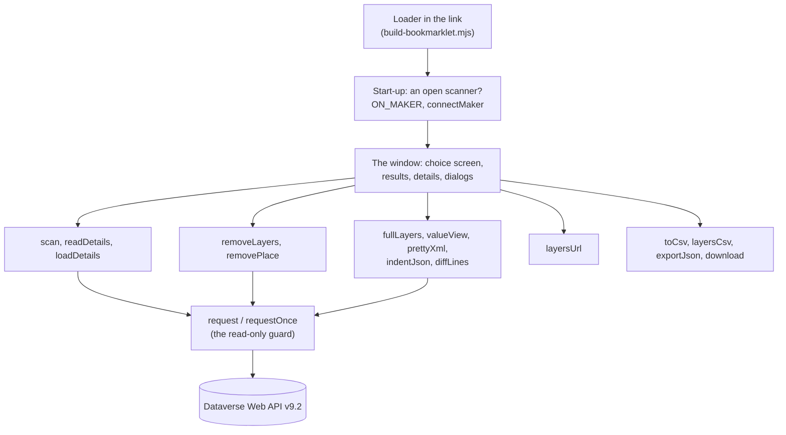

**Why one file, and no library.** A bookmarklet is one script. A single file can also be pasted into the console as it
is ([2.6](#26-the-development-loop)), needs no bundler, and can be read from top to bottom. The scanner runs inside other people's pages: it must
not depend on their code or disturb it, and it must stay under the size limit of a favourite. So it uses no framework
and no component library: the Fluent 2 look of the window is plain CSS in the file ([8.1](#81-shadow-dom-and-styles)).

**Order inside the function.** Function declarations are hoisted, so the start-up at the top can call
`connectMaker` before the line that defines it. Values declared with `const`, such as `CONFIG`, exist only from their
line on; the code above the settings part does not use them.

The file marks its parts with comment lines: `// ------...------ <name>` in the engine and `// ---- <name>` in the
window. In the order of the file:

| Marker | What it holds | Main names | Chapter |
| --- | --- | --- | --- |
| (the top, before any marker) | The header comment with the safety rules; where the scanner may run; a scanner already open on the page; connecting | `ON_MAKER`, `envOfUrl`, `KEY`, `placeholder`, `giveUp`, `conn` | [4.2](#42-start-up-and-connecting) |
| `sign-in on the maker portal` | Reading the maker portal's cached token, and finding the environment's address | `accessTokenEntries`, `scopesOf`, `makerToken`, `makerAccount`, `connectMaker` | [5.7](#57-the-maker-portal-sign-in) |
| `settings` | The settings, the values derived from the connection, the constant tables | `CONFIG`, `VERSION`, `ORIGIN`, `API`, `ACTIVE`, `DEFAULT`, `ORG`, `MAKER`, `IS_DEV`, `IS_PROD`, `CLASSIC`, `NAMES`, `METADATA`, `GROUPS`, `groupOf`, `typeWanted`, `STATE_ONLY`, `MICROSOFT`, `QUIET_NO_ACCESS` | [4.3](#43-settings-config), [4.4](#44-constant-tables-classic-names-metadata-groups-and-others) |
| `Web API` | Every request with the read-only guard, concurrency, retries, Stop and paging; reading a component's layers | `request`, `requestOnce`, `read`, `write`, `getAll`, `pool`, `slot`, `release`, `pause`, `stopAllReads`, `resumeReads`, `SessionError`, `StopError`, `GUID`, `placeOk`, `getLayers`, `places`, `managedOf`, `managedPrint`, `ExactNumber`, `exactNumbers`, `fileRefOf`, `changedKeys` | [5](#5-the-request-layer), [3.5](#35-msdyn_componentlayers) |
| `managed solutions` | The list of managed solutions, hidden ones included | `listManagedSolutions` | [8.3](#83-the-choice-screen-and-saved-selections) |
| `scan` | The scan, the details of the findings, the status line | `scan`, `readDetails`, `loadDetails`, `statusLine` | [6](#6-the-scan-step-by-step) |
| `remove` | Deleting, with the checks before and after each place | `removePlace`, `removeLayers` | [10](#10-deleting) |
| `files` | Downloads, the CSV and JSON exports | `stamp`, `download`, `csvCell`, `toCsv`, `layersCsv`, `exportJson` | [11](#11-exports) |
| `links to the solution layers pages` | The address of each finding's layers page | `PART_SEGMENT`, `CLASSIC_PAGE`, `classicLayers`, `layersUrl` | [7](#7-links-to-the-solution-layers-pages) |
| `UI` | Escaping, icons, the sections of the object types, the style sheet, the window's markup in a shadow root | `esc`, `P`, `icon`, `TYPE_SECTIONS`, `STYLE`, `host`, `root`, `app`, `mini`, `$` | [8.1](#81-shadow-dom-and-styles) |
| `state` | The window's state, and the choices remembered in the browser | `view`, `result`, `busy`, `scanning`, `deleting`, `chosen`, `typesSel`, `tablesSel`, `logRows`, `STORE`, `SAVED`, `loadSaved`, `storeSaved`, `plural` | [4.5](#45-state-and-globals), [8.3](#83-the-choice-screen-and-saved-selections) |
| `dialogs and toasts` | The one dialog and the messages in the corner | `openDialog`, `toast` | [8.9](#89-toasts-dialogs-and-the-deleting-pill) |
| `menus` | The Saved selections, Export and More menus, with the keyboard of Fluent menus | `openMenu`, `closeMenus` | [8.8](#88-keyboard-and-accessibility) |
| `the choice screen` | Switching screens; the solutions, object types and saved selections | `setView`, `solRows`, `renderSolutions`, `TABLE_GROUPS`, `groupOn`, `renderTypes`, `renderSaved`, `renderPickBar`, `renderPick` | [8.2](#82-views-and-rendering), [8.3](#83-the-choice-screen-and-saved-selections) |
| `tables` | The Tables card and the Choose tables dialog; ticking solutions; applying and saving selections | `readTables`, `loadTables`, `renderTables`, `toggleSol`, `applySaved`, `changedPick` | [8.3](#83-the-choice-screen-and-saved-selections), [8.4](#84-the-table-picker) |
| `scanning` | Starting a scan and showing its progress | `scopeText`, `progress`, `withBusy`, `runScan` | [8.2](#82-views-and-rendering) |
| `results` | Which rows can be ticked; the types Dataverse does not delete | `active`, `undeletable`, `cannotDelete`, `selectable`, `solName`, `solNameU`, `cmpText` | [8.5](#85-results-search-type-bubbles-and-column-menus), [10.10](#1010-types-dataverse-will-not-delete) |
| `column filters and sorting` | The five filterable columns, the rows shown, the values of a column | `COLS`, `filters`, `sortBy`, `shown`, `drawnRows`, `columnValues`, `renderFilters` | [8.5](#85-results-search-type-bubbles-and-column-menus) |
| `type bubbles` | The bubbles above the grid and the More menu | `renderChips`, `layoutChips`, `typeClick` | [8.5](#85-results-search-type-bubbles-and-column-menus) |
| `column widths` | Column widths, then the column menus and the rows of the grid | `applyColWidths`, `fitColumn`, `openPop`, `renderPop`, `setFilter`, `rowHtml`, `renderRows`, `fitTags`, `updateRow`, `syncSelection`, `renderBanners`, `subtitle`, `renderResults`, `rescan` | [8.5](#85-results-search-type-bubbles-and-column-menus), [8.6](#86-column-widths) |
| `a component's layers and what changed` | Reading every layer, showing values, the line difference, the three tabs of the details | `fullLayers`, `parseJson`, `attrsOf`, `safeJson`, `stable`, `scalarText`, `prettyXml`, `indentJson`, `valueView`, `asStored`, `diffLines`, `diffHtml`, `sheet`, `openSheet`, `loadSheet`, `compareRows`, `renderCompareTab`, `FileRef`, `isWrContent`, `contentSide`, `fileBody`, `propBodyOf`, `activeWhen`, `renderLayersTab`, `highlightJson`, `childTables`, `renderJsonTab` | [9](#9-details-and-comparison) |
| `details: events` | Clicks and keys in the details: tabs, pickers, folds, Copy, Download | `sheetGo`, `copyText` | [9.9](#99-copy-and-download) |
| `deleting` | The confirmation and the run | `beforeUnload`, `confirmDelete`, `runDelete` | [10](#10-deleting) |
| `the window` | Moving, resizing, maximizing | `fitGeo`, `defaultGeo`, `placeWin`, `toggleMax`, `startDrag`, `onDrag`, `endDrag`, `onResize` | [8.7](#87-moving-resizing-and-maximizing) |
| `open, close, environment changes` | Closing and opening the window again, Escape and Tab, the solution open in the maker portal, the test hooks, the first load | `hide`, `onEscape`, `openSolution`, `takeOpenSolution`, `show`, `destroy`, `loadSolutions` | [4.2](#42-start-up-and-connecting), [4.6](#46-the-test-hooks-on-window__layerscanner), [8.8](#88-keyboard-and-accessibility) |

### 4.2 Start-up and connecting

When the favourite is clicked, the loader in the link unpacks the code and runs it ([12.2](#122-the-loader-and-the-size-limit)). The scanner then decides
whether it may start, and where its data comes from.

`layer-scanner.js`, the start (the top of the function):

```js
(async () => {
  'use strict'
  // Where it runs: a page of the environment itself, or the maker portal (make.powerapps.com) with an environment open.
  const ON_MAKER = /^make\.(preview\.)?powerapps\.com$/i.test(location.hostname)
  const envOfUrl = () => ((/\/environments\/([0-9a-z-]+)/i.exec(location.pathname) || [])[1] || '').toLowerCase()
  const KEY = ON_MAKER ? 'maker|' + envOfUrl() : location.hostname
  const old = window.__layerScanner
  if (old) {
    if (typeof old.destroy !== 'function') { alert('An older version of the scanner is open on this page. Reload the page, then click the bookmark again.'); return }
    if (old.starting) { alert('The scanner is still starting. Wait a moment.'); return }
    if (old.key === KEY && old.ready()) { old.show(); return }
    // Another environment (the maker portal changes environment without reloading the page), or a start that failed:
    // start again.
    if (!old.destroy()) { alert('The scanner is still working. Wait until it has finished, then click the bookmark again.'); return }
  }
  if (!ON_MAKER && !/\.dynamics\.com$/i.test(location.hostname)) { alert('Open the environment (https://<org>.crm.dynamics.com) or its Solutions page in the maker portal (make.powerapps.com) first, then click the bookmark again.'); return }
  if (ON_MAKER && !envOfUrl()) { alert('Open an environment in the maker portal (for example its Solutions page), then click the bookmark again.'); return }
  const placeholder = { key: KEY, starting: true }   // a second click while connecting does not start a second scanner
  window.__layerScanner = placeholder
  const giveUp = (msg) => { if (window.__layerScanner === placeholder) delete window.__layerScanner; alert(msg) }
  let conn
  try { conn = ON_MAKER ? await connectMaker(envOfUrl()) : { origin: location.origin, envId: '', host: location.hostname, account: '' } } catch (e) { giveUp(e.message); return }
  if (conn.error) { giveUp(conn.error); return }
  if (ON_MAKER && envOfUrl() !== conn.envId) { giveUp('The maker portal moved to another environment while the scanner was starting. Click the bookmark again.'); return }
```

**One scanner per page.** `KEY` names the environment: the host name on an environment page, `maker|` and the
environment id on the maker portal. A click on the favourite while a scanner is already on the page does this:

| On the page | What happens |
| --- | --- |
| Nothing | The scanner starts |
| A scanner of a version without `destroy` | An alert asks to reload the page |
| A scanner that is still connecting (`starting`) | An alert asks to wait |
| A ready scanner for the same environment | Its window is shown again (`show`): no second scanner, and no new code |
| A scanner for another environment (the maker portal changes environments without reloading the page), or one whose start failed | It is removed (`destroy`) and a new one starts; if it is busy, `destroy` refuses and an alert asks to wait |

`ready()` is true once the list of managed solutions has loaded. The placeholder object `{ key, starting: true }` holds
the place during the connection, so that a double click starts one scanner only; `giveUp` removes it again, but only
if it is still its own.

**Where it may run.** On a host that is neither the maker portal nor under `.dynamics.com`, or on the maker portal
without an environment in the address, an alert says what to open, and nothing else happens.

**Connecting.** `conn` holds where the data comes from:

| Field | On an environment page | On the maker portal |
| --- | --- | --- |
| `origin` | The page's own origin, for example `https://contoso.crm.dynamics.com` | The environment's Dataverse address, found by `connectMaker` |
| `envId` | Empty at first; `loadSolutions` reads it with `RetrieveCurrentOrganization` for the links to the maker portal ([chapter 7](#7-links-to-the-solution-layers-pages)) | The id in the page address, confirmed by Dataverse |
| `host` | The page's host name | The environment's host name, used to pick its token for each request |
| `account` | Empty: the browser's session cookie signs the requests | The maker portal account whose token the scanner uses |

`connectMaker` ([5.7](#57-the-maker-portal-sign-in)) asks each Dataverse host that the maker portal holds a token for, most recently used first, for
its environment id with `RetrieveCurrentOrganization`, and keeps the one whose id is the id in the page address. If the
browser holds the maker portal sign-in of several accounts for that environment and none is marked active, it refuses
to guess, and the alert says so. If no host matches, the alert says: "The maker portal has no current sign-in to this
environment's data. Wait until the Solutions list has loaded (or reload the page), then click the bookmark again."

**After connecting**, the rest of the function runs without waiting: the settings and constants ([4.3](#43-settings-config), [4.4](#44-constant-tables-classic-names-metadata-groups-and-others)), the
functions of the engine, then the window. The window is built at once: a `div` (`host`) covering the page, with a
shadow root that holds the style sheet and the markup ([8.1](#81-shadow-dom-and-styles)). Key presses are stopped at `host`, so the app's own
keyboard shortcuts do not react to typing in the window. The function ends by replacing the placeholder with the real
`window.__layerScanner` ([4.6](#46-the-test-hooks-on-window__layerscanner)), showing the choice screen, and calling `loadSolutions`.

`layer-scanner.js`, `loadSolutions`:

```js
function loadSolutions() {
  solState = 'loading'; solError = ''; renderSolutions(); renderPickBar()
  withBusy(async () => {
    try {
      allSolutions = await listManagedSolutions()
      const known = new Set(allSolutions.map((s) => s.unique))
      chosen = new Set([...chosen].filter((u) => known.has(u)))
      // The environment id, for the links to the maker portal (the maker portal's own address already has it).
      if (!conn.envId) try { conn.envId = lc((await read("RetrieveCurrentOrganization(AccessType=Microsoft.Dynamics.CRM.EndpointAccessType'Default')")).Detail.EnvironmentId) } catch (e) { if (e instanceof SessionError) throw e }
      takeOpenSolution()   // started from a solution's page in the maker portal: that solution, all types
      solState = allSolutions.length ? 'ready' : 'none'
    } catch (e) { solState = 'failed'; solError = e.message }
  }).then(() => {
    if (view === 'pick') renderPick()
    if (solState === 'ready') loadTables().catch(() => { })   // the tables' display names, for the Tables card; read again when chosen
  })
}
```

1. While the list loads, the solution list shows placeholder rows of the same size, so nothing jumps when the rows
   arrive ([8.3](#83-the-choice-screen-and-saved-selections)).
2. The remembered choice ([8.3](#83-the-choice-screen-and-saved-selections)) keeps only solutions that are installed in this environment.
3. On an environment page, the environment id is read once. If that fails (other than an expired sign-in), the
   scanner still works, and the rows link to the environment's classic layers page instead of the maker portal ([7.3](#73-the-classic-page)).
4. Started on a solution's page in the maker portal (`.../solutions/<solution id>/...`), `takeOpenSolution` selects
   that solution with all object types and no table limit, and the bar says why. If that solution is not managed, the
   bar says so instead.
5. Once the solutions are ready, the list of tables is read in the background, for the Tables card ([8.4](#84-the-table-picker)).

The whole load runs inside `withBusy`, so `destroy` refuses to remove a scanner that is still loading.

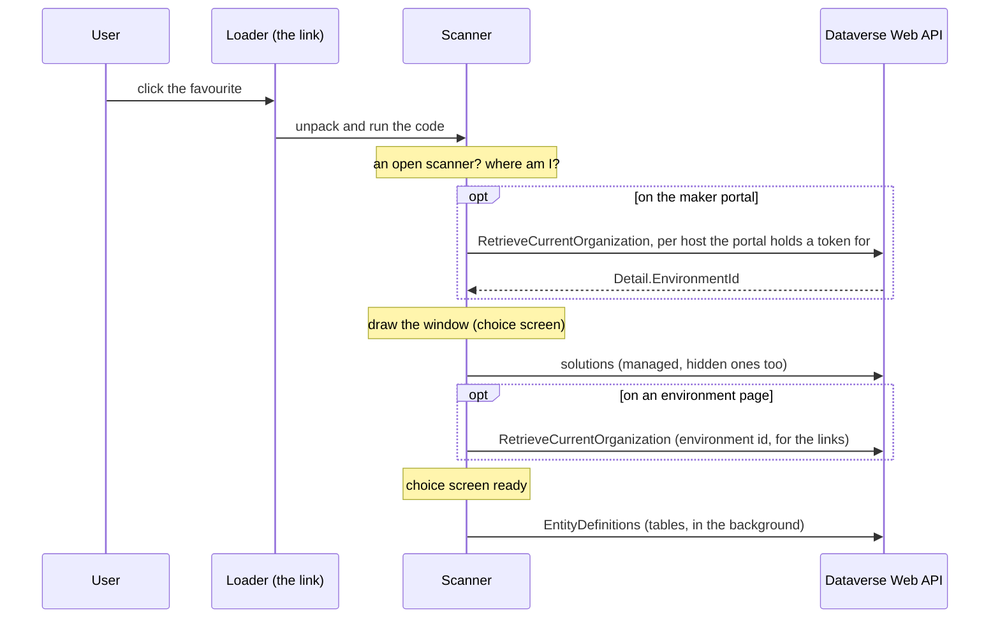

### 4.3 Settings: `CONFIG`

The main limits and timings of the scanner are in one object near the top of the file. A few more are written next to
the code that uses them: constants such as `MAX_LINES` ([4.4](#44-constant-tables-classic-names-metadata-groups-and-others)), and plain numbers such as the 10-second wait when a
removal meets a lock ([3.8](#38-removeactivecustomizations)).

`layer-scanner.js`, `CONFIG`:

```js
const CONFIG = {
  // Optional environment rules, set at build time from scanner.settings.json (see the README); none by default.
  // Each is a regular expression matched against the environment's name, the first part of its address.
  developmentEnvironments: null,                  // deleting is never offered there
  productionEnvironments: null,                   // the delete confirmation names them as production, in red
  maxRemovePerRun: 100,                           // larger clean-ups go in several runs
  autoDetails: 500,                               // details are read automatically for this many findings; the rest on request
  maxRows: 2000,                                  // rows drawn in the table (filter to see others)
  concurrency: 4,                                 // requests in flight at once (Dataverse allows 52 per user)
  detailConcurrency: 3,
  pageSize: 5000,                                 // rows per page (Dataverse maximum); smaller only for tests
  deleteConcurrency: 1,                           // one component at a time, as Solution Layers Explorer does (Dataverse does
                                                  // the removals one after the other anyway, about 8 s each)
  layerCheckLimit: 1000,                          // components not in the solutions' component lists whose layers are read to place them,
                                                  // and components flagged only by the solution summary whose layers are read to confirm them
  readTimeout: 300000,                            // a read with no full answer after 5 minutes is ended, not sent again
}
```

| Setting | Default | What it controls | Used by |
| --- | --- | --- | --- |
| `developmentEnvironments` | `null` | A regular expression matched against the environment's name (`ORG`). When it matches, deleting is turned off: the tick boxes are disabled, the **Delete** buttons hidden, a *Development* badge in the title bar says why in its tooltip, and `removeLayers` refuses to run. Set by the build from `scanner.settings.json` ([12.5](#125-environment-rules-scannersettingsjson)) | `IS_DEV` |
| `productionEnvironments` | `null` | Matched the same way. When it matches, a red *Production* badge in the title bar, and the confirmation says "You're deleting in the production environment" with the environment's name | `IS_PROD` |
| `maxRemovePerRun` | 100 | Most components in one deletion run. With more ticked, **Delete** is disabled and the bar says "You can delete up to 100 at a time." | `syncSelection`, `confirmDelete` |
| `autoDetails` | 500 | Findings whose details the scan reads by itself, besides the ones only the summary found; the rest on request, with **Read N more** (N is 500, or fewer when fewer are left) | `scan`, `renderBanners` |
| `maxRows` | 2,000 | Rows drawn in the grid; a search or a filter reaches the others, and the subtitle says when only the first 2,000 are drawn | `drawnRows`, `subtitle` |
| `concurrency` | 4 | Requests in flight at once, for every request of the scanner; also the number of component types swept at a time | `slot`, `scan` |
| `detailConcurrency` | 3 | Components whose layers are read at a time, for the details and for placing components by their layers | `loadDetails`, `scan` |
| `pageSize` | 5,000 | Rows per page, asked with the header `Prefer: odata.maxpagesize` (the Dataverse maximum). Smaller only for tests of the paging | `requestOnce` |
| `deleteConcurrency` | 1 | Components deleted at a time ([1.4](#14-how-deleting-works-in-one-page)) | `removeLayers` |
| `layerCheckLimit` | 1,000 | Most components placed by their layers ([6.7](#67-components-placed-by-their-layers)), and most summary-only components confirmed by their layers ([6.8](#68-step-4-confirming-and-reading-the-details)), in one scan. Components left to place beyond it make the scan incomplete; summary-only components beyond it stay *not read yet*, and the banner says they might have no unmanaged layer of their own | `scan` |
| `readTimeout` | 300,000 (5 minutes) | A read with no full answer within this many milliseconds is ended and not sent again, so that a heavy query does not load the server twice | `requestOnce` |

[13.2](#132-change-limits-and-timings) explains how to change them, and Appendix [A.1](#a1-config) lists them again.

Right after `CONFIG`, the values that depend on the connection:

`layer-scanner.js`, the settings part:

```js
const VERSION = '__VERSION__'   // set by build-bookmarklet.mjs from package.json
const ORIGIN = conn.origin
const API = ORIGIN + '/api/data/v9.2/'
const ACTIVE = 'fd140aae-4df4-11dd-bd17-0019b9312238'    // the unmanaged ("Active") layer, same id everywhere
const DEFAULT = 'fd140aaf-4df4-11dd-bd17-0019b9312238'
const ORG = new URL(ORIGIN).hostname.split('.')[0]
const MAKER = ON_MAKER ? location.origin : 'https://make.powerapps.com'   // the maker portal, for the links to each component's layers
const IS_DEV = !!CONFIG.developmentEnvironments && CONFIG.developmentEnvironments.test(ORG), IS_PROD = !!CONFIG.productionEnvironments && CONFIG.productionEnvironments.test(ORG)
```

| Name | Value | Used for |
| --- | --- | --- |
| `VERSION` | `'__VERSION__'` in the source; the build writes the version of `package.json` ([12.4](#124-the-version)) | The tooltip of the window's title; `window.__layerScanner.version` |
| `ORIGIN`, `API` | The environment's address, and its Web API address | `requestOnce` accepts nothing else ([5.2](#52-read-only-by-design)) |
| `ACTIVE`, `DEFAULT` | The two fixed solution ids ([3.2](#32-the-active-solution-and-the-default-solution)) | The sweep, the summary, the links |
| `ORG` | The environment's name: the first part of its host name, for example `contoso` for `contoso.crm.dynamics.com` | The badge in the title bar (with the full address as its tooltip), the environment rules, the names of downloaded files, the key of the remembered choice ([8.3](#83-the-choice-screen-and-saved-selections)) |
| `MAKER` | The maker portal's address: the page's own on the maker portal (so the preview portal stays on preview), else `https://make.powerapps.com` | The links ([7.1](#71-maker-portal-addresses)) |
| `IS_DEV`, `IS_PROD` | Whether the environment rules match `ORG` | Deleting turned off, the badges, the confirmation |

**Changing a setting** means changing `CONFIG` and building again. For a test, `window.__layerScanner.config` is the
same object ([4.6](#46-the-test-hooks-on-window__layerscanner)): a value changed there takes effect where it is next read, for example `pageSize` at the next
request. The environment rules are the exception: `IS_DEV` and `IS_PROD` are worked out once, at start-up.

### 4.4 Constant tables: `CLASSIC`, `NAMES`, `METADATA`, `GROUPS` and others

The scan is driven by a few tables of constants, all in the settings part. They hold what the scanner knows about
Dataverse that it cannot read from the environment.

**`CLASSIC`: the classic component types.** One entry per type number: the component's table (its logical name), the
layer name ([3.4](#34-component-types-and-layer-names)), and the name the maker portal shows. It has 49 types.

`layer-scanner.js`, `CLASSIC` (the first lines):

```js
// Classic component types: the table behind each, the name the layer table uses, and the name the maker portal shows.
const CLASSIC = {
  1: ['entity', 'Entity', 'Table'], 2: ['attribute', 'Attribute', 'Column'], 9: ['', 'OptionSet', 'Choice'], 10: ['relationship', 'EntityRelationship', 'Relationship'],
  14: ['entitykey', 'EntityKey', 'Key'], 20: ['role', 'Role', 'Security role'], 22: ['displaystring', 'DisplayString', 'Display string'],
  26: ['savedquery', 'SavedQuery', 'View'], 29: ['workflow', 'Workflow', 'Process'], 31: ['report', 'Report', 'Report'], 36: ['template', 'Template', 'Email template'],
  // ...
}
```

* The scan looks up each table in `EntityDefinitions` for its entity set name (the name in Web API addresses), its
  primary id column and its primary name column. A type whose table is missing, or has no `solutionid` or no
  `ismanaged` column, cannot be swept; it is counted in `typesWithoutColumns`.
* An empty table name (type 9, global choices) means "not swept": the summary finds those ([3.6](#36-the-solution-component-summary)).
* Types 1, 2, 10 and 14 are swept through `METADATA` instead (below).
* `WORKFLOW_TYPE`, `FORM_TYPE` and `VIEW_TYPE`, right after `CLASSIC`, name processes, forms and views by their kind,
  as the maker portal does (*Cloud flow*, *Main form*, *Public view* ...).

**Which columns name a component.** The sweep asks each table only for the columns it needs; these tables say which.

`layer-scanner.js`, `NAMES` and the column tables:

```js
// Columns used to show each component: [display name column, schema/unique name column]. Others use the primary name.
const NAMES = {
  22: [null, 'displaystringkey'], 29: ['name', 'uniquename'], 36: ['title', null], 61: ['displayname', 'name'], 62: ['sitemapname', 'sitemapnameunique'],
  80: ['name', 'uniquename'], 90: ['name', 'typename'], 300: ['displayname', 'name'], 380: ['displayname', 'schemaname'], 381: ['schemaname', 'schemaname'],
}
const SCHEMA_GUESS = ['uniquename', 'schemaname', 'connectionreferencelogicalname']   // newer component types
const TABLE_COLUMN = { 60: 'objecttypecode', 26: 'returnedtypecode', 59: 'primaryentitytypecode', 29: 'primaryentity', 50: 'entity' }
const SUBTYPE_COLUMN = { 29: 'category', 60: 'type', 26: 'querytype' }
const WANTED_COLUMNS = ['ismanaged', 'solutionid', 'name', 'displayname', 'title', 'typename', 'sitemapname', 'sitemapnameunique', 'displaystringkey', 'category', 'type', 'querytype', ...SCHEMA_GUESS]
```

`WANTED_COLUMNS` lists the columns whose presence the scan checks on every table, in one request at the start ([1.3](#13-how-a-scan-works-in-one-page)).
The name and kind columns go into a query only when the table has them (that one request tells), so the same code
works for every type and every version of Dataverse. [6.2](#62-step-1-one-sweep-per-component-type) explains how the sweep uses `NAMES`, `SCHEMA_GUESS`,
`TABLE_COLUMN` and `SUBTYPE_COLUMN`.

**Metadata, copies, parts.** Four more constants steer the sweep and step 3. [Chapter 6](#6-the-scan-step-by-step) shows each one in the code that
uses it:

| Constant | Holds | Used by |
| --- | --- | --- |
| `METADATA` | For tables, columns, relationships and keys: the component table's entity set, its id column and its name column ([3.3](#33-managed-and-unmanaged-components)) | The sweep ([6.3](#63-tables-columns-relationships-and-keys)) |
| `TYPE_FILTER` | The extra filter that leaves out copies: business-unit copies of roles, activation copies of processes ([3.3](#33-managed-and-unmanaged-components)) | The sweep ([6.2](#62-step-1-one-sweep-per-component-type)) |
| `TABLE_PARTS` | The types a table "with all objects" brings: columns, relationships, keys, views, charts, forms ([3.7](#37-solution-components-and-with-all-objects)) | Step 3, `solsOf` ([6.6](#66-step-3-which-managed-solutions-hold-each-component)) |
| `TABLE_BOUND` | The types that can belong to a table. With tables chosen, only these types are swept, and a finding is kept when it is one of the chosen tables or belongs to one (for a relationship, either of its two tables) | `scan`, `inTables` ([6.5](#65-object-types-and-tables)) |

**Object types.** The choice screen offers object types grouped as the maker portal groups them. Forms are split into
forms and dashboards, and processes into business rules, cloud flows and other processes, by their kind.

`layer-scanner.js`, `GROUPS` and `CODE_GROUP`:

```js
// Object types to choose from, as the maker portal groups them. Forms and processes are split by their kind.
const GROUPS = ['Tables', 'Columns', 'Relationships', 'Keys', 'Forms', 'Views', 'Charts', 'Business rules', 'Dashboards', 'Cloud flows', 'Other processes',
  'Choices', 'Security roles', 'Column security profiles', 'Web resources', 'Environment variables', 'Connection references', 'Email templates',
  'Display strings', 'Plug-ins', 'Apps', 'Site maps', 'Reports', 'Other']
const CODE_GROUP = { 1: 'Tables', 2: 'Columns', 10: 'Relationships', 14: 'Keys', 26: 'Views', 59: 'Charts', 9: 'Choices', 20: 'Security roles', 70: 'Column security profiles',
  71: 'Column security profiles', 61: 'Web resources', 380: 'Environment variables', 381: 'Environment variables', 36: 'Email templates', 22: 'Display strings',
  90: 'Plug-ins', 91: 'Plug-ins', 92: 'Plug-ins', 93: 'Plug-ins', 80: 'Apps', 300: 'Apps', 62: 'Site maps', 31: 'Reports' }
```

The 24 groups are used twice, by `groupOf` and `typeWanted`, which come right after them ([6.5](#65-object-types-and-tables)
shows both). Before the sweep, `typeWanted` says whether a component type must be read at all: a type is read when any
of its groups is chosen, so forms are read for *Forms* or *Dashboards*. After the summary, `groupOf` puts each finding
in exactly one group, by its kind, and findings of groups that were not chosen are dropped. Every type that
`CODE_GROUP` does not name, and that is not a form, a process or a connection reference, is in *Other*. On the screen, `TYPE_SECTIONS` arranges the groups in sections (Data, Forms and views, Automation, Apps and
resources, Security and settings, Everything else), and `TABLE_GROUPS` lists the groups still offered when tables are
chosen ([8.3](#83-the-choice-screen-and-saved-selections)).

**Processes, publishers and quiet types.**

`layer-scanner.js`, `MICROSOFT` and `QUIET_NO_ACCESS`:

```js
const MICROSOFT = /microsoft|dynamics 365/i   // publishers hidden by default in the solution list
// Types skipped without a note when Dataverse refuses them with its own security error 0x80040256 (CrmSecurityError),
// seen in some environments even for System Administrators who hold the privileges it names. Any other refusal of
// them (PrivilegeDenied 0x80040220: the role really lacks the privilege) is still named. Still read where allowed.
const QUIET_NO_ACCESS = new Set(['AttributeImageConfiguration', 'EntityImageConfiguration'])
```

* `STATE_ONLY`, right before `MICROSOFT`: the properties left out of a finding's list of changes (with every name ending in
  `idunique`). When a process's unmanaged layer changes nothing else, and its status or owner is among its changes,
  *What changed* says *Only status or owner*; otherwise, when nothing is left once these are left out, it says *Only
  system values*. [6.8](#68-step-4-confirming-and-reading-the-details) shows the set and how `readDetails` uses it.
* `MICROSOFT`: solutions whose publisher matches it are hidden in the choice screen until *Show Microsoft and hidden
  solutions* is turned on, as are solutions that are hidden in Dataverse (`isvisible` false). A chosen solution is
  always shown.
* `QUIET_NO_ACCESS`: the component types (by layer name) that are skipped without the *Not checked* note when their
  sweep is refused with `CheckPrivilege` and error code 0x80040256 ([6.9](#69-complete-or-incomplete)). In some environments Dataverse refuses the column and
  table image configurations that way even to System Administrators who hold the privileges it names: 0x80040256 is
  *CrmSecurityError*, "A failure occurred in CrmSecurity", a fault of its own security check, so the note named them
  in every scan. A refusal with *PrivilegeDenied* (0x80040220, the role really lacks the privilege) is still named.
  They are still read wherever Dataverse allows it (the code comes from the answer's `error.code`, kept on the error as
  `code` by `requestOnce`).

**Other constants, further down the file.** Each is explained in its chapter:

| Constant | Holds | Chapter |
| --- | --- | --- |
| `GUID` | The pattern of a component id, checked by `placeOk` before an id goes into an address | [5.2](#52-read-only-by-design) |
| `LAYER_SYSTEM` | The values left out when the managed layers are compared after a removal: `overwritetime`, `modifiedon`, `modifiedby`, `modifiedonbehalfby`, `versionnumber` | [10.6](#106-after-each-place-the-checks) |
| `PART_SEGMENT`, `CLASSIC_PAGE` | The part of a maker portal address for each part of a table; the types linked to the classic page | [7.1](#71-maker-portal-addresses), [7.3](#73-the-classic-page) |
| `P`, `TYPE_SECTIONS`, `STYLE` | The icons (20 by 20 paths), the sections of the object types, the style sheet | [8.1](#81-shadow-dom-and-styles), [8.3](#83-the-choice-screen-and-saved-selections) |
| `LOG_HEAD` | The header of the deletion log | [11.4](#114-deletion-log-csv) |
| `STORE`, `SAVED`, `COLW`, `GEO` | The keys of the browser storage | [8.3](#83-the-choice-screen-and-saved-selections) |
| `TABLE_GROUPS` | The object types offered when tables are chosen | [8.3](#83-the-choice-screen-and-saved-selections) |
| `undeletable`, `NO_DELETE` | The types without a tick box (it starts with email templates, type 36, and grows when Dataverse refuses another type), and the text of their tooltip | [10.10](#1010-types-dataverse-will-not-delete) |
| `SPECIAL_TIPS`, `STATUS` | The tooltips of *Only system values* and *Only status or owner*; the labels and colours of the outcomes | [8.5](#85-results-search-type-bubbles-and-column-menus), [10.7](#107-outcomes) |
| `COLS` | The five filterable columns, and how to get each column's values from a finding | [8.5](#85-results-search-type-bubbles-and-column-menus) |
| `POP_MAX` | Values listed at once in a column menu (300); a search finds the others | [8.5](#85-results-search-type-bubbles-and-column-menus) |
| `COL_KEYS`, `COL_MIN`, `COL_MAX`, `CHANGED_MIN` | The resizable columns, their least and greatest widths, and the least width of *What changed* (150 pixels) | [8.6](#86-column-widths) |
| `SYSTEM_KEYS` | The system values that *Hide system values* hides in the comparison | [9.2](#92-comparing-two-layers) |
| `WR_IMAGE` | The web resource types shown as images | [9.3](#93-showing-a-value-valueview) |
| `BIG`, `MAX_LINES` | The most characters of a value compared on the screen (1,000,000) and the most lines of a difference drawn at once (3,000) | [9.10](#910-limits-that-keep-the-page-responsive) |
| `JSON_FIELD`, `DEPTH` | The three views of the JSON tab; the names of a privilege's depths | [9.8](#98-layers-and-json-tabs-children-tables) |
| `MIN_W`, `MIN_H` | The least size of the window: 720 by 560 pixels | [8.7](#87-moving-resizing-and-maximizing) |

Three sets of "system" property names exist, for three different jobs: `STATE_ONLY` for the list of changes of a
finding, `SYSTEM_KEYS` for the comparison of two layers, and `LAYER_SYSTEM` for the check after a removal. They are
kept apart on purpose: each one leaves out only what is noise for its own job.

### 4.5 State and globals

All state lives in variables inside the scanner's function. Nothing is kept on the server, and only a few choices are
kept in the browser.

**The finding.** Each component the scan finds is one object, named `f` throughout the code. Its fields are filled in
step by step, by the steps of the scan ([chapter 6](#6-the-scan-step-by-step)) and by the window:

| Field | Set by | Holds |
| --- | --- | --- |
| `key` | The sweep or the summary | `<type number>\|<id>`, unique within a scan; used as the row's key everywhere in the window |
| `code`, `kind` | The sweep or the summary | The type number (2 for a column, 60 for a form), and the layer name ([3.4](#34-component-types-and-layer-names)), such as `Attribute` or `SystemForm` |
| `id` | The sweep or the summary | The component's id, in lower case. For tables, columns, keys and relationships, the metadata id (for a relationship, the definition's place) |
| `alt` | The metadata step ([6.3](#63-tables-columns-relationships-and-keys)) | For a relationship: its other place, `[{ id, kind: 'Relationship' }]` ([3.4](#34-component-types-and-layer-names)) |
| `type` | The sweep or the summary | The name shown in the Type column: *Column*, *Main form*, *Public view*, *Cloud flow* ... |
| `display`, `schema`, `logical` | The sweep or the summary | Display name; schema or unique name; logical name (used to match a table to the chosen tables) |
| `table` | The sweep or the summary | The logical name of the component's table, or empty |
| `tables`, `schemaName` | The metadata step ([6.3](#63-tables-columns-relationships-and-keys)) | For a relationship: both of its tables, and its schema name |
| `fromSummary` | The summary ([6.4](#64-step-2-the-solution-summary)) | `true` when only the solution summary found it |
| `kindGuessed` | The summary ([6.4](#64-step-2-the-solution-summary)) | `true` when the type number has no known layer name, so the summary's type name is used |
| `tableLabel`, `tableId` | Step 3 ([6.6](#66-step-3-which-managed-solutions-hold-each-component)) | The table as "Display name (logical name)"; the table's metadata id, for the links |
| `listedIn` | Step 3 ([6.6](#66-step-3-which-managed-solutions-hold-each-component)) | The managed solutions whose component list has a row for it |
| `solutions`, `solutionIds` | Step 3 ([6.6](#66-step-3-which-managed-solutions-hold-each-component)) | The chosen managed solutions that hold it: their names joined with commas, and their ids sorted by name |
| `linkSolution` | Step 3 ([6.6](#66-step-3-which-managed-solutions-hold-each-component)) | The solution its link opens in ([7.2](#72-which-solution-goes-in-the-address)) |
| `placedByLayers` | Step 3 ([6.6](#66-step-3-which-managed-solutions-hold-each-component)) | `true` when its solutions came from its layers ([6.7](#67-components-placed-by-their-layers)) |
| `detailsLoaded` | `readDetails` ([6.8](#68-step-4-confirming-and-reading-the-details)) | `true` once its layers were read |
| `activeKinds` | `readDetails` ([6.8](#68-step-4-confirming-and-reading-the-details)) | The layer names of the places that have an unmanaged layer and at least one managed layer |
| `layerList` | `readDetails` ([6.8](#68-step-4-confirming-and-reading-the-details)) | Every layer of every place, with its order, solution, publisher, overwrite time and number of changes (the All layers export, [11.2](#112-all-layers-csv)) |
| `layers` | `readDetails` ([6.8](#68-step-4-confirming-and-reading-the-details)) | The solutions of its managed layers, top first, joined with " > " (the tooltip of the Managed solution column) |
| `changed`, `changedKeys` | `readDetails` ([6.8](#68-step-4-confirming-and-reading-the-details)) | The text of *What changed* (up to 10 names, or *Only system values*, *Only status or owner*, *Layers could not be read*), and the full list of changed properties |
| `stateOnly` | `readDetails` ([6.8](#68-step-4-confirming-and-reading-the-details)) | `true` for a process whose unmanaged layer changes only its status or owner |
| `noLayer` | `readDetails` ([6.8](#68-step-4-confirming-and-reading-the-details)) | `true` when its layers show no unmanaged layer on top of a managed one; such a finding is dropped |
| `deleted` | `runDelete` ([chapter 10](#10-deleting)) | `true` once its unmanaged layer was deleted; the row stays, struck through |

**The result of a scan.** `scan` returns one object with the findings, what was chosen, what was skipped and why, and
the time and number of requests ([6.1](#61-inputs-and-the-result-object) lists its fields). The window keeps it in `result`, and **Full details (JSON)**
exports it ([11.3](#113-full-details-json)).

**The request layer** ([chapter 5](#5-the-request-layer)):

| Variable | Holds |
| --- | --- |
| `conn` | The connection: `origin`, `envId`, `host`, `account` ([4.2](#42-start-up-and-connecting)) |
| `requests` | The number of requests of the current scan; `scan` sets it to 0 when it starts |
| `inFlight`, `waiting` | The requests in flight, and the ones waiting for a free place (`slot`, `release`) |
| `liveRequests` | The requests started and not finished, including those waiting or pausing. A stopped scan's reads have all ended when it is 0 |
| `pauseUntil` | The time until which every request waits, after an HTTP 429 |
| `armed` | `true` only while `removeLayers` runs: the one state in which a write passes the guard ([5.2](#52-read-only-by-design)) |
| `stopReads`, `stopCtl` | Stop: a flag, and the `AbortController` whose signal every read carries ([5.5](#55-stop)) |

**The window** ([chapter 8](#8-the-window)):

| Part | Variables |
| --- | --- |
| The screens | `view` (`'pick'` or `'results'`), `busy`, `scanning`, `deleting` (`null`, or the run: its keys, the counts, the start time, the stop flag and the component being deleted), `scanError`, `finishing` |
| The choice screen | `allSolutions`, `solState` (`'loading'`, `'ready'`, `'none'` or `'failed'`), `solError`, `chosen` (unique names), `typesSel`, `showAll`, `activeSaved`, `pickReason`, `tablesSel`, `tableList`, `tablesPromise`, `firstList` |
| The results | `result`, `selected` (the keys of the ticked rows), `status` (key to the outcome of a deletion and its detail), `keepDeleted` (deleted rows still shown until the search or a filter changes), `filters`, `sortBy`, `pop` (the open column menu), `pinned` (types picked from More), `chipsKey`, `scanScope`, `scanTypes`, `scanGen` |
| The deletion log | `logRows` (every deletion of the page session; a new scan does not clear it), `lastLog` |
| The columns | `colW`, `colDrag` |
| The details | `sheet` (the component shown, its tab, its place, its layers, the two layers compared and the options; for a web resource with a layer that keeps its content as a file, the file in effect and its content, `sheet.wrFile`), `layerCache` (every layer of the last 20 places read, with all their data), `layerEpoch` (raised by each removal, so reads started before it are not kept), `diffs`, `diffSeq` |
| The window | `geo` (place, size, maximized), `drag` |

**One task at a time: `busy`.** Loading the solutions, a scan, **Read N more** and a deletion run all go through
`withBusy`, which refuses to start a second task while one runs.

`layer-scanner.js`, `withBusy`:

```js
async function withBusy(fn) {
  if (busy) return false
  busy = true
  try { await fn(); return true } finally { busy = false }
}
```

While `busy` is true, `destroy` refuses to remove the scanner ([4.2](#42-start-up-and-connecting)), and no second task starts.

**Browser storage.** The scanner keeps four things in the browser's local storage: the last choice, the saved
selections, the column widths and the window's place and size. [8.3](#83-the-choice-screen-and-saved-selections) lists the keys, what each one holds, which ones the
environments of the maker portal share, and how every value read back is checked. Every read and write is in a `try`
block, so a browser that refuses storage only loses these conveniences. On the maker portal the scanner also **reads**
the portal's own sign-in cache in local storage ([5.7](#57-the-maker-portal-sign-in)); it never writes it. Results, details and logs are never stored:
they are gone when the page is reloaded.

**What the scanner adds to the page.** The `host` element at the end of `<body>`; a `keydown` listener on `document`
for Escape (in the capture phase, so the window gets it first when it has the focus); a `resize` listener on `window`;
a `beforeunload` listener while a deletion runs ([10.8](#108-stop-sign-in-expiry-and-leaving-the-page)); and `window.__layerScanner`. The `beforeunload` listener is
removed when the run ends; `destroy` removes the rest (and refuses while a run is going on).

### 4.6 The test hooks on `window.__layerScanner`

At the end of the start-up, the scanner puts one object on the page. The scanner itself uses it only at start-up, to
find an open scanner ([4.2](#42-start-up-and-connecting)); tests use it to drive the engine without the window.

`layer-scanner.js`, the test hooks (in `open, close, environment changes`):

```js
window.__layerScanner = { key: KEY, version: VERSION, show, destroy, ready: () => solState === 'ready', scan, listManagedSolutions, loadDetails, removeLayers, getLayers, layersUrl, config: CONFIG, environment: () => ({ org: ORG, url: ORIGIN, envId: conn.envId }),
  parts: { diffLines, prettyXml, indentJson, parseJson, valueView, childTables, scalarText } }   // also used by automated tests
```

| Member | What it is |
| --- | --- |
| `key`, `version` | The environment key ([4.2](#42-start-up-and-connecting)) and the version |
| `show()`, `destroy()`, `ready()` | Show the window again; remove the scanner from the page (returns `false`, and does nothing, while it is busy); whether the solutions have loaded |
| `scan(solutions, progress, options)` | The scan ([chapter 6](#6-the-scan-step-by-step)). `solutions` are objects from `listManagedSolutions`; `progress(text, percent)` is called as it goes; `options` are `details`, `allSolutions`, `objectTypes` and `tables` ([6.1](#61-inputs-and-the-result-object) explains them and the result) |
| `listManagedSolutions()` | Every managed solution, hidden ones included: `id`, `unique`, `name`, `version`, `installedOn`, `publisher`, `hidden` |
| `loadDetails(result, findings, progress)` | Reads the details of more findings of a result ([6.8](#68-step-4-confirming-and-reading-the-details)) |
| `removeLayers(findings, onRow, options)` | Deletes the unmanaged layers of the findings, with the checks but **without any confirmation** ([chapter 10](#10-deleting)) |
| `getLayers(id, kind)` | The layers of one place, top first ([3.5](#35-msdyn_componentlayers)) |
| `layersUrl(f)` | The link of a finding ([chapter 7](#7-links-to-the-solution-layers-pages)) |
| `config` | `CONFIG` itself ([4.3](#43-settings-config)) |
| `environment()` | `{ org, url, envId }`; on an environment page, `envId` is filled once the solutions have loaded ([4.2](#42-start-up-and-connecting)) |
| `parts` | Functions of the details that need no Dataverse: `diffLines`, `prettyXml`, `indentJson`, `parseJson`, `valueView`, `childTables`, `scalarText` ([chapter 9](#9-details-and-comparison)) |

**Using them from the console.** On a page where the scanner is open (and its solutions have loaded):

```js
const s = window.__layerScanner
s.version          // "1.0.0" ("__VERSION__" when the source itself was pasted)
s.environment()    // { org: "contoso", url: "https://contoso.crm.dynamics.com", envId: "..." }
const all = await s.listManagedSolutions()
const mine = all.filter((x) => x.unique === 'contoso_projects')
const r = await s.scan(mine, (text, percent) => console.log(Math.round(percent), text), { allSolutions: all, details: false })
r.findings.map((f) => `${f.type}: ${f.schema || f.display}`)
```

With `details: false`, the scan still reads the layers of the components that only the summary found ([6.8](#68-step-4-confirming-and-reading-the-details)) and of
the components it must place by their layers ([6.7](#67-components-placed-by-their-layers)), and no others. A scan started here runs beside the window, which
does not know about it: starting a scan in the window ends its reads (`runScan` calls `resumeReads`, [5.5](#55-stop)).

The `parts` are plain functions, handy for checking a change to the details without an environment:

```js
s.parts.indentJson('{"a":[1,2],"b":{}}')
// '{\n  "a": [\n    1,\n    2\n  ],\n  "b": {}\n}'
s.parts.diffLines(['a', 'b', 'c'], ['a', 'x', 'c'])
// [[0,0,0],[-1,1,-1],[1,-1,1],[0,2,2]]: a the same, b removed, x added, c the same
```

`config` is useful for tests of the paging: with `s.config.pageSize = 50`, every list comes in many small pages. In the
test environment, a scan with page size 50 found the same components with about 785 requests instead of about 450.

**What the hooks do not change.** Every request made through the hooks goes through the same `requestOnce`, with the
same address check and the same read-only guard. `removeLayers` arms writes for its own run only, refuses to run in a
development environment, and does the same checks before and after each place as a run from the window; it does not
ask for a confirmation, does not apply `maxRemovePerRun`, and does not update the window. Use it only on components of
a test solution. The hooks give nothing that code running in the page could not do by calling the Web API itself, so
they do not weaken the read-only design: they only make the scanner's own functions easy to test.

---

## 5. The request layer

Every request the scanner sends to Dataverse goes through one function, `requestOnce`. It is the lowest part of the
engine: the scan ([chapter 6](#6-the-scan-step-by-step)), the details ([chapter 9](#9-details-and-comparison)) and
deleting ([chapter 10](#10-deleting)) all build on it. This chapter explains what that function allows and refuses, how it shares the environment's capacity, what it does when Dataverse is busy, slow or
unreachable, how **Stop** ends the reads of a scan, how collections are read page by page, and how the scanner signs in
when it runs on the maker portal.

### 5.1 One function for every request

The scanner talks to the Dataverse Web API, version 9.2, at the environment's own address, for example
`https://contoso.crm.dynamics.com/api/data/v9.2/`. Whether it lists the managed solutions, sweeps a component type,
reads the layers of a component or removes an unmanaged layer, the request goes through `requestOnce`. Small wrappers
around it name the intent.

`layer-scanner.js`, `request`, `read` and `write`:

```js
let liveRequests = 0   // requests started and not finished (waiting, pausing or in flight)
async function request(method, path, body, opts = {}) {
  liveRequests++
  try { return await requestOnce(method, path, body, opts) } finally { liveRequests-- }
}
// ...
const read = (path) => request('GET', path)
const write = (method, path, body) => request(method, path, body, { write: true })
```

| Function | Used for | Goes through |
| --- | --- | --- |
| `read(path)` | Every read that returns one answer: the solution summary's check, the kind of a form or process, the environment id. | `request('GET', path)` |
| `getAll(path)` | Every collection, page by page ([5.6](#56-paging-and-pools)). | `read` for each page |
| `write(method, path, body)` | The removal of an unmanaged layer, and nothing else. Its only caller is `removePlace`. | `request(..., { write: true })` |
| `request(...)` | Counts the requests that are started and not finished (`liveRequests`), so that Stop knows when the last one has ended ([5.5](#55-stop)). | `requestOnce` |

**The one request that does not go through it.** On the maker portal, `connectMaker` sends its own `fetch` before the
scanner knows which Dataverse address belongs to the environment ([5.7](#57-the-maker-portal-sign-in)). It sends only
`RetrieveCurrentOrganization`, only to `https` addresses ending in `.dynamics.com` for which the maker portal already
holds a token, and gives each one 30 seconds.

**What `requestOnce` does, in order.**

1. Checks the address and the method ([5.2](#52-read-only-by-design)). A refused request never reaches the network.
2. Then, up to six attempts:
   1. Ends at once if the scan has been stopped ([5.5](#55-stop)).
   2. Waits while a throttling pause is running ([5.4](#54-retries-throttling-and-the-read-time-limit)).
   3. On the maker portal, reads the borrowed token again ([5.7](#57-the-maker-portal-sign-in)).
   4. Waits for a free slot: at most four requests are in flight ([5.3](#53-concurrency)).
   5. Sends the request. A read gets a 5-minute limit and can be aborted by Stop; a write gets neither.
   6. Reads the whole answer as text and gives the slot back.
   7. Returns the parsed JSON, tries again, or throws an error.

The part that sends the request:

`layer-scanner.js`, `requestOnce`:

```js
// A read ends when the scan is stopped, or when no full answer came within CONFIG.readTimeout (it is then not
// sent again, so a heavy query does not load the server twice). A write is never ended early: its result is
// checked by reading the layers again.
const ctl = new AbortController(), onStop = () => ctl.abort()
let late = false, res, text, netError = null
const timer = write ? 0 : setTimeout(() => { late = true; ctl.abort() }, CONFIG.readTimeout)
if (halt) halt.addEventListener('abort', onStop)
try {
  requests++
  res = await fetch(url, {
    method, credentials: ON_MAKER ? 'omit' : 'same-origin', redirect: 'manual', signal: write ? undefined : ctl.signal,
    headers: { Accept: 'application/json', 'Content-Type': 'application/json; charset=utf-8', 'OData-MaxVersion': '4.0', 'OData-Version': '4.0', Prefer: `odata.maxpagesize=${CONFIG.pageSize}`, ...auth },
    body: body ? JSON.stringify(body) : undefined,
  })
  text = await res.text()
} catch (e) { netError = e }
finally { clearTimeout(timer); if (halt) halt.removeEventListener('abort', onStop); release() }
```

| Option | Value | Why |
| --- | --- | --- |
| `credentials` | `same-origin` on a page of the environment; `omit` on the maker portal. | On the environment's own pages, the browser's session cookie signs the request in. On the maker portal there is no such session; the borrowed token goes in the `Authorization` header instead, and no cookie is sent. |
| `redirect` | `manual` | A redirect, usually to the sign-in page when the session has ended, is not followed. It comes back as a response of type `opaqueredirect` and is treated as an expired session. |
| `signal` | Reads only | Aborted by Stop or by the 5-minute timer. A write is never aborted. |
| `Accept`, `Content-Type`, `OData-MaxVersion`, `OData-Version` | JSON, OData 4.0 | The Web API's own format and version. |
| `Prefer` | `odata.maxpagesize=5000` | The largest page Dataverse returns (`CONFIG.pageSize`). It does no harm on requests that return one record. |
| `Authorization` | `Bearer` and the token, on the maker portal only | See [5.7](#57-the-maker-portal-sign-in). |

**The request counter.** `requests` grows by one for every `fetch`, retries included. `scan` sets it to 0 when it
starts and reports it in the result (`result.requests`) and in the last progress message. "452 requests" therefore
counts every attempt sent during that scan, including any other request sent meanwhile (the counter is shared, so the
background read of the table list counts too if it runs at the same time).

**Errors.** `requestOnce` throws one of these:

`layer-scanner.js`:

```js
class SessionError extends Error {}
class StopError extends SessionError {}   // the scan was stopped: it passes every catch, as a session error does
const MAKER_EXPIRED = "The maker portal's sign-in to this environment has expired. Reload the page, then click the bookmark again."
```

| Error | Thrown when | What happens next |
| --- | --- | --- |
| `SessionError` | The sign-in has ended: an answer 401, a redirect, or (on the maker portal) no token or one about to expire. | Every step of the scan passes it on (`if (e instanceof SessionError) throw e`). The scan ends, and the window shows "Your sign-in has expired". |
| `StopError` | The scan was stopped. | It is a `SessionError`, so it passes every `catch` in the same way, with no second check in each. The window goes back to the choice. |
| `Error` with `status` | Dataverse answered with an error status. | The step that sent the request decides: most record it as a part that could not be read ([6.9](#69-complete-or-incomplete)); the sweep of a type recognizes a 403 "no read access" ([6.2](#62-step-1-one-sweep-per-component-type)). |
| `Error` | A blocked address, a network error after the retries, no answer within 5 minutes, or an answer that is not JSON. | As above. |

### 5.2 Read-only by design

The scan, the details and the exports only read. The first lines of `requestOnce` make sure of it.

`layer-scanner.js`, `requestOnce`:

```js
async function requestOnce(method, path, body, { write = false } = {}) {
  // Only this environment's Web API, and only reads unless a confirmed removal is running.
  const u = new URL(path, API), url = u.href
  if (u.origin !== ORIGIN || !u.pathname.startsWith('/api/data/v9.2/')) throw new Error(`Blocked: ${url.slice(0, 80)} is not this environment's Web API.`)
  let all
  try { all = decodeURIComponent(u.pathname + u.search) } catch { throw new Error(`Blocked: ${url.slice(0, 80)} is not a valid address.`) }
  if (u.pathname.includes('//')) throw new Error(`Blocked: ${url.slice(0, 80)} is not a valid address.`)
  if ((method !== 'GET' || /RemoveActiveCustomization/i.test(all)) && !(write && armed)) throw new Error('Blocked: the scanner is read-only outside a confirmed removal.')
```

| Check | Refuses | Why |
| --- | --- | --- |
| Origin and path | Any address that is not the environment's address (`ORIGIN`) followed by `/api/data/v9.2/`. | Nothing is sent to another host or another path, and on the maker portal the borrowed token cannot leave the environment. The `@odata.nextLink` addresses that come back from Dataverse go through the same check. |
| Decoding | An address that `decodeURIComponent` cannot decode. | The method and removal name check below reads the decoded address. An address that cannot be decoded cannot be checked, so it is refused. |
| Empty path segments | A path that contains `//`. | The scanner never builds such a path. |
| Method and removal name | Any method other than `GET`, and any address that contains `RemoveActiveCustomization` anywhere in its decoded path or query, in any case, unless the request comes from `write()` while `armed` is true. | `RemoveActiveCustomizations` is a Web API function, called with `GET`, so a check of the method alone would let it through. The same pattern also covers the older `RemoveActiveCustomization` action. |

**Who can write.** `write()` is the only function that passes `write: true`, and `removePlace` is its only caller.
`armed` is true only while `removeLayers` runs:

`layer-scanner.js`, `removeLayers`:

```js
armed = true
try {
// ...
} finally { armed = false }
```

In the window, `removeLayers` is called only by `runDelete`, after the one confirmation of a deletion (scripts on the
page can also reach it through `window.__layerScanner`, [6.1](#61-inputs-and-the-result-object), which the tests use).
It refuses to run in a development environment named in the build settings (`scanner.settings.json`). A request with
`write: true` outside `removeLayers` is refused because `armed` is false; a request sent through `read()` while a
removal runs is refused unless it is a plain read.

**Ids and names in addresses.** Before a component id or a layer name goes into an address, it is checked:

`layer-scanner.js`, `placeOk`:

```js
const GUID = /^[0-9a-f]{8}-[0-9a-f]{4}-[0-9a-f]{4}-[0-9a-f]{4}-[0-9a-f]{12}$/i
function placeOk(id, kind) { if (!GUID.test(String(id)) || !/^[A-Za-z][A-Za-z0-9_]{0,99}$/.test(String(kind))) throw new Error(`Not a component id and layer name: ${String(id).slice(0, 40)} ${String(kind).slice(0, 40)}`) }
```

`getLayers`, the details' `fullLayers` and `removePlace` call `placeOk`. The membership step keeps only ids that are
GUIDs ([6.6](#66-step-3-which-managed-solutions-hold-each-component)), and the reads of the kind of a form or process
skip an id that is not one ([6.4](#64-step-2-the-solution-summary)).

**No batches.** The scanner uses only `/api/data/v9.2/` and never sends `$batch`. A model-driven app sends `$batch`
requests of its own to `/api/data/v9.0/` in the background. They show up in the browser's network log next to the
scanner's requests, but they come from the app.

**Verified.** In every test scan, the browser's network log showed no write request from the scanner.

### 5.3 Concurrency

At most four requests are in flight at once (`CONFIG.concurrency`), whatever asks for them: the scan, the details of
a component, the list of tables or a deletion. A request waits for a free slot just before it is sent:

`layer-scanner.js`, `slot` and `release`:

```js
const waiting = []
async function slot() { while (inFlight >= CONFIG.concurrency) await new Promise((r) => waiting.push(r)); inFlight++ }
function release() { inFlight--; const w = waiting.shift(); if (w) w() }
```

`release` frees the slot and wakes the request that has waited longest, which checks again. `requestOnce` gives the
slot back as soon as the answer has been read, also when the request failed (in a `finally` block).

**Why four.** Dataverse's service protection limits allow 52 requests in flight per user. Four leave the rest to the
app the user has open, keep the load on the environment modest, and are enough: a full scan of a large environment
takes about half a minute ([6.10](#610-performance-and-scale)).

**Waiting holds no slot.** The slot is given back as soon as an answer has been read, and the throttling pause and
the waits between retries happen while no slot is held, so a request that waits does not hold back the others.

Each step also limits how many of its items run at once, with `pool` ([5.6](#56-paging-and-pools)):

| Step | Items at once | Set by |
| --- | --- | --- |
| The first reads: tables, columns of interest, component type definitions | 3 requests together | `scan` (`Promise.all`) |
| One sweep per component type | 4 types | `CONFIG.concurrency` |
| Table, column and key definitions, 100 tables per request | 2 requests | `scan` |
| Relationship definitions | 3 requests together | `scan` (`Promise.all`) |
| Solution summary, the kind of forms and processes it flags, solution membership | 1 at a time | `scan` (one after the other) |
| Components placed by their layers, and the details of each finding | 3 components | `CONFIG.detailConcurrency` |
| Deleting | 1 component | `CONFIG.deleteConcurrency` |

The layers of a component can be large (a form's layer data can come to about half a megabyte), so layer reads run
three at a time. Deleting runs one component at a time: Dataverse carries out removals one after the other anyway.

### 5.4 Retries, throttling and the read time limit

After the answer has arrived, the rest of `requestOnce` decides what to do with it:

`layer-scanner.js`, `requestOnce`:

```js
if (halted()) throw stop()
if (late) throw new Error(`${method} ${path.slice(0, 120)}: no answer within ${CONFIG.readTimeout / 60000} minutes`)
if (netError) {   // network error (VPN blip, dropped connection)
  if (!write && attempt < 6) { await pause(1000 * 2 ** attempt, halt); continue }
  throw new Error(`${method} ${path.slice(0, 120)}: network error ${netError.message}`)
}
if (res.type === 'opaqueredirect' || res.status === 401) {
  if (ON_MAKER && !renewed) { renewed = true; attempt--; continue }   // the portal may have renewed its token meanwhile
  throw new SessionError(ON_MAKER ? MAKER_EXPIRED : 'Your session has expired. Reload the page, sign in again and click the bookmark.')
}
if (res.status === 429) { pauseUntil = Math.max(pauseUntil, Date.now() + 1000 * Number(res.headers.get('Retry-After') || 2 ** attempt)); if (attempt < 6) continue }
// A 500/504 on a heavy query is usually a server timeout: try it once more only, so it does not load the server.
if (!write && (res.status === 502 || res.status === 503) && attempt < 6) { await pause(1000 * 2 ** attempt, halt); continue }
if (!write && (res.status === 500 || res.status === 504) && attempt < 2) { await pause(3000, halt); continue }
let json = null
try { json = text ? JSON.parse(text) : null } catch { json = undefined }
if (!res.ok) { const e = new Error(`${method} ${path.slice(0, 140)}: HTTP ${res.status} ${(json && json.error && json.error.message) || ''}`); e.status = res.status; e.code = (json && json.error && json.error.code) || ''; throw e }
if (json === undefined) throw new Error(`${method} ${path.slice(0, 120)}: the answer was not JSON (sign-in page?)`)
return json
```

The sixth attempt is not followed by another: a 429, 502 or 503 then becomes an error with its status, and a network
error is reported as one.

**The policy.**

| Answer | A read | A write (the removal) |
| --- | --- | --- |
| 429 (throttled) | Pauses every request for the `Retry-After` time (in seconds; 2, 4, 8, 16 or 32 seconds when the header is missing), then tries again. Up to six attempts. | The same: Dataverse refused the request before running it. |
| 502, 503 | Waits 2, 4, 8, 16, then 32 seconds and tries again. Up to six attempts. | Not sent again. |
| 500, 504 | Waits 3 seconds and tries once more. | Not sent again. |
| Network error (dropped connection, VPN interruption) | Waits 2, 4, 8, 16, then 32 seconds and tries again. Up to six attempts. | Not sent again. |
| No full answer within 5 minutes | Ended and not sent again. | No time limit. |
| 401, or a redirect | On the maker portal, the token is read again and the request sent once more (this does not count as an attempt). Otherwise, or the second time, a `SessionError`. | The same. |
| Any other error status | An error with the status and Dataverse's message. | The same. |
| Success, but not JSON | An error: "the answer was not JSON (sign-in page?)". | The same. |

**Throttling.** When Dataverse's service protection limits are reached, it answers 429 with a `Retry-After` header.
The request moves `pauseUntil` forward and goes back to the top of its loop, where it waits:

`layer-scanner.js`, `requestOnce`:

```js
while (Date.now() < pauseUntil) { await pause(pauseUntil - Date.now(), halt); if (halted()) throw stop() }
```

`pauseUntil` is shared by every request, new ones included, so the scanner as a whole stops for the time Dataverse
asked for instead of each request finding out on its own. The limits are counted per user, so only the user running
the scanner is slowed down; other users are not. On the maker portal, Dataverse lets the page read `Retry-After`
(its CORS answer exposes that header), so throttling works there too.

**Server errors.** A 502 or 503 is usually a short interruption, so the wait grows each time. A 500 or 504 on a heavy
query is usually the server running out of time; sending it again and again would load the server for the same
outcome, so it is tried only once more.

**The read time limit.** A read that has no full answer, the status and the whole body, within
`CONFIG.readTimeout` (5 minutes) is aborted by its timer (`late`) and fails with "no answer within 5 minutes". It is
not sent again: a query that takes that long is heavy for the server, and a second copy would load it twice, most
likely for the same outcome. The step that sent it then handles the error like any other: most steps record a part
that could not be read, so the scan says it is INCOMPLETE ([6.9](#69-complete-or-incomplete)) and the user can scan
again later; a failed read of a component's layers shows "Layers could not be read"; a failed first read ends the scan.

**Writes.** A write has no time limit, is never aborted (not even by Stop) and is never sent again after an error
status or a network error: the error can arrive after Dataverse has already made the change. Instead, the deletion
reads the component's layers again right after the call and decides from what it finds. Two cases are tried again:
a 429, because Dataverse refused the request before running it, and a customization lock (another import or publish is
running), which `removePlace` waits out, 10 seconds at a time, up to five times. On the maker portal, a 401 or a
redirect is also sent once more with the token read again, as for a read: the request was refused before it ran.

**Errors and JSON.** An error status becomes an `Error` whose message holds the method, the start of the address, the
status and Dataverse's own message, with the status in `e.status`. A success is read as text and parsed with
`JSON.parse`: an empty body gives `null`, and a body that is not JSON (typically a sign-in page) is refused. The layer
data in an answer (`msdyn_changes`, `msdyn_componentjson`) is JSON text held in string columns, so it stays text here;
it is parsed later, where every number JavaScript cannot hold exactly as written is kept as written (`exactNumbers`,
[9.5](#95-json-indented-without-loss-indentjson-and-exact-numbers)).

### 5.5 Stop

**Stop scan** ends a scan within about a second, even when reads are waiting for a throttling pause or for a slow
answer. Two pieces of state make it work: a flag, `stopReads`, and an `AbortController`, `stopCtl`.

`layer-scanner.js`, `stopAllReads`, `resumeReads` and `pause`:

```js
let requests = 0, pauseUntil = 0, inFlight = 0, armed = false, stopReads = false
// Stop: the reads waiting or in flight end at once (their fetch is aborted). A removal is never aborted.
let stopCtl = new AbortController()
function stopAllReads() { stopReads = true; stopCtl.abort() }
function resumeReads() { const old = stopCtl; stopCtl = new AbortController(); stopReads = false; old.abort() }   // reads of before end too
// A wait before a read is tried again, which Stop ends early (halt: the read's stop signal). Writes wait it out.
const pause = (ms, halt) => (!halt ? sleep(ms) : new Promise((r) => {
  if (halt.aborted) return r()
  const done = () => { clearTimeout(t); halt.removeEventListener('abort', done); r() }
  const t = setTimeout(done, ms)
  halt.addEventListener('abort', done)
}))
```

Each read takes the stop signal of the moment it starts, and checks it at every step:

`layer-scanner.js`, `requestOnce`:

```js
let renewed = false
// A read belongs to the scan running when it started: once that scan is stopped, it stays stopped.
const halt = write ? null : stopCtl.signal, halted = () => !!halt && (halt.aborted || stopReads)
const stop = () => new StopError('The scan was stopped.')
for (let attempt = 1; attempt <= 6; attempt++) {
  if (halted()) throw stop()
  while (Date.now() < pauseUntil) { await pause(pauseUntil - Date.now(), halt); if (halted()) throw stop() }
```

Where a read is when Stop is pressed, and what ends it:

| The read is ... | What ends it |
| --- | --- |
| About to start (a step is going to call it) | `halted()` at the top of the loop throws a `StopError`. Nothing is sent. |
| Waiting for the throttling pause or between retries | `pause` resolves at once on the abort; `halted()` then throws. |
| Waiting for a slot | It gets the slot, sees `halted()`, gives the slot back and throws. |
| In flight | `onStop` aborts its `fetch` ([5.1](#51-one-function-for-every-request)). The abort is caught as a network error, and `halted()` throws before the error is looked at. |
| Answered just now | `halted()` right after the `fetch` throws; the answer is not used. |

A write is not affected: its `halt` is `null`. A deletion has its own **Stop deleting**, which ends the run after the
component being deleted at that moment.

**What the window does.** The button calls `stopAllReads`:

`layer-scanner.js`, the **Stop scan** button:

```js
$('stopScan').onclick = () => { if (scanning && !stopReads) { stopAllReads(); $('stopScan').disabled = true; $('stopScan').textContent = 'Stopping…'; $('stepTxt').textContent = 'Stopping…' } }
```

The `StopError` passes every `catch` in `scan` and `pool` and reaches `runScan`, which goes back to the choice:

`layer-scanner.js`, `runScan`:

```js
scanning = true; resumeReads(); scanGen++; scanScope = scopeText(sols, types, tables); scanTypes = types
// ...
try { result = await scan(sols, progress, { allSolutions, objectTypes: types, tables }) }
catch (e) { if (e instanceof StopError) stopped = true; else scanError = e.message; result = null }
finally {
  scanning = false
  const gen = scanGen
  const settle = () => { if (gen !== scanGen) return; if (!liveRequests) resumeReads(); else setTimeout(settle, 100) }   // the scan's other reads end first
  setTimeout(settle, 0)
  $('stopScan').hidden = true
  if (stopped) { progOff(true); setView('pick'); toast('Scan stopped.', { kind: 'info' }); return }
```

1. A step that runs its items in a `pool` waits for the running items to end, then throws the `StopError`
   ([5.6](#56-paging-and-pools)); the other steps throw it at once.
2. `runScan` shows the choice again with the message "Scan stopped.". A stopped scan has no result: nothing found up
   to then is shown.
3. `settle` checks every 100 milliseconds until no request is left (`liveRequests` is 0), then calls `resumeReads`.
   Until then every read is refused, including any that a step of the stopped scan was about to start. If a new scan
   has started meanwhile (`scanGen` has changed), it has called `resumeReads` itself, and `settle` does nothing.

**Why `resumeReads` also aborts the old controller.** A read that was started under the previous stop signal belongs
to what was running then. Aborting that signal ends it, so it cannot outlive the scan it belonged to and add its
answer to the next one.

**The table list.** The list of tables for **Choose tables** is read in the background and can be cut by `resumeReads`
when a scan starts, or refused during the moment after a Stop. `readTables` then tries again, up to 20 times, 300
milliseconds apart ([8.4](#84-the-table-picker) shows it).

**Verified.** Stopping a scan of every managed solution of a large test environment went back to the choice in under
a second.

### 5.6 Paging and pools

**Paging.** Dataverse returns a collection in pages of at most 5,000 rows (the `Prefer` header, [5.1](#51-one-function-for-every-request)). `getAll` reads
every page:

`layer-scanner.js`, `getAll`:

```js
async function getAll(path) {
  let url = path, rows = [], pages = 0
  while (url) {
    const page = await read(url)
    if (!page || !Array.isArray(page.value)) throw new Error(`Unexpected answer for ${path.slice(0, 100)}`)
    rows = rows.concat(page.value)
    url = page['@odata.nextLink'] || null
    if (++pages > 2000) throw new Error('Too many pages')
  }
  return rows
}
```

* Each page is read with `read`, so the `@odata.nextLink` address that Dataverse returns goes through the address check
  of [5.2](#52-read-only-by-design) like any other.
* An answer without a `value` array is an error ("Unexpected answer for ..."), never an empty list.
* A collection of more than 2,000 pages (over 10 million rows at 5,000 a page) ends with "Too many pages", so a loop
  of next links cannot run forever.

Most sweeps of the scan return a single page: they ask only for the components that have an unmanaged layer, and there
are few. Paging was tested with a page size of 50 instead of 5,000 (`CONFIG.pageSize`): the same 152 findings, with
785 requests instead of 452.

**Pools.** `pool` runs a function over a list, a few items at a time:

`layer-scanner.js`, `pool`:

```js
// Runs fn over the items, n at a time. The first error stops new items and is thrown when the running ones are done
// (so their progress messages do not overwrite it).
async function pool(items, n, fn) {
  let i = 0, failed = null
  await Promise.all(Array.from({ length: Math.min(n, items.length) }, async () => { while (i < items.length && !failed) { const k = i++; try { await fn(items[k], k) } catch (e) { failed = failed || e } } }))
  if (failed) throw failed
}
```

* `n` workers take the next item from the list until it is empty.
* The first error stops the workers from taking new items. It is thrown once the items already running have ended,
  so their progress messages cannot overwrite it.
* Inside the scan, the sweeps, the placing by layers and the details catch their errors item by item and record them.
  The errors that reach `pool` there are therefore the ones that must end the whole scan: an expired session and
  Stop. The one exception is the reading of the table, column and key definitions: a failed request ends that step's
  `pool`, and the step records "Tables, columns and relationships: ..." ([6.3](#63-tables-columns-relationships-and-keys)).

### 5.7 The maker portal sign-in

On a page of the environment, for example `https://contoso.crm.dynamics.com/main.aspx`, the page has a session with
Dataverse, and each request carries the browser's session cookie (`credentials: 'same-origin'`). On the maker portal
(`make.powerapps.com`), the page has no session with the environment's Dataverse address. The maker portal keeps its
own Dataverse sign-in, an access token issued through Microsoft's MSAL library, in the browser's local storage, and
renews it while the portal is used. No interface of the page hands it out, so the scanner borrows the cached token,
for this one environment only.

**Where the scanner runs.** At the start, `ON_MAKER` tells the two places apart (`make.powerapps.com` or
`make.preview.powerapps.com`). On the maker portal, the environment id comes from the page address
(`/environments/{id}/...`) and `connectMaker` finds the Dataverse address; the scanner does not start without it. On a
page of the environment, `conn` is that page's own address, and `loadSolutions` reads the environment id later
through `read`, with `RetrieveCurrentOrganization`, for the links to the maker portal ([4.2](#42-start-up-and-connecting) shows the line;
[chapter 7](#7-links-to-the-solution-layers-pages) the links).

**Finding the token.** The MSAL cache holds one entry per access token, under a key that contains `|accesstoken|`.
`accessTokenEntries` reads those entries; each names its scopes (`target`), its account (`homeAccountId`) and its
expiry (`expiresOn`, in seconds):

`layer-scanner.js`, `scopesOf` and `makerToken`:

```js
function scopesOf(e) { return String(e.target || '').toLowerCase().split(' ') }
// The token for a host, of one signed-in account (the one the environment was confirmed with), never another's.
function makerToken(host, account) {
  let best = null
  for (const e of accessTokenEntries()) if (String(e.homeAccountId) === account && scopesOf(e).some((t) => t.startsWith(`https://${host}/`)) && (!best || Number(e.expiresOn) > Number(best.expiresOn))) best = e
  return best && { token: best.secret, secondsLeft: Number(best.expiresOn) - Math.floor(Date.now() / 1000) }
}
```

`makerToken` keeps the tokens of one account whose scopes start with the environment's address, and takes the one that
expires last. It is called for every attempt of every request, so a token the portal has renewed in the meantime is
picked up.

**One account.** A browser profile can hold the maker portal sign-in of several accounts. The scanner uses the account
the portal uses, and never mixes two:

`layer-scanner.js`, `makerAccount`:

```js
// The account the maker portal is using for a host: the only account with a token for it, or MSAL's active account.
// { account, ambiguous }: ambiguous when several accounts have one and none is marked active.
function makerAccount(host) {
  const accounts = [...new Set(accessTokenEntries().filter((e) => scopesOf(e).some((t) => t.startsWith(`https://${host}/`))).map((e) => String(e.homeAccountId)))]
  if (accounts.length <= 1) return { account: accounts[0] || '', ambiguous: false }
  for (let i = 0; i < localStorage.length; i++) {
    const k = localStorage.key(i) || ''
    if (!/active-account/i.test(k)) continue
    try { const a = JSON.parse(localStorage.getItem(k)); if (a && accounts.includes(String(a.homeAccountId))) return { account: String(a.homeAccountId), ambiguous: false } } catch { }
  }
  return { account: accounts[0], ambiguous: true }
}
```

**The environment's address.** The maker portal address names the environment by its id, not by its Dataverse
address, and the cache can hold tokens for several environments. `connectMaker` asks each address the portal holds a
token for which environment it is:

`layer-scanner.js`, `connectMaker`:

```js
// The environment's Dataverse address: every address the portal holds a token for is asked for its environment id,
// and only the one whose id is the id in the page address is used (the browser can hold tokens for several).
async function connectMaker(envId) {
  const hosts = new Set()
  for (const e of accessTokenEntries()) for (const t of scopesOf(e)) { const m = /^https:\/\/([a-z0-9-]+(?:\.[a-z0-9-]+)*\.dynamics\.com)\//.exec(t); if (m) hosts.add(m[1]) }
  // Try first the addresses this page has called most recently (the open environment's), so other environments are
  // asked only when needed (a read of their id, with their own token).
  const last = new Map()
  for (const r of performance.getEntriesByType('resource')) { try { const h = new URL(r.name).hostname.toLowerCase(); last.set(h, Math.max(last.get(h) || 0, r.startTime + 1)) } catch { } }
  for (const host of [...hosts].sort((a, b) => (last.get(b) || 0) - (last.get(a) || 0))) {
    const { account, ambiguous } = makerAccount(host)
    const t = makerToken(host, account)
    if (!t || t.secondsLeft < 120) continue
    try {
      const r = await fetch(`https://${host}/api/data/v9.2/RetrieveCurrentOrganization(AccessType=Microsoft.Dynamics.CRM.EndpointAccessType'Default')`,
        { credentials: 'omit', redirect: 'manual', headers: { Accept: 'application/json', Authorization: 'Bearer ' + t.token }, signal: AbortSignal.timeout(30000) })
      if (!r.ok) continue
      const d = (await r.json()).Detail
      if (d && String(d.EnvironmentId).toLowerCase() === envId) {
        if (ambiguous) return { error: 'This browser holds the maker portal sign-in of more than one account for this environment, and the scanner cannot tell which one you are using. Sign out of the other account (or use a separate browser profile), reload the page, then click the bookmark again.' }
        return { origin: `https://${host}`, envId, host, account }
      }
    } catch { }
  }
  throw new Error("The maker portal has no current sign-in to this environment's data. Wait until the Solutions list has loaded (or reload the page), then click the bookmark again.")
}
```

The addresses come from the scopes of the cached tokens (only `https` addresses ending in `.dynamics.com`), sorted
by when this page last called them (the browser's resource timing entries), so the open environment's address usually comes first and other environments are asked only
when needed. Each is asked with its own token (at least 2 minutes left), without cookies or redirects, for 30 seconds
at most. The first address whose `Detail.EnvironmentId` is the id in the page address is used; when several accounts
hold a token for it and none is marked active, the scanner refuses to start rather than pick one.

After `connectMaker`, the scanner checks that the page address still names the same environment: the maker portal
changes environments without reloading the page.

**Using the token.** For every attempt, `requestOnce` reads the token again and puts it in the `Authorization` header:

`layer-scanner.js`, `requestOnce`:

```js
const auth = {}
if (ON_MAKER) {
  const t = makerToken(conn.host, conn.account)
  if (!t || t.secondsLeft < 30) throw new SessionError(MAKER_EXPIRED)
  auth.Authorization = 'Bearer ' + t.token
}
// ...
if (res.type === 'opaqueredirect' || res.status === 401) {
  if (ON_MAKER && !renewed) { renewed = true; attempt--; continue }   // the portal may have renewed its token meanwhile
  throw new SessionError(ON_MAKER ? MAKER_EXPIRED : 'Your session has expired. Reload the page, sign in again and click the bookmark.')
}
```

| Situation | What happens |
| --- | --- |
| No token, or less than 30 seconds left | The request is not sent. A `SessionError`: "The maker portal's sign-in to this environment has expired. Reload the page, then click the bookmark again." |
| Answer 401, or a redirect | The token is read again (the portal may have renewed it meanwhile) and the request sent once more. A second 401 gives the same `SessionError`. |

**Where the token goes.** Only into the `Authorization` header of requests to the confirmed environment's Web API
(the address check of [5.2](#52-read-only-by-design)), and of `connectMaker`'s own check. It is never stored, shown, logged, or put in an export
or the deletion log. Requests on the maker portal are sent with `credentials: 'omit'`.

**Cross-origin requests.** Dataverse answers requests from `make.powerapps.com` with `Access-Control-Allow-Origin` set
to that origin, for every query the scanner uses. It exposes `Retry-After` to the page, but not the
`x-ms-ratelimit-*` headers.

**Limits.**

* The MSAL cache in local storage is not a documented interface. A future version of the portal could store it
  differently; the scanner then says it has no sign-in, and never guesses.
* The maker portal renews its token only while the portal page itself is used. A long deletion can outlast it; the
  components not reached are then marked "Not tried". Before a deletion, the confirmation warns when the sign-in ends
  in less than about a minute plus 20 seconds per component. Large deletions are better run from a page of the
  environment.

---

## 6. The scan step by step

`scan` finds the components of the chosen managed solutions that have an unmanaged (Active) layer on top. It does not
read the layers of every component, one by one, as Solution Layers Explorer (XrmToolBox) does. It asks each component
table for the rows whose top layer is unmanaged, checks a summary that covers the types it cannot ask that way, and
only then works out which managed solutions hold what it found. The work therefore follows the number of component
types and the number of findings, not the number of components in the environment.

[1.3](#13-how-a-scan-works-in-one-page) gave the outline in one page. This chapter goes through each step with its code and its requests, then says what
makes a scan complete or INCOMPLETE and how it scales.

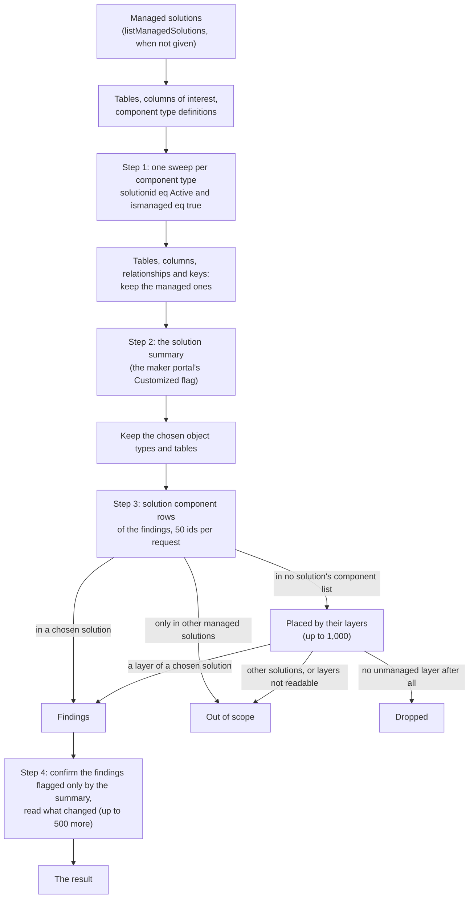

The progress line under the title says which step is running:

| Progress message | Progress | Step |
| --- | --- | --- |
| Reading tables… | 2% | The first reads ([6.2](#62-step-1-one-sweep-per-component-type)) |
| Checking component types (*n* of *N*)… | 5% to 50% | Step 1, the sweeps |
| Checking tables, columns and relationships… | 52% | Matching the metadata rows, when the sweeps found any ([6.3](#63-tables-columns-relationships-and-keys)) |
| Checking other customized components… | 58% | Step 2, the solution summary ([6.4](#64-step-2-the-solution-summary)) |
| Finding which solutions the components are in…, then the same with (*n* of *N*) | 62% to 64% | Step 3, membership ([6.6](#66-step-3-which-managed-solutions-hold-each-component)) |
| Checking the remaining components (*n* of *N*)… | 64% to 69% | Components placed by their layers ([6.7](#67-components-placed-by-their-layers)) |
| Reading what changed (*n* of *N*)… | 70% to 99% | Step 4, the details ([6.8](#68-step-4-confirming-and-reading-the-details)) |
| The result's status line | 100% | The end (`statusLine`, [6.9](#69-complete-or-incomplete)) |

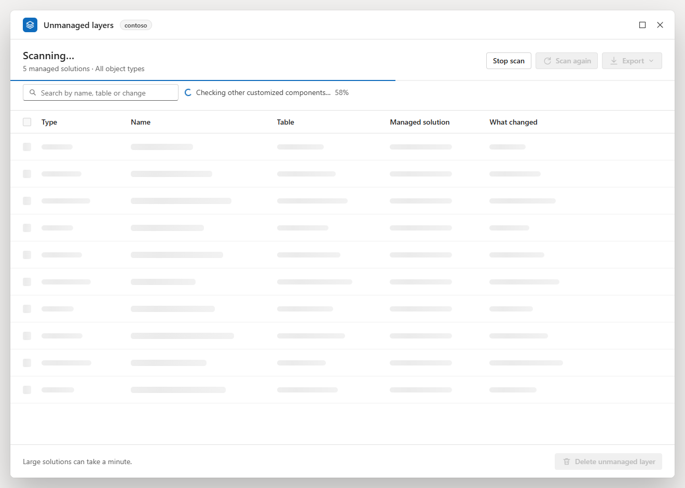

*A scan of five managed solutions during step 2: before it reads the solution summary, `scan` has called
`progress('Checking other customized components…', 58)`. Placeholder rows of the final size keep the grid from jumping
when the results arrive. **Stop scan** calls `stopAllReads` ([5.5](#55-stop)).*

### 6.1 Inputs and the result object

`layer-scanner.js`, `scan`:

```js
// solutions: the managed solutions chosen ({ id, unique, name }); allSolutions: every managed solution (read when not given)
// objectTypes: object type groups to check (see GROUPS); empty or null: all of them.
// tables: logical names of the tables whose components are checked; empty or null: all (and components without a table).
async function scan(solutions, progress = () => {}, { details = true, allSolutions = null, objectTypes = null, tables: onlyTables = null } = {}) {
```

| Input | Meaning |
| --- | --- |
| `solutions` | The managed solutions chosen, as `{ id, unique, name }`. The window always passes at least one. |
| `progress(message, percent)` | Called at each step. The window shows the message and moves the progress bar. |
| `details` | Whether the details of the findings (what each unmanaged layer changes) are read for up to 500 of them during the scan. Default `true`. The findings flagged only by the solution summary are read in any case ([6.8](#68-step-4-confirming-and-reading-the-details)). |
| `allSolutions` | Every managed solution of the environment, as `listManagedSolutions` returns them. Read when not given. |
| `objectTypes` | The object type groups chosen, such as `['Forms', 'Views']` (the names in `GROUPS`). Empty or `null`: all of them. |
| `tables` | The logical names of the tables chosen, such as `['contoso_project']`. Empty or `null`: every table, and the components that belong to no table. |

The window calls it from `runScan` ([5.5](#55-stop)) with the solutions, object types and tables of the choice
screen, and the managed solution list it read when it opened:

```js
try { result = await scan(sols, progress, { allSolutions, objectTypes: types, tables }) }
```

Scripts on the page can call `scan`, `listManagedSolutions` and the scanner's other functions too, through the
object the scanner leaves on `window` ([4.6](#46-the-test-hooks-on-window__layerscanner)).

`listManagedSolutions` reads every managed solution, the hidden ones included: Microsoft's base solutions (System and
others) are hidden, and many standard tables, forms and views belong only to them.

```text
solutions?$select=solutionid,uniquename,friendlyname,version,installedon,isvisible&$filter=ismanaged eq true&$expand=publisherid($select=friendlyname,customizationprefix)
```

**The result.** `scan` returns one object. The **Full details (JSON)** export ([11.3](#113-full-details-json)) writes it out,
without `solutionNames` and `environment` (a short list of the components counted in `environmentFindings`).

| Field | Holds |
| --- | --- |
| `org`, `url` | The environment's name (the first part of its address, such as `contoso`) and its address. |
| `scannedOn`, `seconds`, `requests` | When the scan ran (UTC, ISO 8601), how long it took in seconds and how many requests it sent ([5.1](#51-one-function-for-every-request)). |
| `solutions`, `types`, `tables` | What was chosen: unique names of the solutions; object type groups (`null`: all); table logical names (`null`: all). |
| `findings` | The components with an unmanaged layer on top, in the chosen solutions, sorted by type and then by name. |
| `typesFailed` | The parts that could not be read. Not empty: the scan is INCOMPLETE ([6.9](#69-complete-or-incomplete)). |
| `noAccess` | Component types the user's security role cannot read, as `{ type, kind, privilege }`, with `quiet: true` for the image configurations refused with 0x80040256 (`QUIET_NO_ACCESS`). Shown as "Not checked", not as incomplete; the quiet ones are not shown, only kept in the JSON export. |
| `warnings` | Messages shown as a neutral banner above the grid. No step of this version adds one. |
| `notes` | Information only, such as the number of internal rows without a definition ([6.3](#63-tables-columns-relationships-and-keys)). In the JSON export only. |
| `cleared` | Components that looked layered but whose layers show no unmanaged layer on top of a managed one, as "type name". Not listed. |
| `outOfScope` | Components with an unmanaged layer that are in other managed solutions only (with those solutions in `inSolutions`, or their managed layers in `layers` for those placed by their layers), or that could not be placed (`error`, `notChecked`). Not listed; in the JSON export. |
| `environmentFindings` | How many components with an unmanaged layer were found in the environment, of the object types and tables chosen, in any solution: counted before the solutions were applied and before the summary-only ones were confirmed. |
| `typesChecked`, `typesWithoutColumns` | How many component types were swept, and the type numbers whose table is missing or has no `ismanaged` or `solutionid` column, so that they could not be swept and are left to the solution summary ([6.2](#62-step-1-one-sweep-per-component-type)). |
| `solutionNames` | A map from a solution's unique name to its display name, for the details. Not exported. |

**A finding.** Each entry of `findings` is one component, the object named `f` throughout the code. The scan fills
most of its fields, `readDetails` ([6.8](#68-step-4-confirming-and-reading-the-details)) the ones about its layers, and the window `deleted`; [4.5](#45-state-and-globals) lists every field and
the step that sets it.

### 6.2 Step 1: one sweep per component type

**The first reads.** Three requests run together (`Promise.all`): the tables, the columns that matter for the sweeps,
and the component type definitions (used for the types that are not in the built-in list). With the environment's
address as base (`https://contoso.crm.dynamics.com/api/data/v9.2/`), they are:

```text
EntityDefinitions?$select=LogicalName,SchemaName,DisplayName,MetadataId,EntitySetName,PrimaryIdAttribute,PrimaryNameAttribute

EntityDefinitions?$select=LogicalName&$expand=Attributes($select=LogicalName;$filter=LogicalName eq 'ismanaged' or LogicalName eq 'solutionid' or LogicalName eq 'name' or LogicalName eq 'displayname' or LogicalName eq 'title' or LogicalName eq 'typename' or LogicalName eq 'sitemapname' or LogicalName eq 'sitemapnameunique' or LogicalName eq 'displaystringkey' or LogicalName eq 'category' or LogicalName eq 'type' or LogicalName eq 'querytype' or LogicalName eq 'uniquename' or LogicalName eq 'schemaname' or LogicalName eq 'connectionreferencelogicalname')

solutioncomponentdefinitions?$select=solutioncomponenttype,name,primaryentityname
```

The second one returns, for every table, only the columns in `WANTED_COLUMNS` that it has. The sweeps use it to know
whether a table can be asked for its unmanaged rows (it needs `solutionid` and `ismanaged`) and which name columns it
has. These three reads, and the managed solution list when it is not given, are the only reads whose failure ends the
scan as a whole: without them, nothing else can be read.

**Component types come from two places.**

| Source | Types | Gives |
| --- | --- | --- |
| `CLASSIC`, built in ([4.4](#44-constant-tables-classic-names-metadata-groups-and-others)) | 49 classic types, from 1 (table) to 432 (table image configuration). | For each: the table behind it, the name the layer table uses, and the label the maker portal shows. |
| `solutioncomponentdefinitions` | The newer ("solution component framework") types, such as connection references. | `name`: the layer name; `primaryentityname`: the table. The label is the table's display name in sentence case ("Connection Reference" becomes "Connection reference"). |

`layer-scanner.js`, `scan`:

```js
const types = new Map(Object.entries(CLASSIC).map(([k, v]) => [Number(k), { table: v[0], kind: v[1], label: v[2] }]))
const kindOf = new Map([...types.entries()].map(([k, v]) => [k, v.kind]))
for (const d of defs) {
  if (!kindOf.has(d.solutioncomponenttype)) kindOf.set(d.solutioncomponenttype, d.name)
  if (!types.has(d.solutioncomponenttype) && d.primaryentityname) {
    const t = tables.get(d.primaryentityname)
    types.set(d.solutioncomponenttype, { table: d.primaryentityname, kind: d.name, label: sentence((t && label(t.DisplayName)) || d.name) })
  }
}
```

Every type number gets a layer name in `kindOf`, also the newer types without a table. Only the types with a table
(`ty.table`) can be swept. `typeLabel` turns a type number, and for processes, forms and views their kind, into the
label the grid shows (`WORKFLOW_TYPE`, `FORM_TYPE`, `VIEW_TYPE`).

**The sweep.** For each type that has a table, of the object types and tables chosen, one query asks for the
components whose top layer is unmanaged:

`layer-scanner.js`, `scan`:

```js
// 1. One sweep per component type.
const found = new Map(), metaRows = [], noColumns = []
let done = 0
const typeList = [...types.entries()].filter(([code, ty]) => ty.table && typeWanted(code, ty.kind, groups) && (!tableSet || TABLE_BOUND.has(code)))
await pool(typeList, CONFIG.concurrency, async ([code, ty]) => {
  try {
    if (METADATA[code]) {
      const [set, pk, nm] = METADATA[code]
      for (const r of await getAll(`${set}?$select=${pk},${nm}&$filter=solutionid eq ${ACTIVE}`)) metaRows.push({ code, id: lc(r[pk]), name: r[nm] })
    } else {
      const t = tables.get(ty.table), c = cols.get(ty.table)
      if (!t || !t.EntitySetName || !c || !c.has('solutionid') || !c.has('ismanaged')) { noColumns.push(code); return }
      const has = (col) => col && (c.has(col) || col === t.PrimaryNameAttribute)
      const [dCol0, sCol0] = NAMES[code] || [t.PrimaryNameAttribute, SCHEMA_GUESS.find((x) => c.has(x)) || null]
      const dCol = has(dCol0) ? dCol0 : t.PrimaryNameAttribute, sCol = has(sCol0) ? sCol0 : null
      const tCol = TABLE_COLUMN[code], subCol = has(SUBTYPE_COLUMN[code]) ? SUBTYPE_COLUMN[code] : null
      const sel = [...new Set([t.PrimaryIdAttribute, dCol, sCol, tCol, subCol].filter(Boolean))].join(',')
      const extra = TYPE_FILTER[code] ? ` and ${TYPE_FILTER[code]}` : ''
      for (const r of await getAll(`${t.EntitySetName}?$select=${sel}&$filter=solutionid eq ${ACTIVE} and ismanaged eq true${extra}`)) {
        const id = lc(r[t.PrimaryIdAttribute])
        const table = tCol && r[tCol] && r[tCol] !== 'none' ? r[tCol] : ''
        const sub = subCol ? r[subCol] : null
        found.set(`${code}|${id}`, { key: `${code}|${id}`, code, kind: ty.kind, id, display: (dCol && r[dCol]) || '', schema: (sCol && r[sCol]) || '', logical: (sCol && r[sCol]) || (dCol && r[dCol]) || '', table,
          type: code === 60 && !table && sub === 0 ? 'Dashboard' : typeLabel(code, sub) })
      }
    }
  } catch (e) {
    if (e instanceof SessionError) throw e
    // A type the user's security role cannot read: not an error, but said. The image configurations refused with
    // Dataverse's own security error (see QUIET_NO_ACCESS) are skipped without a note.
    const priv = e.status === 403 && /CheckPrivilege/i.test(e.message) && /prv\w+/.exec(e.message)
    if (priv) noAccess.push({ type: ty.label, kind: ty.kind, privilege: priv[0], ...(QUIET_NO_ACCESS.has(ty.kind) && /^0x80040256$/i.test(e.code || '') ? { quiet: true } : {}) })
    else failed.push(`${ty.kind}: ${e.message}`)
  }
  progress(`Checking component types (${++done} of ${typeList.length})…`, 5 + 45 * done / typeList.length)
})
```

Tables, columns, relationships and keys are swept differently, through `METADATA` ([6.3](#63-tables-columns-relationships-and-keys)).
For every other type the query is:

```text
{entity set}?$select={id},{display name},{schema name},{table},{kind}&$filter=solutionid eq fd140aae-4df4-11dd-bd17-0019b9312238 and ismanaged eq true[ and {type filter}]
```

For example, for web resources and for processes:

```text
webresourceset?$select=webresourceid,displayname,name&$filter=solutionid eq fd140aae-4df4-11dd-bd17-0019b9312238 and ismanaged eq true

workflows?$select=workflowid,name,uniquename,primaryentity,category&$filter=solutionid eq fd140aae-4df4-11dd-bd17-0019b9312238 and ismanaged eq true and type eq 1
```

`fd140aae-4df4-11dd-bd17-0019b9312238` is the Active solution (`ACTIVE`), the unmanaged layer, with the same id in
every environment.

**Why one query per type finds them.** A managed component keeps `ismanaged` true. When its top layer is unmanaged,
its `solutionid` names the Active solution instead of the managed solution it came from. The query therefore returns
exactly the managed components with an unmanaged layer on top, and nothing else: an unmanaged-only component has
`ismanaged` false. This was checked against a read of the layers of every component of a test environment, one by
one (83,000 components): the same 135 components, with no false positives. On a managed test solution with 17 layered
components of 13 types, the scan found all 17.

**The columns of each query** are chosen at run time from the columns the table has:

| Constant | For | Holds |
| --- | --- | --- |
| `NAMES` | Types whose names are not in the primary name column | `[display name column, schema or unique name column]`, such as `['displayname', 'name']` for web resources. Other types use the table's primary name. |
| `SCHEMA_GUESS` | Types not in `NAMES` (mostly the newer types) | The schema name column, the first of `uniquename`, `schemaname` and `connectionreferencelogicalname` that the table has. |
| `TABLE_COLUMN` | Forms, views, charts, processes, ribbons | The column that names the component's table, such as `objecttypecode` for forms. `none` means no table. |
| `SUBTYPE_COLUMN` | Processes, forms, views | The column that holds the kind (`category`, `type`, `querytype`), turned into a label by `WORKFLOW_TYPE`, `FORM_TYPE` and `VIEW_TYPE`. |
| `TYPE_FILTER` | Security roles, processes | An extra condition (below). |

`layer-scanner.js`, `TYPE_FILTER`:

```js
// Rows that are not components themselves: business-unit copies of roles, activation copies of classic processes.
const TYPE_FILTER = { 20: '_parentroleid_value eq null', 29: 'type eq 1' }
```

A security role exists once per business unit: the copies in child business units have a parent role and are not
components of their own. A classic process has a definition row (`type` 1) and, while it is activated, an activation
row (`type` 2). Without these conditions, one changed role or process would be listed several times.

**What can go wrong for a type, and what happens.**

| Situation | Result |
| --- | --- |
| The type's table is not in the table list, has no entity set, or has no `solutionid` or `ismanaged` column | The type is not swept, and its number goes into `typesWithoutColumns`. It relies on the solution summary. |
| Answer 403 with `SecLib::CheckPrivilege` (the user's security role cannot read the table) | The type goes into `noAccess` with the privilege named in the message, such as `prvReadAttribute`. Shown as "Not checked", not as incomplete ([6.9](#69-complete-or-incomplete)); the image configurations refused with error 0x80040256 get `quiet: true` and are not shown (`QUIET_NO_ACCESS`). |
| Any other error | `failed` gets "`{kind}`: `{message}`", and the scan is INCOMPLETE. |
| An expired session, or Stop | Passed on: the scan ends ([5.1](#51-one-function-for-every-request)). |

Types that are never swept: choices (global option sets, type 9, which have no table of their own) and newer types
without a primary table. They are covered by the solution summary.

### 6.3 Tables, columns, relationships and keys

Tables, columns, relationships and keys have component tables of their own, but those tables have no `ismanaged`
column, so the sweep cannot tell a managed column from an unmanaged one. The sweep reads the rows whose top layer is
unmanaged, and the definitions (the metadata) say which are managed.

`layer-scanner.js`, `METADATA`:

```js
// Tables, columns, relationships and keys have their own component tables without an ismanaged column.
// Relationships carry their own ids there, so they are matched to their definitions by schema name.
const METADATA = { 1: ['entities', 'entityid', 'logicalname'], 2: ['attributes', 'attributeid', 'logicalname'], 10: ['relationships', 'relationshipid', 'name'], 14: ['entitykeys', 'entitykeyid', 'logicalname'] }
```

| Type | Swept with | Matched to its definition by |
| --- | --- | --- |
| Table (1) | `entities?$select=entityid,logicalname&$filter=solutionid eq fd140aae-4df4-11dd-bd17-0019b9312238` | Id: `entityid` is the table's metadata id. |
| Column (2) | `attributes?$select=attributeid,logicalname&$filter=solutionid eq fd140aae-…` | Id: `attributeid` is the column's metadata id. |
| Relationship (10) | `relationships?$select=relationshipid,name&$filter=solutionid eq fd140aae-…` | Schema name: `relationshipid` is an id of its own. |
| Key (14) | `entitykeys?$select=entitykeyid,logicalname&$filter=solutionid eq fd140aae-…` | Id: `entitykeyid` is the key's metadata id. |

**The definitions.** This step runs only when the sweeps found at least one such row. The tables, columns and keys are
read 100 tables per request, two requests at a time (`pool`). With tables chosen, only the chosen tables are read. One request, for 100 tables, looks like this:

```text
EntityDefinitions?$select=LogicalName,MetadataId,IsManaged&$filter=LogicalName eq 'account' or LogicalName eq 'contact' or … or LogicalName eq 'contoso_project'&$expand=Attributes($select=MetadataId,IsManaged,SchemaName,DisplayName),Keys($select=MetadataId,IsManaged,SchemaName,DisplayName)
```

The relationship definitions are read whole, in three requests:

```text
RelationshipDefinitions?$select=MetadataId,SchemaName,IsManaged
RelationshipDefinitions/Microsoft.Dynamics.CRM.OneToManyRelationshipMetadata?$select=MetadataId,ReferencedEntity,ReferencingEntity
RelationshipDefinitions/Microsoft.Dynamics.CRM.ManyToManyRelationshipMetadata?$select=MetadataId,Entity1LogicalName,Entity2LogicalName
```

**Matching.** Each row the sweep found is matched to its definition, and only the managed ones are kept:

`layer-scanner.js`, `scan`:

```js
const internal = [], unknown = []
for (const m of metaRows) {
  let id = m.id, isManaged = managed.get(id), extra = {}
  // A relationship's own settings (cascading) are layered on its "Relationship" component, whose id is the
  // relationships-table id; its definition ("EntityRelationship") uses the metadata id. Both are checked.
  if (m.code === 10) { const r = relByName.get(lc(m.name)); if (r) { id = lc(r.MetadataId); isManaged = r.IsManaged; extra = { alt: [{ id: m.id, kind: 'Relationship' }], tables: relTables.get(id) || [], schemaName: r.SchemaName } } }
  if (isManaged === undefined) {   // no definition found
    if (tableSet && m.code !== 10) continue   // a table that was not chosen (only the chosen tables were read)
    // Known internal rows: hidden "...dsc" columns, and the two internal halves ("One"/"Two") of a many-to-many relationship.
    const half = m.code === 10 && /(One|Two)$/.test(m.name) && relByName.has(lc(m.name.replace(/(One|Two)$/, '')))
    ;(m.code === 2 && /dsc$/i.test(m.name) || half ? internal : unknown).push(`${types.get(m.code).label} ${m.name}`)
    continue
  }
  if (isManaged !== true) continue   // unmanaged-only components are not layers on managed solutions
  const nm = names.get(id) || {}
  const table = m.code === 1 ? '' : m.code === 10 ? (extra.tables || [])[0] || '' : tableOf.get(id) || ''
  found.set(`${m.code}|${id}`, { key: `${m.code}|${id}`, code: m.code, kind: types.get(m.code).kind, type: types.get(m.code).label, id,
    display: nm.display || '', schema: extra.schemaName || nm.schema || m.name, logical: m.name, table, ...extra })
}
if (internal.length) notes.push(`${internal.length} internal rows (hidden ...dsc columns, internal halves of many-to-many relationships) have no definition and are not listed.`)
if (unknown.length) failed.push(`${unknown.length} table, column, relationship or key rows with an unmanaged top layer have no matching definition: ${unknown.slice(0, 20).join(', ')}${unknown.length > 20 ? ', ...' : ''}`)
```

| The row's definition | What happens |
| --- | --- |
| Found, `IsManaged` true | A finding. A column or key gets its table; a relationship gets its first table (the referencing table of a one-to-many relationship, the first table of a many-to-many one) and both in `tables`. |
| Found, `IsManaged` false | Not listed: an unmanaged-only component is not a layer on a managed solution. |
| Not found, with tables chosen (not a relationship) | Skipped: the row belongs to a table that was not chosen, whose definitions were not read. |
| Not found: a hidden "...dsc" column, or the internal "One" or "Two" half of a many-to-many relationship | An internal row. Counted in `notes`, not listed. In a large test environment there were 344 of them (332 columns such as `owneriddsc`, 12 halves). |
| Not found, anything else | Counted, and the first 20 named, in `failed`: the scan is INCOMPLETE. |
| The step fails | `failed` gets "Tables, columns and relationships: `{message}`". |

**A relationship has two places.** Its definition and its own settings are layered separately, under different names
and ids:

| Place | Layer name | Id | Holds |
| --- | --- | --- | --- |
| The definition | `EntityRelationship` | The metadata id (from `RelationshipDefinitions`) | The relationship's definition. |
| The settings | `Relationship` | The `relationships` table's own id (`relationshipid`) | Its own settings, such as cascading: what happens to related records when a record is deleted, assigned or shared. |

The finding uses the metadata id as `id` and `EntityRelationship` as `kind`, and keeps the second place in `alt`:
`[{ id: relationshipid, kind: 'Relationship' }]`. `places(f)` returns both. Reading the layers, deleting and the links
all look at both places. Reading a relationship's layers the way Solution Layers Explorer does returns nothing; reading
both places by their layer names finds them.

### 6.4 Step 2: the solution summary

Some types cannot be swept: choices (global option sets), newer types without a table, and types whose table has no
`solutionid` or `ismanaged` column. For those, the scanner reads the maker portal's "Customized" flag, from the
virtual table `msdyn_solutioncomponentsummaries`, for the Default solution, which holds every component:

`layer-scanner.js`, `scan`:

```js
try {
  const summaryRows = await getAll(`msdyn_solutioncomponentsummaries?$filter=(msdyn_solutionid eq ${DEFAULT}) and (msdyn_hasactivecustomization eq 'true') and (msdyn_ismanaged eq 'true')&$select=msdyn_componenttype,msdyn_componenttypename,msdyn_objectid,msdyn_name,msdyn_displayname,msdyn_primaryentityname`)
  for (const s of summaryRows) {
    const code = Math.round(Number(s.msdyn_componenttype)), id = lc(s.msdyn_objectid), key = `${code}|${id}`
    if (found.has(key)) continue
    const table = s.msdyn_primaryentityname && s.msdyn_primaryentityname !== 'none' ? s.msdyn_primaryentityname : ''
    found.set(key, { key, code, kind: kindOf.get(code) || s.msdyn_componenttypename, kindGuessed: !kindOf.has(code), type: typeLabel(code, null), id,
      display: s.msdyn_displayname || '', schema: s.msdyn_name || '', logical: s.msdyn_name, table, fromSummary: true })
  }
  const summaryKinds = new Set([1, 26, 29, 60, 61, 80, 62, 20])   // types the summary flags whenever they are customized
  let broken = !summaryRows.length && [...found.values()].some((f) => summaryKinds.has(f.code))
  if (!summaryRows.length && !broken) {   // nothing customized at all, or a summary that answers nothing: it always lists the Default solution's tables
    const probe = await read(`msdyn_solutioncomponentsummaries?$filter=(msdyn_solutionid eq ${DEFAULT}) and (msdyn_componenttype eq 1)&$select=msdyn_objectid&$top=1`)
    broken = !(probe && Array.isArray(probe.value) && probe.value.length)
  }
  if (broken) failed.push('Solution summary: it returned nothing although it should list the customized components, so global option sets and other types without a table were not checked')
```

```text
msdyn_solutioncomponentsummaries?$filter=(msdyn_solutionid eq fd140aaf-4df4-11dd-bd17-0019b9312238) and (msdyn_hasactivecustomization eq 'true') and (msdyn_ismanaged eq 'true')&$select=msdyn_componenttype,msdyn_componenttypename,msdyn_objectid,msdyn_name,msdyn_displayname,msdyn_primaryentityname
```

* `fd140aaf-4df4-11dd-bd17-0019b9312238` is the Default solution (`DEFAULT`).
* The two flags are compared as text, `eq 'true'`: `msdyn_hasactivecustomization` filters only that way, and
  `msdyn_hasactivecustomization eq true` returns error `0x80060888`.
* A row the sweeps already found is skipped. Every other row becomes a finding with `fromSummary: true`. Its layer
  name comes from `kindOf`; when the type number is unknown, the summary's type name is used instead (`kindGuessed`),
  and the type is shown as "Type *number*".

**An empty summary.** The summary is a virtual table and might return nothing in an environment where it does not
work. An empty answer is therefore checked:

* If the sweeps found a component of a type the summary always flags when it is customized (tables, views, processes,
  forms, web resources, apps, site maps, security roles), the empty summary is wrong.
* If they found none, one more request asks the summary for a single table of the Default solution, which always has
  tables. No answer means the summary does not work:

```text
msdyn_solutioncomponentsummaries?$filter=(msdyn_solutionid eq fd140aaf-4df4-11dd-bd17-0019b9312238) and (msdyn_componenttype eq 1)&$select=msdyn_objectid&$top=1
```

Either way, `failed` gets "Solution summary: it returned nothing although it should list the customized components,
so global option sets and other types without a table were not checked", and the scan is INCOMPLETE.

**Forms and processes found only by the summary.** The summary does not say which kind of form or process a component
is, and the kind decides its type label and its object type group (a business rule and a cloud flow are both
processes). Each one's kind is read, one at a time:

```text
systemforms({id})?$select=type,objecttypecode
workflows({id})?$select=category,primaryentity
```

The answer gives the kind, and the table when the summary named none; `typeLabel` then gives the label (*Main form*,
*Cloud flow*). A form or process on a table that was not chosen is skipped. A failed read leaves the component with the
label of its type number (*Form*, *Process*); only an expired session or Stop end the scan.

**What the summary cannot do.**

* It cannot be narrowed to the chosen tables: a filter on `msdyn_primaryentityname` is ignored (the same rows come
  back). Rows on other tables are dropped afterwards ([6.5](#65-object-types-and-tables)).
* It flags a table when only one of its parts, such as a form, is customized. A table flagged only by the summary
  might have no unmanaged layer of its own, so step 4 reads its layers before it is listed
  ([6.8](#68-step-4-confirming-and-reading-the-details)).
* It does not cover the types the user's security role cannot read: a summary filter on their type numbers returns
  HTTP 400.

**When it fails.** `failed` gets "Solution summary (global option sets and types without a table): `{message}`". The
summary is one of the slowest queries of the scan (about 4 seconds in a large test environment); when Dataverse answers
500 or 504 it is tried once more, and when no full answer comes within 5 minutes it is not
([5.4](#54-retries-throttling-and-the-read-time-limit)).

### 6.5 Object types and tables

The choice screen can narrow a scan in two ways: to some **object types** (as the maker portal groups them in a
solution's Objects list) and to some **tables**. Both make the scan faster, because fewer component types are swept.

`layer-scanner.js`, `groupOf` and `typeWanted`:

```js
const isConnRef = (kind) => /^connectionreference$/i.test(kind || '')
function groupOf(f) {
  if (f.code === 60) return /dashboard/i.test(f.type) ? 'Dashboards' : 'Forms'
  if (f.code === 29) return f.type === 'Business rule' ? 'Business rules' : f.type === 'Cloud flow' ? 'Cloud flows' : 'Other processes'
  if (isConnRef(f.kind)) return 'Connection references'
  return CODE_GROUP[f.code] || 'Other'
}
// Whether a component type has to be read for the chosen groups (null: all groups).
function typeWanted(code, kind, groups) {
  if (!groups) return true
  if (code === 60) return groups.has('Forms') || groups.has('Dashboards')
  if (code === 29) return groups.has('Business rules') || groups.has('Cloud flows') || groups.has('Other processes')
  if (isConnRef(kind)) return groups.has('Connection references')
  return groups.has(CODE_GROUP[code] || 'Other')
}
```

* `typeWanted` decides, before step 1, which component types are swept. Forms and processes are read when any of
  their groups is chosen (*Forms* or *Dashboards*; *Business rules*, *Cloud flows* or *Other processes*), because the
  kind is only known row by row.
* `groupOf` decides, after step 2, which group each finding belongs to, from its kind: an interactive dashboard is in
  *Dashboards*, a cloud flow in *Cloud flows*. A connection reference is recognized by its layer name, because it is a
  newer type whose number is not built in.

**Tables.** With tables chosen, only the types that can belong to a table are swept, and only the components of the
chosen tables are kept:

`layer-scanner.js`, `TABLE_PARTS` and `TABLE_BOUND`:

```js
// Parts of a table: in a solution that holds the table "with all objects", these belong to it without rows of their own.
const TABLE_PARTS = new Set([2, 10, 14, 26, 59, 60])
// Types that belong to a table: tables, columns, relationships, keys, views, processes, ribbons, charts, forms.
const TABLE_BOUND = new Set([1, 2, 10, 14, 26, 29, 50, 59, 60])
```

`layer-scanner.js`, `scan`:

```js
const inTables = (f) => TABLE_BOUND.has(f.code) && (f.code === 1 ? tableSet.has(lc(f.logical)) : [f.table, ...(f.tables || [])].some((t) => t && tableSet.has(lc(t))))
```

A table is kept when it is one of the chosen tables; any other table-bound component when its table, or for a
relationship either of its tables, is one of them. The components that belong to no table (choices, web resources,
security roles, apps and others) are left out entirely; the choice screen says so before anything is chosen.

After step 2, the findings outside the choice are dropped:

`layer-scanner.js`, `scan`:

```js
// Only the chosen object types.
if (groups) for (const [k, f] of found) if (!groups.has(groupOf(f))) found.delete(k)
// Only the components of the chosen tables.
if (tableSet) for (const [k, f] of found) if (!inTables(f)) found.delete(k)
```

| Stage | Object types chosen | Tables chosen |
| --- | --- | --- |
| Step 1, the sweeps | Only the types `typeWanted` accepts. | Only the types in `TABLE_BOUND`. |
| Matching tables, columns and keys | No change. | Only the chosen tables' definitions are read. |
| Step 2, the summary | Read whole (it cannot be narrowed). | Read whole; the kind of a form or process is read only when it is on a chosen table or the summary names no table for it. |
| After step 2 | Findings of other groups are dropped. | Findings of other tables are dropped. |
| Step 3 onwards | Only the findings left are placed and read. | The same. |

In a test, one table of a small managed solution was scanned in about 9 seconds with 32 requests, against
15 to 25 seconds and about 310 to 330 requests with every table.

### 6.6 Step 3: which managed solutions hold each component

The findings so far are every layered component of the environment, of the types and tables chosen. Step 3 keeps
those in the chosen managed solutions. It does not read the component lists of the chosen solutions, which can be
very long (Microsoft's System solution holds most of the standard tables, with all their parts). It reads the solution
component rows of the findings themselves, by id, in requests like this one:

```text
solutioncomponents?$select=objectid,componenttype,rootcomponentbehavior,_solutionid_value&$filter=Microsoft.Dynamics.CRM.In(PropertyName='objectid',PropertyValues=['{id 1}','{id 2}',…,'{id 50}'])
```

* The ids are those of the findings, the second place of each relationship (`alt`), and the tables that the parts
  are on (`tablesOf`, below). Only GUIDs go into the address.
* Fifty ids per request keep the address at about 2,500 characters. The requests run one after the other.
* Rows in solutions that are not managed (the Default solution, the Active solution and every unmanaged solution) are
  ignored. The others are kept in `rowsOf`, by component id, as `{ sol, type, behavior }`.
* Reading by id gives the same membership as reading each solution's whole component list. This was cross-checked on
  seven solutions, System included.

**Parts of a table held "with all objects".** A solution can hold a table with all its parts, without a row for each
part. `rootcomponentbehavior` on the table's row says how it is held, and only 0, *Include subcomponents*, brings the
table's parts with it ([3.7](#37-solution-components-and-with-all-objects) has the three values).

`layer-scanner.js`, `scan`:

```js
const solsOf = (f) => {
  const s = new Set()
  for (const id of [f.id, ...(f.alt ? [f.alt[0].id] : [])]) for (const r of rowsOf.get(id) || []) s.add(r.sol)
  f.listedIn = [...s]   // solutions whose component list has it (the maker portal opens it in those)
  // A table held "with all objects" brings its columns, forms, views, charts, keys and relationships.
  for (const t of tablesOf(f)) for (const r of rowsOf.get(tableId.get(t)) || []) if (r.type === 1 && r.behavior === 0) s.add(r.sol)
  return [...s]
}
// ...
for (const f of found.values()) {
  f.tableLabel = f.table ? tableLabel(f.table) : ''
  f.tableId = f.code === 1 ? f.id : tableId.get(f.table) || ''   // for the maker portal link
  const all = solsOf(f), chosen = all.filter((x) => chosenIds.has(x))
  if (chosen.length) { f.solutions = names(chosen); f.solutionIds = sortIds(chosen); f.linkSolution = sortIds(chosen.filter((x) => f.listedIn.includes(x)))[0] || f.solutionIds[0]; inScope.push(f) }
  else if (all.length) oos(f, { inSolutions: names(all) })
  else noRow.push(f)
}
```

* `tablesOf` gives the tables of a part: columns, relationships (both tables), keys, views, charts and forms
  (`TABLE_PARTS`). Business rules and other processes, ribbons and the tables themselves need a row of their own.
* `solsOf` gives every managed solution that holds the component: those with a row for it (`listedIn`), and those
  that hold one of its tables with `componenttype` 1 and `rootcomponentbehavior` 0.
* `linkSolution` is the chosen solution its links open in: the first by name among the chosen solutions that list it,
  otherwise the first chosen solution that holds its table ([7.2](#72-which-solution-goes-in-the-address)).

| The component is held by | Result |
| --- | --- |
| At least one chosen solution | A finding, with `solutions` (the names, for the grid), `solutionIds` and `linkSolution`. |
| Only managed solutions that were not chosen | `outOfScope`, with `inSolutions`. Not listed. |
| No managed solution's component list | `noRow`: placed by its layers ([6.7](#67-components-placed-by-their-layers)). |

When this step fails, `failed` gets "Solutions of the components: `{message}`". The components whose rows were not read
then go to `noRow`, and their layers place them.

### 6.7 Components placed by their layers

A few parts of standard tables are in a managed solution without a row of their own in any component list. In a large
test environment there were 12: hidden name columns such as `RegardingObjectIdYomiName`, two display strings and a
view, all in System. For these, the managed layers say which solutions they are in: a layer's
`msdyn_solutionname` is the unique name of its solution.

`layer-scanner.js`, `scan`:

```js
const toCheck = noRow.slice(0, CONFIG.layerCheckLimit), notPlaced = []
const someOf = (list) => list.slice(0, 20).map((f) => `${f.type} ${f.schema || f.display || f.id}`).join(', ') + (list.length > 20 ? ', ...' : '')
if (noRow.length > toCheck.length) failed.push(`Solutions of ${noRow.length - toCheck.length} components with an unmanaged layer that are in no solution's component list: there are more than ${CONFIG.layerCheckLimit.toLocaleString()}, so they were not checked: ${someOf(noRow.slice(CONFIG.layerCheckLimit))}`)
let checked = 0
await pool(toCheck, CONFIG.detailConcurrency, async (f) => {
  try {
    const managedUnique = await readDetails(f, allNames)
    const chosen = allSolutions.filter((s) => chosenIds.has(s.id) && managedUnique.includes(s.unique)).map((s) => s.id)
    if (chosen.length) { f.solutions = names(chosen); f.solutionIds = sortIds(chosen); f.placedByLayers = true; inScope.push(f) }
    else if (f.noLayer) { /* no unmanaged layer after all */ }
    else if (/could not be read/.test(f.changed || '')) { notPlaced.push(f); oos(f, { error: f.changed }) }
    else oos(f, { layers: f.layers })
  } catch (e) { if (e instanceof SessionError) throw e; notPlaced.push(f); oos(f, { error: e.message }) }
  progress(`Checking the remaining components (${++checked} of ${toCheck.length})…`, 64 + 5 * checked / Math.max(1, toCheck.length))
})
if (notPlaced.length) failed.push(`Solutions of ${notPlaced.length} components with an unmanaged layer: they are in no solution's component list and their layers could not be read, so it is not known whether they are in the chosen solutions: ${someOf(notPlaced)}`)
for (const f of noRow.slice(CONFIG.layerCheckLimit)) oos(f, { notChecked: true })
```

At most 1,000 of them are read (`CONFIG.layerCheckLimit`), three at a time, with `readDetails`
([6.8](#68-step-4-confirming-and-reading-the-details)), which returns the unique names of the managed layers'
solutions when the component has an unmanaged layer on top.

| What the layers show | Result |
| --- | --- |
| An unmanaged layer on top of managed layers, one of them from a chosen solution | A finding, with `placedByLayers: true`. Its links open in the Default solution ([7.2](#72-which-solution-goes-in-the-address)). Its details are already read. |
| An unmanaged layer on top of layers of other solutions only | `outOfScope`, with its managed layers. |
| No unmanaged layer on top of a managed one (`noLayer`) | Dropped. |
| The layers could not be read | `outOfScope` with the error, and `notPlaced`: it might be in a chosen solution. |
| More than 1,000 such components | The rest go to `outOfScope` with `notChecked`. |

The last two make the scan INCOMPLETE ([6.9](#69-complete-or-incomplete)): a component that cannot be placed might
belong in the list.

The findings are then sorted by type, and by name within a type.

### 6.8 Step 4: confirming and reading the details

Step 4 reads the layers of the findings: to confirm the ones flagged only by the solution summary, and to show what
each unmanaged layer changes.

`layer-scanner.js`, `scan`:

```js
// 4. Details: the managed layers underneath and what the unmanaged layer changes. Components flagged only by the
//    solution summary are read first, all of them and whatever the details setting: the summary also flags a table
//    when only one of its parts is customized, so only their own layers say whether they have an unmanaged layer.
//    The other findings' details are read up to autoDetails (the rest on request).
//    More than layerCheckLimit of them: the rest stay "not read yet" (the banner says they aren't confirmed yet).
const unread = result.findings.filter((f) => !f.detailsLoaded)
const confirm = unread.filter((f) => f.fromSummary).slice(0, CONFIG.layerCheckLimit)
const toRead = details ? [...confirm, ...unread.filter((f) => !f.fromSummary).slice(0, CONFIG.autoDetails)] : confirm
if (toRead.length) await loadDetails(result, toRead, progress)
// One whose layers could not be read is not confirmed, so the list might hold it wrongly: the scan is incomplete.
// (A type whose layer name is not known is the exception: it is shown as "Layers could not be read".)
const kept = new Set(result.findings), unconfirmed = confirm.filter((f) => kept.has(f) && !f.kindGuessed && !(f.activeKinds || []).length)
if (unconfirmed.length) failed.push(`${unconfirmed.length} components flagged only by the solution summary could not be confirmed, because their layers could not be read: ${someOf(unconfirmed)}`)
result.seconds = (performance.now() - t0) / 1000
result.requests = requests
progress(statusLine(result), 100)
return result
```

1. **Confirming.** The findings flagged only by the summary are read first, up to 1,000 (`CONFIG.layerCheckLimit`),
   whatever the `details` setting.
2. **Details.** With `details` on (always, in the window), up to 500 other findings are read as well
   (`CONFIG.autoDetails`). The rest stay "not read yet".
3. A finding flagged only by the summary whose layers could not be read is not confirmed and might not belong in the
   list, so the scan is INCOMPLETE. A finding whose layer name is not known (`kindGuessed`) is the exception: it is
   listed with "Layers could not be read".

**Reading one component.** `readDetails` reads the layers of each place of the component (a relationship has two)
with `getLayers`, which checks the id and the name (`placeOk`, [5.2](#52-read-only-by-design)), reads every page and sorts the layers by
`msdyn_order`, top first:

```text
msdyn_componentlayers?$filter=(msdyn_componentid eq '{id}' and msdyn_solutioncomponentname eq 'Attribute')&$select=msdyn_solutionname,msdyn_order,msdyn_name,msdyn_solutioncomponentname,msdyn_changes,msdyn_componentlayerid,msdyn_publishername,msdyn_overwritetime
```

The layer table needs both the component id (in quotes) and the layer name. The layer name is the type's own name,
not its number: email templates are `Template` (not `EmailTemplate`), and newer types use the name from
`solutioncomponentdefinitions`.

`layer-scanner.js`, `readDetails`:

```js
// Reads the layers of one component: the managed layers underneath (top first) and what the unmanaged layer changes.
// Returns the unique names of its managed layers' solutions.
async function readDetails(f, names) {
  let any = false, managedLayers = null, keys = [], readAll = true, sawLayers = false
  const activeKinds = [], layerList = []
  for (const p of places(f)) {
    let layers
    try { layers = await getLayers(p.id, p.kind) } catch (e) { if (e instanceof SessionError) throw e; readAll = false; continue }
    if (layers.length) sawLayers = true
    for (const l of layers) layerList.push({ place: p.kind, order: l.msdyn_order, solution: l.msdyn_solutionname, publisher: l.msdyn_publishername || '', overwrite: l.msdyn_overwritetime || '', name: l.msdyn_name || '', layerId: l.msdyn_componentlayerid || '', changes: changedKeys(l).length })
    const active = layers.find((l) => l.msdyn_solutionname === 'Active')
    if (!managedLayers && layers.some((l) => l.msdyn_solutionname !== 'Active')) managedLayers = layers.filter((l) => l.msdyn_solutionname !== 'Active').map((l) => l.msdyn_solutionname)
    if (active && layers.some((l) => l.msdyn_solutionname !== 'Active')) { any = true; activeKinds.push(p.kind); keys = keys.concat(changedKeys(active)); if (!f.display && !f.schema) f.display = active.msdyn_name || '' }
  }
  f.activeKinds = activeKinds
  f.layerList = layerList
  f.layers = managedLayers ? managedLayers.map((u) => names.get(u) || u).join(' > ') : ''
  f.detailsLoaded = true
  if (any) {
    const extra = keys.filter((k) => !STATE_ONLY.has(k) && !/idunique$/i.test(k))
    f.stateOnly = f.kind === 'Workflow' && extra.length === 0 && keys.some((k) => ['statecode', 'statuscode', 'ownerid', 'owninguser', 'owningteam'].includes(k))
    f.changed = f.stateOnly ? 'Only status or owner' : extra.length ? [...new Set(extra)].slice(0, 10).join(', ') : 'Only system values'
    f.changedKeys = !f.stateOnly && extra.length ? [...new Set(extra)] : undefined   // all of them (What changed shows the first 10)
  } else if (readAll && sawLayers && !f.kindGuessed) f.noLayer = true   // its managed layers were read and none is unmanaged: not a finding
  else f.changed = sawLayers || !readAll ? 'Layers could not be read' : `Layers could not be read (no layers under the name ${f.kind})`
  return any ? managedLayers || [] : []
}
```

* `activeKinds`: the places where an Active layer sits on a managed layer. A place with only an Active layer is an
  unmanaged-only component and does not count.
* `layers`: the managed layers underneath, top first, by solution name ("Contoso Core > System"). The grid shows them
  when the pointer rests on the managed solution.
* `layerList`: every layer of every place, with its order, solution, publisher, overwrite time and number of changed
  properties, for the **All layers (CSV)** export.
* `changed` and `changedKeys`: the properties the unmanaged layer changes, from its `msdyn_changes`. The status, the
  owner and the values Dataverse sets itself are left out (`STATE_ONLY`, and names ending in `idunique`).

`layer-scanner.js`, `STATE_ONLY`:

```js
// A process layer holding only these properties was just switched on or off, or given a new owner.
const STATE_ONLY = new Set(['statecode', 'statuscode', 'ownerid', 'owninguser', 'owningteam', 'owningbusinessunit', 'modifiedon', 'modifiedby',
  'modifiedonbehalfby', 'versionnumber', 'componentstate', 'overwritetime', 'solutionid', 'supportingsolutionid', 'ismanaged', 'workflowid', 'workflowidunique'])
```

| What changed shows | When |
| --- | --- |
| The property names, such as `displayname`, `requiredlevel` | The unmanaged layer changes these properties. `changedKeys` holds all of them; the grid shows as many as fit. |
| Only status or owner | A process whose unmanaged layer changes only its status (on or off) or its owner, and values Dataverse sets itself. |
| Only system values | The unmanaged layer changes only values Dataverse sets itself, such as `modifiedon` (for a component that is not a process, also when it changes only its status or owner), or no property at all. |
| Layers could not be read | A place could not be read, or the layers did not show an unmanaged layer on a managed one and the layer name is not known for sure. |
| Layers could not be read (no layers under the name *X*) | Every place was read and none returned a layer: the layer name is probably not the one Dataverse uses for this type. |
| Not read yet | The details have not been read (the window shows this for findings without `detailsLoaded`). |

A finding whose layers were all read, with at least one layer and no unmanaged layer on top of a managed one, gets
`noLayer` and is dropped, unless its layer name is not known for sure (`kindGuessed`). It typically comes from the
summary, or its unmanaged layer was removed since the sweep.

`loadDetails` reads a list of findings three at a time and drops those with `noLayer`, keeping their names in
`cleared`:

`layer-scanner.js`, `loadDetails`:

```js
async function loadDetails(result, list, progress = () => {}) {
  let n = 0
  const names = result.solutionNames || new Map()
  await pool(list, CONFIG.detailConcurrency, async (f) => {
    try { await readDetails(f, names) } catch (e) { if (e instanceof SessionError) throw e; f.changed = 'Layers could not be read' }
    progress(`Reading what changed (${++n} of ${list.length})…`, 70 + 29 * n / list.length)
  })
  const cleared = new Set(result.findings.filter((f) => f.noLayer).map((f) => f.key))
  result.cleared = (result.cleared || []).concat(result.findings.filter((f) => cleared.has(f.key)).map((f) => `${f.type} ${f.schema || f.display}`))
  result.findings = result.findings.filter((f) => !cleared.has(f.key))
}
```

A failed read marks the finding "Layers could not be read" instead of ending the scan.

**Reading more.** When findings are left unread, a banner above the grid says how many, and how many of them were
flagged only by the summary and "might have no unmanaged layer of their own". Its button, **Read N more** (N is 500,
or fewer when fewer are left), calls `loadDetails` for the next 500, those flagged only by the summary first. Rows that
turn out to have no unmanaged layer leave the list, and their tick is removed ([8.5](#85-results-search-type-bubbles-and-column-menus)).


*The results of a scan of five managed solutions. What changed holds the property names that `readDetails` found in
each unmanaged layer; "Only status or owner" is a cloud flow whose unmanaged layer only switched it on or off or gave it
a new owner (`stateOnly`). Managed solution lists the chosen solutions that hold the component (`solsOf`): the
Customer tier column is in two of them.*

### 6.9 Complete or INCOMPLETE

A scan that could not read everything never looks complete. Every part that fails adds a message to `typesFailed`,
and one message is enough for the window to say the list might be incomplete.

| Message (start) | Step | Meaning |
| --- | --- | --- |
| "`{kind}`: `{error}`" | Step 1 | A component type could not be swept. |
| "*n* table, column, relationship or key rows with an unmanaged top layer have no matching definition: …" | Matching the metadata | Rows that are neither known internal rows nor matched to a definition. |
| "Tables, columns and relationships: `{error}`" | Matching the metadata | The definitions could not be read. |
| "Solution summary: it returned nothing although it should list the customized components, …" | Step 2 | The summary answered with nothing, and the check showed that it should have ([6.4](#64-step-2-the-solution-summary)). |
| "Solution summary (global option sets and types without a table): `{error}`" | Step 2 | The summary, or its check, could not be read. |
| "Solutions of the components: `{error}`" | Step 3 | The solution component rows could not be read. |
| "Solutions of *n* components … there are more than 1,000, so they were not checked: …" | Placing by layers | Too many components without a row to place. |
| "Solutions of *n* components with an unmanaged layer: they are in no solution's component list and their layers could not be read, …" | Placing by layers | Components that could not be placed. |
| "*n* components flagged only by the solution summary could not be confirmed, because their layers could not be read: …" | Step 4 | Findings that might not belong in the list. |

**What the user sees.** The window shows a warning banner above the grid, "Some parts couldn't be read, so this list
might be incomplete. Scan again in a moment.", with the messages under **Details**. The last progress message, from
`statusLine`, starts with "INCOMPLETE:":

`layer-scanner.js`, `statusLine`:

```js
function statusLine(r) {
  const left = r.findings.filter((f) => !f.detailsLoaded).length
  let s = `Found ${r.findings.length} components with an unmanaged layer in the ${r.solutions.length} chosen managed solution(s)${r.types ? ` (${r.types.join(', ')} only)` : ''}, in ${r.seconds.toFixed(1)} s (${r.requests} requests).`
  if (left) s += ` What changed isn't read yet for ${left}.`
  const na = (r.noAccess || []).filter((x) => !x.quiet)
  if (na.length) s += ` Not checked (no read access): ${na.map((x) => x.type).join(', ')}.`
  if (r.typesFailed.length) s = `INCOMPLETE: ${r.typesFailed.length} part(s) could not be read (see Export JSON). ` + s
  return s
}
```

The window replaces the progress line with the results right after, so the status line is mostly read by scripts that
call `scan` with a `progress` of their own. The JSON export holds `typesFailed` in full.

**Not checked is not incomplete.** A component type the user's security role cannot read (an answer 403 with
`SecLib::CheckPrivilege` to its sweep) goes into `noAccess`. The window shows a neutral note instead, for example
"Not checked: Connection role. Your security role can't read this type (prvReadConnectionRole), so it was skipped.
Everything else was checked." Scanning again would not help, the summary cannot cover those types, and everything
else was checked. The column and table image configurations refused with Dataverse's own security error 0x80040256
are the exception (`QUIET_NO_ACCESS`): in some environments Dataverse refuses them that way even to System
Administrators, so they are recorded with `quiet: true` (in the JSON export) and named neither in the note nor in the
status line. The note then leaves out "Everything else was checked.", which would not be true. Refused for a missing
privilege (0x80040220), they are named as any other type.

**Not failures either.**

| What | Where it is said |
| --- | --- |
| Types that could not be swept because their table has no `solutionid` or `ismanaged` column (`typesWithoutColumns`) | JSON export. The summary covers them. |
| Internal rows without a definition (`notes`) | JSON export. |
| Findings whose layers show no unmanaged layer (`cleared`) | JSON export. They are not listed. |
| Components only in other managed solutions (`outOfScope`) | JSON export. |
| A finding whose layer name is not known, with layers that cannot be read | Listed, with "Layers could not be read". |
| More than 1,000 findings flagged only by the summary, or more than 500 others, not read yet | The banner, with **Read N more**; for those flagged by the summary it adds that they "might have no unmanaged layer of their own". |

**A scan that does not finish.** Some errors end the scan without a result:

| Error | The window shows |
| --- | --- |
| The sign-in has expired (`SessionError`) | "Your sign-in has expired", with the message. |
| One of the first reads failed: the tables, the columns, the component type definitions, or the managed solutions when they were not given | "Couldn't read the environment. Dataverse didn't respond to one of the requests. This is usually temporary, so try again in a moment.", with the error under **Details**, and **Try again**. |
| Stop (`StopError`) | The choice screen, with "Scan stopped.". |

None of these shows part of a list: either the scan finished and says what it could not read, or there is no list.

### 6.10 Performance and scale

**Measured.** In a test environment with about 950 tables, 37,000 columns, 11,000 relationships, 28,700 top-level
components and 517 managed solutions, of which 152 components had an unmanaged layer on top:

| Scan | Time | Requests | Findings |
| --- | --- | --- | --- |
| Every managed solution | About 30 seconds (26 to 33 in several runs) | About 450 | 152 |
| One small managed solution | 15 to 25 seconds | About 310 to 330 | 17 |
| The same solution, one table | About 9 seconds | 32 | 9 |
| Every managed solution, page size 50 instead of 5,000 (a test of the paging) | About 25 seconds | 785 | 152 |

For comparison, reading the layers of each of the environment's 83,000 components, in batches of 200, four batches at a
time, took 45 minutes, and found the same 135 components that the scan found at that point (before a managed test
solution was added).

A small solution costs almost as much as all of them, because steps 1 and 2 read the whole environment by type, and
only steps 3 and 4 depend on the solutions chosen. Choosing object types or tables cuts step 1.

**Where the requests go.** For the scan of every managed solution in that environment, and estimated for a very large
one:

| Step | Test environment | Very large environment (estimate: 5,000 tables, 200,000 columns, 150,000 components, 2,000 findings) |
| --- | --- | --- |
| Managed solution list | 1 request (517 solutions) | 1 to 2 requests |
| Tables, columns of interest, type definitions | 3 requests, about 0.4 MB, under a second | 3 requests, about 2 MB |
| One sweep per component type | About 110 requests | 110 to 250 requests (more pages only where many rows have an unmanaged layer) |
| Table, column and key definitions, 100 tables per request | 10 requests, 4.8 MB, under a second | 50 requests, about 25 to 50 MB |
| Relationship definitions | 3 requests, 2.2 MB | 3 to 6 requests, about 12 MB |
| Solution summary | 1 request, about 4 seconds | Likely 20 to 60 seconds. A 500 or 504 is tried once more; no full answer in 5 minutes ends it. Either way the scan is then INCOMPLETE. |
| Kind of each form or process flagged only by the summary | 1 request each | 1 request each |
| Solution membership, 50 ids per request | 5 requests | About 50 requests (plus the tables of the parts) |
| Components placed by their layers | 12 components, 1 to 2 requests each | At most 1,000; more make the scan INCOMPLETE |
| Confirming the findings flagged only by the summary | 1 to 2 requests each, at most 1,000 | The same |
| Details | 1 to 2 requests per finding, 500 at most during the scan | 500 per step; a form's layers can be about 0.5 MB |
| Whole scan | About 450 requests, about 30 seconds | Roughly 1,000 to 2,500 requests, a few minutes |
| One by one, as Solution Layers Explorer does | About 83,000 lookups, 1.7 to 3.5 hours | About 400,000 lookups, 8 to 17 hours |

**Against the service protection limits.** Dataverse limits each user, over 5 minutes, to 6,000 requests and 20
minutes of combined execution time, with at most 52 requests at once. A full scan stays far below the request count,
sends at most 4 requests at once ([5.3](#53-concurrency)), and pauses everything for the `Retry-After` time when it is
throttled ([5.4](#54-retries-throttling-and-the-read-time-limit)). The heaviest part is the layer details of forms; it
is capped at 500 per step and read three at a time. Only the user running the scan is throttled if a limit is reached;
other users are not.

---

## 7. Links to the solution layers pages

Each row opens the page that shows the component's solution layers, the same page as **See solution layers** in the
maker portal. One function, `layersUrl`, builds the address. It is used by a click on the row or its name, the open
icon at the end of the row, the open button in a component's details, and the "Solution layers page" column of the
**Excel (CSV)** export. When it returns an empty address, the row and the name are not links.

### 7.1 Maker portal addresses

`layer-scanner.js`, `layersUrl`:

```js
const PART_SEGMENT = { 2: 'fields', 10: 'relationships', 14: 'keys', 26: 'views', 59: 'charts', 60: 'forms' }
const CLASSIC_PAGE = new Set([22, 72, 73, 90, 93, 172])
const classicLayers = (kind, id) => `${ORIGIN}/WebResources/msdyn_/solutionlayers/index.html#/componentlayers/${encodeURIComponent(kind)}/${id}`
function layersUrl(f) {
  if (f.code === 10 && f.alt && f.activeKinds && f.activeKinds.length && f.activeKinds.every((k) => k === 'Relationship')) return classicLayers('Relationship', f.alt[0].id)
  if ((CLASSIC_PAGE.has(f.code) || !conn.envId) && !f.kindGuessed) return classicLayers(f.kind, f.id)
  if (!conn.envId) return ''
  const base = `${MAKER}/environments/${conn.envId}/solutions/${f.placedByLayers || !f.linkSolution ? DEFAULT : f.linkSolution}`
  if (f.code === 1) return `${base}/entities/${f.id}/layers`
  const seg = PART_SEGMENT[f.code] || (f.code === 29 && f.type === 'Business rule' ? 'business%20rules' : '')
  if (seg && f.tableId) return `${base}/objects/entities/${f.tableId}/${seg}/${f.id}/layers`
  return `${base}/objects/all/${f.id}/layers`
}
```

Most types open in the maker portal. `{environment}` is the environment id, `{solution}` the id of the solution
chosen in [7.2](#72-which-solution-goes-in-the-address), `{table}` the metadata id of the component's own table (`tableId`), and `{id}` the component id.

| Component | Address |
| --- | --- |
| Table | `https://make.powerapps.com/environments/{environment}/solutions/{solution}/entities/{id}/layers` |
| Column, relationship, key, view (any kind), chart, form (any kind) | `https://make.powerapps.com/environments/{environment}/solutions/{solution}/objects/entities/{table}/{part}/{id}/layers`, where `{part}` is `fields`, `relationships`, `keys`, `views`, `charts` or `forms` (`PART_SEGMENT`) |
| Business rule | The same, with `business%20rules` as `{part}` |
| Every other type with a maker page: cloud flows and other processes, connection references, environment variables, email templates, security roles, column security profiles, web resources, choices, plug-in assemblies and steps, apps, site maps, dashboards, reports, and others | `https://make.powerapps.com/environments/{environment}/solutions/{solution}/objects/all/{id}/layers` |
| Display strings, plug-in types, plug-in step images, record filters, channel access profiles; a relationship whose unmanaged layer is only on its cascade settings | The classic page of the environment ([7.3](#73-the-classic-page)) |

* The table in the address must be the component's own table, and `objects/` is required for the parts of a table.
* A part without a known table, such as a dashboard, uses `objects/all`.
* For a relationship, `{table}` is its first table ([6.3](#63-tables-columns-relationships-and-keys)) and `{id}` its metadata id.
* On the preview maker portal (`make.preview.powerapps.com`), links use that address instead (`MAKER` is the page's
  own origin there).
* On a page of the environment, the environment id comes from `RetrieveCurrentOrganization` ([5.7](#57-the-maker-portal-sign-in)).
  If it could not be read, links go to the classic page.

Every address was found in the maker portal and then opened directly for at least one component of each of the 23
types found in a test environment. A maker page takes 3 to 8 seconds to load.

### 7.2 Which solution goes in the address

The maker portal's layers page loads a component only when the solution in its address holds it: either its component
list has the component, or it holds the component's table "with all objects". That is exactly how step 3 decides that
a component is in a solution ([6.6](#66-step-3-which-managed-solutions-hold-each-component)), so the address uses a
chosen solution that holds it:

| The finding | Solution in the address |
| --- | --- |
| Listed in one or more chosen solutions | The first of them by name (`linkSolution`). |
| Held only through its table "with all objects" | The first chosen solution, by name, that holds its table. |
| Placed by its layers (`placedByLayers`), or no solution known | The Default solution (`fd140aaf-4df4-11dd-bd17-0019b9312238`), which has every component. |

The page then opens inside the managed solution the component was found in, with that solution in its breadcrumb, so
the user lands in the solution the row names.

The tooltip of the name and of the open icon says where the link goes:

`layer-scanner.js`, `linkTitle`:

```js
function linkTitle(f, link) {
  if (/componentlayers/.test(link)) return f.code === 10 ? "Open the classic Solution layers page (it shows the relationship's cascade settings)" : 'Open the classic Solution layers page'
  return `Open solution layers in ${f.placedByLayers || !f.linkSolution ? 'Default Solution' : solName(f.linkSolution)}${f.code === 10 ? " (the maker portal shows the relationship's definition, not its cascade settings)" : ''}`
}
```

A relationship's maker page shows the layers of its definition only. Its tooltip says so, and when its unmanaged layer
is only on its cascade settings, the link goes to the classic page instead ([7.3](#73-the-classic-page)).

### 7.3 The classic page

Every environment has a classic *Solution layers* page, which shows the layers of any component by its layer name and id.
`classicLayers` ([7.1](#71-maker-portal-addresses)) builds its address:

```text
https://contoso.crm.dynamics.com/WebResources/msdyn_/solutionlayers/index.html#/componentlayers/DisplayString/{id}
```

It opens on the environment's own address, also when the scanner runs on the maker portal, and uses the browser's own
session with the environment.

`layersUrl` uses it in three cases:

| Case | Address |
| --- | --- |
| A relationship whose unmanaged layer is only on its cascade settings: every place in `activeKinds` is `Relationship` (known once the details are read) | `Relationship` and the `relationships` table's id (`alt`) |
| A type in `CLASSIC_PAGE`, whose maker page does not exist or is empty | The finding's layer name and id |
| No environment id, so no maker portal address can be built | The finding's layer name and id |

`CLASSIC_PAGE` holds the type numbers 22 (display strings), 90 (plug-in types), 93 (plug-in step images), and 72, 73
and 172 (record filters and channel access profiles).

A finding whose layer name is not known for sure (`kindGuessed`) never gets a classic link, because the page needs the
right name. It opens in the maker portal (`objects/all`), or has no link when the environment id is not known.

---

## 8. The window

This chapter describes the user interface half of `layer-scanner.js`, from the `UI` section marker to the end of the
file: how the window is drawn and styled, how each screen is rendered, what is remembered in the browser, and how the
mouse, the keyboard and screen readers are handled. The details sheet, where layers are read and compared, lives in
the same half and is described in [chapter 9](#9-details-and-comparison).

The window has no network code of its own. Every read it starts (the tables for the picker, a component's layers for
the details) goes through `request` and `requestOnce` ([chapter 5](#5-the-request-layer)), with the same address check and read-only guard as the
scan, and every removal goes through `removeLayers`.

### 8.1 Shadow DOM and styles

**Why a shadow root.** The window is drawn over pages the scanner does not control: a model-driven app or the maker
portal. Their style sheets would change the window, and the window's style sheet would change the page. The source
says: "Fluent 2 design (the maker portal's own design language), drawn in a shadow root so the page's styles do not
reach it."

`layer-scanner.js`, the host element (right after `STYLE`):

```js
const host = document.createElement('div')
host.style.cssText = 'position:fixed;inset:0;z-index:2147483646;pointer-events:none'   // only the window itself takes clicks
const root = host.attachShadow({ mode: 'open' })
try { const s = new CSSStyleSheet(); s.replaceSync(STYLE); root.adoptedStyleSheets = [s] } catch { const st = document.createElement('style'); st.textContent = STYLE; root.appendChild(st) }
```

* **One layer over the whole page**, with a `z-index` just under the highest value browsers accept, so the window
  stays above the app's own menus and dialogs.
* **The page stays usable.** The host and the `.app` element inside it have `pointer-events:none`; only the window
  (`.win`) and the deleting pill ([8.9](#89-toasts-dialogs-and-the-deleting-pill)) take clicks. While a drag runs, the classes `moving`, `sizing` and `colsizing`
  give `.app` the pointer for the whole page, so the cursor keeps its shape and the page under it does not react.
* **Nothing is inherited.** `:host{all:initial}` resets every property the page would pass down (font, colour, line
  height, text direction).
* **The style sheet** `STYLE` is one template string, adopted as a constructable style sheet, or added as a `<style>`
  element where that fails. When `build-bookmarklet.mjs` minifies the code, it turns each line break followed by
  indentation in the HTML and CSS templates into a single space.
* **Keyboard events stay inside.** The host stops `keydown`, `keyup` and `keypress` from leaving the shadow tree ("keep
  the app's shortcuts out of the window"): typing in the window's search box must not trigger the model-driven app's
  keyboard shortcuts. The Escape handler ([8.8](#88-keyboard-and-accessibility)) listens on the document in the capture phase, so it still sees the key
  first.

**Design tokens.** The colours are Fluent 2 values, defined as custom properties on `.app`:

| Token | Value | Used for |
| --- | --- | --- |
| `--brand`, `--brand-h`, `--brand-p` | `#0f6cbd`, `#115ea3`, `#0f548c` | Primary buttons (rest, hover, pressed), the focus line of inputs, the selected tab, the progress bar, pressed bubbles |
| `--brand-bg` | `#ebf3fc` | Selected rows, pressed bubbles, counts, notes, folds in a difference |
| `--fg1` to `--fg4` | `#242424`, `#424242`, `#616161`, `#707070` | Text, from strongest to weakest |
| `--bg1` to `--bg4` | `#fff`, `#fafafa`, `#f5f5f5`, `#ebebeb` | Backgrounds: window, property headers, hover, pressed |
| `--s1` to `--s3` | `#d1d1d1`, `#e0e0e0`, `#f0f0f0` | Strokes: control borders, card borders, row separators |
| `--red`, `--red-h`, `--red-bg`, `--red-s` | `#c50f1f`, `#a80d1a`, `#fdf3f4`, `#eeacb2` | Delete buttons, errors, the *Production* badge |
| `--green`, `--green-bg` | `#0e700e`, `#f1faf1` | The deleted check mark, "Nothing to clean up" |
| `--amber`, `--amber-bg`, `--amber-s` | `#8a3707`, `#fff9f5`, `#fdcfb4` | The incomplete-scan banner, the *Development* badge, the sign-in note in the delete confirmation, the amber pills (*Changed*, *Unmanaged*, *Result unknown*, *Deleted (not checked)*, *Partly deleted*) |

`--brand-s` (`#b4d6fa`) is defined but not used. A few colours are written directly: link text (`#115ea3`), disabled
controls (`#f0f0f0` behind `#bdbdbd` text), removed and added lines in a difference (`#fdeaea`, `#e9f7ec`, and
`#f6c3c3`, `#b6e3bf` for the marked part), the JSON colours (keys `#a4262c`, strings `#0f548c`, numbers `#0e700e`,
`true`, `false` and `null` `#8a3707`), and the whole deleting pill ([8.9](#89-toasts-dialogs-and-the-deleting-pill)), which lies outside `.app` and cannot use its
custom properties.

**Type, shapes and depth.** Text is Segoe UI 14/20 px; the screen headings are 20/28 px at weight 600 (the title bar
16/22 px, the details title 18/24 px). Property names, values, differences and JSON use "Cascadia Mono", then
Consolas. Controls have 4 px corners; cards, the window and dialogs 8 px.
Shadows follow Fluent's elevation: `0 32px 64px` for the window and dialogs, `0 8px 16px` for menus and toasts. Each
control is a class: `.btn` (`primary`, `danger`, `danger-o`, `subtle`, `icon`), `.input`, `.switch`, `.chip` (a type
bubble), `.pill` (`ok`, `bad`, `amb`), `.badge`, `.card`, `.menu`, `.pop`, `.tabs`, `.seg`, `.sel`, `.toast`, `.dialog`.

**Icons.** There are no image files and no icon font. The object `P` holds the path data of 26 icons drawn on a 20 x 20
grid, and `icon(name, size)` writes an inline SVG with `stroke="currentColor"` (an icon takes the colour of its text)
and `aria-hidden="true"`. This keeps the bookmarklet small and makes no request for a file.

**Narrow windows.** The window is resized on its own, so the layout reacts to the window's width, not the page's:
`.panel` is a size container (`container-type:inline-size`), and one container query applies below 900 px. It narrows
the right column of the choice screen to 280 px, lists the object types in one column, hides the word *Optional*, the
table icon and the count on the tables card, narrows the results' search box to 220 px and keeps only the icons of the
buttons at the top of the details. Until a column is resized, the results grid never squeezes below 1,000 px: it
scrolls sideways instead ([8.5](#85-results-search-type-bubbles-and-column-menus), [8.6](#86-column-widths)).

**Motion.** The window fades in, panels rise, the details slide in, placeholders shimmer. With *Reduce motion* set in
the operating system (`prefers-reduced-motion:reduce`), all of these are turned off. The window has one colour scheme
(light, like the maker portal's default) and no rules for Windows high contrast mode (`forced-colors`).

### 8.2 Views and rendering

**One markup string.** The whole window is written once, when the scanner starts (`app.innerHTML = ...`). Later
renders change the content of its parts, show or hide them, and set attributes.

```text
div (host on document.body: fixed, full page, pointer-events:none)
└── #shadow-root (open)                   style sheet: STYLE
    ├── div.app                           the tokens; fixed, full page, pointer-events:none
    │   └── div.win#win                   the window: place and size from geo (8.7)
    │       ├── div.panel (role="dialog")
    │       │   ├── div.top#top            title bar: logo, "Unmanaged layers", environment badges, Maximize, Close
    │       │   ├── section.view#vPick     the choice screen (8.3)
    │       │   │   ├── div.pick-head      heading, Saved selections menu
    │       │   │   ├── div.cols           Managed solutions card | Object types card, Limit to tables card
    │       │   │   └── div.bar            message, Back to results, Save selection, Scan
    │       │   ├── section.view#vRes      the results (8.5)
    │       │   │   ├── div.res-head       title, subtitle, Stop scan, Change selection, Scan again, Export menu
    │       │   │   ├── div.progress#prog  2 px progress bar
    │       │   │   ├── div.tools#resTools search box, type bubbles, More, Clear filters, scan step
    │       │   │   ├── div#banners
    │       │   │   ├── div.grid-wrap      table.grid (sticky header with the column menus, tbody#rows), div.empty
    │       │   │   └── div.bar#selBar     selection message, Clear selection, Stop deleting, Delete
    │       │   ├── section.sheet#sheet    the details (chapter 9), over the results, below the title bar
    │       │   ├── div.pop#pop            the column menu (one, moved under the header clicked)
    │       │   ├── div.scrim#dlg          the dialog (one, filled for each use)
    │       │   ├── div.toasts#toasts
    │       │   └── div.sr#live            live region for screen readers
    │       └── div.rz × 8                 resize handles: four edges, four corners
    └── button.mini                        the deleting pill (8.9)
```

Inside the panel, later parts sit on top of earlier ones: the details (`z-index` 12), the column menu (15), the dialog
(20) and the toasts (30). `$` is a short name for `root.getElementById`.

**State.** The window's state is a handful of variables at the top of the UI half, listed in [4.5](#45-state-and-globals): the screen shown
(`view`), the last result (`result`), whether something is working (`busy`, `scanning`, `deleting`), the choice
(`chosen`, `typesSel`, `tablesSel`), the ticks, outcomes and filters of the results (`selected`, `status`, `filters`,
`sortBy`, `pinned`), the column widths (`colW`, [8.6](#86-column-widths)) and the window's place and size (`geo`, [8.7](#87-moving-resizing-and-maximizing)). The render functions
below draw from them.

**Two screens.** `setView` shows one of the two sections and draws it.

`layer-scanner.js`, `setView`:

```js
function setView(v) {
  view = v
  $('vPick').hidden = v !== 'pick'
  $('vRes').hidden = v !== 'results'
  for (const t of root.querySelectorAll('.toast:not(.sticky)')) t.dismiss()
  closeMenus(); closePop(); closeSheet()
  if (v === 'pick') { keepDeleted.clear(); renderPick(); setTimeout(() => $('solSearch').focus(), 30) }
  else { renderResults(); setTimeout(() => $('resTitle').focus(), 30) }
}
```

Changing screens closes everything that floats, dismisses the toasts that are not sticky ([8.9](#89-toasts-dialogs-and-the-deleting-pill)), and puts the focus on
the first thing a user needs: the solution search, or the results title (an `h2` with `tabindex="-1"`, so screen
readers start reading there).

**The render functions.** Each part has one function that draws it from the state, by building an HTML string and
setting the `innerHTML` of one container.

| Function | Draws | Called when |
| --- | --- | --- |
| `renderPick` | The choice screen: `renderSaved`, `renderSolutions`, `renderTables`, `renderTypes`, `renderPickBar` | The screen is shown, a saved selection is applied, the solutions arrive, the window is shown again (`show`) |
| `renderResults` | The header buttons, the progress bar, the placeholders while scanning or the error, then `renderFilters`, `renderBanners`, `renderRows` and the subtitle | A scan starts or ends, after **Read N more**, before and after a deletion run |
| `renderFilters` | **Clear filters (n)**, the bubbles (`renderChips`, then `layoutChips`), the sort and filter marks of the headers | A filter or the sort changes |
| `renderRows` | The rows drawn and the empty state, then `fitTags` and `syncSelection` | A search, a filter, a sort |
| `updateRow` | One row, replaced in place with a fresh `rowHtml` | Each step of a deletion run |
| `syncSelection` | The select-all box, the row highlights, the bottom bar, the deleting pill | A tick changes; during a deletion run |
| `renderSheetBody` | The details ([chapter 9](#9-details-and-comparison)) | The details open; a tab, a layer or an option changes |

**Events.** Lists are drawn again whole, so their events are handled by one listener on a container that is never
replaced (`#solList`, `#tlList`, `#rows`, `#popList`, `#sheet`, or `root`). The listener finds the element clicked
with `closest` and reads its `data-` attributes (`data-u`, `data-k`, `data-view`, `data-col`, `data-type`,
`data-copy` and others).

**Escaping.** Everything the window shows comes from Dataverse, from local storage or from the page, and is treated as
untrusted text:

* `esc` replaces `&`, `<`, `>`, `"` and `'` with character references. Every value put into an HTML string goes through
  it, in text and in attribute values (names, labels, messages, ids in `data-` attributes, link addresses).
* Where a whole element's text is set, `textContent` is used instead (the details title, the dialog title, the scan
  step). Keys used in selectors go through `CSS.escape`.
* `escXml` and `escAttr` write XML, not HTML: `prettyXml` uses them to build the laid-out XML source ([9.4](#94-xml-laid-out-without-loss-prettyxml)). That text
  is escaped again (`escLine`) before it is drawn, so the user sees the XML source as text.
* `highlightJson` adds `<span>` elements to JSON text. It escapes every string and leaves the rest as it is, which is
  safe because it is only given valid JSON ([9.5](#95-json-indented-without-loss-indentjson-and-exact-numbers)).

Every `innerHTML` assignment was checked, and 20,000 random JSON documents were sent through the highlighter, without
finding a way to add markup.

**Nothing jumps.** The source says: "Nothing is inserted above content after it is drawn, so nothing jumps." In
practice:

* Placeholder rows have the real row height: six while the solutions load (53 px), ten while a scan runs.
* The progress bar is always in the layout (2 px); when idle it is transparent and hidden from screen readers.
* The search box, the bubbles, **Clear filters** and the scan step share one row of fixed height (44 px). Bubbles never
  wrap: those that do not fit go under **More** ([8.5](#85-results-search-type-bubbles-and-column-menus)).
* Text that changes keeps a minimum width (the **Scan** button 96 px, the details' position "14 of 23" 56 px); the
  object types list keeps the room of its scroll bar (`scrollbar-gutter:stable`).
* Banners are drawn by `renderResults` together with the rows they describe, never added later above rows on screen.
* Long names end with an ellipsis inside their column instead of wrapping, so every row keeps its height. The *Type*
  and *Managed solution* cells show their full text as a tooltip (`title`).

**The results screen's states.** `renderResults` draws one of three states and writes it to `data-state` on the
section (`running`, `failed` or `done`), which the tests read.

| State | Title | What shows |
| --- | --- | --- |
| Scanning | "Scanning…" | **Stop scan**; the scope as the subtitle; the progress bar; the step and its percentage; ten placeholder rows; "Large solutions can take a minute." in the bottom bar |
| Failed, sign-in | "Scan didn't finish" | "Your sign-in has expired" and the message; **Change selection**, **Try again** |
| Failed, other | "Scan didn't finish" | "Couldn't read the environment", "Dataverse didn't respond to one of the requests. This is usually temporary, so try again in a moment.", the message under *Details*; **Change selection**, **Try again** |
| Done | "23 unmanaged layers" or "No unmanaged layers" | Banners, bubbles, the grid, the bottom bar ([8.5](#85-results-search-type-bubbles-and-column-menus)) |


*Scanning: **Stop scan** in the header, **Scan again** and **Export** disabled, the progress bar at 58%, the step
"Checking other customized components…" reported by `scan` through `progress`, and ten shimmering placeholder rows.*

`progress(msg, pct)` keeps the bar between 2 and 100% and sets `aria-valuenow`. After **Stop scan** it ignores new
steps, so "Stopping…" stays until the scan has ended; a stopped scan goes back to the choice screen with the toast
"Scan stopped.". A finished scan fills the bar, which fades out 300 ms later (`finishing`).

### 8.3 The choice screen and saved selections


*The choice screen (`renderPick`) with *Show Microsoft and hidden solutions* on: five managed solutions ticked ("5
selected" in the card header), hidden solutions tagged *Hidden*, every object type ticked, no table chosen. The footer
(`renderPickBar`) says "5 solutions · All object types".*

**Managed solutions.** `renderSolutions` draws the rows that `solRows` returns:

* Without *Show Microsoft and hidden solutions*, solutions whose publisher matches "microsoft" or "dynamics 365"
  (`MICROSOFT`), and hidden solutions, are left out, **except the ones ticked**: a choice is never hidden from the
  person making it.
* The search looks in the name, the unique name and the publisher. Each row shows the name (and *Hidden*), the unique
  name, the publisher, the version and the installed date.
* **Select all shown** ticks the rows listed now (the search and the switch apply); **Clear** unticks every solution.
* While the list loads, six placeholder rows are drawn; a failed load shows the error and **Try again**; an
  environment without managed solutions shows "No managed solutions".

**Object types.** `renderTypes` draws the groups of `TYPE_SECTIONS` (*Data*, *Forms and views*, *Automation*, *Apps
and resources*, *Security and settings*, *Everything else*) as native check boxes. *All* in the card header is
checked, unchecked or mixed (`indeterminate`). When tables are chosen, only the types that can belong to a table are
listed (`TABLE_GROUPS`), with a note saying why; the ticks of the other types are kept in `typesSel` and come back as
they were when the table limit is removed. *All* acts only on the types listed.

**Limit to tables.** `renderTables` draws the tables card: "Every table is checked. ..." with **Choose tables**, or the
chosen tables as tags (at most 16, then "+N more", in at most two lines), a hint saying what is checked, **Check all
tables** and **Change**. The tags show display names once the tables are read ([8.4](#84-the-table-picker)).

**The footer.** `renderPickBar` enables **Scan** and **Save selection** only when the solutions are loaded and at
least one solution and one type are ticked; **Scan** also waits until nothing is working (`busy`). Its message is, in
order: "Loading managed solutions…", "The solution list couldn't be loaded.", "Select at least one managed solution to
scan." (or the reason a solution open in the maker portal was not taken, see below), "Select at least one object
type.", or the summary of the choice ("**Sales forms** · **3 solutions** · Forms, Views · Table: Project"). **Back to
results** shows when a result exists. Any change of the choice calls `changedPick`, which drops the name of the saved
selection applied.

**Started from a solution in the maker portal.** When the page is a solution's page in the maker portal
(`/solutions/<solution id>`), `takeOpenSolution` ([4.2](#42-start-up-and-connecting)) ticks that solution alone, with every type and no table limit, and the footer says "selected
because it's open in the maker portal". Showing the window again from another managed solution's page does the same
and switches to the choice screen. If the solution is not managed, the footer says so and the last choice stays.

**What is remembered.** Four keys in the browser's local storage:

| Key | Holds | Written by |
| --- | --- | --- |
| `unmanagedLayerScanner:<org>:solutions` | The last choice in this environment: `{ solutions, types, tables, pick }` | `runScan`, at each scan |
| `unmanagedLayerScanner:selections` | The saved selections: `[{ name, solutions, types, pick, tables, savedOn }]`, sorted by name | `storeSaved`: **Save**, remove, **Undo** |
| `unmanagedLayerScanner:columns` | Column widths in pixels: `{ type, name, table, solution }` ([8.6](#86-column-widths)) | `saveColW`; removed by **Reset column widths** |
| `unmanagedLayerScanner:window` | The window's place and size: `{ x, y, w, h, max }` ([8.7](#87-moving-resizing-and-maximizing)) | `saveGeo`, after a move, a resize or maximize |

`<org>` is the first part of the environment's address (`contoso` for `contoso.crm.dynamics.com`). Local storage belongs
to the site. On an environment's own pages, each environment has its own. On the maker portal, every environment
shares one: saved selections, column widths and the window's place are shared there, while the last choice stays per
environment because its key names the environment. The **Save selection** dialog says which: "Saved in this browser
for every environment" or "for this environment only".

`types` and `pick` are two views of the object types: `types` is what is scanned (empty for all) and is used for the
summary text; `pick` is every ticked type, including those hidden while tables are chosen, and is what is put back.
Older entries without `pick` fall back to `types`, and an older last choice stored as a plain list of solution unique
names is still read.

**Reading storage safely.** Any script on the same site, or a person in the developer tools, can change local storage,
and a browser can refuse it (a private window, blocked site data). Every read and write is in a `try` block, and every
value read is checked before it is used.

`layer-scanner.js`, `loadSaved`:

```js
const loadSaved = () => {
  try {
    const v = JSON.parse(localStorage.getItem(SAVED) || '[]')
    return (Array.isArray(v) ? v : []).filter((x) => x && typeof x.name === 'string' && x.name.trim() && Array.isArray(x.solutions))
      .map((x) => ({ name: x.name.slice(0, 60), solutions: strings(x.solutions), types: strings(x.types).filter((g) => GROUPS.includes(g)), pick: strings(x.pick).filter((g) => GROUPS.includes(g)), tables: strings(x.tables).filter((t) => /^[a-z0-9_]{1,128}$/i.test(t)).map(lc), savedOn: typeof x.savedOn === 'string' ? x.savedOn.slice(0, 10) : '' }))
  } catch { return [] }
}
```

Names are cut to 60 characters, object types must be known groups (`GROUPS`), and table names must be plain logical
names, because the scan later puts them into query addresses. Without these checks, a crafted saved selection could
stop the window from starting. Column widths must be numbers between 40 and 3,000 and the window's place four finite
numbers; anything else is ignored.

**Saved selections.** The **Saved selections** menu (`renderSaved`) lists each one with its summary ("3 solutions ·
Forms, Views · Table: Project"), a check mark on the one applied, and a trash button.

* **Applying one** (`applySaved`) ticks its solutions that are installed here, its types and its tables. Its
  solutions that are not installed here are named in a warning toast.
* **Removing one** asks nothing: the toast "Removed “Sales forms”." offers **Undo**.
* **Save selection** asks for a name (at most 60 characters). When the name exists, the button says **Replace**. The
  old entry's solutions that are not installed in this environment are kept, so saving on one environment of the maker
  portal does not drop another environment's solutions.

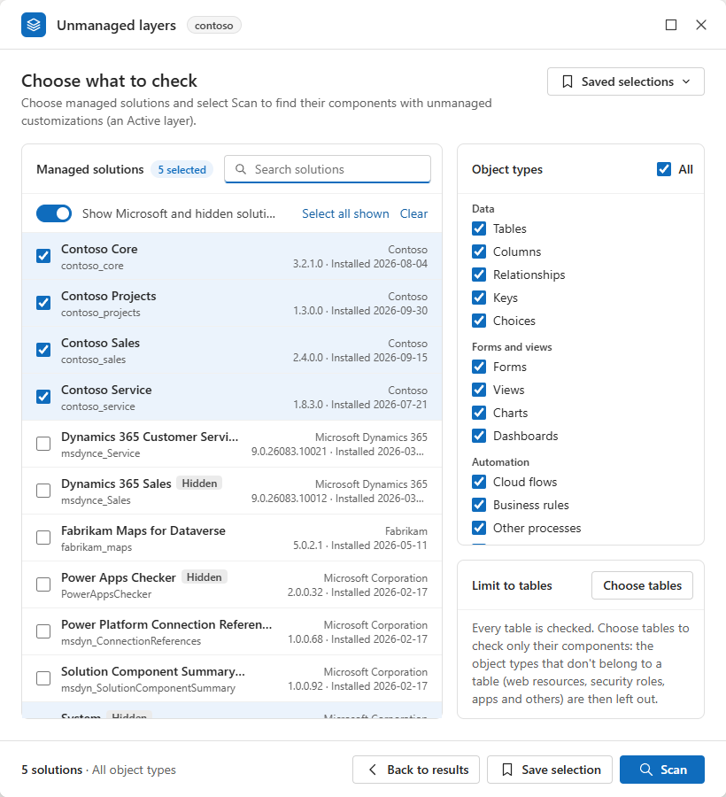

*The choice screen in a window about 820 px wide. Below 900 px the container query ([8.1](#81-shadow-dom-and-styles)) narrows the right column to
280 px, lists the object types in one column and drops *Optional* and the table icon from the tables card. **Back to
results** shows because a scan result exists.*

### 8.4 The table picker

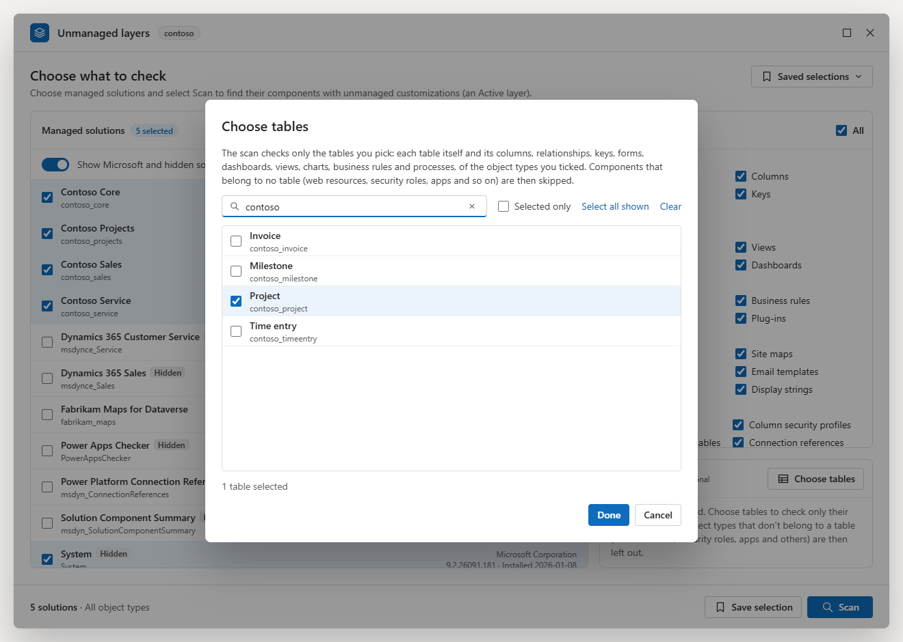

*The **Choose tables** dialog (wide, 720 px) with the search "contoso": four tables match in their display or logical
name, one is ticked, and the footer says "1 table selected".*

**Reading the tables.** `loadTables` reads every table once per window, with one request (paged by `getAll`, [5.6](#56-paging-and-pools)):
`EntityDefinitions?$select=LogicalName,DisplayName,IsPrivate`. Private tables are left out, and the rest are sorted by
display name. It starts as soon as the solutions are loaded, so the tables card can show display names; the dialog
shows "Loading tables…" until they arrive. A failed read is not kept (`tablesPromise` is cleared), so opening the
dialog again tries again.

`layer-scanner.js`, `readTables`:

```js
const readTables = async () => { for (let i = 0; ; i++) { try { return await getAll('EntityDefinitions?$select=LogicalName,DisplayName,IsPrivate') } catch (e) { if (!(e instanceof StopError) || i >= 20) throw e; await sleep(300) } } }
```

**Why it retries a stopped read.** Starting a scan, or **Stop scan**, ends the reads in flight at once, this one
included if it was still running. A stopped read is not an error of the table list, so it is tried again, up to 20
times, 300 ms apart.

**Working on a copy.** The dialog works on `tmp`, a copy of `tablesSel`. **Cancel** leaves the choice as it was;
**Done** copies `tmp` back and draws the tables card and the object types again (the types offered depend on whether
tables are chosen, [8.3](#83-the-choice-screen-and-saved-selections)).

**The list.** `draw` lists the tables that match the search (display or logical name) and, with *Selected only*, only
the ticked ones. **Select all shown** ticks the tables listed; **Clear** unticks every table. The footer says "N tables
selected", or "None selected: all tables are checked". A click ticks a row in place, without drawing the list again.
The list is a listbox with one row in the tab order ([8.8](#88-keyboard-and-accessibility)): ↑ and ↓ move, Home and End go to the ends, Space and Enter
tick.

### 8.5 Results: search, type bubbles and column menus


*The results of a scan of five managed solutions: 23 unmanaged layers. The subtitle gives the scope and the time; the
bubbles show *All 23* and seven types with their counts, and **More 9** holds the types that do not fit. The *Email
template* row has an information icon instead of a tick box: Dataverse does not delete that type's unmanaged layer.*

**The header.** The title is the number of unmanaged layers not deleted. `subtitle` writes the scope (solutions, object
types, tables) and "Scanned in 2.5 s", then, when they apply, "3 deleted", "showing 5 of 23" (while a search or filter
hides rows) and "the first 2,000 are drawn". **Change selection**, **Scan again** and **Export** are disabled during a
deletion run.

**Banners.** `renderBanners` adds one banner per case above the grid:

| Banner | When |
| --- | --- |
| "Some parts couldn't be read, so this list might be incomplete. Scan again in a moment." (amber), with *Details* listing each part | The scan is incomplete (`result.typesFailed`) |
| "Not checked: *types*. Your security role can't read these types (*privileges*), so they were skipped. Everything else was checked." | Types the user cannot read (`result.noAccess`, except the quiet image configurations; without the last sentence when there are quiet ones) |
| "What changed is shown for N components. M more aren't read yet ..." (with how many were flagged only by the solution summary and might have no unmanaged layer of their own), and **Read N more** | Findings whose layers were not read yet |
| The scan's warnings | `result.warnings` |

**Read N more** reads the next 500 at most (`CONFIG.autoDetails`) with `loadDetails` ([6.8](#68-step-4-confirming-and-reading-the-details)), those flagged only by the
solution summary first. Rows that turn out to have no unmanaged layer leave the list and the selection.

**The grid.**

| Column | Default width | Shows |
| --- | --- | --- |
| (tick) | 48 px | A tick box; a spinner while the row is deleted; a green check once deleted; an information icon for a type whose unmanaged layer Dataverse does not delete |
| Type | 172 px | The type as the maker portal names it |
| Name | 22% | The display name as a link to the component's solution layers page, and the schema name under it |
| Table | 17% | The table's display name, and its logical name under it; "—" for no table |
| Managed solution | 15% | The chosen solutions the component is in; the tooltip adds the managed layers underneath, top first |
| What changed | the rest | The names of the properties the unmanaged layer changes; after a deletion attempt, the outcome |
| (actions) | 88 px | **Layers and what changed** (the details) and the solution layers link |

The table has `table-layout:fixed`, a sticky header and, until a column is resized ([8.6](#86-column-widths)), a minimum width of 1,000 px:
"a narrow window scrolls sideways instead of losing a column".

**Clicking a row.** A click anywhere on a row, except its tick box, a link or a button, opens the component's solution
layers page in a new tab (`window.open` with `noopener`). A double click does not open a second tab (`e.detail > 1`),
and selecting text in a row to copy it opens nothing. *What changed* and the document icon open the details ([chapter 9](#9-details-and-comparison))
instead. For the keyboard, the name and the icon at the end of the row are real links.

**What changed.** `changedCell` builds one tag per property name (at most 40) and a "+N" element; `fitTags` then shows
as many tags as fit in the column, and "+N" for the rest. Its comment: "All widths are read first, then everything is
written, so a long list costs one layout." Reading and writing in turn would force a layout per row. The first tag
always shows (cut with an ellipsis if need be), and the tags shown plus "+N" always add up to the total. A
`ResizeObserver` fits them again when the grid's width changes. A row not read yet says "Not read yet"; a process whose
layer only switched it on or off or changed its owner, "Only status or owner"; a layer that changes only values
Dataverse sets itself, "Only system values".

**Rows drawn.** `drawnRows` returns the first 2,000 rows shown (`CONFIG.maxRows`). The table has no virtual scrolling:
every search, filter and sort draws all its rows again, so their number is capped, and the subtitle says when rows are
not drawn. The exports are not capped: **Excel (CSV)** and **All layers (CSV)** take every row shown that is not
deleted, drawn or not.

**Search, filters and sorting.** The search box matches the type, the names, the table, the solutions and the changed
property names (`matches`), at each keystroke. Each column is described in `COLS` by its title and a function that
gives a row's values in that column.

`layer-scanner.js`, `COLS`:

```js
const changedValues = (f) => (!f.detailsLoaded && !f.changed ? ['Not read yet'] : f.changedKeys ? f.changedKeys : [f.changed || '(None)'])
const COLS = {
  type: ['Type', (f) => [f.type]],
  name: ['Name', (f) => [f.display || f.schema || '(no name)']],
  table: ['Table', (f) => [f.table ? f.tableLabel || f.table : '(No table)']],
  solution: ['Managed solution', (f) => (f.solutionIds && f.solutionIds.length ? f.solutionIds.map((id) => solName(id) || id) : [f.solutions || '(None)'])],
  changed: ['What changed', changedValues],
}
```

* A row can have several values in a column: one per solution, one per changed property. A filter is the set of values
  shown, and a row passes when **any** of its values is in it. That makes "which components changed `formxml`?" one
  tick in the *What changed* menu.
* `shown` applies `visible`, the filters (`passes`) and the search, then the sort. `visible` keeps deleted rows on the
  screen, struck through, until the search or a filter changes (`keepDeleted`).
* Without a sort, rows keep the scan's order (by type, then name). Sorting compares text with `localeCompare`,
  ignoring case and accents and reading digits as numbers (`cmpText`); ties are ordered by type, then name. The same
  sort again goes back to the scan's order.
* `setFilter` drops a filter that keeps every value of the column ("A filter that keeps every value is no filter").

**The column menu.** A click on a column header opens the column menu (`openPop`), under the header (above it when
there is less than 300 px below and more room above), inside the window, between 160 and 520 px high (`placePop`). It
follows the window when the window moves.

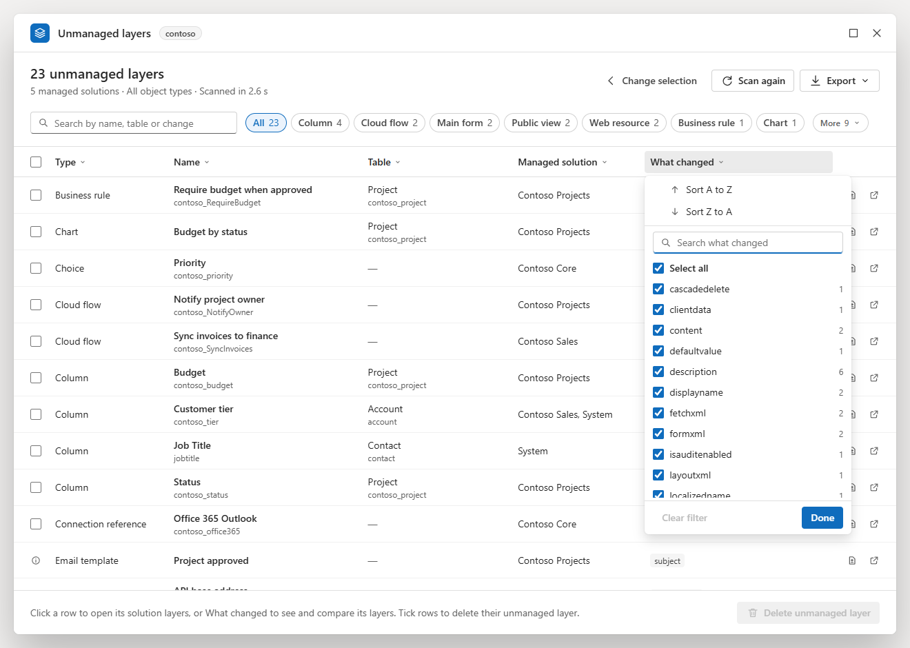

*The *What changed* column menu: **Sort A to Z**, **Sort Z to A**, the search, **Select all**, and one value per
changed property with the number of rows that have it (*description*: 6). **Fit to contents** is not offered because
this column has no width of its own ([8.6](#86-column-widths)), and **Reset column widths** shows only once a width was changed.*

* **The values** come from `columnValues`, each with the number of rows that have it among the rows the other columns'
  filters and the search leave. A value filtered in but with no row left is still listed, with 0, so it can be
  cleared. Values in parentheses ("(No table)", "(None)") come last.
* **Ticking or clearing** a value filters at once; there is no Apply. **Select all** (**Select all search results**
  while searching) acts on every value that matches the search, also those beyond the ones listed. **Enter** in the
  menu's search keeps only the values found that are ticked, as in Excel, and closes the menu. At most 300 values are
  listed (`POP_MAX`), then "N more values. Search to find them."
* **Clear filter** removes the column's filter. **Done** and Esc close the menu and return the focus to the header; it
  also closes when the focus leaves it and on a click outside it.
* While scanning or deleting, the headers are disabled. Each shows a sort arrow and a filter mark when they apply, and
  its cell carries `aria-sort`.

**Type bubbles.** The bubbles are the Type column's filter, drawn as buttons: ticking types in the Type menu presses
the same bubbles. `renderChips` counts the rows not deleted per type.

`layer-scanner.js`, `typeClick`:

```js
const typeClick = (t, add) => {
  if (deleting || !result) return
  const ft = filters.type
  if (!t) setFilter('type', null)
  else if (add) { const s = new Set(ft || []); s.has(t) ? s.delete(t) : s.add(t); setFilter('type', s.size ? s : null) }
  else setFilter('type', ft && ft.size === 1 && ft.has(t) ? null : new Set([t]))
}
```

* A click shows only that type; a second click on the same bubble shows all types again; Ctrl+click (Cmd+click on a
  Mac) adds or removes a type; *All* clears the filter. **Clear filters (n)** clears the other columns' filters; the
  bubbles keep theirs.
* **The order is fixed**: types picked from **More** first (see below), then most rows first, then by name. A click on
  a bubble never moves it, so a second click at the same place hits the same type. (An earlier version moved the
  pressed bubble to the front, and a second click then picked another type.)
* A pressed type whose rows have all been deleted stays, with 0, so the filter stays visible.

**More.** The bubbles must never wrap, scroll or run off the window. `layoutChips` measures which bubbles pass the
right edge of their box, hides them and lists them in the **More** menu (`menuitemcheckbox`, a check mark for the
pressed ones). The width of **More** depends on its count, which depends on its width, so it measures again, up to four
times.

`layer-scanner.js`, `layoutChips` (the measuring):

```js
const over = () => { const right = box.getBoundingClientRect().right + 0.5; return chips.filter((c) => c.getBoundingClientRect().right > right) }
const label = (n) => { $('moreBtn').innerHTML = `More <span class="n">${n}</span>${icon('chevron', 12)}`; $('moreBtn').setAttribute('aria-label', `${n} more types`) }
const settle = () => { let h = over(); for (let i = 0; i < 4; i++) { label(h.length); const h2 = over(); if (h2.length === h.length) return h2; h = h2 } return over() }
```

A type picked from **More** is pinned (`pinned`, until the next scan): it moves right after *All*, so it is in view,
and the last bubble that no longer fits goes under **More**. **More** is drawn pressed when a hidden type is filtered.
A `ResizeObserver` lays the row out again when its width changes; `layoutChips` does nothing when the width, the
number of bubbles and **Clear filters** are as before (`chipsKey`).

**Selection and the bottom bar.** `selected` holds the keys of the ticked rows; the select-all box ticks the selectable
rows drawn. `syncSelection` keeps the bar up to date: with nothing ticked, a hint ("Click a row to open its solution
layers, or What changed to see and compare its layers. ..."); with rows ticked, "**3 components selected**" (plus "· 2
hidden by the search or filters"), **Clear selection** and **Delete 3 unmanaged layers**; above 100, "You can delete up
to 100 at a time." in red, with **Delete** disabled (`CONFIG.maxRemovePerRun`); during a run, the progress ([8.9](#89-toasts-dialogs-and-the-deleting-pill)).

A row cannot be ticked during a deletion run, once it is deleted, when Dataverse does not delete its type's unmanaged
layer, or in a development environment named in `scanner.settings.json`, where **Delete** is not shown at all
(`selectable`, [10.1](#101-from-ticks-to-a-run)).

**Export**, in the header, saves the rows and the details as files; [chapter 11](#11-exports) describes each export.

### 8.6 Column widths

Four columns can be resized: *Type*, *Name*, *Table* and *Managed solution*. *What changed* has no edge of its own: "it
takes the room the others leave (at least 150 px; the grid scrolls sideways below that)".

* **Drag** the right edge of a header. The edges show when the pointer is over the header row.
* **Double-click** an edge, or select **Fit to contents** in the column's menu (also from the keyboard), to make the
  column as wide as its longest value drawn, narrower or wider.
* **Reset column widths**, in any column's menu once a width was changed, goes back to the defaults. The widths are
  remembered ([8.3](#83-the-choice-screen-and-saved-selections)).

A column is at least `COL_MIN` wide (Type 90, Name 120, Table 100, Managed solution 100 px) and at most `COL_MAX`
(900 px). *What changed* keeps at least `CHANGED_MIN` (150 px): the grid's minimum width is the sum of the other
columns plus that. Until a column is resized, the widths are those of the `colgroup` (`COL_DEFAULT`).

**From percentages to pixels.** Until a column is resized, three columns are percentages. The first real move of a drag,
or a fit, calls `startColW`, which measures the four columns and keeps them in pixels from then on, so the others do
not change width while one is dragged. `applyColWidths` writes the widths to the `colgroup` and leaves *What changed*
without a width, so it takes the rest.

**Dragging.**

* `pointerdown` on an edge (`.cr`) captures the pointer and adds `colsizing` to `.app`, so the cursor stays a
  column-resize cursor over the whole page.
* A move of less than 3 px is not a resize ("a click is not a resize"): a click on an edge changes and saves nothing.
* Each move sets the column to its starting width plus the distance, within `COL_MIN` and `COL_MAX`, and fits the tags
  again on the next animation frame (`scheduleFit`), not on every pointer event.
* While the grid is scrolled sideways, it keeps at least the width it had when the drag started (`hold`). Otherwise a
  narrower column would shrink the grid, the scroll position would change and the edge would slide away from the
  pointer.
* Only a drag that moved saves the widths.

**Fitting.** `fitColumn` measures text, not boxes.

`layer-scanner.js`, `textW` and `fitColumn`:

```js
// As wide as its longest value shown (and its header): the text's own width, whatever the column's width is now.
const textW = (el) => { const r = document.createRange(); r.selectNodeContents(el); return r.getBoundingClientRect().width }
function fitColumn(k) {
  const i = COL_KEYS.indexOf(k) + 1, th = thOf(k), hb = th.querySelector('.hb')
  if (i < 1) return
  startColW()
  let w = textW(hb.querySelector('.l')) + hb.querySelector('.ind').getBoundingClientRect().width + 4 + 16 + 8 + 10   // gap, the button's and the cell's padding, the edge
  for (const tr of root.querySelectorAll('#rows tr[data-k]')) {
    const td = tr.children[i]
    if (!td) continue
    const parts = [...td.children]
    w = Math.max(w, 24 + (parts.length ? Math.max(...parts.map(textW)) : textW(td)))
  }
  colW[k] = Math.round(Math.min(COL_MAX, Math.max(COL_MIN[k], Math.ceil(w) + 2)))
  applyColWidths(); saveColW(); fitTags()
}
```

* A `Range` around an element's contents gives the width of the text itself. The element's box would report the
  column's current width, so a column made too wide could never be fitted narrower.
* Each line of a cell counts (the display name and the schema name under it).
* `Math.ceil(w) + 2` makes up for widths rounded to half pixels, which could cut the last letter of the longest name.

### 8.7 Moving, resizing and maximizing

The window floats over the page without blocking it: "moved by its title bar, resized by its edges and corners,
maximized with the button or a double-click on the title bar. Its place and size are remembered in this browser."

**The geometry.** `geo` holds `{ x, y, w, h, max }` in page pixels. `placeWin` writes it to the `.win` element, sets the
**Maximize** button's icon and label ("Maximize" or "Restore down"), and places an open column menu again. The first
time, the window is centred, at most 1,280 x 900 px and 24 px from each edge of a smaller page (`defaultGeo`);
afterwards, the stored geometry is used, fitted into the page.

`layer-scanner.js`, `fitGeo`:

```js
// Kept inside the page: wholly when it fits (strict), or with at least part of the title bar reachable while moving.
function fitGeo(g, strict) {
  const W = vw(), H = vh()
  const w = Math.round(Math.min(Math.max(g.w, Math.min(MIN_W, W)), W)), h = Math.round(Math.min(Math.max(g.h, Math.min(MIN_H, H)), H))
  const x = strict ? Math.min(Math.max(g.x, 0), W - w) : Math.min(Math.max(g.x, 160 - w), W - 160)
  const y = strict ? Math.min(Math.max(g.y, 0), H - h) : Math.min(Math.max(g.y, 0), H - 56)
  return { x: Math.round(x), y: Math.round(y), w, h, max: !!g.max }
}
```

* **Size**: at least 720 x 560 px (`MIN_W`, `MIN_H`), at most the page. On a page smaller than that, the page's size
  is the minimum.
* **Strict** (opening, the page resized, the window shown again, **Restore down**): the whole window is pulled into
  view.
* **Loose** (while moving): the window may go partly off the page, but at least 160 px of it stay on the page across,
  and the title bar (56 px high) never leaves the page at the top or the bottom. The window can always be grabbed.

**Moving.** `pointerdown` on the title bar, outside its buttons, starts a drag with the pointer captured, so a fast move
does not lose the window. A move of less than 4 px (across and down together) is not a move, so a click on the title
bar does nothing. While moving, `.app` gets `moving`: it takes the pointer for the whole page, and text in the window
cannot be selected by accident.

**Maximizing.** **Maximize**, or a double-click on the title bar, toggles `max`. The class `max` on `.win` covers the
page (`!important` overrides the inline sizes), squares the corners and hides the resize handles. The size from before
stays in `geo` for **Restore down**. Dragging the title bar of a maximized window "comes back to its size under the
pointer, as in Windows" (`onDrag`): grabbed at three quarters of the page's width, the restored window is held at
three quarters of its own, at the top of the page.

**Resizing.** Eight handles (`.rz`) lie along the panel's edges and reach 6 px outside them: 8 px strips on the edges
(stopping 14 px from the corners) and 18 x 18 px squares on the corners, each with the matching cursor. The east and
south edges stop at the page's right and bottom; the west and north edges stop at its left and top, and none can make
the window smaller than the minimum.

**When the page changes.** On a `resize` of the page, a window that is not maximized is fitted again (strict); a
maximized one follows the page by itself. The geometry is saved after a move or resize that actually moved, and after
each toggle of **Maximize**.

### 8.8 Keyboard and accessibility

**Keys.**

| Where | Key | Does |
| --- | --- | --- |
| Anywhere in the window | Esc | The first that applies: clears a search box that has text; closes the column menu; closes an open menu; closes the dialog; closes the details; closes the window (during a deletion run, it becomes the pill, [8.9](#89-toasts-dialogs-and-the-deleting-pill)) |
| Anywhere in the window | Tab, Shift+Tab | Moves through the window and wraps at its ends; while a dialog is open, through the dialog only |
| Solution list, table list | ↑, ↓, Home, End; Space, Enter | Moves to the previous, next, first or last row; ticks or unticks the row |
| **Saved selections**, **Export**, **More** | ↑, ↓ (wrapping), Home, End | Moves through the items |
| The same menus | Tab | Closes the menu; the focus goes back to its button |
| A saved selection in the menu | Enter, Space | Applies it |
| A column menu's search | Enter | Keeps only the values found |
| **Save selection** dialog | Enter | Saves |
| Details | Alt+↑, Alt+↓ | Previous or next component, in the order of the grid |
| Details tabs | ←, → | Previous or next tab, wrapping; the tab is selected at once |

**Esc acts only on the window.** The handler listens on the document in the capture phase, and returns at once unless
the window is shown and the event's path goes through the host, that is, unless the focus is in the window. The page
keeps its own Esc.

`layer-scanner.js`, `onEscape`:

```js
// Escape works on the window only when it has the focus (the page around it keeps its own Escape).
const onEscape = (e) => {
  if (e.key !== 'Escape' || host.style.display === 'none' || app.hidden || !e.composedPath().includes(host)) return
  e.preventDefault()
  const t = e.composedPath()[0]
  if (t && t.type === 'search' && t.value) { t.value = ''; t.dispatchEvent(new Event('input', { bubbles: true })); return }   // first Escape clears a search
  if (!$('pop').hidden) { closePop(true); return }
  if (!$('savedMenu').hidden || !$('exportMenu').hidden || !$('moreMenu').hidden) { closeMenus(true); return }
  if (!dlgClose && !$('sheet').hidden) { closeSheet(); return }
  hide()
}
document.addEventListener('keydown', onEscape, true)
```

`composedPath()[0]` is the element inside the shadow tree that has the focus (`e.target` would only be the host).
Clearing a search fires an `input` event, so the list is filtered again as if the text had been deleted. Outside a
deletion run, `hide` closes an open dialog before anything else ([8.9](#89-toasts-dialogs-and-the-deleting-pill)).

**Tab stays in the window.** The window is not modal: the page around it stays usable with the mouse. For the keyboard,
a handler on the shadow root wraps Tab at the window's first and last focusable elements (in the dialog's while one is
open), skipping disabled, hidden and `inert` ones; between them the browser's own order applies. Without it, Tab would
leave the window, whose elements come last in the page, for the page's own controls.

**`inert`.** An open dialog makes the title bar, both screens and the details `inert`: they cannot be clicked or
focused and are hidden from screen readers. The open details make the results `inert` the same way.

**Where the focus goes.**

| After | The focus goes to |
| --- | --- |
| The choice screen is shown | The solution search |
| The results are shown (also when a scan starts), a deletion is confirmed, a deletion run ends | The results title (`h2`, `tabindex="-1"`) |
| The details open / close | The details title / the row's **Layers and what changed** button (the results title if the row is not drawn) |
| A dialog opens | Its first input, else the button marked `focus` (**Cancel** in the delete confirmation), else its first button |
| A dialog closes | The element that had the focus before, if it is still there, enabled and shown; else the solution search or the results title |
| A column menu closes with Esc, **Done** or a sort; a menu closes with Esc or Tab | Its column header; its button |
| A saved selection is applied | **Scan**, or the solution search while **Scan** is disabled |
| A drop-down or a segmented button in the details is used | The same control, drawn again |

The details title is focused 30 ms after opening, and that timer is cleared when the details close: "a focus still
pending from opening must not land after closing".

**Roles and attributes.**

| Element | Role and attributes |
| --- | --- |
| The window | `role="dialog"`, `aria-modal="false"`, labelled by its title |
| Solution list, table list | `role="listbox"`, `aria-multiselectable="true"`; rows `role="option"` with `aria-selected`; one row in the tab order (`tabindex="0"`, moved with the arrows); the check box in each row `aria-hidden` and out of the tab order; the solution list `aria-busy` while it loads |
| *Show Microsoft and hidden solutions* | `role="switch"`, `aria-checked` |
| **Saved selections**, **Export**, **More** | `aria-haspopup="menu"`, `aria-expanded`; `role="menu"` with `menuitem` (in **More**: `menuitemcheckbox`, `aria-checked`) |
| Type bubbles | `role="group"` "Filter by type"; each bubble `aria-pressed`; **More** labelled "9 more types" |
| The grid | Labelled "Components with an unmanaged layer"; `aria-busy` while scanning; `aria-sort` on each header cell; header buttons `aria-haspopup="dialog"`, `aria-expanded` |
| Column menu | `role="dialog"` labelled "Sort and filter *column*" |
| Progress bar | `role="progressbar"`, `aria-valuenow`; hidden from the accessibility tree when idle |
| Tick column icons | `role="img"` labelled "Deleted", "Deleting" or "Can't be deleted here" |
| Icon buttons and links | `aria-label`, for example "Layers and what changed: *name*", or the link's title with "(opens in a new tab)" |
| Details | Labelled by the component's name; `tablist`, `tab` (`aria-selected`, `aria-controls`, one in the tab order), `tabpanel` (labelled by the selected tab); property headers `aria-expanded`; the layer drop-downs "Compare (shown in red)" and "With (shown in green)" |
| Dialog | `role="dialog"`, `aria-modal="true"`, labelled by its title and described by its body |
| Toasts | `role="status"`; warnings `role="alert"` |

**What a screen reader hears.** A live region (`#live`, `aria-live="polite"`) announces what happens away from the
focus: "Scan finished: 23 unmanaged layers." (or "no unmanaged layers"), "Scan didn't finish.", "Stopping after the
component being deleted now." and "Deleted 3 of 3.". `announce` empties the region and writes the text 50 ms later, so
the same text said twice is still read. Toasts are read as they appear.

**Focus rings.** Every focusable element shows a 2 px black outline when focused from the keyboard (`:focus-visible`);
buttons draw it inside their border, and primary and danger buttons add a white inner line so the ring shows on the
coloured background.

### 8.9 Toasts, dialogs and the deleting pill

**Toasts.** `toast(text, { kind, action, sticky })` shows a short message in the lower right corner of the window,
above the bottom bar: `ok` (green check), `warn` (amber warning, `role="alert"`) or `info`. A toast can have one action
link (**Undo**, **Download log**) and always has a close button. Its text is escaped.

* It goes away after 5 seconds, or 8 seconds when it has an action, so there is time to use it. The timer stops while
  the pointer or the focus is on the toast, and starts again when they leave.
* A sticky toast stays until it is closed. Sticky toasts carry results a user must not miss: a deletion run that did
  not delete everything, a run stopped by the user, by an expired sign-in or by an error, a failed **Read N more**, and
  a successful run that finished while the window was closed.
* Changing screens dismisses the toasts that are not sticky (`setView`).

**Dialogs.** There is one dialog element; `openDialog({ title, body, actions, wide })` fills it for **Choose tables**
(wide, [8.4](#84-the-table-picker)), **Save selection** ([8.3](#83-the-choice-screen-and-saved-selections)) and the delete confirmation ([10.2](#102-the-confirmation)). The callers build the body and escape what
they put in it. While it is open, the title bar, both screens and the details are `inert`; `dlgClose` hides it, ends
`inert` (the results stay inert behind the details) and returns the focus ([8.8](#88-keyboard-and-accessibility)). `dlgClose` is also the flag "a dialog
is open": Esc and the window's close button close the dialog first, and showing the window again does not redraw the
screen behind it.

**During a deletion run.** The deletion itself (`removeLayers`) and its safety checks are described in [chapter 10](#10-deleting);
the window shows its progress.

Each step redraws one row (`updateRow`) and, while the window is shown, scrolls it into view, so the list follows the
component being deleted. The search, the bubbles, the column menus, **Change selection**, **Scan again** and
**Export** are disabled, and the details cannot be opened. The bar says "**Deleting 2 of 3**: API base address
(Environment variable) · about a minute or less left · You can close this window; deleting continues.", with **Stop
deleting** (then "Stopping…"), which ends the run after the component being deleted; the time left then gives way to
"stopping after this one". `timeLeft` assumes 8.5 seconds per component until the first is done ("Dataverse takes
about 8 s per component"), then uses the pace so far; under a minute it says "about a minute or less left", otherwise
"about *n* min left". Leaving or reloading the page asks for confirmation (`beforeunload`, [10.8](#108-stop-sign-in-expiry-and-leaving-the-page)).

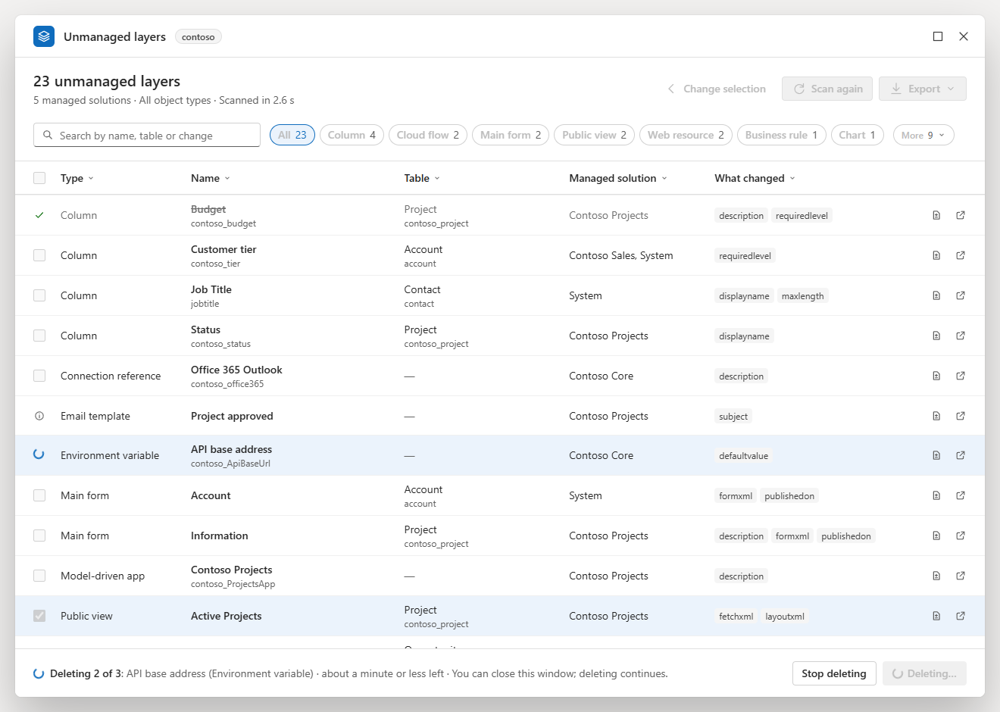

*While deleting: the first component is done (struck through, green check), the second has a spinner, the third waits
ticked and disabled; the rows still in the run have a blue background. The header buttons and the bubbles are
disabled.*

**The deleting pill.** Closing the window during a run does not stop it: `hide` turns the window into a pill in the
lower right corner of the page.

`layer-scanner.js`, `minimize`, `restore` and `hide`:

```js
const minimize = () => { app.hidden = true; mini.hidden = false; syncMini() }
const restore = () => { app.hidden = false; mini.hidden = true }
const hide = () => {
  if (dlgClose && !deleting) { dlgClose(); return }
  closeMenus(); closePop()
  if (deleting) { minimize(); return }   // deleting goes on; the pill in the corner shows how far it is
  restore(); host.style.display = 'none'
}
```

* The pill (`button.mini`) says "Deleting unmanaged layers · 5 of 17" and the time left, with a spinner; when the run
  ends, "Deleting finished · Select to see the results" with a green check. Selecting it shows the window as it was.
* `syncSelection` updates it at every step (`syncMini`).
* It lies outside `.app`, where the design tokens are defined, so its colours are written directly in its CSS.

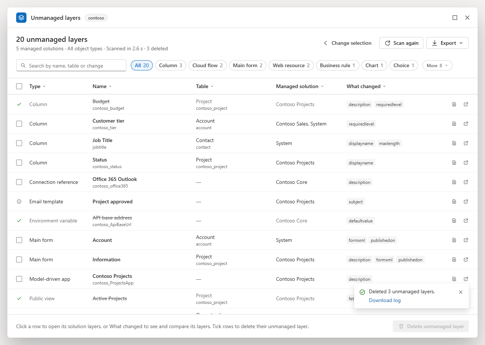

*After the run: the deleted rows stay in place, struck through with a green check, until the search or a filter
changes. The title, the subtitle ("3 deleted") and the bubbles are counted again, and the toast offers **Download
log**, the log of this run.*

**Closing and opening again.** Outside a run, closing only hides the host (`display:none`); the state stays. Clicking
the bookmark again on the same environment calls `show`, which shows the window as it was, fitted into the page. On
the maker portal, which changes environments without reloading the page, clicking the bookmark in another
environment calls `destroy`, which removes the window (not while it is working) before a new one starts.

---

## 9. Details and comparison

The details sheet shows one component's layers and what each one changes, as Solution Layers Explorer does: the
comparison of any two layers property by property (*What changed*), the list of layers (*Layers*) and each layer's raw
data (*JSON*). It opens from a row's *What changed* cell or its document icon (`openSheet`), over the results; **Back**
or Esc closes it. It does not open during a scan or a deletion run, and it reads nothing until it is opened.

**The sheet's state.**

| Field | Holds |
| --- | --- |
| `f` | The component shown |
| `tab` | `compare`, `layers` or `json`; kept when moving to the previous or next component |
| `place` | Which part of the component: a relationship has two ([9.1](#91-reading-every-layer)) |
| `layers`, `error` | Every layer of that place, top first (`null` while reading); the read's error, if it failed |
| `a`, `b` | The two layers compared, as indexes in `layers`: `a` in green ("with"), `b` in red ("Compare") |
| `onlyDiff`, `hideSystem`, `sbs` | *Only differences* and *Hide system values* (both on at first); **Side by side** (off at first) |
| `open` | The properties expanded; at first the first three that differ |
| `json`, `jl` | The *JSON* tab's data (`changes`, `all` or `children`) and layer |
| `token`, `cmp` | The current read ([9.1](#91-reading-every-layer)); the last comparison drawn (`compareRows`), for Copy and for redrawing one property |
| `wrFile` | For a web resource with at least one layer that keeps its content as a file: `{ ref, content }`, the reference (in lower case) and the content (base64) of the file in effect now, or `{ error }` when they could not be read; `null` otherwise. `compareRows` gives that content to the top layer when its file is that one ([9.11](#911-web-resource-content-kept-as-a-file-contentfileref)) |

`onlyDiff`, `hideSystem`, `sbs` and `json` stay as set for as long as the window exists: a user who prefers side by
side gets it for every component.

**The head.** `renderSheetHead` writes the name, the type, the schema name, the table and the solutions, the position
in the grid ("14 of 23"), **Previous** and **Next** (disabled at the ends; they follow the rows drawn, with the grid's
sort and filters), the **Solution layers** link and **Delete unmanaged layer**, which opens the same confirmation as
the bottom bar, for this component.

### 9.1 Reading every layer

`layer-scanner.js`, `fullLayers`:

```js
const layerCache = new Map()   // "id|layer name" -> every layer with all its data, top first (the last 20 components)
let layerEpoch = 0              // changes when a removal ran: reads started before it are not kept
async function fullLayers(p) {
  const k = `${p.id}|${p.kind}`
  if (layerCache.has(k)) { const v = layerCache.get(k); layerCache.delete(k); layerCache.set(k, v); return v }
  placeOk(p.id, p.kind)
  const epoch = layerEpoch
  const rows = (await getAll(`msdyn_componentlayers?$filter=(msdyn_componentid eq '${p.id}' and msdyn_solutioncomponentname eq '${p.kind}')`)).sort((a, b) => b.msdyn_order - a.msdyn_order)
  if (epoch === layerEpoch) { layerCache.set(k, rows); while (layerCache.size > 20) layerCache.delete(layerCache.keys().next().value) }
  return rows
}
```

**All columns.** The query has no `$select`, so each layer row comes with all its data: `msdyn_changes` (what the layer
changes), `msdyn_componentjson` (the component as that layer defines it, *All properties*), `msdyn_children`
(*Children*), `msdyn_order`, `msdyn_solutionname`, `msdyn_publishername` and `msdyn_overwritetime`. The scan's own read
(`getLayers`, [3.5](#35-msdyn_componentlayers), used by `readDetails`, [6.8](#68-step-4-confirming-and-reading-the-details)) asks for eight columns only: it runs for hundreds of components and
needs neither the full component nor its children. The rows are sorted by `msdyn_order`, highest first, so index 0 is the top layer.

**A place.** Layers are read per place: a component id and the name its layers use (`msdyn_solutioncomponentname`).
`places(f)` ([3.4](#34-component-types-and-layer-names)) gives the component's own place and, for a relationship, a second one: its cascade settings are
layered on the `Relationship` component, its definition on `EntityRelationship`. `openSheet` starts on the place that
has the unmanaged layer, and a segmented button (*Cascade settings*, *Definition*) switches. `placeOk` ([5.2](#52-read-only-by-design)) checks
that the id is a GUID and the name a plain identifier before either goes into the address.

**The cache.** The layers of the last 20 places are kept. A `Map` keeps its keys in the order they were added, so a hit
is moved to the end and the first key is the one used longest ago. Going back and forth with **Previous** and **Next**
reads nothing again, while memory stays bounded: each layer row of a form holds its form XML, in *All properties* and
often in *Changes* too.

**`layerEpoch`.** A deletion run increases it after each component and removes that component's places from the cache,
so the details read them again. A read that started before a removal can finish after it; comparing the epoch keeps
such a read from putting the old layers back into the cache.

**The token.** `loadSheet` gives each read its own token, and picks the two layers compared by default.

`layer-scanner.js`, `loadSheet`:

```js
async function loadSheet() {
  const f = sheet.f, p = places(f)[sheet.place], token = {}
  sheet.token = token; sheet.layers = null; sheet.error = ''; sheet.open = null
  renderSheetBody()
  try { const l = await fullLayers(p); if (sheet.token !== token) return; sheet.layers = l }
  catch (e) { if (sheet.token !== token) return; sheet.error = e.message }
    // A web resource whose content Dataverse keeps as a file: each layer holds only a reference to its file
    // (contentfileref). The Web API gives out only the file in effect now, through the web resource itself; it is
    // shown for the top layer when its reference is that file's (see compareRows), and no other layer's content is
    // ever guessed.
  sheet.wrFile = null
  if (lc(p.kind) === 'webresource' && (sheet.layers || []).some((l) => fileRefOf(attrsOf(l.msdyn_componentjson)))) {
    try { const w = await read(`webresourceset(${p.id})?$select=content,contentfileref`); if (sheet.token !== token) return; sheet.wrFile = { ref: lc(w && w.contentfileref), content: (w && w.content) || '' } }
    catch (e) { if (sheet.token !== token) return; sheet.wrFile = { error: e.message } }
  }
  const L = sheet.layers || [], ia = L.findIndex((l) => l.msdyn_solutionname === 'Active')
  sheet.a = ia >= 0 ? ia : 0                       // by default the unmanaged layer, against the managed layer right under it
  sheet.b = Math.min(L.length - 1, sheet.a + 1)
  if (sheet.b === sheet.a) sheet.b = Math.max(0, sheet.a - 1)
  sheet.jl = sheet.a
  renderSheetBody()
}
```

Holding Alt+↓ starts a read for each component passed. When an answer arrives and `sheet.token` is no longer its token,
the user has moved on (another component, another place, or the details closed), and the answer is dropped: only the
last read draws. By default the unmanaged layer (*Active*) is compared with the managed layer right under it, and the
*JSON* tab starts on the unmanaged layer.

**A web resource whose content is kept as a file.** When at least one layer of a web resource holds a `contentfileref`
in its *All properties* ([3.5](#35-msdyn_componentlayers)), `loadSheet` also reads the content in effect now, once each time the details load, with
`webresourceset(<id>)?$select=content,contentfileref`, and keeps it in `sheet.wrFile` (or the read's error). A layer
that holds the content itself needs no read. The details are drawn after this read, so "Reading the layers…" stays
until it is done. The answer is not cached with the layers. `compareRows` uses it for the one `content` row
([9.2](#92-comparing-two-layers)); [9.11](#911-web-resource-content-kept-as-a-file-contentfileref) explains what is shown.

**The states.** "Reading the layers…" with a spinner; "Couldn't read the layers" with the message and **Try again**; "No
layers" ("Dataverse has no layers for this component under the name ..."); and, with one layer, "Only one layer": there
is nothing to compare, and its data is under *JSON*.

The read is an ordinary request through `requestOnce` ([chapter 5](#5-the-request-layer)): the address check and the read-only guard apply,
throttling pauses it, and a read with no full answer within 5 minutes ends with an error instead of being sent
again.

### 9.2 Comparing two layers

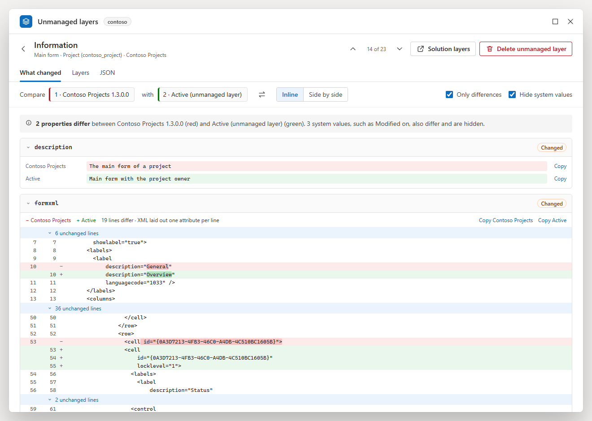

*The *What changed* tab of a main form: the managed layer (red) against the unmanaged layer (green). The head note
counts two properties that differ and three system values, hidden. *description* is short, so it is shown as two lines
of text; *formxml* is laid out one attribute per line ([9.4](#94-xml-laid-out-without-loss-prettyxml)) and compared line by line ([9.7](#97-the-line-difference-difflines-folds-and-side-by-side)), with the changed part of
each line marked and the unchanged stretches folded.*

**What is compared.** Each layer's *All properties* (`msdyn_componentjson`): an entity whose `Attributes` are a list of
`{ Key, Value }`. `attrsOf` turns it into a `Map` from key to value, reading numbers exactly ([9.5](#95-json-indented-without-loss-indentjson-and-exact-numbers)). Because each
layer's whole component is compared, not only its *Changes*, any two layers can be compared, managed ones too.

`layer-scanner.js`, `compareRows`:

```js
function compareRows(L) {
  const A = L[sheet.a], B = L[sheet.b], ma = attrsOf(A.msdyn_componentjson), mb = attrsOf(B.msdyn_componentjson)
  // A web resource's content is one property, whichever way each layer holds it: in the layer (content) or as a
  // file of its own (contentfileref). The two can differ between layers. The content in effect (read by loadSheet) is
  // the top layer's, so it is given only to the top layer, and only when that layer's file is the file in effect (and
  // to the other layer too when both name that same file); any other file can't be read and is kept as a FileRef.
  if (lc(A.msdyn_solutioncomponentname || places(sheet.f)[sheet.place].kind) === 'webresource') {
    const cur = sheet.wrFile && !sheet.wrFile.error ? sheet.wrFile : null, ra = fileRefOf(ma), rb = fileRefOf(mb)
    const inEffect = (ref, l) => !!cur && ref === cur.ref && (l === L[0] || (ra === rb && (A === L[0] || B === L[0])))
    for (const [m, l, ref] of [[ma, A, ra], [mb, B, rb]]) {
      if (ref && !m.has('content')) m.set('content', inEffect(ref, l) ? cur.content : new FileRef(ref, l === L[0]))
      if (ref) m.delete('contentfileref')
    }
  }
  const keys = [...new Set([...ma.keys(), ...mb.keys()])]
  const rows = keys.map((k) => { const inA = ma.has(k), inB = mb.has(k); return { k, inA, inB, same: inA && inB && stable(ma.get(k)) === stable(mb.get(k)), system: isSystemKey(k), va: ma.get(k), vb: mb.get(k) } })
  rows.sort((x, y) => (x.same - y.same) || (x.system - y.system) || cmpText(x.k, y.k))
  return { A, B, ma, mb, rows }
}
```

* **Every key of either layer** is a row. A property found in one layer only is shown, marked "Only in *layer*".
* **A web resource's content is one row**, named `content`, whichever way each layer holds it: in the layer
  (`content`, base64) or as a file of its own (`contentfileref`). There is no `contentfileref` row. The top layer,
  when its file is the one in effect (`sheet.wrFile`, [9.1](#91-reading-every-layer)), gets that content as its value (so does the other layer
  when both name that file); any other file becomes a `FileRef`, which is never shown. A layer that holds both keeps its own `content`. *Same* or not is then decided as for any
  property: the same base64 is *Same* whichever way each layer keeps it, and two layers that name the same file are
  *Same* too ([9.11](#911-web-resource-content-kept-as-a-file-contentfileref)).
* **Same or not** is decided on the values, not on how they are shown. `stable` writes a value as JSON with the keys of
  every object sorted, so objects with the same keys in another order are the same (as Solution Layers Explorer's
  `DeepEquals`). If a value cannot be written (nested too deeply), `stable` returns a random string, so the property
  counts as different rather than the same.
* **System values** are those Dataverse sets itself: `isSystemKey` is true for `modifiedon`, `modifiedby`,
  `modifiedonbehalfby`, `createdon`, `createdby`, `createdonbehalfby`, `versionnumber`, `overwritetime`, `solutionid`,
  `supportingsolutionid`, `componentstate`, `ismanaged`, `publishedon`, `organizationid` and any key ending in
  `idunique`. They almost always differ between layers and say nothing about the customization.
* **The order**: properties that differ first; within each group, ordinary properties before system values; then by
  name.

**The controls** (`renderCompareTab`):

* **Compare** (red) and **with** (green): with more than two layers, two drop-downs listing every layer as its order,
  then its solution's name and version ("1 · Contoso Projects 1.3.0.0", "2 · Active (unmanaged layer)"). Each lists every layer except the one chosen in the other, so a layer can never be compared with
  itself. With exactly two layers there is nothing to choose: both are shown as fixed labels.
* The swap button exchanges the sides. **Inline** or **Side by side** chooses the layout of line differences ([9.7](#97-the-line-difference-difflines-folds-and-side-by-side)).
* *Only differences* lists only the properties that differ; *Hide system values* hides the system values.
* Choosing other layers, swapping or **Compare with Active** ([9.8](#98-layers-and-json-tabs-children-tables)) collapses the properties and opens the first three
  that differ.

**The head note** says how many properties differ, between which layers, and how many system values differ too: "**2
properties differ** between Contoso Projects 1.3.0.0 (red) and Active (unmanaged layer) (green). 3 system values, such
as Modified on, also differ and are hidden." With nothing to list, it says "The two layers are the same", or "Only
system values differ" with a hint to clear *Hide system values*.

**A property.** `propHtml` draws a header button (the key in monospace, *System* for a system value, and a pill: *Same*,
*Changed* in amber, or *Only in ...*) and, only when the property is expanded, its body. Expanding or collapsing one
property redraws that property alone (`redrawProp`), so a form with dozens of large properties costs only what is
open. If drawing a body fails, `propBody` shows "This value couldn't be shown (...). It is in the JSON tab." instead of
breaking the tab.

**How a value is shown.** `propBodyOf` first checks for a web resource's `content` with a file that cannot be read on
at least one side (`isWrContent`), and hands it to `contentSide` and `fileBody` ([9.11](#911-web-resource-content-kept-as-a-file-contentfileref)). Any other property's two values,
a web resource's `content` that both sides hold in the layer or as the file in effect included, are turned into text
with `valueView` ([9.3](#93-showing-a-value-valueview)), and shown in one of four forms:

| Values | Shown as |
| --- | --- |
| An image web resource on either side | Both images, red side first, then their descriptions ("(image, 192 bytes)") |
| Either text longer than 1,000,000 characters (`BIG`) | "This value is too large to compare here (N characters). Copy it to compare it in another tool.", and the Copy links |
| Both texts on one line, at most 200 characters each | Two lines of text, each labelled with its layer, on red and green when they differ, with a **Copy** link at the end of each line; "(empty)" for an empty value, "not in this layer" (and no Copy) for a missing one |
| Anything else | A line difference ([9.7](#97-the-line-difference-difflines-folds-and-side-by-side)) under a legend: "− *red layer*", "+ *green layer*", "N lines differ", what was done to the text ("XML laid out one attribute per line", "JSON indented", "decoded from base64"), and the Copy links |

In a line difference, a property found in one layer only is compared with nothing, so all its lines show as removed or
added.

### 9.3 Showing a value: `valueView`

`valueView` turns a property's value into the text compared on the screen. With `exact` set, it returns the value as
stored instead, for Copy ([9.9](#99-copy-and-download)) and for values that look the same once laid out ([9.6](#96-when-two-values-look-the-same)).

`layer-scanner.js`, `valueView`:

```js
const WR_IMAGE = { 5: 'image/png', 6: 'image/jpeg', 7: 'image/gif', 10: 'image/x-icon' }
// A property's value as text for comparing; web resource content decoded (images are shown as images).
// exact: the value as stored, not laid out (web resource content still decoded), for Copy.
function valueView(key, v, attrs, kind, exact = false) {
  if (lc(kind) === 'webresource' && key === 'content' && typeof v === 'string' && /^[A-Za-z0-9+/=\s]*$/.test(v)) {
    const t = Number(scalarText(attrs.get('webresourcetype'))), bytes = Math.round(v.replace(/\s/g, '').length * 3 / 4)
    if (WR_IMAGE[t]) return exact ? { text: v } : { image: `data:${WR_IMAGE[t]};base64,${v.replace(/\s/g, '')}`, text: `(image, ${bytes.toLocaleString()} bytes)` }
    if (t === 8) return { text: exact ? v : `(Silverlight file, ${bytes.toLocaleString()} bytes)` }
    const d = b64Text(v)
    if (d != null) return { text: !exact && [4, 9, 11, 12].includes(t) ? prettyXml(d) || d : d, note: 'decoded from base64' }
  }
  const text = scalarText(v)
  if (typeof v === 'string' && !exact) {
    const t = text.trim()
    if (t.startsWith('<') && t.endsWith('>')) { const x = prettyXml(t); if (x) return { text: x, note: 'XML laid out one attribute per line' } }
    if ((t.startsWith('{') && t.endsWith('}')) || (t.startsWith('[') && t.endsWith(']'))) { const j = parseJson(t); if (j && typeof j === 'object') { const x = indentJson(t); if (x) return { text: x, note: 'JSON indented' } } }
  }
  return { text }
}
```

**Web resource content.** A web resource's `content` is its file in base64. It is shown according to the web
resource's type (`webresourcetype`, read from the same layer):

| Type | Shown as |
| --- | --- |
| 5 PNG, 6 JPG, 7 GIF, 10 ICO | The image, and "(image, N bytes)" as its text |
| 8 Silverlight (XAP) | "(Silverlight file, N bytes)" |
| 4 XML, 9 XSL, 11 SVG, 12 RESX | The decoded text, laid out as XML ([9.4](#94-xml-laid-out-without-loss-prettyxml)) when it parses |
| 1 HTML, 2 CSS, 3 JavaScript, any other | The decoded text |

`b64Text` decodes the base64 (white space removed) as UTF-8 and drops a byte order mark; invalid byte sequences are
replaced, not fatal. Content that is not valid base64 is shown as stored. The byte count comes from the base64 length,
so it may be up to two bytes too high.

When Dataverse keeps a layer's content as a file, the layer holds `contentfileref` instead of `content`. When the layer
is the top one and its file is the one in effect, `compareRows` gives it the content in effect, read from the web
resource itself, as its `content` value, so `valueView` shows it the same way. Any other file is a `FileRef`, which
never reaches `valueView` ([9.11](#911-web-resource-content-kept-as-a-file-contentfileref)).

**Images.** An image is shown from a `data:` address built from the content, and only when the content holds only
base64 characters (the test at the start of `valueView`) and the web resource's type is one of the four in `WR_IMAGE`.
The image type in the address comes from that fixed list, never from the content. The address is escaped and put in an
`` element, which runs no script, on a chequered background (so transparent parts show) and at most 280 x 200 px.
SVG web resources are not in the list: they are compared as XML text.

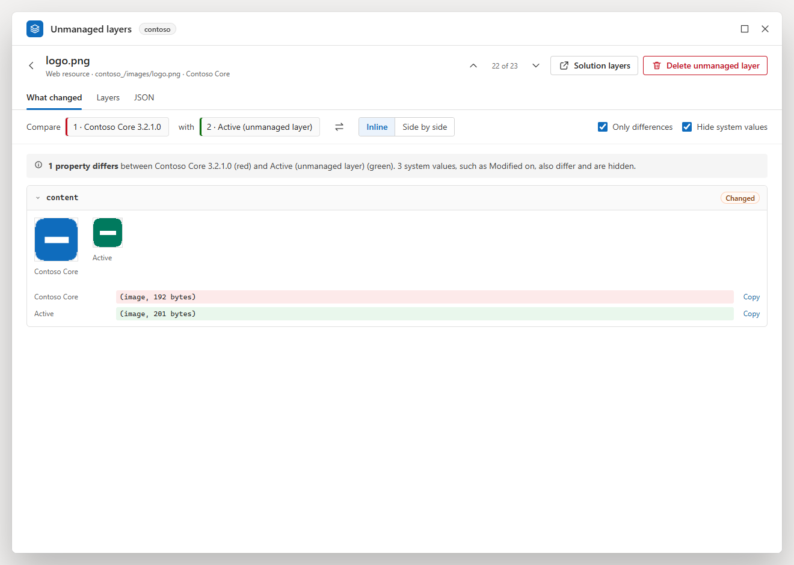

*An image web resource: the managed layer's image and the unmanaged layer's, each captioned with its layer, then their
descriptions as two lines of text: "(image, 192 bytes)" in red and "(image, 201 bytes)" in green.*

**Other values.** `scalarText` writes a value of the layer data as text:

| Value | Text |
| --- | --- |
| `null` or missing | Empty |
| Text, number, true or false | As it is. A number that JavaScript cannot hold exactly as written (an `ExactNumber`, [9.5](#95-json-indented-without-loss-indentjson-and-exact-numbers)) keeps its text, for example `1.0` or `12345678901234567890` |
| A lookup `{ Id, LogicalName, Name }` | "contact 1b2c... (Name)" |
| A choice or a money value `{ Value }` | The value |
| A managed property `{ Value, CanBeChanged }` | "true (can be changed: false)" |
| Any other object or list | JSON indented by two spaces (`safeJson`), with exact numbers written as written, without quotes |

Below 40 levels of nesting it calls itself for an inner `Value`; deeper, it writes JSON at once.

`layer-scanner.js`, `scalarText`:

```js
function scalarText(v, depth = 0) {
  if (depth > 40) return safeJson(v)
  if (v === null || v === undefined) return ''
  if (typeof v !== 'object' || v instanceof ExactNumber) return String(v)
  if ('Id' in v && 'LogicalName' in v) return `${v.LogicalName} ${v.Id}${v.Name ? ` (${v.Name})` : ''}`   // a lookup
  const keys = Object.keys(v)
  if (keys.length === 1 && 'Value' in v) return scalarText(v.Value, depth + 1)   // a choice or a number
  if ('Value' in v && 'CanBeChanged' in v) return `${scalarText(v.Value, depth + 1)} (can be changed: ${v.CanBeChanged})`   // a managed property
  return safeJson(v, 2)
}
```

**Text that is XML or JSON.** A text value that starts with `<` and ends with `>` is laid out as XML ([9.4](#94-xml-laid-out-without-loss-prettyxml)); one that
starts with `{` or `[`, ends with `}` or `]` and parses as JSON is indented ([9.5](#95-json-indented-without-loss-indentjson-and-exact-numbers)). When the layout fails (not
well-formed, too large), the text is shown as stored. Forms, views, charts, site maps, ribbons and process definitions
are stored as XML text, and many newer properties as JSON text, so most long values are laid out.

### 9.4 XML laid out without loss: `prettyXml`

Form XML, FetchXML and similar values are stored on one long line. Compared as they are, any change would make the
whole value one changed line. `prettyXml` puts each element, and each attribute of an element with several, on its own
line, and changes nothing else. Its comment states the rule: "Only the spacing between elements changes. Text is kept
exactly as written, and an element whose text matters (text mixed with elements, or xml:space="preserve") is kept as
written on one line, so that two different values never look the same."

For example, `<tab name="general" showlabel="true"><labels><label description="General" languagecode="1033" /></labels></tab>`
is shown as:

```xml
<tab
    name="general"
    showlabel="true">
  <labels>
    <label
        description="General"
        languagecode="1033" />
  </labels>
</tab>
```

A change of `description` is now one changed line, and the marked part ([9.7](#97-the-line-difference-difflines-folds-and-side-by-side)) is the word that changed.

`layer-scanner.js`, `prettyXml` (the walk):

```js
const walk = (n, d) => {
  const pad = '  '.repeat(d)
  if (n.nodeType === 1) {
    const at = attrs(n), kids = [...n.childNodes]
    const head = at.length > 1 ? [`${pad}<${n.nodeName}`, ...at.map((a) => `${pad}    ${a}`)] : [`${pad}<${n.nodeName}${at.length ? ' ' + at[0] : ''}`]
    if (!kids.length) { head[head.length - 1] += ' />'; out.push(...head); return }
    // Text only, text among elements, spacing within a line (such as a space between two words in SVG text), or
    // spacing that must be kept: the content exactly as written. Line breaks and indentation between elements go.
    if (n.getAttribute('xml:space') === 'preserve' || kids.every(texty) || kids.some((c) => texty(c) && (!blank(c) || !/[\r\n]/.test(c.nodeValue)))) { head[head.length - 1] += `>${kids.map(flat).join('')}</${n.nodeName}>`; out.push(...head); return }
    head[head.length - 1] += '>'
    out.push(...head)
    for (const c of kids) if (!blank(c)) walk(c, d + 1)   // only the spacing between elements is left out
    out.push(`${pad}</${n.nodeName}>`)
  } else { const s = flat(n); if (s) out.push(pad + s) }
}
```

**The rules.**

* **Parsing.** The value is parsed by the browser's `DOMParser` as XML, which runs no scripts. A value that is not
  well-formed gives `null` and is shown as stored.
* **Elements.** Each element starts a line, indented two spaces per level. With two or more attributes, each is on its
  own line, four spaces further in; with one, it stays on the element's line. An empty element ends with ` />`.
* **Attributes** keep their order and are written with `escAttr`, which writes a tab, a line feed and a carriage return
  inside a value as `&#9;`, `&#10;` and `&#13;`. An XML parser turns a literal line break in an attribute value into a
  space, so a line break written as a reference is a different value, and it stays visibly different.
* **Text.** An element with only text, text mixed with elements, spacing within a line between its children (a space
  between two words in SVG text), or `xml:space="preserve"` is written on one line as written (`flat`), apart from line
  breaks in its own text. Only white space with a line break between elements (the original's indentation) is left out.
* **Comments, CDATA sections and processing instructions** are kept as they are.
* **The XML declaration** is not part of the parsed document, so it is copied from the start of the value.
* **A DOCTYPE** makes `prettyXml` give up ("a DOCTYPE can add default attributes"): the value is shown as stored.
* **Text is escaped** with `escXml`, so the result is XML source again. When drawn, it is escaped once more for HTML
  (`escLine`), so `&amp;` in the value shows as `&amp;`.

**What can still differ.** The layout is the same for values the XML parser reads the same way: `&#65;` and `A`, single
and double quotes around attributes, spacing inside a tag, line endings. When two different values look the same after
layout, they are shown as stored instead ([9.6](#96-when-two-values-look-the-same)).

**Limits.** A value over 3,000,000 characters is not parsed, and a result over 200,000 lines is not used. A document
nested deeply enough to overflow the stack is caught (`try` around the walk). All three are shown as stored.

### 9.5 JSON indented without loss: `indentJson` and exact numbers

**Why not `JSON.stringify(JSON.parse(text), null, 2)`.** Parsing and writing JSON again changes it: numbers become
JavaScript numbers (`12345678901234567890` becomes `12345678901234567000`, `1.50` becomes `1.5`), keys that look like
whole numbers move to the front of their object (`{"b":1,"2":2}` becomes `{"2":2,"b":1}`), and of two equal keys only
the last is kept. A comparison must neither show such changes nor hide them, so `indentJson` indents the text as
written.

`layer-scanner.js`, `indentJson`:

```js
// JSON indented without changing it: numbers, strings and the order of keys stay exactly as written (parsing and
// writing it again would round large numbers and reorder some keys). t must be valid JSON.
function indentJson(t) {
  const str = /"(?:\\.|[^"\\])*"/y
  let out = '', depth = 0
  const nl = () => '\n' + '  '.repeat(depth)
  for (let i = 0; i < t.length; i++) {
    const c = t[i]
    if (c === '"') { str.lastIndex = i; const m = str.exec(t); if (!m) return null; out += m[0]; i += m[0].length - 1 }
    else if (c === '{' || c === '[') {
      let j = i + 1
      while (/[ \t\r\n]/.test(t[j] || '')) j++
      if (t[j] === (c === '{' ? '}' : ']')) { out += c + t[j]; i = j } else { depth++; out += c + nl() }
    } else if (c === '}' || c === ']') { depth--; out += nl() + c }
    else if (c === ',') out += ',' + nl()
    else if (c === ':') out += ': '
    else if (!/[ \t\r\n]/.test(c)) out += c
  }
  return out
}
```

* Strings are copied whole with a sticky regular expression, escapes included: nothing inside a string is touched.
* An opening bracket starts a new line one level deeper; an empty `{}` or `[]` stays on one line. A comma ends the
  line; a colon becomes `": "`.
* White space outside strings is dropped; numbers, `true`, `false` and `null` are copied character for character, so
  `{"f":1.50,"big":12345678901234567890}` keeps `1.50` and every digit.
* It is only called on text that `JSON.parse` accepted, so it never sees broken JSON.

**Exact numbers in parsed data.** The layer data itself (`msdyn_componentjson`, `msdyn_changes`) has to be parsed, to
find the properties and compare their values. Parsed as usual, a number becomes a JavaScript number and loses how it
was written: `12345678901234567890` becomes `12345678901234567000`, `0.1234567890123456789` loses its last digits,
`1e2` becomes `100`, and `1.0` and `1.50` become `1` and `1.5`. So `parseJson` passes a reviver, `exactNumbers`, that
keeps every such number as written.

`layer-scanner.js`, `ExactNumber`, `exactNumbers`, `parseJson` and `safeJson`:

```js
// Reads JSON as Dataverse wrote it: a number JavaScript cannot hold exactly as written (a whole number above 2^53,
// such as a relationship's cascade mask, a long fraction, an exponent) is kept as written, in an ExactNumber, so it is
// shown, copied and compared exactly, and never taken for a string with the same digits.
class ExactNumber {
  constructor(s) { this.s = s }
  toJSON() { return '\u0000#' + this.s }   // compared and fingerprinted apart from any string; safeJson writes it back as a number
  toString() { return this.s }
}
const exactNumbers = (k, v, c) => (typeof v === 'number' && c && typeof c.source === 'string' && JSON.stringify(v) !== c.source ? new ExactNumber(c.source) : v)
// ...
const parseJson = (t) => { try { return t ? JSON.parse(t, exactNumbers) : null } catch { return null } }
// ...
const safeJson = (v, n) => { try { return JSON.stringify(v, null, n).replace(/"\\u0000#([-+.0-9eE]+)"/g, '$1') } catch { return String(v) } }   // exact numbers written back as numbers
```

* **Which numbers.** The reviver's third argument (`c.source`, the number as written) is a newer JavaScript feature
  that Edge supports. A number is kept as written when JavaScript would write it back differently
  (`JSON.stringify(v) !== c.source`): the examples above, and `-0`. A number that comes back the same, such as `7` or
  `0.1`, stays a plain JavaScript number. In a browser without `c.source`, every number stays a plain number.
* **Shown and copied as written.** `ExactNumber` holds the text (`s`), and `toString` gives it back: `scalarText`
  shows `1.0` as `1.0` ([9.3](#93-showing-a-value-valueview)), and Copy copies it so ([9.9](#99-copy-and-download)).
* **Compared as written, and never as a string.** `stable` (the comparison of two layers, [9.2](#92-comparing-two-layers)) and `managedPrint`
  (the check after a removal that the managed layers' values did not change, [10.6](#106-after-each-place-the-checks)) write values with
  `JSON.stringify`, which calls `toJSON`: an exact number becomes a marker, the character U+0000 and `#`, followed by the
  number as written. So `1.0` differs from the number `1`, and also from the text `"1.0"`, which has the same digits.
* **Written back as numbers.** `safeJson` writes a value as JSON for the screen and for Copy (`scalarText`, [9.6](#96-when-two-values-look-the-same)),
  and turns each marker back into the number as written, without quotes: `{ "a": 1.0, "b": "1.0" }` stays exactly
  that, indented.

**Colours in the JSON tab.** `highlightJson` colours keys, strings, numbers and `true`, `false` and `null`:

`layer-scanner.js`, `highlightJson`:

```js
function highlightJson(t) {   // only for valid JSON (indentJson of JSON that parsed): outside strings there are only brackets, numbers and words
  if (t.length > 500000) return esc(t)
  return t.replace(/("(?:\\.|[^"\\])*")(\s*:)?|\b(?:true|false|null)\b|-?\d+(?:\.\d+)?(?:[eE][+-]?\d+)?/g, (m, str, colon) => (str ? `<span class="${colon ? 'k' : 's'}">${esc(str)}</span>${colon || ''}` : /^[tfn]/.test(m) ? `<span class="b">${m}</span>` : `<span class="n">${m}</span>`))
}
```

Its output goes into the page as HTML, so it must never let markup through. Strings are escaped with `esc`; everything
else is left as it is. That is safe only because the text is valid JSON: outside strings, valid JSON holds only
brackets, commas, colons, white space, digits, signs, decimal points, exponents and the words `true`, `false` and
`null`, none of which is markup. So `renderJsonTab` calls it only for text that parsed, and escapes anything else with
`esc`. Above 500,000 characters the text is shown escaped and without colours, because the replacement and the many
`<span>` elements would slow the page.

### 9.6 When two values look the same

Laying values out makes them easier to read, and also makes some different values look the same. XML values that
differ only in spacing inside a tag, in how a character is written (`&#65;` or `A`), in a literal line break inside an
attribute, or in line endings (the XML parser normalizes them); XML or JSON with extra spaces at the start or end (the
layout works on the trimmed text); JSON that differs only in spacing; a lookup that differs only in a field its short
form leaves out; a number and a text with the same digits (`1` and `"1"`, or `1.0` and `"1.0"`). The pill would say
*Changed* and the difference would show nothing.

`propBodyOf` notices this case (the values are not the same by `stable`, neither is an image, but their texts are
equal) and shows both as stored.

`layer-scanner.js`, `asStored`:

```js
// Two different values that look the same once laid out (spacing only, or details the short form leaves out): both
// shown as stored instead, so the difference can be seen.
function asStored(r, kind, c) {
  let a = valueView(r.k, r.va, c.ma, kind, true), b = valueView(r.k, r.vb, c.mb, kind, true)
  if (a.text === b.text) { a = { text: safeJson(r.va, 2) }; b = { text: safeJson(r.vb, 2) } }   // as JSON: a string shows its quotes, a number not
  const eol = (x) => x.replace(/\r\n?/g, '\n'), note = a.text !== b.text && eol(a.text) === eol(b.text) ? 'only the line endings differ (CR shows a Windows line ending)' : 'shown as stored: laid out, the two look the same'
  return [{ ...a, note }, { ...b, note }]
}
```

1. First, `valueView` with `exact`: the stored text, web resource content still decoded.
2. If those are still equal (a lookup's short form, a number and a text with the same digits, or two web resource
   contents that decode to the same text), both raw values are written as JSON with `safeJson` ([9.5](#95-json-indented-without-loss-indentjson-and-exact-numbers)): a text in
   quotes, with its line breaks written as `\n`; a number without quotes, exactly as written; an object whole, indented.
3. When the two are drawn as a line difference, the legend's note says which case it is: "only the line endings differ
   (CR shows a Windows line ending)", or "shown as stored: laid out, the two look the same". Short values are drawn as
   two lines of text, without a note.

**Line endings made visible.** Values are split into lines at line feeds, so a Windows line ending leaves a carriage
return at the end of each line. `escLine`, which escapes every line of a difference and every short value, draws it as
"␍" (U+240D) in grey, with the tooltip "Carriage return (CR)", so "a difference in line endings alone can be seen".

**When two values only differ in type.** The number `1` and the text `"1"` are different values (`stable` writes them
differently), but both show as `1`. Step 2 shows them as JSON: `1` and `"1"`, the text with its quotes. The same holds
for an exact number and a text with the same digits (`1.0` and `"1.0"`), because `stable` never takes an `ExactNumber`
for a text ([9.5](#95-json-indented-without-loss-indentjson-and-exact-numbers)).

### 9.7 The line difference: `diffLines`, folds and side by side

**The algorithm.** `diffLines` compares two lists of lines with the Myers algorithm, the one most `diff` tools use: it
finds a shortest list of line removals and additions that turns the first list into the second.

`layer-scanner.js`, `diffLines` (the start and the fallback):

```js
// Line differences (Myers), after taking out the lines both start and end with. Each step: [0 same | -1 removed | 1 added, line in a, line in b].
function diffLines(a, b) {
  let s = 0
  while (s < a.length && s < b.length && a[s] === b[s]) s++
  let ea = a.length, eb = b.length
  while (ea > s && eb > s && a[ea - 1] === b[eb - 1]) { ea--; eb-- }
  const A = a.slice(s, ea), B = b.slice(s, eb), N = A.length, M = B.length, maxD = Math.min(N + M, 2000)
  const v = new Int32Array(2 * maxD + 3), off = maxD + 1, snaps = []
  // ...
  let mid = []
  if (D < 0) mid = [...A.map((_, i) => [-1, i, -1]), ...B.map((_, j) => [1, -1, j])]   // too different: all of one, then all of the other
  // ...
}
```

1. **Same start and end.** The lines both values start and end with are taken out first. Most customizations change a
   few lines in the middle of a long value, so the search often works on a short part.
2. **The search.** For each number of edits `D` from 0 up, every path is extended as far as equal lines allow, until
   one reaches the end of both lists. A copy of the frontier is kept for each `D` (`snaps`), and the steps are found by
   walking back through them.
3. **The limit.** The search stops at 2,000 edits (`maxD`). Its time grows with the length times `D`, and the copies
   of the frontier take memory in proportion to `D` squared (about 4 million numbers at 2,000). When the values differ
   by more than 2,000 removed and added lines, the difference shows the whole old part removed, then the whole new part
   added: still correct, only not paired line by line.
4. **The result** is a list of steps `[kind, line in a, line in b]` (`0` same, `-1` removed, `1` added), with the common
   start and end added back.

As a rough figure, two texts of 100,000 lines that differ in 999 lines (1,998 removed and added lines, just under the
limit) are compared in about 50 ms on a desktop computer.

**Sides and counts.** `propBodyOf` passes the red layer's lines as `a` and the green layer's as `b`. With the defaults,
red is the managed layer, so the unmanaged layer's changes read as additions. "N lines differ" counts, in each block of
changed lines, the larger of the removed and added counts.

**The changed part of a line.** In each block the first removed line is paired with the first added line, the second
with the second, and so on. `markPair` finds what a pair has in common at the start and at the end, and marks the rest
with `<mark>` (a darker red or green). A pair with nothing in common at either end is not marked: the whole line is the
change.

**Inline or side by side.** `opsHtml` draws a range of steps. **Inline** (`dline`): two line-number columns (red layer,
green layer), a sign (`−` or `+`) and the text; a block shows its removed lines, then its added lines. **Side by side**
(`srow`): the red layer's number and text on the left, the green layer's on the right; paired lines share a row, and
where one side has more lines the other is filled with grey. Long lines wrap; they never make the page scroll
sideways.

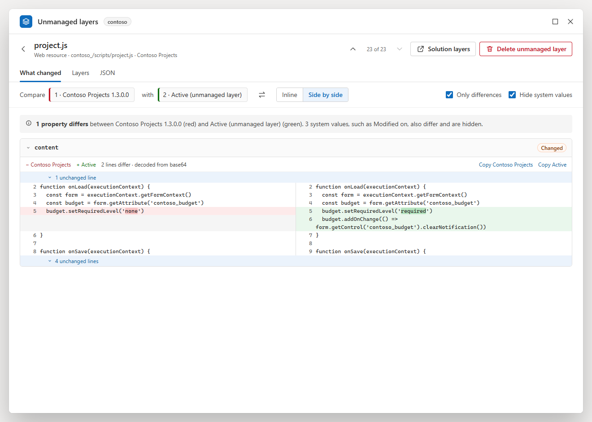

*A JavaScript web resource, decoded from base64, **Side by side**: a changed line paired with its new version (the
changed word marked) and an added line with a grey filler on the left. "2 lines differ": one removed and two added
count as two. The unchanged lines around the change are folded.*

**Folds.** `diffHtml` keeps every changed line and three lines around it, and folds each other stretch of unchanged
lines into a button ("36 unchanged lines"). Selecting a fold draws those lines in its place.

`layer-scanner.js`, `diffHtml`:

```js
// Changed lines with 3 lines around them; longer unchanged stretches folded (select to unfold).
function diffHtml(d) {
  const id = ++diffSeq, n = d.ops.length, keep = new Uint8Array(n)
  diffs.set(id, d)
  for (let i = 0; i < n; i++) if (d.ops[i][0] !== 0) for (let j = Math.max(0, i - 3); j <= Math.min(n - 1, i + 3); j++) keep[j] = 1
  let h = '', i = 0, drawn = 0
  while (i < n) {
    let j = i
    while (j < n && keep[j] === keep[i]) j++
    if (keep[i]) {
      if (drawn + (j - i) > MAX_LINES) { const k = i + Math.max(0, MAX_LINES - drawn); h += opsHtml(d, i, k) + `<div class="pop-more">${plural(n - k, 'more line')} of this difference ${n - k === 1 ? "isn't" : "aren't"} shown. Copy the values to compare them in another tool.</div>`; break }
      h += opsHtml(d, i, j); drawn += j - i
    } else h += foldBtn(id, i, j)
    i = j
  }
  return `<div class="diff">${h}</div>`
}
```

* Each difference drawn is kept in `diffs` under a number that its fold buttons carry (`data-d`, `data-from`,
  `data-to`). The map is emptied whenever the details are drawn again or closed, so it holds only what is on the screen.
* **At most 3,000 lines** are drawn per difference (`MAX_LINES`), folds not counted; the rest is replaced by "N more
  lines of this difference aren't shown. Copy the values to compare them in another tool." **Unfolding** draws at most
  3,000 lines at a time and leaves a new fold for the rest.
* Each difference is at most 560 px high and scrolls inside, so a long one does not push the other properties down.
* With *Only differences* cleared, a long property that is the same shows "The text is the same" and one fold holding
  all its lines.

### 9.8 Layers and JSON tabs, Children tables

**Layers.** `renderLayersTab` lists the layers of the place as the maker portal's *Solution layers* page does, top
first.


*The *Layers* tab of a main form: the unmanaged layer (order 2, *Unmanaged*, last published on 2026-10-09, 3 changed
properties) over the managed layer of Contoso Projects 1.3.0.0. **JSON** opens a layer's data; **Compare with Active** compares the managed layer
with the unmanaged one.*

| Column | From |
| --- | --- |
| Order | `msdyn_order` |
| Solution | The solution's display name, and its unique name under it; for the unmanaged layer, "Active" and "Unmanaged customizations" |
| Publisher | `msdyn_publishername` |
| Layer | A pill: *Unmanaged* (amber) or *Managed* |
| Version | The solution's version, taken from the list of managed solutions read at the start (`solVersion`); empty for the unmanaged layer |
| Overwrite time | `msdyn_overwritetime` in the browser's local format. The unmanaged layer always carries 1900-01-01, so its row shows `activeWhen` instead: the last change with *Last changed* under it, or for a form the last publish with *Last published*, and a tooltip that says where it comes from; "—" when its data holds neither (relationships) |
| Changed properties | The number of properties in `msdyn_changes` (`changedKeys`) |
| (actions) | **Compare with Active** (on the other layers, when there is an unmanaged layer): *What changed* with that layer in red and the unmanaged layer in green. **JSON**: the *JSON* tab on that layer |

**The unmanaged layer's date.** Dataverse dates the unmanaged layer's overwrite time 1900-01-01, but the layer's own
data (*All properties*, then *Changes*) holds the component's `modifiedon`: the last time it was saved, usually the
unmanaged change. A form holds `publishedon`, its last publish, instead; a relationship holds neither. For a record
type the managed layers carry the same `modifiedon`: it is the component's, not the layer's. Table and column layers
write these times without a zone; they are UTC, so `activeWhen` adds the `Z`.

`layer-scanner.js`, `activeWhen`:

```js
// When the unmanaged layer was last changed. Dataverse gives it no overwrite time (1900-01-01), but its data holds the
// component's last save, modifiedon (for a form publishedon, its last publish); relationships hold neither. Table and
// column layers write these times without a zone: they are UTC.
function activeWhen(l) {
  for (const t of [l.msdyn_componentjson, l.msdyn_changes]) {
    const m = attrsOf(t)
    for (const [k, label, tip] of [['modifiedon', 'Last changed', 'when the component was last saved (modifiedon): usually the unmanaged change, though a later import or publish also sets it'], ['publishedon', 'Last published', 'when it was last published (publishedon)']]) {
      const v = m.get(k)
      if (typeof v === 'string' && /^\d{4}-\d\d-\d\dT\d\d:\d\d/.test(v) && !/^1900/.test(v)) return { at: /(Z|[+-]\d\d:?\d\d)$/i.test(v) ? v : v + 'Z', label, tip: `Dataverse gives an unmanaged layer no overwrite time. This is ${tip}.` }
    }
  }
  return null
}
```

**JSON.** `renderJsonTab` shows one layer's raw data, as Solution Layers Explorer's *Changes*, *All properties* and
*Children* tabs do. A drop-down picks the layer; **Changes** (`msdyn_changes`, what this layer changes), **All
properties** (`msdyn_componentjson`, the component as this layer defines it) and **Children** (`msdyn_children`,
records that belong to the component in this layer) pick the data. `jsonText` indents text that parses as a JSON object
or list with `indentJson` ([9.5](#95-json-indented-without-loss-indentjson-and-exact-numbers)), and `highlightJson` colours it; anything else is shown as it is, escaped. A layer
without that data shows "No changes" ("No all properties", "No children").

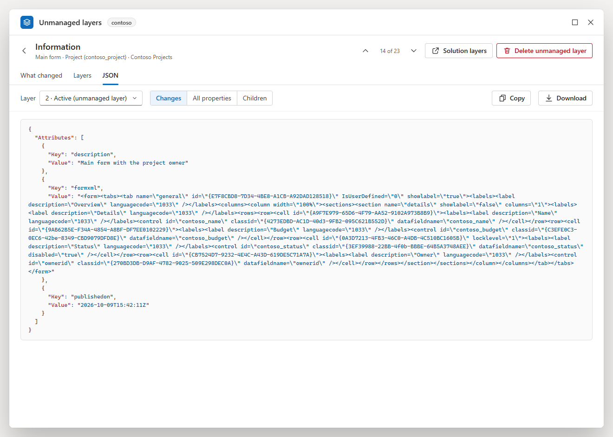

*The *JSON* tab on the unmanaged layer of a main form, **Changes**: indented, with keys and strings in colour.
The form XML stays one string, because this tab shows the data as stored; *What changed* is where it is laid out.*

**Children as tables.** Lists of records inside *Children*, such as a security role's privileges or a choice's labels
and values, are hard to read as JSON. `childTables` finds them and `childTablesHtml` draws each as a table above the
JSON.

`layer-scanner.js`, `childTables`:

```js
const DEPTH = { 1: 'User', 2: 'Business unit', 4: 'Parent: child business units', 8: 'Organization' }
function childTables(j) {
  const out = []
  const visit = (v, path, depth) => {
    if (!v || typeof v !== 'object' || depth > 5 || out.length >= 10) return
    const ents = Array.isArray(v) ? v : Array.isArray(v.Entities) ? v.Entities : null
    if (ents && ents.length && ents.every((e) => e && Array.isArray(e.Attributes))) { out.push({ path: path || 'Records', rows: ents.map((e) => new Map(e.Attributes.filter((a) => a && typeof a.Key === 'string').map((a) => [a.Key, a.Value]))) }); return }
    for (const [k, x] of Object.entries(v)) visit(x, path ? `${path}.${k}` : k, depth + 1)
  }
  visit(j, '', 0)
  return out
}
```

* **A list of records** is a list (or an object with an `Entities` list) whose items all have an `Attributes` list.
  The search goes at most five levels deep and stops after ten tables.
* **The title** is the path to the list ("Records" at the top) and the number of records. **The columns** are the
  eight keys found in the most records, most frequent first.
* **The cells** use `scalarText` ([9.3](#93-showing-a-value-valueview)), cut to 160 characters with "…". For `privilegedepthmask` the depth is named:
  "User (1)", "Business unit (2)", "Parent: child business units (4)", "Organization (8)".
* **At most 500 rows** per table, then "The first 500 are shown; all of them are in the JSON below." Building the
  tables is inside a `try` block: data of an unexpected shape shows the JSON alone.

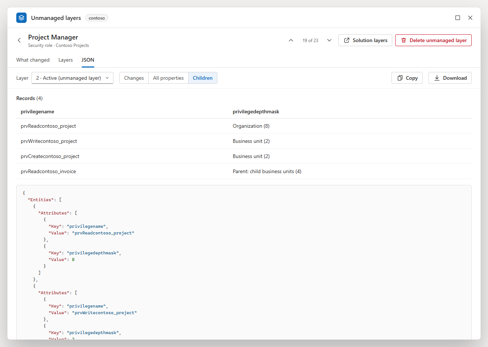

*The *Children* data of a security role's unmanaged layer: four privileges as a table ("Records (4)"), each depth
named, above the indented JSON.*

### 9.9 Copy and Download

Copy and Download act only on a click, and only on data already read. They make no request.

**Copy in *What changed*.** Every value compared can be copied, for each layer that has the property:

* a property shown as a line difference, or as too large to compare, has **Copy *red layer*** and **Copy *green
  layer*** links in its legend;
* a short value (one line, at most 200 characters, [9.2](#92-comparing-two-layers)) has a **Copy** link at the end of each layer's line (its
  tooltip names the layer);
* a web resource's content with a file that cannot be read on one side ([9.11](#911-web-resource-content-kept-as-a-file-contentfileref)) has **Copy *layer*** on the line of each
  layer whose content can be read (held in the layer, or the top layer's file in effect); a layer whose content cannot be read has
  none.

The click handler copies the value as stored, not as laid out on the screen: "The value as stored (web resource
content decoded), not as laid out on the screen, so it can be pasted back as it was."

`layer-scanner.js`, the click handler of the details, **Copy**:

```js
else if (t.dataset.copy) {
  const k = t.closest('.prop').dataset.k, r = sheet.cmp && sheet.cmp.rows.find((x) => x.k === k), c = sheet.cmp
  if (!r) return
  // The value as stored (web resource content decoded), not as laid out on the screen, so it can be pasted back as it was.
  const side = t.dataset.copy === 'a', kind = c.A.msdyn_solutioncomponentname || places(sheet.f)[sheet.place].kind
  const x = isWrContent(r, kind) ? contentSide(side ? r.inA : r.inB, side ? r.va : r.vb, side ? c.ma : c.mb, kind).exact   // a web resource's content, maybe kept as a file
    : valueView(r.k, side ? r.va : r.vb, side ? c.ma : c.mb, kind, true)
  if (x) copyText(x.text, `the ${r.k === 'content' ? 'content' : 'value'} in ${layerShort(side ? c.A : c.B)}`)
}
```

For a web resource's `content` with a file that cannot be read on one side, the handler copies
`contentSide(...).exact`, the decoded content of that layer ([9.11](#911-web-resource-content-kept-as-a-file-contentfileref)); a side that cannot be read gives nothing to
copy, and has no Copy link anyway. Any other row, a web resource's `content` that both layers hold in the layer or as
the file in effect included, goes through `valueView` with `exact`.

| Value | What is copied |
| --- | --- |
| Text (XML and JSON included) | The text exactly as stored: no layout, no indentation, its own line endings |
| A number JavaScript cannot hold exactly as written (`ExactNumber`, [9.5](#95-json-indented-without-loss-indentjson-and-exact-numbers)) | The number as written, for example `1.0`, `1e2` or `12345678901234567890` |
| Text or script web resource content | The decoded text |
| Image or Silverlight web resource content | The base64 text, as stored |
| A web resource's content kept as a file (`contentfileref`) | For the top layer, when its file is the one in effect: that content, as for `content` above (decoded text, or base64 for an image or Silverlight file). Nothing for a layer whose file cannot be read |
| A lookup, a choice or a managed property | The short text shown on the screen (`scalarText`) |
| Any other object | JSON indented by two spaces (`safeJson`: exact numbers as written, without quotes) |

**Copy and Download in *JSON*.** Both take the text the tab shows (`jsonText`): the indented JSON, whose values,
strings and key order are as stored ([9.5](#95-json-indented-without-loss-indentjson-and-exact-numbers)), or the stored text when it is not JSON. **Download** saves it as
`<layer name>-<component id>-<layer solution>-<data>.json`, in lower case, for example
`systemform-<id>-active-changes.json` (the data is `changes`, `all` or `children`), through `download`: a `Blob`, a
temporary link, and an object address released after a minute.

`copyText` uses `navigator.clipboard.writeText` and confirms with a toast ("Copied the value in Active.", "Copied the
content in Active." for a property named `content`, such as a web resource's content, "Copied changes."). When the browser refuses, a
warning toast says "The browser didn't allow copying."

### 9.10 Limits that keep the page responsive

The details show data that customizers control and that can be very large: form XML of several hundred kilobytes, web
resources of megabytes, deeply nested JSON. The page must stay usable whatever the data: without limits, a very large
or crafted value could freeze the tab in the comparison. Each limit below shows the rest another way, so nothing is
lost: Copy gives the full value, and the *JSON* tab the full data.

| Limit | Value | Where | Why |
| --- | --- | --- | --- |
| Places whose layers are cached | 20 | `fullLayers` | Previous and next read nothing again, and memory stays bounded ([9.1](#91-reading-every-layer)) |
| Property bodies drawn | The expanded ones; at first the first three that differ | `propHtml`, `redrawProp` | A form has dozens of properties; drawing only what is open keeps the tab quick |
| A value compared on the screen, or a web resource's content shown alone ([9.11](#911-web-resource-content-kept-as-a-file-contentfileref)) | 1,000,000 characters (`BIG`) | `propBodyOf`, `fileBody` | Splitting, comparing, escaping and drawing a larger value would hold the page; it can be copied instead |
| A short value | One line of at most 200 characters on each side | `propBodyOf` | Two lines of text read better than a difference of one line |
| XML laid out | 3,000,000 characters in, 200,000 lines out | `prettyXml` | Parsing and walking a larger document takes too long; it is shown as stored |
| Nesting | 40 levels in `scalarText`; stack overflows caught in `prettyXml`, `stable` and `propBody` | | Deeply nested data shows as JSON or as stored, or counts as different; it never breaks the view |
| Edits searched | 2,000 removed and added lines | `diffLines` | Time grows with the length times the edits, memory with the edits squared; beyond it, the old and new parts are shown whole |
| Lines drawn per difference | 3,000, and 3,000 per unfold | `MAX_LINES`, `diffHtml` | Each line is several elements; tens of thousands at once would slow the page |
| Unchanged lines around a change | 3 | `diffHtml` | Enough to see where a change is; the rest is folded |
| Height of one difference | 560 px, then it scrolls | `.diff` | A long difference does not push the other properties far down |
| JSON coloured | 500,000 characters | `highlightJson` | Above it, the text is shown escaped and without colours |
| Children tables | 10 tables, 5 levels, 8 columns, 500 rows, 160 characters per cell | `childTables`, `childTablesHtml` | A role can have hundreds of privileges; the tables stay readable and quick, and the JSON below has everything |

The results have limits of their own ([8.5](#85-results-search-type-bubbles-and-column-menus)): 2,000 rows drawn (`CONFIG.maxRows`), 300 values listed in a column menu
(`POP_MAX`), 40 property names built per *What changed* cell, and 16 table names on the tables card.

### 9.11 Web resource content kept as a file: `contentfileref`

Dataverse can keep a web resource's content as a file instead of in the layer data, and each layer holds it one way or
the other ([3.5](#35-msdyn_componentlayers)). A layer that keeps it as a file has `contentfileref`, a reference to its own file, in its *All
properties* instead of `content`. The two layers of one web resource can differ: in the test environment, right after
a web resource's content was saved through the Web API, the Active layer held the content in the layer while the
managed layer held only a file reference; Dataverse later moved both to files. The Web API gives out only the file in
effect now, through the web resource itself; the files of the other layers cannot be read (`fileattachments` refuses
Retrieve and has no readable body). So *What changed* shows one `content` property whichever way each layer keeps it,
compares the two contents when both can be read, says so when one cannot, and never guesses a layer's content.

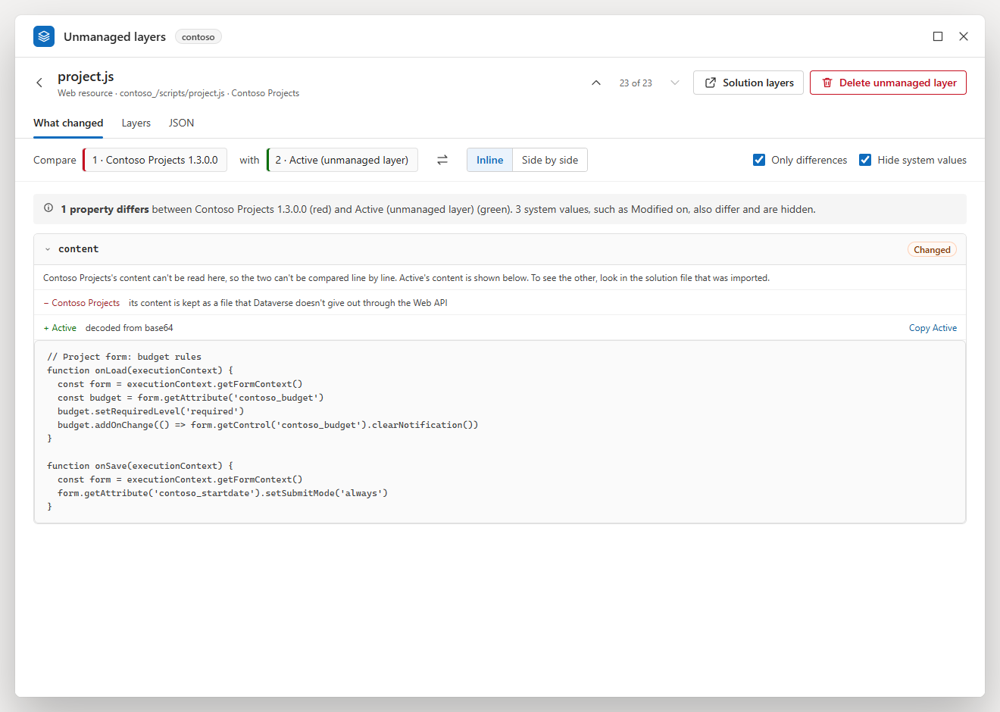

*A JavaScript web resource whose content is kept as files: Dataverse gives out only the Active layer's file, so the `content` property shows the Active layer's content with **Copy Active**; the managed layer's line says that its file can't be read through the Web API.*

**Reading the content in effect.** When at least one layer of a web resource holds a `contentfileref`, `loadSheet`
reads the web resource once each time its details load ([9.1](#91-reading-every-layer)): `webresourceset(<id>)?$select=content,contentfileref`, the
content in effect (base64) and the reference of its file. It keeps them in `sheet.wrFile` as `{ ref, content }`, the
reference in lower case, or `{ error }` when the read failed.

`layer-scanner.js`, `fileRefOf`:

```js
// The reference to the file that holds a web resource's content in a layer (contentfileref), when Dataverse keeps
// the content as a file instead of in the layer ('' otherwise). attrs: a Map of a layer's properties, or its
// Attributes list.
const fileRefOf = (attrs) => {
  const v = attrs instanceof Map ? attrs.get('contentfileref') : ((Array.isArray(attrs) ? attrs : []).find((a) => a && a.Key === 'contentfileref') || {}).Value
  const s = v && typeof v === 'object' ? v.Id || v.Value : v
  return typeof s === 'string' && GUID.test(s) ? lc(s) : ''
}
```

A reference is a GUID, given as it is or as the `Id` or `Value` of an object; anything else counts as no reference.

**One `content` row.** `compareRows` ([9.2](#92-comparing-two-layers)) merges the two ways for each of the two layers compared. The content in effect is
the top layer's, so only the top layer gets it as its `content`, when it holds a reference and no `content` and its
reference is the file in effect; the other layer gets it too only when both name that same file. Any other reference
becomes a `FileRef` (`top` is set for the top layer's), which is never shown. The `contentfileref` key is then removed, so there is no row of that name. A layer that holds
the content itself keeps it. The *JSON* tab still shows each layer's data as stored, with the references.

`layer-scanner.js`, `FileRef` and `isWrContent`:

```js
// A web resource layer's content kept as a file (contentfileref) that can't be read here, in a compared row: compared
// by its file (top: the layer is the top one, whose file would be the one in effect; see compareRows).
class FileRef { constructor(ref, top = false) { this.ref = ref; this.top = top } toJSON() { return '\u0000@' + this.ref } toString() { return `(a file: ${this.ref})` } }
const isWrContent = (r, kind) => r.k === 'content' && lc(kind) === 'webresource' && (r.va instanceof FileRef || r.vb instanceof FileRef)
```

`stable` writes a `FileRef` as a text that starts with a NUL character and `@`, which base64 never holds: two layers
that name the same file are *Same*, and a file that cannot be read never counts as the same as content that can.
`isWrContent` is true for a web resource's `content` row with a `FileRef` on at least one side.

**Both sides can be read.** When each layer holds its content in the layer, or was given the content in effect by
`compareRows`, the row holds no `FileRef` and is an ordinary property: *Same* when the base64 is the same, whichever way each layer keeps it;
otherwise decoded by `valueView` ([9.3](#93-showing-a-value-valueview)) and shown as any other value ([9.2](#92-comparing-two-layers)): a short value side by side, with **Copy**
at the end of each layer's line, a longer one line by line, an image as an image.

**At least one side cannot be read.** `propBodyOf` asks `contentSide` about each of the two layers.

`layer-scanner.js`, `contentSide` and the start of `propBodyOf`:

```js
// One side of a web resource's content: { view, exact } when it is held in the layer (or was the content in effect,
// given by compareRows), { why } when it is a file that can't be read, {} when the layer has no content.
function contentSide(inL, v, m, kind) {
  if (!inL) return {}
  if (!(v instanceof FileRef)) return { view: valueView('content', v, m, kind), exact: valueView('content', v, m, kind, true) }
  const cur = sheet.wrFile
  if (v.top && (!cur || cur.error)) return { why: `its content is kept as a file, and the content in effect couldn't be read${cur ? ` (${cur.error})` : ''}` }
  return { why: "its content is kept as a file that Dataverse doesn't give out through the Web API" }
}
// ...
function propBodyOf(r, c) {
  const kind = c.A.msdyn_solutioncomponentname || places(sheet.f)[sheet.place].kind
  let xa, xb
  if (isWrContent(r, kind)) {   // a web resource's content, one side at least kept as a file
    const sa = contentSide(r.inA, r.va, c.ma, kind), sb = contentSide(r.inB, r.vb, c.mb, kind)
    if (r.same || (r.inA && !sa.view) || (r.inB && !sb.view)) return fileBody(r, c, kind, sa, sb)
    xa = sa.view || null; xb = sb.view || null   // both can be read: compared line by line as any other value
    if (xa && xb && !xa.image && !xb.image) {
      if (sa.exact.text === sb.exact.text) return '<div class="legend"><span>The content is the same in both layers; only the way Dataverse keeps it differs (in the layer, or as a file).</span></div>'
      if (xa.text === xb.text) { const note = 'shown as stored: laid out, the two look the same'; xa = { ...sa.exact, note }; xb = { ...sb.exact, note } }
    }
  } else {
    xa = r.inA ? valueView(r.k, r.va, c.ma, kind) : null; xb = r.inB ? valueView(r.k, r.vb, c.mb, kind) : null
    if (xa && xb && !r.same && !xa.image && !xb.image && xa.text === xb.text) [xa, xb] = asStored(r, kind, c)
  }
  // ...
}
```

`contentSide` returns:

| The layer | Returns |
| --- | --- |
| Has no content | `{}`; `fileBody` gives it no line |
| Holds the content in the layer, or was given the content in effect by `compareRows` | `{ view, exact }`: `valueView` of the content, laid out and as stored |
| Keeps it as a file (a lower layer, even one whose reference is the file in effect, or a top layer whose file is another) | `{ why }`: "its content is kept as a file that Dataverse doesn't give out through the Web API" |
| The top layer, keeping it as a file, when the content in effect could not be read | `{ why }`: "its content is kept as a file, and the content in effect couldn't be read (*error*)" |

A `FileRef` is never shown: the only file Dataverse gives out is the one in effect, and `compareRows` has already
given its content to the top layer (and to the other layer when both name that file). A lower layer whose reference
is the file in effect stays a `FileRef`: the content in effect is the top layer's, so it is never shown as a lower
layer's. `propBodyOf` hands the row
to `fileBody` when it is *Same* (both layers name the same file) or when a layer that has content cannot be read.
Otherwise both sides can be read and are drawn as any other value; when neither is an image and the two decode to the
same text although they are stored differently, it says "The content is the same in both layers; only the way
Dataverse keeps it differs (in the layer, or as a file).", and when only the laid-out texts are equal, both are shown
as stored ([9.6](#96-when-two-values-look-the-same)).

**What `fileBody` shows.** A lead sentence, then a line for each layer that has content, red ("−") first, then green
("+"):

| Case | Lead sentence |
| --- | --- |
| Both layers name the same file | "Both layers use the same file, so their content is the same." Only the green layer's line follows |
| One layer's content can be read, the other's cannot | "*Layer*'s content can't be read here, so the two can't be compared line by line. *Other layer*'s content is shown below. To see the other, look in the solution file that was imported." The first name is the layer that cannot be read |
| No layer's content can be read | "Neither layer's content can be read here: Dataverse keeps it in files and gives out only the file in effect now, which is neither of these two." The last clause only when the content in effect was read and neither layer names its file |

Each layer's line holds its sign and name, then:

* for a layer whose content can be read: `valueView`'s note ("decoded from base64"), or "its content" when there is
  none (an image, for example), and **Copy *layer***. Under the line, the content: the image, the text in a code box
  (with line endings shown, [9.6](#96-when-two-values-look-the-same)), or, above 1,000,000 characters (`BIG`), "This content is too large to show here (*n*
  characters). Copy it to read it in another tool.";
* for a layer whose content cannot be read, the reason from `contentSide`.

`layer-scanner.js`, `fileBody`:

```js
// A web resource's content when at least one side can't be shown: never guessed, never compared line by line.
function fileBody(r, c, kind, sa, sb) {
  const la = esc(layerShort(c.A)), lb = esc(layerShort(c.B)), cur = sheet.wrFile && !sheet.wrFile.error ? sheet.wrFile : null
  const sides = [[sb, lb, 'b', 'lo', '−', r.inB], [sa, la, 'a', 'ln2', '+', r.inA]].filter((x) => x[5])
  const shown = sides.filter(([s]) => s.view), hidden = sides.filter(([s]) => !s.view)
  const neither = cur && ![r.va, r.vb].some((v) => v instanceof FileRef && v.ref === cur.ref)   // the file in effect is not one of these two
  const lead = r.same ? 'Both layers use the same file, so their content is the same.'
    : shown.length ? `${hidden.map(([, l]) => l).join(' and ')}'s content can't be read here, so the two can't be compared line by line. ${shown.map(([, l]) => l).join(' and ')}'s content is shown below. To see the other, look in the solution file that was imported.`
      : `Neither layer's content can be read here: Dataverse keeps it in files and gives out only the file in effect now${neither ? ', which is neither of these two' : ''}.`
  const body = (s) => {
    const x = s.view
    if (x.image) return `<div class="imgs"><figure></figure></div>`
    if (x.text.length > BIG) return `<div class="legend"><span>This content is too large to show here (${x.text.length.toLocaleString()} characters). Copy it to read it in another tool.</span></div>`
    return `<pre class="code fcode">${escLine(x.text)}</pre>`
  }
  return `<div class="legend"><span>${lead}</span></div>` + sides.filter(([s], i) => !(r.same && i === 0)).map(([s, l, side, cls, sign]) => `<div class="legend"><span class="${cls}">${sign} ${l}</span><span>${s.view ? esc(s.view.note || 'its content') : esc(s.why)}</span><span class="spacer"></span>${s.view ? `<button class="link" data-copy="${side}" title="Copy the content of ${l}">Copy ${l}</button>` : ''}</div>${s.view ? body(s) : ''}`).join('')
}
```

**Every combination.** The two layers compared can hold the content in any of these ways:

| One layer | The other layer | Shown |
| --- | --- | --- |
| In the layer | In the layer | An ordinary property ([9.2](#92-comparing-two-layers)) |
| In the layer | The file in effect, on the top layer | An ordinary property; *Same* when the base64 is the same |
| In the layer, or the file in effect on the top layer | Any other file (on a lower layer, even the file in effect) | `fileBody`: the first layer's content, and the reason for the other |
| The file in effect, one of the two being the top layer | The same file | Both get the content in effect: *Same* |
| Any other file | The same file | *Same*: "Both layers use the same file, so their content is the same." |
| A file that can't be read | A different file that can't be read | `fileBody`: "Neither layer's content can be read here: ..." |
| The top layer's file, when the content in effect could not be read | | `fileBody`: that layer's line gives the error |

After a customization the file in effect is usually the unmanaged layer's (or the unmanaged layer holds the content
itself), so with the defaults (the Active layer in green against the managed layer under it) the green line shows the
content and the red line says that the managed layer's content is kept as a file that Dataverse doesn't give out
through the Web API.

**Copy** copies `contentSide(...).exact`, the decoded content (base64 for an image or a Silverlight file) ([9.9](#99-copy-and-download)):
"Copied the content in Active." A removal of such a web resource's unmanaged layer keeps the content in the deletion
log when it can ([10.4](#104-before-each-place)).

---

## 10. Deleting

Deleting is the only part of the scanner that changes anything in the environment. This chapter follows one run from
the ticked rows to the log: how the list of components is put together, the confirmation, `removeLayers` and the
checks around each Dataverse call, the outcomes, what happens when a run is stopped or the sign-in ends, and the log of
what was removed.

What a deletion does, in Dataverse terms: it removes the unmanaged (Active) layer of a component, the same as
**Remove active customizations** on the component's *Solution layers* page in the maker portal. The component then
behaves as its top managed layer defines. Nothing else is removed: not a managed layer, not the component itself, not
another component's layer. Nothing is published either. In every test the removal took effect without publishing, and
publishing a table would also publish other people's pending changes on it.

The whole flow, with the function that does each step:

```
ticked rows (selected)
  -> Delete unmanaged layer (delBtn), or Delete unmanaged layer in the details (shDel)
  -> confirmDelete: one dialog that lists the components in the order they will be deleted
  -> runDelete: the window's side of the run (rows, bottom bar, pill, log, final message)
       -> removeLayers: arms the write guard and takes one component at a time
            -> one(f), for each place of the component:
                 getLayers (before) -> removePlace -> getLayers (after) -> outcome of the place
            <- onRow(f, state, detail, result) when each component is done
  <- a message with Download log
```

### 10.1 From ticks to a run

The tick boxes fill `selected`, a set of finding keys (`"<type number>|<component id>"`). A row has an active tick box
only when `selectable` allows it.

`layer-scanner.js`, `selectable`:

```js
const selectable = (f) => !IS_DEV && !deleting && !f.deleted && !cannotDelete(f)
```

So nothing can be ticked in a development environment ([12.5](#125-environment-rules-scannersettingsjson)), during a run, once a row is deleted, or when its type is
one that Dataverse does not delete ([10.10](#1010-types-dataverse-will-not-delete)). The tick box in the header ticks or clears the selectable rows that are
drawn (at most `CONFIG.maxRows`).

Ticks survive the search and the column filters. A ticked row that a filter hides stays ticked, and the bottom bar
says so: "3 components selected · 1 hidden by the search or filters". A new scan clears every tick, and **Read N more**
removes the ticks of rows that turned out to have no unmanaged layer.

`syncSelection` keeps the bottom bar in step. The button reads **Delete unmanaged layer** for one component and
**Delete 3 unmanaged layers** for three. It is disabled while a scan or a run is going on, when nothing is ticked, and
above `CONFIG.maxRemovePerRun` (100), when the bar says "120 selected · You can delete up to 100 at a time." In a
development environment the button is not drawn at all.

**The order.** The components are deleted top to bottom in the order shown, whatever column the list is sorted by.
Ticked rows that the search or a filter hides come after them, in the scan's order (by type, then by name).

`layer-scanner.js`, the click handler of the Delete button:

```js
// In the order shown, top to bottom (whatever the sort); ticked rows hidden by a filter come after, in the scan's order.
$('delBtn').onclick = () => {
  if (!result) return
  const at = new Map(shown().map((f, i) => [f.key, i])), n = result.findings.length
  confirmDelete(result.findings.map((f, i) => [f, at.has(f.key) ? at.get(f.key) : n + i]).filter(([f]) => selected.has(f.key)).sort((a, b) => a[1] - b[1]).map(([f]) => f))
}
```

**Why this order?** People read the list from the top. The confirmation shows the same list, in the same order, as
the run follows, so what you read in the dialog is what happens, and **Stop deleting** ([10.8](#108-stop-sign-in-expiry-and-leaving-the-page)) leaves exactly the rows
below the current one untouched.

**From the details.** **Delete unmanaged layer** in a component's details (`shDel`) calls `confirmDelete([sheet.f])`:
that component alone, ticked or not. The button is hidden for deleted rows and for types Dataverse does not delete,
and disabled while the window is busy.

### 10.2 The confirmation

`confirmDelete` does nothing while the window is busy, in a development environment, or without a scan result. It
filters the components through `selectable` once more and does nothing when none is left or there are more than
`CONFIG.maxRemovePerRun`. Then it opens one dialog.


*"Delete 3 unmanaged layers?" for the column Budget (`contoso_budget`, on Project), the environment variable API base
address (`contoso_ApiBaseUrl`) and the public view Active Projects (on Project), listed in the order `delBtn` gave
them. **Cancel** has the focus; the bottom bar behind the dialog says "3 components selected".*

| Part | Text | When |
| --- | --- | --- |
| Title | "Delete unmanaged layer?" or "Delete 3 unmanaged layers?" | Always |
| Explanation | "This removes the unmanaged customizations (the Active layer) from these 3 components, the same as **Remove active customizations** on the Solution layers page. They go back to what the managed solution defines. Managed layers aren't changed." (for one: "this component", "It goes back") | Always |
| Red note | "You're deleting in the production environment **contoso**." | The environment's name matches `productionEnvironments` ([12.5](#125-environment-rules-scannersettingsjson)) |
| Amber note | "The maker portal sign-in ends in about 12 minutes, which might not be enough. Reload the page to renew it, or delete fewer at a time." | Maker portal only: the borrowed sign-in (`makerToken`, [5.7](#57-the-maker-portal-sign-in)) has less than 60 seconds plus 20 seconds per component left |
| List | Type, name, then the schema name, "on *table*" and "hidden by the search or filters" where they apply | Always |
| Footer | "They are deleted one at a time, in this order. You can't undo this. A log of the removed changes can be downloaded afterward." (for one, without the first sentence) | Always |
| Buttons | **Delete** (red) and **Cancel** | Always |

`layer-scanner.js`, `confirmDelete`, the guards and the sign-in check:

```js
function confirmDelete(items) {
  if (busy || IS_DEV || !result) return
  items = items.filter(selectable)
  if (!items.length || items.length > CONFIG.maxRemovePerRun) return
  const one = items.length === 1, shownKeys = new Set(shown().map((f) => f.key))
  let signIn = ''
  if (ON_MAKER) {
    // The borrowed sign-in is renewed only while the portal itself is used; a run that outlasts it stops safely.
    const t = makerToken(conn.host, conn.account), left = t ? t.secondsLeft : 0
    if (left < 60 + 20 * items.length) signIn = `<div class="note amb">${icon('warn')}<span>The maker portal sign-in ends in about ${plural(Math.max(0, Math.floor(left / 60)), 'minute')}, which might not be enough. Reload the page to renew it, or delete fewer at a time.</span></div>`
  }
```

**Why 20 seconds per component?** Dataverse's removal call took 7 to 9 seconds per component in tests, and about 25
seconds for a relationship, which has two places ([10.3](#103-removelayers)). The scanner's own reads add under a second. Twenty seconds
per component leaves room for a slow call.

`openDialog` makes the rest of the window inert and puts the focus on **Cancel**, so Enter alone never deletes; the
window's Tab handler keeps the focus inside the dialog while it is open. Escape closes the dialog. **Delete** closes the details (if open) and the dialog, and
starts `runDelete`.

**Why one confirmation and nothing more?** It is the maker portal's own design: one question, then the removal. The
protection is in the checks that run around every call ([10.4](#104-before-each-place) and [10.6](#106-after-each-place-the-checks)), which need no extra step from the user.
Earlier versions also asked for a backup download, the environment's name and a change reference; they were removed,
and the checks stayed.

### 10.3 `removeLayers`

`removeLayers(items, onRow, { concurrency, shouldStop })` deletes the unmanaged layer of each finding in `items` and
returns one result per item, in the order of `items`: `{ f, outcome, detail, layers, ms }`. The array also carries
`stopped` (why the run ended early, or `null`) and `userStopped` (how many components were not tried because the user
stopped the run). `ms` holds the milliseconds spent reading before, in the call and checking after; the window does not
show them, but a script can.

`layer-scanner.js`, `removeLayers`, the start:

```js
async function removeLayers(items, onRow = () => {}, { concurrency = CONFIG.deleteConcurrency, shouldStop = () => false } = {}) {
  if (IS_DEV) throw new Error('Deleting is turned off in development environments.')
  const results = new Array(items.length)
  let stopped = null
  results.userStopped = 0
  // onRow(f, state, detail, result): the result (with the removed changes) as soon as a component is done, so the
  // log keeps it even if the run ends early. The screen cannot stop or lose a run.
  const report = (f, state, detail, r) => { try { onRow(f, state, detail, r) } catch { } }
  const notTried = (f, why) => { const r = { f, outcome: 'Not attempted', detail: why, layers: [], ms: {} }; report(f, r.outcome, why, r); return r }
```

`report` swallows any error of `onRow`: a bug in the window cannot stop a run halfway or lose a result.

**Arming the write guard.** Every request goes through `requestOnce`, which refuses anything but a read unless a
removal is running ([5.2](#52-read-only-by-design) shows the guard). A request other than a GET, or one whose decoded address names the removal
anywhere, passes the guard only when it was sent through `write()` (which sets `write: true`) while `armed` is true.
`removePlace` is the only caller of `write()`, and `removeLayers` is the only code that sets `armed`, for the length of
the run:

`layer-scanner.js`, `removeLayers`, the end:

```js
armed = true
try {
  let next = 0
  await Promise.all(Array.from({ length: Math.max(1, Math.min(concurrency, items.length)) }, async () => {
    while (next < items.length) { const k = next++; results[k] = await one(items[k]) }
  }))
  results.stopped = stopped
} finally { armed = false }
return results
```

**One at a time.** `CONFIG.deleteConcurrency` is 1, as in Solution Layers Explorer. Dataverse does the removals one
after the other anyway: in a test with 17 components, one at a time took 161 seconds, four at a time 147 seconds and
eight at a time 136 seconds, and at eight at a time each call waited up to 120 seconds, close to Dataverse's 2-minute
limit for a request. One at a time also makes the order and **Stop deleting** exact.

**One component: `one(f)`.** For each item, `one` first checks whether the run has already ended (the sign-in expired)
or the user stopped it; either way the component is reported as not attempted. Otherwise it reports the state
`Deleting` (the row shows a spinner) and goes through the component's places.

**Places.** A place is a component id with the layer name Dataverse files its layers under. Most components have one.
A relationship found by its schema name has two, in this order: its cascade settings (layer name `Relationship`, with
the id of the `relationships` table) and its definition (`EntityRelationship`, with the metadata id). `places(f)` ([3.4](#34-component-types-and-layer-names))
returns them. For a component with two places, each detail starts with "cascade settings: " or "definition: ".

### 10.4 Before each place

Right before a place is touched, its layers are read again with `getLayers` ([3.5](#35-msdyn_componentlayers)). The scan's copy is not used: someone may
have removed the layer in the maker portal since, or an import may have changed the component.

`layer-scanner.js`, `removeLayers` (in `one`), before the call:

```js
for (const p of places(f)) {
  let before
  try { before = await timed('read', () => getLayers(p.id, p.kind)) } catch (e) { if (e instanceof SessionError) throw e; outcomes.push('Failed'); say(p, `its layers could not be read (${e.message}); nothing was deleted`); continue }
  if (before.length) sawLayers = true
  const top = before.find((l) => l.msdyn_solutionname === 'Active'), managedBefore = managedOf(before), printBefore = managedPrint(before)
  if (!top || before[0] !== top || !managedBefore.length) continue   // nothing to delete here, or unmanaged-only (deleting that would delete the component)
  touched = true
  const name = top.msdyn_solutioncomponentname || p.kind
  const entry = { place: p.kind, id: p.id, layerName: name, result: '', changes: top.msdyn_changes || '' }
  kept.push(entry)
  // A web resource whose content is kept as a file: the unmanaged layer's changes name only its file, which goes
  // with the removal. Its content (base64, as Dataverse stores it) is kept in the log when that file is the one
  // in effect now, so the change can still be redone by hand.
  let fileRef = ''
  try { fileRef = lc(p.kind) === 'webresource' ? fileRefOf(JSON.parse(top.msdyn_changes || '{}').Attributes) : '' } catch { }
  if (fileRef) {
    try { const w = await timed('read', () => read(`webresourceset(${p.id})?$select=content,contentfileref`)); if (w && lc(w.contentfileref) === fileRef) entry.content = w.content || '' }
    catch (e) { if (e instanceof SessionError) throw e }
    if (entry.content === undefined) entry.contentNote = 'the content of the unmanaged layer could not be read before the removal'
  }
  called = true
  const error = await timed('remove', () => removePlace({ id: p.id, name }))
```

Step by step:

1. **The layers cannot be read:** the place fails with "its layers could not be read (...); nothing was deleted", and
   nothing is sent for it.
2. **Nothing to delete:** the place is skipped when it has no Active layer, when the Active layer is not the top one
   (`getLayers` sorts the layers by `msdyn_order`, highest first), or when no managed layer lies under it.
3. **The unmanaged-only rule.** A component with only an Active layer is not a managed component: removing its Active
   layer would delete the component itself. The scan never lists such components, and this check makes sure a
   component that became one since the scan is not touched either.
4. **What is recorded:** `managedBefore`, the managed layers as `solution#order`, and `printBefore`, the same layers
   with their publisher and the values each one sets ([10.6](#106-after-each-place-the-checks)).
5. **The layer name** sent to Dataverse is the one on the Active layer's row (`msdyn_solutioncomponentname`), spelled
   as Dataverse spells it; the scan's layer name is used only when the row has none. The check after the call reads
   the layers under that same name.
6. **The log entry** keeps the Active layer's `msdyn_changes` exactly as stored, before it is gone ([10.9](#109-the-deletion-log)).
7. **A web resource whose content is kept as a file** ([3.5](#35-msdyn_componentlayers)). When the unmanaged layer keeps its content as a file, its
   changes name only that file (`contentfileref`), and the file goes with the removal. When the unmanaged layer holds
   the content itself, its changes already contain it, and nothing more is read. When the Active layer's
   `msdyn_changes` holds a reference, the web resource's content in effect is read right before the call, with
   `webresourceset(<id>)?$select=content,contentfileref`. When the reference of the file in effect is the unmanaged
   layer's, the entry keeps the content as `content`, base64, as Dataverse stores it. Otherwise (another file is in
   effect, or the read failed), the entry gets `contentNote`: "the content of the unmanaged layer could not be read
   before the removal". This costs one extra read per such component, counted in `ms.read`. An expired sign-in during
   this read ends the run before the call, and the component is not tried ([10.8](#108-stop-sign-in-expiry-and-leaving-the-page)); any other error only leads to the note.

A change to the unmanaged layer made in the few seconds between this read and the call is removed with it, but is not
in the log. A change to the managed layers in that time shows in the check after the call ([10.6](#106-after-each-place-the-checks)).

### 10.5 The call: `removePlace`

`layer-scanner.js`, `removePlace`:

```js
async function removePlace(place) {
  placeOk(place.id, place.name)
  for (let tries = 0; ; tries++) {
    try {
      await write('GET', `RemoveActiveCustomizations(SolutionComponentName='${place.name}',ComponentId=${place.id})`)
      return null
    } catch (e) {
      if (e instanceof SessionError) throw e
      if (/Resource not found for the segment 'RemoveActiveCustomizations'/i.test(e.message)) {   // older environments: the documented action
        try { await write('POST', 'RemoveActiveCustomization', { LogicalName: lc(place.name), Id: place.id }); return null } catch (e2) { if (e2 instanceof SessionError) throw e2; return e2.message }
      }
      if (/0x8004F077|CustomizationLock|another .* running/i.test(e.message) && tries < 5) { await sleep(10000); continue }   // an import or publish holds the lock
      if (/0x8004f059|not supported for components of type/i.test(e.message)) return 'Dataverse does not allow deleting the unmanaged layer of this component type. Undo the change by hand, or import its managed solution again with "Overwrite unmanaged customizations".'
      return e.message
    }
  }
}
```

* `placeOk` checks that the id is a GUID and the layer name is a plain name (a letter, then up to 99 letters, digits or
  underscores) before either goes into the address.
* `RemoveActiveCustomizations` is the Dataverse function the maker portal and Solution Layers Explorer use. It is a
  function, so it is called with GET, through `write()` so that the guard requires `armed`.
* Environments that do not know the function answer "Resource not found for the segment"; the older action
  `RemoveActiveCustomization` is then sent once, as a POST with the layer name in lower case and the id.
* An import or a publish holds the customization lock (error 0x8004F077): the call waits 10 seconds and tries again,
  up to five more times.
* Error 0x8004f059 ("not supported for components of type") gets a plain message ([10.10](#1010-types-dataverse-will-not-delete)).
* Any other error is returned as text, not thrown. Only an expired sign-in (`SessionError`) is thrown.

**How a write is sent.** `requestOnce` treats writes differently from reads ([5.4](#54-retries-throttling-and-the-read-time-limit)): a write has no time limit, cannot
be aborted, and is sent again only when it certainly did not run, after a 429 or, on the maker portal, once after a
401. After a 5xx answer or a network error it is not sent again, because the server may have made the change before
the answer was lost.

**Why the call's answer is not trusted.** An error answer does not prove that nothing happened, and a success answer
does not prove that the right thing happened. The outcome comes from reading the layers again ([10.6](#106-after-each-place-the-checks)). A call that
returned an error but left a clean result counts as deleted.

### 10.6 After each place: the checks

`layer-scanner.js`, `removeLayers` (in `one`), after the call:

```js
let after = null
try { after = await timed('check', () => getLayers(p.id, name)) } catch (e) { if (e instanceof SessionError) throw e }
if (!after) { outcomes.push(error ? 'Unknown' : 'Deleted, not verified'); say(p, error ? `the call returned an error and the layers could not be read again: ${error}` : 'the layers could not be read again to check') }
else if (after.some((l) => l.msdyn_solutionname === 'Active')) { outcomes.push('Failed'); say(p, error || 'the unmanaged layer is still there') }
else if (JSON.stringify(managedOf(after)) !== JSON.stringify(managedBefore)) { outcomes.push('Failed'); say(p, `the managed layers changed: before ${managedBefore.join(' > ')}, now ${managedOf(after).join(' > ')}`) }
else if (JSON.stringify(managedPrint(after)) !== JSON.stringify(printBefore)) { outcomes.push('Unknown'); say(p, 'the unmanaged layer is gone, but the values of a managed layer changed at the same time (another import or change?); check its layers') }
else outcomes.push('Deleted')
entry.result = outcomes[outcomes.length - 1]
```

The checks, in the order they are made:

| After the call | Outcome of the place | Detail |
| --- | --- | --- |
| The layers cannot be read again, and the call returned an error | `Unknown` | "the call returned an error and the layers could not be read again: *error*" |
| The layers cannot be read again, and the call returned no error | `Deleted, not verified` | "the layers could not be read again to check" |
| An Active layer is still there | `Failed` | The call's error, or "the unmanaged layer is still there" |
| The managed layers are not the same list (solution and order) | `Failed` | "the managed layers changed: before contoso_projects#2 > System#1, now ..." |
| The same managed layers, but one of them has another publisher or sets a different value | `Unknown` | "the unmanaged layer is gone, but the values of a managed layer changed at the same time (another import or change?); check its layers" |
| Otherwise | `Deleted` | None |

`layer-scanner.js`, `managedOf` and `managedPrint`:

```js
const managedOf = (layers) => layers.filter((l) => l.msdyn_solutionname !== 'Active').map((l) => `${l.msdyn_solutionname}#${l.msdyn_order}`)
// The managed layers as they are defined (solution, order, publisher and the values each one sets), to check that a
// removal left them as they were. Values Dataverse keeps up to date itself are left out (after a removal it resets
// the overwrite time of the layer that comes on top).
const LAYER_SYSTEM = new Set(['overwritetime', 'modifiedon', 'modifiedby', 'modifiedonbehalfby', 'versionnumber'])
// ...
const managedPrint = (layers) => layers.filter((l) => l.msdyn_solutionname !== 'Active').map((l) => {
  let set = l.msdyn_changes || ''
  try { const a = JSON.parse(set, exactNumbers).Attributes; if (Array.isArray(a)) set = sortedJson(a.filter((x) => x && !LAYER_SYSTEM.has(lc(x.Key))).map((x) => [String(x.Key), x.Value]).sort((p, q) => (p[0] < q[0] ? -1 : p[0] > q[0] ? 1 : 0))) } catch { }
  return `${l.msdyn_solutionname}#${l.msdyn_order}#${l.msdyn_publishername || ''}#${set}`
})
```

`managedPrint` gives one string per managed layer: its solution, its order, its publisher and the values it sets (the
`Attributes` of its `msdyn_changes`, sorted by name, objects with their keys sorted). For a column whose managed layer
in Contoso Projects sets a description and a maximum length, the string is:

```
contoso_projects#2#Contoso#[["description","x"],["maxlength",100]]
```

The values Dataverse keeps up to date itself are left out: after a removal it resets the overwrite time of the layer
that comes on top. The changes are read with `exactNumbers` ([9.5](#95-json-indented-without-loss-indentjson-and-exact-numbers)), so a number JavaScript cannot hold exactly as written
(a relationship's cascade mask above 2^53, for example) is compared as written, and never taken for a text with the
same digits. A layer whose changes cannot be parsed is compared by its stored text.

**Why two comparisons?** `managedOf` answers "are the same managed layers still there, in the same order?"; a
difference there is a failure. `managedPrint` answers "does each one still set the same values?". A difference there,
with the Active layer gone, usually means another import or change ran at the same moment: the removal worked, but the
component is not what it was. The scanner cannot tell which change came from where, so the outcome is `Unknown` and
the detail says to look at the layers.

After each component, `runDelete` drops the component's layers from the details cache (`layerCache`) and moves
`layerEpoch` on, so its details read the layers again and a read that started before the removal is not kept.

### 10.7 Outcomes

A component's outcome combines the outcomes of its places:

`layer-scanner.js`, `removeLayers` (in `one`):

```js
const every = (v) => outcomes.length > 0 && outcomes.every((o) => o === v)
const outcome = every('Deleted') ? 'Deleted' : every('Skipped') ? 'Skipped' : every('Not attempted') ? 'Not attempted' : outcomes.includes('Unknown') && !outcomes.includes('Failed') ? 'Unknown' : outcomes.some((o) => o.startsWith('Deleted')) ? (outcomes.every((o) => o.startsWith('Deleted')) ? 'Deleted, not verified' : 'Partly deleted') : outcomes.includes('Unknown') ? 'Unknown' : 'Failed'
```

The first row that fits decides:

| Places | Component |
| --- | --- |
| Every place `Deleted` | `Deleted` |
| No place touched and none failed | `Skipped`, with "it has no unmanaged layer on top of a managed layer any more", or "its layers could not be read (no layers under the name *layer name*)" when no layers came back at all |
| Only `Not attempted` (the sign-in expired before anything was sent, [10.8](#108-stop-sign-in-expiry-and-leaving-the-page)) | `Not attempted` |
| `Unknown`, and no `Failed` | `Unknown` |
| Every place deleted, at least one without a check | `Deleted, not verified` |
| Some places deleted (with or without a check), the others failed | `Partly deleted` |
| `Unknown` and `Failed`, nothing deleted | `Unknown` |
| Anything else | `Failed` |

A place that was skipped adds no outcome. A relationship whose unmanaged layer is only on its cascade settings
therefore ends as `Deleted` when that one place is deleted. An unexpected error inside `one` adds `Unknown`, with the
detail "stopped on an error: *message*".

The window maps the outcomes to what the row shows through `STATUS`:

`layer-scanner.js`, `STATUS`:

```js
const STATUS = { Skipped: ['', 'Skipped'], 'Not attempted': ['', 'Not tried'], Unknown: ['amb', 'Result unknown'], Failed: ['bad', 'Not deleted'], 'Deleted, not verified': ['amb', 'Deleted (not checked)'], 'Partly deleted': ['amb', 'Partly deleted'] }
```

The pill and the detail replace the *What changed* cell of the row; the detail starts with a capital and ends with a
full stop, and its tooltip holds the whole text. `Deleted` has no pill: the row is struck through and a green check
takes the place of its tick box. Appendix [A.4](#a4-outcomes) lists every outcome with its meaning.


*A run of three. The column Budget is done: struck through, with a green check. The environment variable API base
address is being deleted: a spinner in its tick box column, and the bottom bar says "Deleting 2 of 3: API base address
(Environment variable) · about a minute or less left · You can close this window; deleting continues." The rows of the
run not done yet are blue; the public view still to come is ticked and greyed out. Scan again, Export, the search, the
type bubbles and the column menus are disabled until the run ends.*

Deleted rows stay in the list, struck through, until the search or a filter changes, you go back to the choice screen,
or a new scan starts (`keepDeleted`). The title and the type bubbles leave them out at once ("20 unmanaged layers"),
and the subtitle counts them ("· 3 deleted"). A row with any other outcome can be ticked again.


*After the run: three rows struck through, the title down to 20, the subtitle "5 managed solutions · All object types ·
Scanned in 2.5 s · 3 deleted", and the message "Deleted 3 unmanaged layers." with **Download log**. The email
template keeps its information icon instead of a tick box ([10.10](#1010-types-dataverse-will-not-delete)).*

**The final message.** When the run ends, `runDelete` counts the outcomes and shows one message:

| Situation | Message | Look |
| --- | --- | --- |
| The sign-in expired during the run | "Deleted 2. Your sign-in expired, so the rest weren't tried. Reload the page and scan again." | Warning, stays until dismissed |
| You stopped the run | "Stopped: 1 deleted, 2 not tried. The ones not tried are still ticked." | Warning, stays |
| One component, deleted | "Deleted the unmanaged layer of “Budget”." | Success; stays only if the window was closed |
| Several, all deleted | "Deleted 3 unmanaged layers." | Success; stays only if the window was closed |
| Anything else | "Done: 2 deleted, 1 couldn't be deleted (the reasons are in the rows)." | Warning when any component is not deleted, not checked, partly deleted or unknown; stays |
| `removeLayers` itself failed | "Stopped: *message*" | Warning, stays |

The counts start with "*n* deleted" and add, only when not zero and in this order: "deleted but not checked",
"already without an unmanaged layer" (`Skipped`), "partly deleted", "with an unknown result", "couldn't be deleted" and
"not tried". "(the reasons are in the rows)" follows when any component failed, was partly deleted or has an unknown
result. The messages at the end of a run offer **Download log** ([10.9](#109-the-deletion-log)) when the run logged anything. Screen readers
hear "Deleted 2 of 3." at the end.

### 10.8 Stop, sign-in expiry and leaving the page

**Stop deleting.** The button in the bottom bar sets `deleting.stop`. It then reads "Stopping…" and is disabled, and
the bar says "stopping after this one". `removeLayers` asks `shouldStop()` before it starts each component: the
component being deleted finishes, with its checks, and every later one is reported `Not attempted` with the detail
"you stopped the run" (not repeated in the row). A removal that has started is never interrupted: writes carry no
abort signal. After the run the components that were not tried are ticked again, so one click on **Delete** goes on
where the run stopped.

**The sign-in expires.** On an environment page, an answer of 401 or a redirect (to the sign-in page) throws a
`SessionError` ([5.4](#54-retries-throttling-and-the-read-time-limit)): "Your session has expired. Reload the page, sign in again and click the bookmark." On the maker
portal, the borrowed token is read again for every request; a request is refused when the token has less than 30
seconds left, and after a 401 the request is sent once more with the token read again (the portal may have renewed it)
before it gives "The maker portal's sign-in to this environment has expired. Reload the page, then click the bookmark
again." ([5.7](#57-the-maker-portal-sign-in)). In `removeLayers`:

| When | Outcome | Detail |
| --- | --- | --- |
| Before the component's removal was sent | `Not attempted` | "the sign-in expired before this component was tried" |
| After its removal was sent | `Unknown` | "the sign-in expired during this component; check its layers after signing in again" |
| Every later component | `Not attempted` | "the sign-in expired" |

`results.stopped` is then set and the final message is the sign-in one ([10.7](#107-outcomes)). The maker portal renews its token only
while the portal page itself is in use, which is why the confirmation warns when the token may run out ([10.2](#102-the-confirmation)). Large
runs are better started from the environment's own page, whose sign-in does not depend on the portal renewing a token.

**Closing the window.** During a run, the close button and Escape only hide the window (`hide` calls `minimize`). A
pill in the bottom right corner of the page shows how far the run is, with the time left: "Deleting unmanaged layers ·
5 of 17 · about 1 min left". Selecting it opens the window again. When the run is over it reads "Deleting finished ·
Select to see the results", and a success message stays until it is dismissed. [8.9](#89-toasts-dialogs-and-the-deleting-pill) describes the pill and how
`timeLeft` estimates the time.

**Leaving or reloading the page.** For the length of a run, `runDelete` listens to the page's `beforeunload` event,
so the browser asks before it leaves or reloads.

`layer-scanner.js`, `beforeUnload`:

```js
const beforeUnload = (e) => { e.preventDefault(); e.returnValue = '' }
```

If you leave anyway, the scanner stops with the page. The component being deleted at that moment may or may not have
lost its unmanaged layer (its check never ran), the later ones are untouched, and the log is lost: it lives in the
page's memory ([10.9](#109-the-deletion-log)). Open the page again and scan to see where things stand.

**The favourite again.** Clicking the favourite during a run shows the window. In the maker portal, clicking it in
another environment does not replace a working scanner: "The scanner is still working. Wait until it has finished,
then click the bookmark again."

### 10.9 The deletion log

When a component is done, `runDelete` turns its result into one CSV row and adds it to two lists at once: `runRows`,
this run, and `logRows`, every run since the page was loaded (a new scan does not clear it). A run that ends early
keeps the rows of the components already done.

`layer-scanner.js`, the log's header and rows (`logRow` is in `runDelete`):

```js
const logRows = []   // every deletion of this session (scans do not clear it)
const LOG_HEAD = 'Result,Type,Display name,Schema name,Table,Managed solution,Component id,Detail,Unmanaged changes per place (with result),Deleted on'
const logText = (rows) => '\ufeff' + [LOG_HEAD, ...rows].join('\r\n')
// ...
const runRows = [], when = new Date().toISOString()
const logRow = (r) => [r.outcome, r.f.type, r.f.display, r.f.schema, r.f.tableLabel, r.f.solutions, r.f.id, r.detail, JSON.stringify(r.layers), when].map(csvCell).join(',')
```

| Column | Content |
| --- | --- |
| Result | The outcome as the code names it (`Deleted`, `Not attempted`, ...; [A.4](#a4-outcomes) maps them to the labels on the screen) |
| Type, Display name, Schema name | As in the list |
| Table | Display name and logical name, for example `Project (contoso_project)`; empty for a component without a table |
| Managed solution | The chosen managed solutions the component is in |
| Component id | The component's id |
| Detail | The row's detail; empty for `Deleted` |
| Unmanaged changes per place (with result) | A JSON array with one entry per place that was sent for removal (below); `[]` when none was |
| Deleted on | When the run started, in UTC (ISO 8601); the same for every row of a run |

Each entry of the JSON array:

```json
{
  "place": "Attribute",
  "id": "<component id>",
  "layerName": "Attribute",
  "result": "Deleted",
  "changes": "<the Active layer's msdyn_changes, as stored>"
}
```

`place` is the layer name the scan knew the place by, `layerName` the one on the Active layer's row (sent in the call),
`result` the place's own outcome ([10.6](#106-after-each-place-the-checks)). `changes` is the JSON text Dataverse holds for the unmanaged layer: the
properties it set and their values.

**A web resource whose content is kept as a file.** When the unmanaged layer holds the content itself, its `changes`
already contain it (`content`, base64), and the entry is as above. When the unmanaged layer keeps it as a file, its
`changes` name only that file (`contentfileref`), which the removal takes away. So its entry has one more key, after
`changes` ([10.4](#104-before-each-place)):

```json
{
  "place": "WebResource",
  "id": "<component id>",
  "layerName": "WebResource",
  "result": "Deleted",
  "changes": "<the Active layer's msdyn_changes, as stored>",
  "content": "<the unmanaged layer's content, base64, as Dataverse stores it>"
}
```

When the content could not be read before the removal (another file was in effect, or the read failed), the last key
is `"contentNote": "the content of the unmanaged layer could not be read before the removal"` instead. Decode `content`
from base64 to get the file back. The content can be large, so the cell may pass Excel's limit ([11.5](#115-keeping-spreadsheets-safe)).

**Where to get it.**

* **Download log** in the final message: this run's rows only. The text is built when the run ends, so a later run
  cannot change what that message downloads.
* **Export** → **Deletion log (CSV)** (*Every deletion of this session, with the removed changes*): every run since
  the page was loaded. The item appears once a run has logged a row.

Both are saved as `unmanaged-layers-deleted-<environment>-<yyyymmddhhmm>.csv` (the time in UTC, [chapter 11](#11-exports)).

Components that were not tried are in the log too (Result `Not attempted`, an empty array), so the log accounts for
every component of the confirmation.

**Redoing a change.** The log is not an import file. To bring back a change that was needed, read its `changes` text
and set those properties again by hand, in the maker portal; for a web resource kept as a file, upload the decoded
`content` again.

**Download it before you leave.** The log is kept in the page's memory only, not in the browser's storage. A reload,
or a click on the favourite in another environment of the maker portal, loses it.

### 10.10 Types Dataverse will not delete

Dataverse refuses to remove the unmanaged layer of an email template, with error 0x8004f059, whatever the API: the
function `RemoveActiveCustomizations` and the older action `RemoveActiveCustomization` fail the same way. The scanner
knows this from the start.

`layer-scanner.js`, `undeletable`, `cannotDelete` and `NO_DELETE`:

```js
// Types whose unmanaged layer Dataverse does not delete (error 0x8004f059): e-mail templates, and any type that
// fails that way during this session. They stay in the list and the exports, without a tick box.
const undeletable = new Set([36])
const cannotDelete = (f) => undeletable.has(f.code)
const NO_DELETE = 'Dataverse does not allow deleting the unmanaged layer of this type. Undo the change by hand, or import the managed solution again with "Overwrite unmanaged customizations".'
```

Rows of these types show an information icon instead of a tick box, with `NO_DELETE` as its tooltip, and their details
have no Delete button. They stay in the list and in every export. (In a development environment every tick box is
disabled anyway, so the icon is not used there.)

**Types learned during a session.** When Dataverse gives the same answer for another type during a run,
`removePlace` returns its own message ("Dataverse does not allow deleting the unmanaged layer of this component type.
...") and the row shows *Not deleted* with it. `runDelete` recognizes the text and adds the type to `undeletable`:

```js
if (/does not allow deleting the unmanaged layer/.test(detail || '')) undeletable.add(f.code)   // no tick box for this type from now on
```

The type then has no tick box until the page is reloaded. To make it permanent, add its number to `undeletable`
([13.3](#133-add-a-component-type)).

**What to do instead.**

* **Undo the change by hand.** Open the details, compare the Active layer with the managed layer under it, **Copy** the
  managed value and set it again in the maker portal. The component then works as managed, but the unmanaged layer
  stays: it now holds the managed values, and it will hide whatever a later version of the managed solution sets for
  those properties.
* **Import the managed solution again** with the import option *Overwrite unmanaged customizations*. This removes the
  unmanaged customizations of every component in that solution, not only this one: check the scan's list for that
  solution first.

---

## 11. Exports

**Export** in the results header offers the files below. Every export is built in the browser from what the scan has
already read: no request is sent. The menu is disabled while a scan or a run is going on.

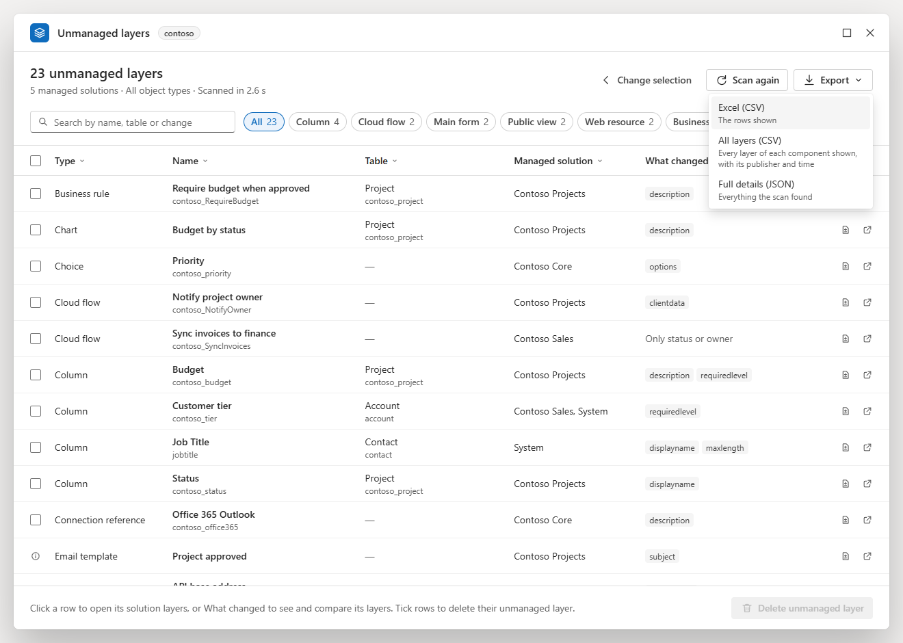

*The **Export** menu before any deletion: **Excel (CSV)** (the rows shown), **All layers (CSV)** (every layer of each
component shown, with its publisher and time) and **Full details (JSON)** (everything the scan found). **Deletion log
(CSV)** is added after the first run of the session. The files are named after the environment and the time in UTC,
for example `unmanaged-layers-contoso-202610151432.csv`.*

| Menu item | Under it | Rows | File name |
| --- | --- | --- | --- |
| Excel (CSV) | The rows shown | The rows the search and filters leave, without deleted ones | `unmanaged-layers-<env>-<stamp>.csv` |
| All layers (CSV) | Every layer of each component shown, with its publisher and time | One per layer of each of those rows | `unmanaged-layers-all-layers-<env>-<stamp>.csv` |
| Full details (JSON) | Everything the scan found | The whole result | `unmanaged-layers-<env>-<stamp>.json` |
| Deletion log (CSV) | Every deletion of this session, with the removed changes | One per component of every run | `unmanaged-layers-deleted-<env>-<stamp>.csv` |

`<env>` is the environment's name (the first part of its address, `ORG`); `<stamp>` is the date and time to the
minute, in UTC, digits only, for example `202610151430` (`stamp`). `download` saves a file through a temporary `blob:`
address and an invisible link, and frees the address a minute later.

### 11.1 Excel (CSV)

`toCsv` writes the rows of `shown()` that are not deleted: every row that the search and the filters leave, in the
order shown (with the column sort), including rows beyond the 2,000 drawn.

| Column | Source |
| --- | --- |
| Type | The type as the maker portal names it (`f.type`) |
| Display name, Schema name | `f.display`, `f.schema` |
| Table | Display name and logical name, for example `Project (contoso_project)` |
| Managed solution | The chosen managed solutions the component is in, by name |
| Managed layers (top first) | The solutions of its managed layers, by name, joined with " > "; empty until its details are read |
| What changed | Every changed property name (not only the first 10), or "Only system values", "Only status or owner", "Layers could not be read"; empty until the details are read |
| Component id | The component's id |
| Solution layers page | The address a row click opens (`layersUrl`) |

### 11.2 All layers (CSV)

`layersCsv` writes one row per layer of each row of the Excel export, as Solution Layers Explorer's Excel export does,
with the component's own columns in front. It uses `f.layerList`, filled by `readDetails` ([6.8](#68-step-4-confirming-and-reading-the-details)) during the scan or
by **Read N more**. A component whose layers were not read gets one row with "(layers not read)": read them first if you need
them.

| Column | Source |
| --- | --- |
| Type, Display name, Schema name, Table, Managed solution, Component id | As in [11.1](#111-excel-csv) |
| Layer component name | The place's layer name (`Relationship` and `EntityRelationship` for the two places of a relationship) |
| Order | `msdyn_order` (the top layer has the highest) |
| Layer solution (unique name) | `Active` for the unmanaged layer |
| Layer solution | "Active (unmanaged layer)", or the solution's display name |
| Publisher | `msdyn_publishername` |
| Overwrite time | `msdyn_overwritetime` as stored; empty when Dataverse dates it 1900-01-01, as it does the Active layer |
| Changed properties | The number of properties in the layer's `msdyn_changes` |
| Component layer id | `msdyn_componentlayerid` |

### 11.3 Full details (JSON)

`exportJson` writes the scan's whole result object, indented by one space, without two internal parts: the solution
names map and the list of every finding in the environment. It is not filtered: deleted findings are included, with
`"deleted": true`. It does not include the scanner's version.

Its keys are the fields of the result that [6.1](#61-inputs-and-the-result-object) lists: what was chosen, the time and the number of requests, the parts
that could not be read (`typesFailed`), the types not checked (`noAccess`), the components left out (`outOfScope`,
`cleared`), the notes, and the `findings`, each with the fields that [4.5](#45-state-and-globals) lists. `notes` and the details of
`outOfScope` are shown only here.

**One layer's data.** The details' *JSON* tab has its own **Copy** and **Download** for the Changes, All properties or
Children of one layer ([9.9](#99-copy-and-download)).

### 11.4 Deletion log (CSV)

The log is described in [10.9](#109-the-deletion-log): one row per component of every run since the page was loaded, with the outcome, the
detail and the unmanaged layer's changes as stored (for a web resource whose content is kept as a file, also that
content, or a note that it could not be read). The final message of each run offers that run's rows alone.

### 11.5 Keeping spreadsheets safe

Every value in the exports comes from the environment, and anyone who can customize it can write text that a
spreadsheet would read as a formula, for example a view named `=HYPERLINK("https://...")`. `csvCell` writes every cell
of the three CSV files:

`layer-scanner.js`, `csvCell`:

```js
const csvCell = (v) => { let s = String(v == null ? '' : v); if (/^[=+\-@\t\r]/.test(s)) s = "'" + s; return `"${s.replace(/"/g, '""')}"` }   // no spreadsheet formulas
```

* A value that starts with `=`, `+`, `-`, `@`, a tab or a carriage return gets an apostrophe in front, so a spreadsheet
  shows it as text instead of running it. `=HYPERLINK(1)` is written `"'=HYPERLINK(1)"`, and `-1` is written `"'-1"`.
* Every cell is quoted and quotes inside are doubled, so commas and line breaks in values are safe.
* The files start with a byte order mark and use Windows line endings (CR LF), so Excel opens them as UTF-8 with a
  double-click.
* Excel holds at most 32,767 characters in a cell. A long value, such as a form's changes in the deletion log, may be
  cut when the file is opened in Excel; the file itself holds the whole value.

**Reading the files with a script.** Remove the byte order mark, read the cells as quoted CSV, and remove a leading
apostrophe when the character after it is one of `=`, `+`, `-`, `@`, a tab or a carriage return.

**What the exports contain.** Names, ids and values of the environment's components, and in the JSON the
environment's address. They never contain the sign-in: no token, no cookie. Treat them as you treat the environment's
configuration.

---

## 12. Building and packaging

The product is one source file, `layer-scanner.js`. `build-bookmarklet.mjs` turns it into the three built files that
[2.4](#24-build) lists, all committed to the repository and attached to each release ([16.6](#166-tag-and-publish)): the minified scanner,
`layer-scanner.min.js`, which can also be pasted into the browser's console ([15.4](#154-running-the-code-without-the-favourite)); the favourite's address,
`layer-scanner.bookmarklet.txt`, a `javascript:` link that carries the minified scanner compressed; and the install
page, `Install unmanaged layer scanner.html`. This chapter follows the build step by step, then explains the loader in
the link and the size limit, the page's script policy, the version, the environment rules and the install page.

Run the build from the repository's root, after `npm ci` has installed terser and the packages it needs, at the
versions of `package-lock.json` ([2.3](#23-install-the-npm-packages)):

```powershell
npm ci
node build-bookmarklet.mjs
```

`npm run build` does the same as the second line. The last line of the output gives the version and the sizes, for
example `bookmarklet 1.0.0: 71063 characters (164.9 KB unpacked)`.

### 12.1 `build-bookmarklet.mjs` step by step

1. **The version.** It reads `version` from `package.json` and writes it into the code in place of
   `const VERSION = '__VERSION__'` ([12.4](#124-the-version)).
2. **The environment rules.** If `scanner.settings.json` exists next to the script, it checks the file and writes its
   patterns into `CONFIG` ([12.5](#125-environment-rules-scannersettingsjson)).

   `build-bookmarklet.mjs`, the replacements and the settings:

   ```js
   let src = fs.readFileSync(path.join(here, 'layer-scanner.js'), 'utf8')
   const put = (from, to) => { if (!src.includes(from)) throw new Error(`layer-scanner.js no longer contains: ${from}`); src = src.replace(from, to) }
   put("const VERSION = '__VERSION__'", `const VERSION = ${JSON.stringify(version)}`)
   const settingsFile = path.join(here, 'scanner.settings.json')
   const settings = fs.existsSync(settingsFile) ? JSON.parse(fs.readFileSync(settingsFile, 'utf8')) : {}
   const RULES = ['developmentEnvironments', 'productionEnvironments']
   if (!settings || typeof settings !== 'object' || Array.isArray(settings)) throw new Error('scanner.settings.json must be a JSON object, as in scanner.settings.example.json')
   // A misspelled name would otherwise be ignored and leave, for example, deleting allowed in a development environment.
   const unknown = Object.keys(settings).filter((k) => !RULES.includes(k))
   if (unknown.length) throw new Error(`scanner.settings.json: unknown setting${unknown.length > 1 ? 's' : ''} ${unknown.join(', ')}. The settings are: ${RULES.join(', ')}.`)
   const applied = []
   for (const key of RULES) {
     const pattern = settings[key]
     if (pattern == null || pattern === '') continue
     if (typeof pattern !== 'string') throw new Error(`scanner.settings.json: ${key} must be a regular expression written as a string`)
     new RegExp(pattern, 'i')   // stops the build on an invalid pattern
     put(`${key}: null,`, `${key}: new RegExp(${JSON.stringify(pattern)}, 'i'),`)
     applied.push(`${key} /${pattern}/i`)
   }
   const local = applied.length > 0
   if (local) console.log(`Built with your environment rules from scanner.settings.json (${applied.join('; ')}): for your organization only, do not publish this build.`)
   else if (fs.existsSync(settingsFile)) console.log('scanner.settings.json names no environment: built without environment rules.')
   ```

   `put` replaces exact text and stops the build when the text is not found, so a reworded line in `layer-scanner.js`
   can never be skipped without notice. The checks stop the build, in this order, on a file that is not valid JSON or not a
   JSON object, on a setting name other than the two rules, on a value that is not a string, and on an invalid regular expression;
   an empty or `null` value is skipped ([2.4](#24-build) gives the messages).
3. **The message.** When at least one rule was applied, the build prints the rules, each as the regular expression it
   built: "Built with your environment rules from scanner.settings.json (developmentEnvironments /^contoso-dev\d*$/i;
   productionEnvironments /^contoso(-preprod)?$/i): for your organization only, do not publish this build." When the
   file exists but sets no rule, it prints "scanner.settings.json names no environment: built without environment
   rules." Without the file it prints neither.
4. **Minify.** terser minifies the code (`ecma: 2020`, two compression passes, names shortened, no comments).
5. **Spaces in the templates.** The line breaks and indentation kept in the HTML and CSS templates come out of terser
   as `\n` followed by spaces; the build turns each such run into one space (`min.code.replace(/\\n +/g, ' ')`). A
   string that needs a real line break followed by spaces must therefore be built in two parts, as `indentJson` does
   with `'\n' + '  '.repeat(depth)`.
6. **Write `layer-scanner.min.js`.**
7. **Compress.** The minified code is compressed with raw deflate (level 9) and encoded in base64.
8. **Write the link** into `layer-scanner.bookmarklet.txt` ([12.2](#122-the-loader-and-the-size-limit)).
9. **Write the install page** ([12.6](#126-the-install-page)), and print the sizes.

### 12.2 The loader and the size limit

The favourite's address holds a small loader and the compressed scanner:

`build-bookmarklet.mjs`, the loader:

```js
const loader = `void (async()=>{try{const t=await new Response(new Blob([Uint8Array.from(atob('${packed}'),(c)=>c.charCodeAt(0))]).stream().pipeThrough(new DecompressionStream('deflate-raw'))).text();try{(0,eval)(t)}catch(e){if(!(e instanceof EvalError))throw e;const s=document.createElement('script');s.src=URL.createObjectURL(new Blob([t],{type:'text/javascript'}));s.onerror=()=>alert('This page does not allow the unmanaged layer scanner to run.');document.head.appendChild(s)}}catch(e){alert('The unmanaged layer scanner could not start: '+e.message)}})()`
```

What it does when the favourite is clicked:

1. `atob` decodes the base64 text into bytes.
2. The browser's own `DecompressionStream('deflate-raw')` unpacks them; `Response(...).text()` reads the result as
   UTF-8 text.
3. The text runs with an indirect `eval` ([12.3](#123-eval-blob-and-the-pages-script-policy)).
4. Any error on the way shows "The unmanaged layer scanner could not start: *message*".

`void` makes the whole expression give `undefined`. A `javascript:` address that gives a value would replace the page
with it.

The build then escapes only what a `javascript:` address needs: `%` (so that decoding gives back exactly the code),
`#` and `?` (so that nothing that stores or parses the address can split it there), and characters outside printable
ASCII. The base64 text contains none of them, so the link stays readable.

**The size limit.** The project's rule is to keep the link under about 100 KB, the size Edge accepts as a favourite's
address. The minified code alone is about 165 KB. Compressed and in base64, version 1.0.0 is a link of 71,063
characters (69.4 KB). Each kilobyte of minified code costs about 0.4 KB of link. Comments and long names cost nothing
(terser removes and shortens them); new texts, CSS and code do. Check the size after every build ([16.3](#163-check-the-link-size)).

### 12.3 eval, blob and the page's script policy

The scanner runs inside the page it is started on, so the page's Content Security Policy decides what it may do.

* **Environment pages** (`https://<org>.crm.dynamics.com/...`) have no script policy, and the maker portal's policy
  allows `eval`. The loader runs the code with an indirect `eval`, `(0,eval)(t)`, which runs it in the page's global
  scope rather than inside the loader's function.
* **A page that forbids `eval`** throws an `EvalError`. The loader then puts the code into a `blob:` address and adds a
  `<script>` element that loads it. A policy that allows `blob:` scripts runs it.
* **A page that forbids both** fires the script's error event: "This page does not allow the unmanaged layer scanner to
  run."
* **Trusted Types.** The window is drawn with `innerHTML` from escaped text. A page that enforces Trusted Types would
  stop the window from being drawn. Neither the environment's pages nor the maker portal enforce them at the time of
  writing.

The window itself lives in a shadow root, with its styles in a constructed style sheet (or a `<style>` element where
the browser has no constructed style sheets), so the page's styles do not reach it and its styles do not reach the
page.

### 12.4 The version

`package.json` holds the one version number. The build writes it into `VERSION`, and it shows in four places:

| Where | How |
| --- | --- |
| The window | The tooltip of the title "Unmanaged layers": "Unmanaged layer scanner 1.0.0" |
| The console | `window.__layerScanner.version` |
| The install page | The footer: "Version 1.0.0 · built 2026-10-15 · 69.4 KB link (164.9 KB unpacked)" |
| The build output | `bookmarklet 1.0.0: ...` |

The exports do not carry it. Code pasted from `layer-scanner.js` without a build shows `__VERSION__` ([15.4](#154-running-the-code-without-the-favourite)).

### 12.5 Environment rules: `scanner.settings.json`

The published scanner knows no environment names: anyone can delete anywhere they have the rights to, and no
environment is named production. An organization can add two rules at build time, in an optional
`scanner.settings.json` next to `build-bookmarklet.mjs`:

`scanner.settings.example.json`:

```json
{
  "developmentEnvironments": "^contoso-dev\\d*$",
  "productionEnvironments": "^contoso(-preprod)?$"
}
```

Each value is a regular expression, written as a JSON string (so `\d` is written `\\d`), matched without regard to
case against the environment's name: the first part of its Dataverse address, `ORG`. On the maker portal it is the
name of the environment's Dataverse address too, so the rules apply the same way there.

| Rule | In the environments it matches |
| --- | --- |
| `developmentEnvironments` | Deleting is off: `removeLayers` refuses, the Delete buttons are not drawn, every tick box is disabled, an amber *Development* badge sits in the title bar (tooltip "Deleting is turned off in development environments"), and the bottom bar ends with "Deleting is turned off in development environments." |
| `productionEnvironments` | A red *Production* badge in the title bar, and the red note in the confirmation ([10.2](#102-the-confirmation)) |

With the example, `contoso-dev`, `contoso-dev1` and `contoso-dev12` are development environments, `contoso` and
`contoso-preprod` are production, and `contoso-test` is neither. An environment that matches both has deleting turned
off and a *Production* badge.

**Anchor the patterns.** Without `^` and `$`, `contoso` matches `contoso-dev` and `contoso-test` as well.

**What the build checks.** The file must be a JSON object, as in the example, and may hold only these two settings: a
misspelled name would otherwise be ignored and leave deleting allowed in a development environment, so it stops the
build ("scanner.settings.json: unknown setting developmentEnvironment. The settings are: developmentEnvironments,
productionEnvironments."). Each value must be a string that is a valid regular expression; an empty or `null` value
sets no rule. The build then prints the rules it applied, so they can be checked: "Built with your environment rules
from scanner.settings.json (developmentEnvironments /^contoso-dev\d*$/i; productionEnvironments
/^contoso(-preprod)?$/i): for your organization only, do not publish this build." A file that sets no rule prints
"scanner.settings.json names no environment: built without environment rules.", and the build is the same as one
without the file. [2.4](#24-build) lists every message that stops the build.

`IS_DEV` and `IS_PROD` are computed once, when the scanner starts. Changing `CONFIG.developmentEnvironments` from the
console afterwards has no effect.

**Never publish such a build.** The file is not published (`.gitignore` lists only the files that are), but the built
files are, and a build made with the file carries its patterns. Build your organization's copy in a separate folder
([13.1](#131-name-your-development-and-production-environments)), and check every release build ([16.4](#164-check-that-no-local-settings-were-used)).

### 12.6 The install page

`Install unmanaged layer scanner.html` is a small page, written by the build, with:

* a short description of the scanner;
* **Install**: "Show the favourites bar (Ctrl+Shift+B)." and "Drag this button onto the favourites bar:", followed by
  the **Unmanaged layers** link; for when dragging does not work, the link in a read-only text box with a **Copy**
  button, to paste as the address of a new favourite named *Unmanaged layers*;
* **Use**: three steps (open a page of the environment, or its Solutions page in the maker portal; click the favourite,
  choose the managed solutions and **Scan**; filter, open, export, or tick components and delete);
* a red note: deleting cannot be undone, what it does, that each component is checked before and after, and that a
  log can be downloaded. A build with `developmentEnvironments` adds "Deleting is turned off in development
  environments.";
* the footer: version, build date and sizes.

The page needs no server: open the file from disk. (GitHub shows an HTML file as source text, so download it first.)
A new version replaces the old favourite: drag the new link and remove the old one, or paste the new address into it.

---

## 13. Customization recipes

Each recipe gives the goal, the places to change, and how to check the result. After any change to
`layer-scanner.js`, run `node build-bookmarklet.mjs`, check the link size ([16.3](#163-check-the-link-size)), and install the new link: the old
favourite keeps the old code.

Many limits can also be tried without a build: `window.__layerScanner.config` is the live `CONFIG` object ([13.2](#132-change-limits-and-timings)).

### 13.1 Name your development and production environments

**Goal:** no deleting in development environments, and a red warning in production ones, for your organization only.

1. Make a copy of the repository folder for your organization's build, so that the files you commit are never built
   with your rules.
2. In the copy, copy `scanner.settings.example.json` to `scanner.settings.json` and write your patterns ([12.5](#125-environment-rules-scannersettingsjson)).
3. Try the patterns against your environments' names in `node`, started in that folder:

   ```js
   const s = require('./scanner.settings.json')
   const dev = new RegExp(s.developmentEnvironments, 'i'), prod = new RegExp(s.productionEnvironments, 'i')
   for (const n of ['contoso', 'contoso-preprod', 'contoso-dev', 'contoso-dev2', 'contoso-test']) console.log(n, dev.test(n), prod.test(n))
   ```

   With the example patterns: `contoso false true`, `contoso-preprod false true`, `contoso-dev true false`,
   `contoso-dev2 true false`, `contoso-test false false`.
4. Run `node build-bookmarklet.mjs`. It prints the rules it applied: "Built with your environment rules from
   scanner.settings.json (developmentEnvironments /^contoso-dev\d*$/i; productionEnvironments /^contoso(-preprod)?$/i):
   for your organization only, do not publish this build." Check that both of your rules are listed. An invalid
   pattern stops the build with the regular expression's error, and a misspelled setting name with "scanner.settings.json:
   unknown setting ... The settings are: developmentEnvironments, productionEnvironments." If it prints
   "scanner.settings.json names no environment: built without environment rules.", the file sets no rule (both values
   empty or `null`).
5. Share the install page of that build inside your organization only.

**Check:** in a development environment the title bar shows *Development*, no Delete button is drawn and the tick
boxes are disabled. In a production environment the title bar shows *Production* and the confirmation has the red
note. The install page says "Deleting is turned off in development environments."

### 13.2 Change limits and timings

The limits that are meant to be changed are in `CONFIG`, at the top of `layer-scanner.js`. [Appendix A.1](#a1-config)
lists every key. The ones changed most often:

* **`autoDetails`** (500): *What changed* is read during the scan for this many findings; **Read N more** reads this
  many at a time. Higher means longer scans of environments with many findings.
* **`maxRows`** (2,000): rows drawn in the list. The exports include every row anyway.
* **`maxRemovePerRun`** (100): the most components in one run. A run of 100 takes about 15 minutes.
* **`concurrency`** (4) and **`detailConcurrency`** (3): requests in flight at once, and components whose layers are
  read at once. Dataverse allows 52 concurrent requests per user, shared with every other tab and tool of that user;
  keep these low.
* **`readTimeout`** (5 minutes): a read with no full answer by then is ended and not sent again.

**Trying a value without a build.** In the console of the page (F12 → **Console**, top frame), for example:

```js
window.__layerScanner.config.autoDetails = 50
```

Every key except the two environment rules is read where it is used, so the change counts from the next scan or run
until the page is reloaded. To keep it, change `CONFIG` and build.

Other limits are written in the code where they are used:

| Limit | Value | Where |
| --- | --- | --- |
| Attempts per request | 6 | `requestOnce` |
| Pause before a read is tried again after a network error, 502 or 503 | 2, 4, 8, 16, 32 seconds | `requestOnce` |
| Retries of a read after 500 or 504 (usually a server timeout) | 1, after 3 seconds | `requestOnce` |
| Pause after 429 | Retry-After, or 2, 4, 8, ... seconds; one pause shared by every request | `requestOnce` |
| Maker portal token: least time left to connect, to send a request | 120 seconds, 30 seconds | `connectMaker`, `requestOnce` |
| Maker portal environment check | 30-second time limit per address | `connectMaker` |
| Confirmation's sign-in warning | Under 60 seconds + 20 seconds per component | `confirmDelete` |
| Customization lock | 10 seconds, up to 5 retries | `removePlace` |
| Ids per solution component request | 50 | `scan` |
| Tables per metadata request, requests at once | 100, 2 | `scan` |
| Pages per query | 2,000 | `getAll` |
| Names listed in a failure | 20 | `scan` (`someOf`) |
| Places whose full layers are kept for the details | 20 | `fullLayers` |
| Characters of a value compared, lines of a difference drawn | 1,000,000, 3,000 | `propBodyOf`, `diffHtml` |
| Differing lines compared line by line | 2,000 edits | `diffLines` |
| XML laid out | Up to 3,000,000 characters and 200,000 lines | `prettyXml` |
| JSON highlighted | Up to 500,000 characters | `highlightJson` |
| Values listed in a column menu | 300 | `renderPop` |
| Estimate per component before the first is done | 8.5 seconds | `timeLeft` |
| Messages | 5 seconds, 8 seconds with an action | `toast` |
| Smallest window | 720 x 560 pixels | `MIN_W`, `MIN_H` |

**Check:** for page sizes and concurrency, watch the **Network** tab ([15.2](#152-the-network-requests-to-look-at)); for the details' limits, open a large
form's details.

### 13.3 Add a component type

**Goal:** a component type the scan does not read, or reads under the wrong name, is found, named and linked.

**First, check whether it is needed.** At each scan the scanner reads `solutioncomponentdefinitions` ([6.2](#62-step-1-one-sweep-per-component-type)) and adds
every type that has a `primaryentityname` and is not in `CLASSIC`, with the definition's name as the layer name and the
table's display name as the label. Most newer types work that way. Add a type to `CLASSIC` when the definition has no
table, when its name is not the name Dataverse files the layers under (email templates, for example, are filed under
`Template`; the name `EmailTemplate` returns no layers), or for a better label.

**How email templates are wired**, as an example: their entries, taken from the four places that name type 36.

```js
36: ['template', 'Template', 'Email template'],   // CLASSIC: table, layer name, label
36: ['title', null],                              // NAMES: display name column, schema name column
36: 'Email templates',                            // CODE_GROUP: the object type group
const undeletable = new Set([36])                 // Dataverse does not delete their unmanaged layer
```

**The maps**, all near the top of `layer-scanner.js` except the last three:

| Map | Entry | Needed when |
| --- | --- | --- |
| `CLASSIC` | `<n>: ['<table>', '<LayerName>', '<Label>']`; table `''` for a type with no component table (found by the solution summary only) | See above |
| `NAMES` | `<n>: ['<display column>', '<schema column>']` | The primary name is not the right display name, or no `uniquename`, `schemaname` or `connectionreferencelogicalname` column holds the schema name |
| `TABLE_COLUMN` | `<n>: '<column>'` | The type belongs to a table: the column that holds the table's logical name |
| `SUBTYPE_COLUMN` | `<n>: '<column>'`, with a label map like `FORM_TYPE` and a line for it in `typeLabel` | The type has kinds, as forms, views and processes do |
| `WANTED_COLUMNS` | Add `'<column>'` | A column named in `NAMES` or `SUBTYPE_COLUMN` is not yet in the list and is not the table's primary name column: the scan looks for these columns only, and leaves out a column it did not find |
| `TYPE_FILTER` | `<n>: '<OData condition>'` | Some rows of the table are not components (as business unit copies of roles) |
| `TABLE_BOUND` | Add `<n>` | The type belongs to a table: it is then swept when tables are chosen |
| `TABLE_PARTS` | Add `<n>` | A table held "with all objects" brings the type with it |
| `CODE_GROUP` | `<n>: '<group>'` | The type belongs to an object type group other than *Other* ([13.6](#136-change-which-object-types-are-offered)) |
| `PART_SEGMENT` | `<n>: '<segment>'` | A table part whose maker portal page is `.../objects/entities/<table>/<segment>/<id>/layers` |
| `CLASSIC_PAGE` | Add `<n>` | The maker portal has no layers page for the type: links open the classic *Solution layers* page |
| `undeletable` | Add `<n>` | Dataverse refuses to remove the type's unmanaged layer |

`METADATA` holds tables, columns, relationships and keys, whose tables have no `ismanaged` column. Do not add to it.

**Finding the values.** In the address bar of a browser signed in to the environment (a Web API GET shows its JSON),
or in the console:

1. The type number: `https://contoso.crm.dynamics.com/api/data/v9.2/solutioncomponents?$select=componenttype&$filter=objectid eq <component id>`.
2. Its definition: `.../solutioncomponentdefinitions?$select=name,primaryentityname&$filter=solutioncomponenttype eq <n>`.
3. The component table must have `ismanaged` and `solutionid`:
   `.../EntityDefinitions(LogicalName='<table>')/Attributes?$select=LogicalName&$filter=LogicalName eq 'ismanaged' or LogicalName eq 'solutionid'`
   must list both. A table without them cannot be swept: its number goes to `typesWithoutColumns` in the JSON export,
   and only the solution summary can find its components.
4. The layer name: with the scanner open, try names in the console until layers come back, starting with the
   definition's name:

   ```js
   await window.__layerScanner.getLayers('<component id>', '<LayerName>')
   ```

   An empty list means a wrong name (or no layers).

**Check:** change a component of that type in a test environment, build, scan its solution: the row has the right
type, name, table and object type group; its details show the layers; its link opens its layers page; and, in the test
environment, deleting it gives *Deleted*.

### 13.4 Change texts

There is no separate file of texts: every text is written where it is used in `layer-scanner.js`, mostly in the
window's HTML template (`app.innerHTML`), in the functions that draw (`renderPickBar`, `syncSelection`,
`renderBanners`, `renderResults`, `confirmDelete`, `runDelete`) and in `STATUS`, `SPECIAL_TIPS`, `NO_DELETE` and the
alerts at the top. The install page's texts and the loader's two alerts are in `build-bookmarklet.mjs`. Search for the
text and change it there. Keep the style of the others: plain words, sentence case, Canadian spelling.

**Texts the code looks for.** A few texts are also matched by the code. Change both sides together:

| Text | Written in | Matched in |
| --- | --- | --- |
| "does not allow deleting the unmanaged layer" | `removePlace` | `runDelete`, to add the type to `undeletable` |
| "could not be read" | `readDetails`, `loadDetails` (`f.changed`) | `scan`, to decide that a component could not be placed |
| "you stopped the run" | `removeLayers` | `statusCell` (not shown in the row) and `runDelete` (ticked again) |
| "sign-in" or "session" | The two session-expired messages | `renderResults`, to show "Your sign-in has expired" |
| "Only system values", "Only status or owner" | `readDetails` | `SPECIAL_TIPS` (their tooltips) |
| The outcome names (`Deleted`, `Not attempted`, ...) | `removeLayers` | `STATUS`, `runDelete`'s counts, the log |
| The object type group names | `GROUPS` | Saved selections and the remembered choice keep only names in `GROUPS` |

Dataverse's own texts are matched too ("Resource not found for the segment", the lock and 0x8004f059 errors in
`removePlace`, `CheckPrivilege` in `scan`). Those come from Dataverse and must not be changed.

**Line breaks.** The build turns a line break followed by spaces into one space ([12.1](#121-build-bookmarkletmjs-step-by-step), step 5).

**Check:** build, open the screen that shows the text, and check that no row, button or bar now cuts it off: most
texts sit on one line with an ellipsis.

### 13.5 Change the look

**Where:** `STYLE`, the style sheet of the window, and `P`, the icons. [8.1](#81-shadow-dom-and-styles) describes both: the Fluent 2 design
tokens (custom properties on `.app`) with their values and uses, the colours written directly, the type, the shapes
and depth, the icons and the container query for narrow windows.

* **A colour** of the window: change its custom property on `.app`; every control uses the tokens. The colours written
  directly are found by searching `STYLE` for them. The deleting pill (`.mini`) lies outside `.app` and has its own
  colours. The window has one colour scheme, light, and no dark theme.
* **An icon:** add or change its path data in `P` (a 20 by 20 grid, drawn with a stroke by `icon(name, size)`).
* **A narrow window:** `@container (max-width:900px)` holds the rules below 900 pixels. The results grid keeps a
  minimum width of 1,000 pixels and scrolls sideways below it.
* **Motion:** `@media (prefers-reduced-motion:reduce)` turns the animations off; add any new animation to that rule.
* **No jumps:** nothing is inserted above content once it is drawn, placeholder rows have the size of real rows, and
  texts that change keep a minimum width ([8.2](#82-views-and-rendering)). Keep it that way.

**Check:** build, then go through every state: the choice screen (wide and narrow), scanning, results, a column menu,
the details (each tab), the confirmation, a run, the pill, and the messages ([A.5](#a5-messages)). Compare screenshots before and
after.

### 13.6 Change which object types are offered

**Where:** `GROUPS`, `TYPE_SECTIONS`, `CODE_GROUP`, `groupOf`, `typeWanted` and `TABLE_GROUPS` ([4.4](#44-constant-tables-classic-names-metadata-groups-and-others) and [6.5](#65-object-types-and-tables) show
them).

| Name | What it is |
| --- | --- |
| `GROUPS` | Every object type group. Also the names kept in saved selections and the remembered choice |
| `TYPE_SECTIONS` | How the choice screen arranges the groups, under headings (Data; Forms and views; ...) |
| `CODE_GROUP` | Type number to group |
| `groupOf(f)` | A finding's group: forms split into Forms and Dashboards, processes into Business rules, Cloud flows and Other processes, connection references found by their layer name |
| `typeWanted(code, kind, groups)` | Whether a type must be swept for the chosen groups. Must agree with `groupOf` |
| `TABLE_GROUPS` | The groups still offered when tables are chosen (those that can belong to a table) |

**Example: a group of its own for custom APIs**, found by their layer name as connection references are (new code;
check the definition's name in your environment first, [13.3](#133-add-a-component-type)):

```js
const isCustomApi = (kind) => /^customapi$/i.test(kind || '')
// in groupOf, before the last line:
if (isCustomApi(f.kind)) return 'Custom APIs'
// in typeWanted, before the last line:
if (isCustomApi(kind)) return groups.has('Custom APIs')
```

Then add `'Custom APIs'` to `GROUPS` (before `'Other'`) and to the Automation section of `TYPE_SECTIONS`. Custom APIs
belong to no table, so `TABLE_GROUPS` stays as it is.

A group that is renamed or removed drops out of saved selections and of the remembered choice the next time they are
read. Tell people to save their selections again.

**Check:** the choice screen shows the new group; scanning with only that group ticked lists only its components; the
results' Type column and bubbles are unchanged (they show types, not groups).

---

## 14. Testing your changes

Test every change in a development or test environment, never in production, in Edge with the developer tools open
(F12). The repository holds no automated tests: the harness used during development drives a signed-in browser against
a test environment and is not part of the published project. What a change has to pass is the build ([chapter 12](#12-building-and-packaging)) and
the checklists below.

Prepare:

* a test environment where you may change and delete customizations;
* a managed test solution of your own, with unmanaged layers on its components ([14.1](#141-a-test-solution-of-your-own));
* the **Network** tab of the developer tools, with **Preserve log** on and the filter `api/data/v9.2`;
* the **Console** tab, for `window.__layerScanner` ([15.1](#151-the-browser-console-and-window__layerscanner)).

Some checks change how requests behave by wrapping `window.fetch` in the console. The scanner calls the page's
`fetch` for every request, so a wrapper sees them all. Use this only in a test environment, and reload the page
afterwards.

### 14.1 A test solution of your own

1. In a development environment, create a publisher with a prefix of its own (for example `tst`) and an unmanaged
   solution with components of many types: a table with three columns, a 1:N relationship, a main form, two public
   views, a chart, a business rule, a cloud flow, a JavaScript and a PNG web resource, an environment variable, a
   connection reference, a global choice, a security role, an email template, a model-driven app and its site map.
2. Export it as **managed**, and import it into the test environment.
3. In the test environment, change each component there: a column's display name, description and required level; a
   view's columns or filter; a field added to the form; the chart's description; the web resource's content; the
   environment variable's default value; the relationship's cascade delete; the email template's subject; the app's
   description; an area in the site map; the table's display name. Each change puts an unmanaged layer on top.
4. Write the changes down, or script them: after every delete test you put them back.

Some changes create no unmanaged layer: switching a managed cloud flow off, and adding a value to a managed global
choice. A role's privilege changes are not in its layer data: the role's details show only system values.

### 14.2 Scan checks

| Test | How | Expected |
| --- | --- | --- |
| The scan only reads | Scan; Network tab, add the **Method** column | Every request of the scanner (they carry `Prefer: odata.maxpagesize=5000`; the app sends requests of its own) is a GET, and none goes to `RemoveActiveCustomization` |
| Everything is found | Scan only the test solution | One row per changed component, with type, name, schema name (for the types that have one; email templates have none), table and the solution filled in; the email template without a tick box |
| The same as the maker portal | Click a few rows | Each opens the component's *Solution layers* page in the test solution, with Active on top |
| Only the chosen solution | Scan another managed solution that does not hold the test components | None of them listed |
| Object types | Tick only Forms and Views | Only forms and views (dashboards are a group of their own) |
| Tables | Choose the test table | The table and its columns, relationship, form, views and chart; no web resources, roles or apps; those types are not offered while tables are chosen |
| Paging | `window.__layerScanner.config.pageSize = 50`, **Scan again** | The same rows; more requests (`requests` in Full details JSON) |
| Stop | **Stop scan** during a scan of every solution | Back to the choice screen within about a second, "Scan stopped."; pending reads show as *(canceled)* in the Network tab |
| A part that cannot be read | Network tab → right-click a `msdyn_solutioncomponentsummaries` request → **Block request URL**, scan | After about a minute (the read is tried 6 times), the amber banner "Some parts couldn't be read, so this list might be incomplete."; **Details** names the solution summary with "network error" |
| A read that takes too long | `config.readTimeout = 1000` and network throttling (**Slow 3G**) | "Scan didn't finish", **Details**: "... no answer within ... minutes"; the read is not sent again |
| Details read later | `config.autoDetails = 2`, scan | Only two rows show *What changed*, besides those found by the solution summary alone (always read); the banner "What changed is shown for ... components. ... more aren’t read yet." with **Read 2 more** |
| Drawn rows | `config.maxRows = 5`, scan | The subtitle ends with "the first 5 are drawn"; Excel (CSV) still has every row |

A `config` value set in the console counts from the next scan (**Scan again**). Reset the values you changed, or
reload the page, after each test. For a second opinion on one solution, compare with Solution Layers Explorer
(XrmToolBox); in tests it missed email templates, connection references and relationships' cascade settings, which the
scanner finds.

### 14.3 Details checks

| Test | Expected |
| --- | --- |
| What changed of the form | The Active layer (green) against the managed layer under it (red); `formxml` laid out one attribute per line; unchanged stretches folded ("12 unchanged lines"), unfolded by a click |
| **Swap**, the two pickers, **Inline** / **Side by side** | Each picker offers every layer except the other's; with two layers both are fixed |
| **Only differences**, **Hide system values** | Same properties and system values (Modified on, overwrite time) appear and disappear |
| The JavaScript web resource | Its content decoded from base64 and compared line by line |
| The PNG web resource | Both images, and "(image, *n* bytes)" |
| A web resource whose content Dataverse keeps as a file (its layers hold `contentfileref` in the *JSON* tab) | One GET `webresourceset(<id>)?$select=content,contentfileref` when the details load. One property, `content`, and no `contentfileref` row. With the Active layer's file in effect and the managed layer's file another one: the lead sentence ("*managed layer*'s content can't be read here, ..."); on the red line, "its content is kept as a file that Dataverse doesn't give out through the Web API", no content and no Copy; on the green (Active) line, "decoded from base64" (or "its content" for an image), **Copy Active** and the content (decoded, an XML type laid out, an image shown). Nothing is compared line by line ([9.11](#911-web-resource-content-kept-as-a-file-contentfileref)) |
| A web resource whose Active layer holds its content in the layer while the managed layer keeps it as a file (right after the content is saved through the Web API) | The same `content` row: the managed layer's line gives the reason, the Active layer's content is shown with **Copy Active**. When both sides can be read (in the layer, or the top layer's file in effect), the row is compared as any other value, and the same base64 kept the two ways is *Same* ([9.11](#911-web-resource-content-kept-as-a-file-contentfileref)) |
| The relationship | **Cascade settings** and **Definition**; the changed cascade on the first |
| Layers tab | Order, solution, publisher, *Managed* or *Unmanaged*, version, overwrite time (for the unmanaged layer, *Last changed* or *Last published* with a date), changed properties; **Compare with Active**, **JSON** |
| JSON tab | Changes, All properties and Children of any layer; **Copy**; **Download** gives `<layer>-<id>-<solution>-changes.json` |
| **Copy** a value | The value as stored (pasted into an editor, not laid out); web resource content decoded. A short value has a **Copy** link at the end of each layer's line, and the toast says "Copied the value in *layer*." ("Copied the content in *layer*." for a web resource's content) |
| Previous and next | Alt+Up and Alt+Down follow the list's order; Escape returns to the row |

The formatting functions can be tried in the console, without a component:

```js
const p = window.__layerScanner.parts
p.indentJson('{"cascadeMask":9223372036854775807,"b":[],"c":[1,2]}')   // the digits are kept, [] stays on one line
p.prettyXml('<a x="1" y="2"><b>t</b></a>')                            // x and y on lines of their own, <b>t</b> as written
p.scalarText(p.parseJson('[1.0, 1e2, "1.0", 12345678901234567890]'))   // indented; the numbers as written, the text in quotes
```

### 14.4 Deleting checks

Delete only layers of your test solution, and put them back afterwards ([14.1](#141-a-test-solution-of-your-own)).

| Test | Expected |
| --- | --- |
| Tick three rows, sort Name Z to A, **Delete 3 unmanaged layers** | The dialog lists them in the order shown; **Cancel** has the focus; Escape or **Cancel** sends nothing |
| Tick a row, then filter it out | The dialog lists it last, with "hidden by the search or filters" |
| **Delete** | For each component: a GET of its layers, one GET `RemoveActiveCustomizations(...)`, a GET of its layers; for a relationship changed in both places, twice; for a web resource kept as a file, also a GET `webresourceset(<id>)?$select=content,contentfileref` before the removal; no other write. Rows done in the order of the dialog |
| During the run | The row being deleted has a spinner and the list follows it; the bottom bar counts and estimates; Export, Scan again and the filters are disabled |
| At the end | Rows struck through with a green check; title and bubbles counted down; "Deleted 3 unmanaged layers." with **Download log** |
| **Stop deleting** after the first | "Stopped: 1 deleted, 2 not tried. The ones not tried are still ticked."; the two rows *Not tried* and ticked |
| A layer already removed (remove one in the maker portal after the scan, then delete it here) | *Skipped*, "It has no unmanaged layer on top of a managed layer any more." |
| The email template | No tick box; an information icon with the explanation |
| Close the window during a run | The pill "Deleting unmanaged layers · *n* of 3 · ..."; selecting it opens the window; at the end "Deleting finished" |
| Reload during a run | The browser asks whether to leave |
| The log | Download log: this run's rows; Export → Deletion log (CSV): every run; the JSON column holds each place's layer name, result and changes, and for a web resource kept as a file its `content` (base64) or `contentNote` |
| A development environment (build with `scanner.settings.json`, [13.1](#131-name-your-development-and-production-environments)) | No Delete button, tick boxes disabled, *Development* badge |

Two outcomes can be produced with a `fetch` wrapper, pasted into the console before **Delete**:

```js
// Deleted (not checked): the check after the removal cannot read the layers.
const realFetch = window.fetch
let failNext = 0
window.fetch = (url, init) => {
  const u = String(url)
  if (u.includes('RemoveActiveCustomizations')) failNext = 6
  else if (failNext > 0 && u.includes('/msdyn_componentlayers')) { failNext--; return Promise.reject(new TypeError('Failed to fetch')) }
  return realFetch(url, init)
}
```

After about a minute of retries the row shows *Deleted (not checked)*, "The layers could not be read again to check.",
and the message is "Done: 0 deleted, 1 deleted but not checked." The layer is in fact gone: **Scan again** shows it.

```js
// An expired sign-in at the second component (components with one place each, on an environment page).
const realFetch = window.fetch
let reads = 0
window.fetch = (url, init) => (String(url).includes('/msdyn_componentlayers') && ++reads === 3
  ? Promise.resolve(new Response('', { status: 401 }))
  : realFetch(url, init))
```

The first component is deleted, the second is *Not tried* ("The sign-in expired before this component was tried."),
and the message is "Deleted 1. Your sign-in expired, so the rest weren't tried. Reload the page and scan again."
Restore with `window.fetch = realFetch`, or reload.

### 14.5 Window and keyboard checks

| Test | Expected |
| --- | --- |
| Drag the title bar; drag an edge or a corner | The window moves and resizes, never below 720 x 560 pixels (or the page's size) |
| Double-click the title bar, or the maximize button | Maximized; **Restore down** or dragging the title bar restores it; a single click does nothing |
| Reload, click the favourite | The same place and size, the last choice, the column widths |
| Click the page outside the window | The page reacts; the window stays |
| Escape in the window | Clears a search first, then closes a column menu, a menu, the details or a dialog, then hides the window (during a run: the pill); Escape on the page does nothing to it |
| Tab and Shift+Tab | The focus stays in the window (in the dialog while one is open) |
| Solution and table lists | Arrow keys, Home and End move; Space or Enter ticks |
| Menus (Saved selections, Export, More) | Arrow keys, Home, End; Tab or Escape closes and returns to the button |
| Column menus | Escape closes and returns to the header (a first Escape clears the menu's search); Enter in the search keeps only the values found |
| Details | Left and Right move between tabs (the focus on a tab); Alt+Up and Alt+Down move between components |
| A window narrower than 900 pixels | The choice screen's right column narrows and the object types go to one column; the results scroll sideways instead of squeezing a column; type bubbles that do not fit go under **More** |
| Column edges | Drag to resize; double-click, or **Fit to contents**, to fit; **Reset column widths** |
| Windows' animation effects off | No animations |
| A screen reader | Hears "Scan finished: 23 unmanaged layers." and "Deleted 3 of 3." |

### 14.6 The maker portal

| Test | Expected |
| --- | --- |
| Open a managed solution's page in make.powerapps.com, click the favourite | That solution is ticked, with all object types; the bottom bar adds "selected because it's open in the maker portal" |
| The same on an unmanaged solution | "The solution open in the maker portal isn't managed. Select managed solutions to scan." |
| Network tab from the click | `RetrieveCurrentOrganization` to the Dataverse addresses the portal holds a sign-in for, most recently used first, until one has the page's environment id (usually the first); from then on every scanner request goes to that address only. Do not copy the `Authorization` header |
| Click a row | For most types, the *Solution layers* page in the same maker portal (make.powerapps.com or its preview) |
| Change to another environment in the portal, click the favourite | The old window is replaced by one for the new environment (its name in the title bar) |
| Delete from the portal | As [14.4](#144-deleting-checks); with many components ticked late in the sign-in's life, the amber note in the confirmation |
| The portal signed in with two accounts, none active | "This browser holds the maker portal sign-in of more than one account for this environment, ..." and nothing runs |

### 14.7 Large environments and throttling

The work of a scan follows the number of component types and of components that have an unmanaged layer, not the size
of the environment ([6.10](#610-performance-and-scale)). In a test environment with about 950 tables, 37,000 columns and 517 managed solutions, a full scan
took about 30 seconds and 450 requests; with a page size of 50 it found the same components with about 785 requests.
Dataverse's service protection limits are, per user, 6,000 requests and 20 minutes of execution time in any 5 minutes,
and 52 requests at once.

| Test | How | Expected |
| --- | --- | --- |
| Paging under load | `config.pageSize = 50`, scan every managed solution | The same findings, more requests, no failed part |
| Throttling | The wrapper below, then scan | The scan pauses about 5 seconds three times (every request waits together), then finishes with the same findings |
| The placement limit | `config.layerCheckLimit = 1` in an environment where several findings have no solution component row | INCOMPLETE, "... there are more than 1, so they were not checked: ..." |
| Delete limit | `config.maxRemovePerRun = 2`, tick 3 | "3 selected · You can delete up to 2 at a time.", Delete disabled |
| Time and requests | Full details (JSON) | `seconds` and `requests` of the scan |

```js
// Three answers of 429 with Retry-After: 5 on the solution summary.
const realFetch = window.fetch
let left = 3
window.fetch = (url, init) => (String(url).includes('/api/data/v9.2/msdyn_solutioncomponentsummaries') && left-- > 0
  ? Promise.resolve(new Response('{}', { status: 429, headers: { 'Retry-After': '5' } }))
  : realFetch(url, init))
```

---

## 15. Debugging and troubleshooting

When something does not work, start with the browser's developer tools: the console, where the scanner's own functions
can be called, and the network log, which shows every request it sends. This chapter says what to look at in each,
lists common problems with their causes, and ends with how to start again and how to report a problem.

### 15.1 The browser console and `window.__layerScanner`

The scanner writes nothing to the console. Errors that escape it show there as ordinary errors, from a script without
a file name (the code ran through `eval`). Once started, it leaves one object on the page, `window.__layerScanner`,
whose members [4.6](#46-the-test-hooks-on-window__layerscanner) lists: the version and the environment key, `environment()`, the live `CONFIG` ([13.2](#132-change-limits-and-timings)), `show` and
`destroy`, the scan's functions, `getLayers`, `layersUrl`, `removeLayers` and the `parts` of the details.
`removeLayers` arms the write guard itself: called from the console it deletes **without any confirmation**. Use it
only in a test environment.

A scan from the console, with its progress printed:

```js
const s = window.__layerScanner
const all = await s.listManagedSolutions()
const r = await s.scan(all.filter((x) => x.unique === 'contoso_projects'), (msg, pct) => console.log(Math.round(pct) + '%', msg), { allSolutions: all })
r.findings.length
```

The last progress message is `statusLine` ([6.9](#69-complete-or-incomplete)), for example "Found 17 components with an unmanaged layer in the 1
chosen managed solution(s), in 19.4 s (318 requests)." The window does not keep it on screen.

### 15.2 The network requests to look at

Developer tools → **Network**, filter `api/data/v9.2`. The app itself sends requests too; the scanner's carry
`Prefer: odata.maxpagesize=5000` (or the configured page size). [Appendix A.2](#a2-web-api-requests) lists them all.
The ones to look at first:

| What | Filter on |
| --- | --- |
| The sweep of each component type (the Active solution's id) | `fd140aae` |
| The solution summary | `msdyn_solutioncomponentsummaries` |
| Which solutions the findings are in | `solutioncomponents?` |
| Layers (details, the checks before and after a removal) | `msdyn_componentlayers` |
| The content in effect of a web resource kept as a file (its details, before its removal) | `webresourceset(` |
| Removals | `RemoveActiveCustomization` |
| The maker portal's environment check | `RetrieveCurrentOrganization` |

A failed request's **Response** tab holds Dataverse's `error.message`, which the scanner also shows in a banner's
**Details** or in the row.

### 15.3 Common problems and their causes

The [README](../README.md) covers what users meet. For developers and administrators, also:

| Symptom | Cause | Fix |
| --- | --- | --- |
| "Open the environment (https://<org>.crm.dynamics.com) or its Solutions page in the maker portal (make.powerapps.com) first, ..." | The page is not on a `*.dynamics.com` address or on make.powerapps.com (or make.preview.powerapps.com); for example the install page, or an environment of a sovereign cloud | Open the environment. For other addresses, change the two host checks at the top of `layer-scanner.js`, the address pattern in `connectMaker` and `MAKER` |
| "The maker portal has no current sign-in to this environment's data. ..." | No token for the environment in the portal's storage, or one with less than 2 minutes left; or a portal version that stores its sign-in differently | Wait for the Solutions list, or reload. If it persists, start from the environment's own page |
| "This browser holds the maker portal sign-in of more than one account ..." | Two accounts signed in, none marked active | Sign out of one, or use another browser profile |
| "The unmanaged layer scanner could not start: ..." | The link was cut when it was saved (base64 decoding fails), or a browser without `DecompressionStream` | Install the favourite again from the install page; use a current Edge |
| "This page does not allow the unmanaged layer scanner to run." | The page forbids `eval` and `blob:` scripts ([12.3](#123-eval-blob-and-the-pages-script-policy)) | Start from another page of the environment, or paste `layer-scanner.min.js` into the console ([15.4](#154-running-the-code-without-the-favourite)) |
| Nothing happens on a click | The favourite's address does not start with `javascript:void`, or the browser's policy blocks `javascript:` favourites | Install it again; under such a policy, use the console ([15.4](#154-running-the-code-without-the-favourite)) |
| "An older version of the scanner is open on this page. ..." | An older version is open on the page | Reload the page |
| A change has no effect | The favourite holds the old code; or the old scanner is still open on the page, and any click on a favourite shows its window | Install the new link and reload the page; check the version in the title's tooltip |
| INCOMPLETE banner | A part could not be read; **Details** names it | Usually passing: scan again. "no answer within 5 minutes" on the summary of a very large environment: try at a quieter time, or raise `readTimeout` |
| "Not checked: ..." banner | The user's role cannot read those types (HTTP 403, `CheckPrivilege`); not for the image configurations refused with 0x80040256 | Scan with an account whose role can read them |
| A component you expected is missing | Its solution was not chosen (it is in `outOfScope` in the JSON), its object type or table was not chosen, it is unmanaged only, or it has no unmanaged layer | Check the JSON's `outOfScope` and `cleared`; choose System and the hidden solutions for standard components |
| *What changed* says "Layers could not be read (no layers under the name ...)" | A type found only by the solution summary, whose layer name the scanner guessed | Add the type ([13.3](#133-add-a-component-type)) |
| *Not deleted*, "the unmanaged layer is still there" | Dataverse answered but the Active layer stayed, or another process put it back | Open its *Solution layers* page; try once more |
| A removal waits about a minute | An import or publish holds the customization lock; the call is retried every 10 seconds, five times | Wait, or delete after the import |
| *Result unknown* | Another change touched the managed layers at the same time, or the sign-in ended during the component | Open its layers; scan again |
| Odd characters in Excel | The file was opened through an import that ignored the byte order mark | Open it with a double-click, or choose UTF-8 |
| Build: "layer-scanner.js no longer contains: ..." | A line the build replaces was changed ([12.1](#121-build-bookmarkletmjs-step-by-step)) | Put `const VERSION = '__VERSION__'`, `developmentEnvironments: null,` and `productionEnvironments: null,` back as they were |
| Build: "Cannot find module 'terser'" | The packages are not installed | `npm ci` |
| Build: "scanner.settings.json: unknown setting ..." or "scanner.settings.json must be a JSON object, ..." | A misspelled rule name, or a file that is not a JSON object ([12.5](#125-environment-rules-scannersettingsjson)) | Use the names `developmentEnvironments` and `productionEnvironments`, in an object as in `scanner.settings.example.json` |
| `npm ci` fails on the lock file | npm 6 or older cannot read `lockfileVersion` 3 | Use npm 7 or later (Node.js 15 and later), or `npm install` |
| The link is larger than about 100 KB | Too much new code or text ([12.2](#122-the-loader-and-the-size-limit)) | Shorten texts, remove unused code |

### 15.4 Running the code without the favourite

Open the console of a page of the environment, or of the maker portal with the environment open (F12 → **Console**,
top frame), paste the content of `layer-scanner.min.js` and press Enter. (The first time, the browser may ask you to
type *allow pasting* before it accepts pasted code.) It starts as the favourite does. Code typed into the developer tools' console
is not blocked by the page's script policy, so this also works where the favourite cannot run.

To debug, paste `layer-scanner.js` itself: the names are readable and a `debugger;` statement you add stops in the
**Sources** tab. Code pasted without a build shows the version `__VERSION__` and has no environment rules.

### 15.5 Starting again

* **The window misbehaves:** close it, reload the page, click the favourite.
* **A stale scanner on the page:** `window.__layerScanner.destroy()` in the console (when it is not working).
* **What the browser keeps:** four keys in the site's local storage, all starting with `unmanagedLayerScanner:`: the
  last choice, the saved selections, the column widths and the window's place and size ([8.3](#83-the-choice-screen-and-saved-selections) lists them). Remove a key
  in the developer tools (**Application**, **Local storage**) to forget it.

### 15.6 Reporting a problem

Open an issue on the repository with: the version (the title's tooltip), the browser and its version, where the
scanner ran (environment page or maker portal), the steps, the messages word for word, and, if the scan was involved,
the **Details** text of a banner. Full details (JSON) helps, but it holds your environment's address and component
names: remove them, or send only the parts that matter. It never holds a token.

---

## 16. Releasing a new version

This chapter is about publishing a release of the project, or your own fork. To offer a change instead, open an issue
or a pull request and say what you changed and how you tested it ([chapter 14](#14-testing-your-changes)).

### 16.1 Version numbers

`package.json` holds the version ([12.4](#124-the-version)). Use the third number for fixes, the second for new features, and the first for
changes that alter how the scanner is used. Change it by hand before the build.

### 16.2 Build and test

```powershell
npm ci
node build-bookmarklet.mjs
```

Build a release after `npm ci`, not `npm install`: `npm ci` installs exactly the packages of `package-lock.json`
(terser 5.51.2 and the packages it needs) and does not change the lock file, so the release is minified by the same
terser as the one before it, and anyone can build it again with the same packages ([2.3](#23-install-the-npm-packages)). To move to a newer terser,
update it on purpose (`npm install terser@<version> --save-dev`), check the link size, and commit `package.json` and
`package-lock.json` with the build.

The build writes the three built files ([chapter 12](#12-building-and-packaging)). Then:

1. Install the new link from the install page in Edge, and go through [chapter 14](#14-testing-your-changes) in a test environment.
2. Commit `layer-scanner.js`, `package.json` (and `package-lock.json` if it changed), the three built files and
   `CHANGELOG.md` together. The install page carries the build date, so every build changes it.

### 16.3 Check the link size

The build's last line gives the link's length, for example `bookmarklet 1.0.0: 71063 characters (164.9 KB unpacked)`.
The install page's footer gives it in kilobytes. Keep it under about 100 KB ([12.2](#122-the-loader-and-the-size-limit)). The file has one byte per
character:

```powershell
(Get-Item layer-scanner.bookmarklet.txt).Length
```

### 16.4 Check that no local settings were used

A build made with `scanner.settings.json` carries an organization's environment names ([12.5](#125-environment-rules-scannersettingsjson)). Before every release:

1. The build's output has no line "Built with your environment rules from scanner.settings.json ...".
2. The minified code holds the empty rules, and the link unpacks to exactly that code:

   ```powershell
   node -e "const fs=require('fs'),z=require('zlib');const l=decodeURIComponent(fs.readFileSync('layer-scanner.bookmarklet.txt','utf8'));const b=/atob\('([^']+)'\)/.exec(l)[1];const c=z.inflateRawSync(Buffer.from(b,'base64')).toString('utf8');console.log(c===fs.readFileSync('layer-scanner.min.js','utf8'),c.includes('developmentEnvironments:null,productionEnvironments:null'))"
   ```

   It must print `true true`.
3. The install page does not contain "Deleting is turned off in development environments."

Building in a folder without `scanner.settings.json` ([13.1](#131-name-your-development-and-production-environments)) avoids the problem in the first place.

### 16.5 The changelog

`CHANGELOG.md` lists each version, newest first, with what changed for the people who use it, in plain words. Each
version is a `##` heading (with the month for a release), and its changes are bullets under bold group names such as
**Scanning**, **Deleting** and **Building and settings**, the most important ones starting with a bold sentence. For
example, shortened from the 1.0.0 entry:

```markdown
## 1.0.0 (October 2026)

The first public release.

**Scanning**

* **A read that gets no full answer within 5 minutes ends** (it is not sent again, so a heavy query does not load the
  server twice).

**Deleting**

* **The check after each removal compares what the managed layers define**: their solution, order and publisher, and
  the values each one sets. When the unmanaged layer is gone but a managed layer's values changed at the same time,
  the row says "Result unknown" with the reason.

**Building and settings**

* The PowerShell version for pipelines was removed; the bookmarklet is the only tool.
```

### 16.6 Tag and publish

Gather the release files in a `dist` folder (it is not part of the repository: the `.gitignore` allow-list leaves it
out). The install page and the Word documents get names without spaces, because GitHub replaces spaces in the names
of release files with dots:

```powershell
New-Item -ItemType Directory -Force dist | Out-Null
Copy-Item 'Install unmanaged layer scanner.html' dist\Install-unmanaged-layer-scanner.html
Copy-Item layer-scanner.bookmarklet.txt, layer-scanner.min.js dist\
Copy-Item 'docs\UnmanagedLayerScanner - Technical Reference.docx' dist\UnmanagedLayerScanner-Technical-Reference.docx
Copy-Item 'docs\UnmanagedLayerScanner - Developer Guide.docx' dist\UnmanagedLayerScanner-Developer-Guide.docx
```

Add `dist\README.txt` (the package in short: what each file is, how to install, and the checksums of
[16.7](#167-checksums)), then tag the commit with the version and create the release from the tag on the repository's
**Releases** page, or with the GitHub CLI:

```powershell
git tag v1.0.0
git push origin v1.0.0
gh release create v1.0.0 (Get-ChildItem dist).FullName --title "Unmanaged Layer Scanner 1.0.0" --notes-file release-notes.md
```

| File | Use |
| --- | --- |
| `Install-unmanaged-layer-scanner.html` | The install page: most people need only this |
| `layer-scanner.bookmarklet.txt` | The link, to paste as a favourite's address |
| `layer-scanner.min.js` | The code, to paste into the console where favourites are blocked |
| `UnmanagedLayerScanner-Technical-Reference.docx` | The README as a Word document |
| `UnmanagedLayerScanner-Developer-Guide.docx` | This guide as a Word document |
| `README.txt` | The package in short, with the checksums |
| `SHA256SUMS.txt` | The checksums, one line per file ([16.7](#167-checksums)) |

The release notes (`release-notes.md` in the command, a file you write for the release and do not commit) are the
version's changelog entry and the table of files.

### 16.7 Checksums

Publish the SHA-256 checksum of each file, so that people can check what they downloaded. Do it in this order:

1. Compute the checksums of the five program and document files and write them at the end of `dist\README.txt`.
2. Then write `dist\SHA256SUMS.txt` with the checksums of every file in `dist`, `README.txt` included:

```powershell
Get-FileHash dist\* -Algorithm SHA256 | Where-Object { (Split-Path $_.Path -Leaf) -ne 'SHA256SUMS.txt' } |
  ForEach-Object { '{0}  {1}' -f $_.Hash.ToLower(), (Split-Path $_.Path -Leaf) } | Set-Content -Encoding ascii dist\SHA256SUMS.txt
```

On macOS or Linux, from the `dist` folder: `sha256sum $(ls | grep -v SHA256SUMS.txt) > SHA256SUMS.txt`.
People check a file with `Get-FileHash <file> -Algorithm SHA256`, or all of them with `sha256sum -c SHA256SUMS.txt`.

The checksums are those of the files attached to the release, built once. `package-lock.json` pins terser and its
packages, so `npm ci` gives a rebuild the same minifier; the install page still differs (it carries the build date).

---

## Appendix A. Reference tables

The tables below collect, for looking things up, what the chapters describe one piece at a time: the settings, every
Web API request, the component types, the outcomes of a deletion and the messages the scanner shows.

### A.1 `CONFIG`

`CONFIG` is at the top of `layer-scanner.js`. `window.__layerScanner.config` is the same object at run time ([13.2](#132-change-limits-and-timings)).

| Key | Default | What it does | Used by |
| --- | --- | --- | --- |
| `developmentEnvironments` | `null` | Regular expression, set by the build from `scanner.settings.json`: environments where deleting is off | `IS_DEV`, computed at start |
| `productionEnvironments` | `null` | Regular expression, set by the build: environments named as production, in red | `IS_PROD`, computed at start |
| `maxRemovePerRun` | `100` | The most components in one run | `syncSelection`, `confirmDelete` |
| `autoDetails` | `500` | Findings whose layers are read during the scan (besides those flagged only by the summary); the size of each **Read N more** | `scan`, `renderBanners` |
| `maxRows` | `2000` | Rows drawn in the list | `drawnRows`, `subtitle` |
| `concurrency` | `4` | Requests in flight at once, for everything; also the component types swept at once | `slot`, `scan` |
| `detailConcurrency` | `3` | Components whose layers are read at once | `loadDetails`, `scan` |
| `pageSize` | `5000` | Rows per page (`Prefer: odata.maxpagesize`), the Dataverse maximum; smaller only for tests | `requestOnce` |
| `deleteConcurrency` | `1` | Components deleted at once | `removeLayers` |
| `layerCheckLimit` | `1000` | Components without a solution component row placed by reading their layers; components flagged only by the summary confirmed by reading their layers | `scan` |
| `readTimeout` | `300000` | Milliseconds a read may take; then it ends and is not sent again | `requestOnce` |

### A.2 Web API requests

Paths are relative to `<environment address>/api/data/v9.2/`. Every request goes through `requestOnce` (except 1;
[chapter 5](#5-the-request-layer)),
with `Accept: application/json`, `Content-Type: application/json; charset=utf-8`, `OData-MaxVersion: 4.0`,
`OData-Version: 4.0` and `Prefer: odata.maxpagesize=<pageSize>`. On an environment page it uses the page's session
(`credentials: same-origin`); on the maker portal it sends `Authorization: Bearer` with the borrowed token and no
cookies. At most `concurrency` requests are in flight. Next pages follow `@odata.nextLink`, checked like any address.
`<Active>` is `fd140aae-4df4-11dd-bd17-0019b9312238`, `<Default>` is `fd140aaf-4df4-11dd-bd17-0019b9312238`.

| # | Method and address | When | Function | Read or write |
| --- | --- | --- | --- | --- |
| 1 | GET `https://<host>/api/data/v9.2/RetrieveCurrentOrganization(AccessType=Microsoft.Dynamics.CRM.EndpointAccessType'Default')` | Maker portal, at start: each Dataverse address the portal holds a token for, most recently used first, until one has the page's environment id (30-second limit each) | `connectMaker` | Read |
| 2 | GET `solutions?$select=solutionid,uniquename,friendlyname,version,installedon,isvisible&$filter=ismanaged eq true&$expand=publisherid($select=friendlyname,customizationprefix)` | Start, and **Try again** | `listManagedSolutions` | Read |
| 3 | GET `RetrieveCurrentOrganization(AccessType=Microsoft.Dynamics.CRM.EndpointAccessType'Default')` | Environment page, at start: the environment id for the maker portal links | `loadSolutions` | Read |
| 4 | GET `EntityDefinitions?$select=LogicalName,DisplayName,IsPrivate` | After the solutions, for the Tables card; again in **Choose tables** if it failed | `loadTables` | Read |
| 5 | GET `EntityDefinitions?$select=LogicalName,SchemaName,DisplayName,MetadataId,EntitySetName,PrimaryIdAttribute,PrimaryNameAttribute` | Each scan | `scan` | Read |
| 6 | GET `EntityDefinitions?$select=LogicalName&$expand=Attributes($select=LogicalName;$filter=LogicalName eq 'ismanaged' or ...)` (the columns of `WANTED_COLUMNS`) | Each scan | `scan` | Read |
| 7 | GET `solutioncomponentdefinitions?$select=solutioncomponenttype,name,primaryentityname` | Each scan | `scan` | Read |
| 8 | GET `entities`, `attributes`, `relationships` or `entitykeys` `?$select=<id>,<name>&$filter=solutionid eq <Active>` | Each scan, for the metadata types chosen | `scan` | Read |
| 9 | GET `<entity set>?$select=<id>,<name columns>,<table column>,<kind column>&$filter=solutionid eq <Active> and ismanaged eq true[ and <TYPE_FILTER>]` | Each scan, one per other component type chosen | `scan` | Read |
| 10 | GET `EntityDefinitions?$select=LogicalName,MetadataId,IsManaged&$filter=LogicalName eq '...' or ...&$expand=Attributes($select=MetadataId,IsManaged,SchemaName,DisplayName),Keys($select=MetadataId,IsManaged,SchemaName,DisplayName)` | When 8 found rows: 100 tables per request (only the chosen tables, when tables are chosen), 2 at a time | `scan` | Read |
| 11 | GET `RelationshipDefinitions?$select=MetadataId,SchemaName,IsManaged`, and the `OneToManyRelationshipMetadata` and `ManyToManyRelationshipMetadata` casts with their tables | When 8 found rows | `scan` | Read |
| 12 | GET `msdyn_solutioncomponentsummaries?$filter=(msdyn_solutionid eq <Default>) and (msdyn_hasactivecustomization eq 'true') and (msdyn_ismanaged eq 'true')&$select=...` | Each scan | `scan` | Read |
| 13 | GET `msdyn_solutioncomponentsummaries?$filter=(msdyn_solutionid eq <Default>) and (msdyn_componenttype eq 1)&$select=msdyn_objectid&$top=1` | When 12 returned nothing and no type it always flags was found: is the summary working? | `scan` | Read |
| 14 | GET `systemforms(<id>)?$select=type,objecttypecode` or `workflows(<id>)?$select=category,primaryentity` | For each form or process found only by the summary, to know its kind | `scan` | Read |
| 15 | GET `solutioncomponents?$select=objectid,componenttype,rootcomponentbehavior,_solutionid_value&$filter=Microsoft.Dynamics.CRM.In(PropertyName='objectid',PropertyValues=['<id>',...])` | Each scan: 50 ids per request (the findings and their tables) | `scan` | Read |
| 16 | GET `msdyn_componentlayers?$filter=(msdyn_componentid eq '<id>' and msdyn_solutioncomponentname eq '<layer name>')&$select=msdyn_solutionname,msdyn_order,msdyn_name,msdyn_solutioncomponentname,msdyn_changes,msdyn_componentlayerid,msdyn_publishername,msdyn_overwritetime` | Placing components without a solution component row; confirming summary-only components; the details of up to `autoDetails` findings; **Read N more**; before and after each removal | `getLayers` | Read |
| 17 | GET `msdyn_componentlayers?$filter=(msdyn_componentid eq '<id>' and msdyn_solutioncomponentname eq '<layer name>')` (every column, with `msdyn_componentjson` and `msdyn_children`) | Opening a component's details, unless one of the last 20 | `fullLayers` | Read |
| 18 | GET `webresourceset(<id>)?$select=content,contentfileref` | A web resource whose content Dataverse keeps as a file ([9.11](#911-web-resource-content-kept-as-a-file-contentfileref)): each time its details load, when a layer's *All properties* hold `contentfileref` (the content in effect, shown for the top layer when its file is that one); and right before the removal of its unmanaged layer, when the Active layer's changes hold `contentfileref` (kept in the log when that file is the one in effect, [10.4](#104-before-each-place)) | `loadSheet`, `removeLayers` | Read |
| 19 | GET `RemoveActiveCustomizations(SolutionComponentName='<layer name>',ComponentId=<id>)` | Each place of a confirmed removal | `removePlace` | **Write** |
| 20 | POST `RemoveActiveCustomization` with `{ "LogicalName": "<layer name in lower case>", "Id": "<id>" }` | Only when 19 answers "Resource not found for the segment" | `removePlace` | **Write** |

### A.3 Component types

The classic types, from `CLASSIC`. *Layer name* is what `msdyn_componentlayers` files the layers under; *Group* is the
object type group (`CODE_GROUP`, `groupOf`, [6.5](#65-object-types-and-tables)).

| Type | Table | Layer name | Label | Group | Notes |
| --- | --- | --- | --- | --- | --- |
| 1 | `entity` | `Entity` | Table | Tables | Metadata: swept through `entities` |
| 2 | `attribute` | `Attribute` | Column | Columns | Metadata; part of a table |
| 9 | (none) | `OptionSet` | Choice | Choices | Found by the solution summary only |
| 10 | `relationship` | `EntityRelationship` | Relationship | Relationships | Metadata; two places (cascade settings as `Relationship`); part of a table |
| 14 | `entitykey` | `EntityKey` | Key | Keys | Metadata; part of a table |
| 20 | `role` | `Role` | Security role | Security roles | Business unit copies left out |
| 22 | `displaystring` | `DisplayString` | Display string | Display strings | Schema name `displaystringkey`; classic layers page |
| 26 | `savedquery` | `SavedQuery` | View | Views | Kind from `querytype`; part of a table |
| 29 | `workflow` | `Workflow` | Process | Business rules, Cloud flows, Other processes | Kind from `category`; activation copies left out |
| 31 | `report` | `Report` | Report | Reports | |
| 36 | `template` | `Template` | Email template | Email templates | Cannot be deleted ([10.10](#1010-types-dataverse-will-not-delete)) |
| 39 | `mailmergetemplate` | `MailMergeTemplate` | Mail merge template | Other | |
| 44 | `duplicaterule` | `DuplicateRule` | Duplicate detection rule | Other | |
| 45 | `duplicaterulecondition` | `DuplicateRuleCondition` | Duplicate detection rule condition | Other | |
| 46 | `entitymap` | `EntityMap` | Table mapping | Other | |
| 47 | `attributemap` | `AttributeMap` | Column mapping | Other | |
| 50 | `ribboncustomization` | `RibbonCustomization` | Ribbon customization | Other | Belongs to a table |
| 59 | `savedqueryvisualization` | `SavedQueryVisualization` | Chart | Charts | Part of a table |
| 60 | `systemform` | `SystemForm` | Form | Forms, Dashboards | Kind from `type`; part of a table |
| 61 | `webresource` | `WebResource` | Web resource | Web resources | |
| 62 | `sitemap` | `SiteMap` | Site map | Site maps | |
| 63 | `connectionrole` | `ConnectionRole` | Connection role | Other | |
| 65 | `hierarchyrule` | `HierarchyRule` | Hierarchy rule | Other | |
| 66 | `customcontrol` | `CustomControl` | Custom control | Other | |
| 68 | `customcontroldefaultconfig` | `CustomControlDefaultConfig` | Custom control default configuration | Other | |
| 70 | `fieldsecurityprofile` | `FieldSecurityProfile` | Field security profile | Column security profiles | |
| 71 | `fieldpermission` | `FieldPermission` | Field permission | Column security profiles | |
| 80 | `appmodule` | `AppModule` | Model-driven app | Apps | |
| 90 | `plugintype` | `PluginType` | Plug-in type | Plug-ins | Classic layers page |
| 91 | `pluginassembly` | `PluginAssembly` | Plug-in assembly | Plug-ins | |
| 92 | `sdkmessageprocessingstep` | `SdkMessageProcessingStep` | Plug-in step | Plug-ins | |
| 93 | `sdkmessageprocessingstepimage` | `SdkMessageProcessingStepImage` | Plug-in step image | Plug-ins | Classic layers page |
| 95 | `serviceendpoint` | `ServiceEndpoint` | Service endpoint | Other | |
| 150 | `routingrule` | `RoutingRule` | Routing rule | Other | |
| 151 | `routingruleitem` | `RoutingRuleItem` | Routing rule item | Other | |
| 152 | `sla` | `SLA` | SLA | Other | |
| 153 | `slaitem` | `SLAItem` | SLA item | Other | |
| 154 | `convertrule` | `ConvertRule` | Record creation rule | Other | |
| 155 | `convertruleitem` | `ConvertRuleItem` | Record creation rule item | Other | |
| 161 | `mobileofflineprofile` | `MobileOfflineProfile` | Mobile offline profile | Other | |
| 162 | `mobileofflineprofileitem` | `MobileOfflineProfileItem` | Mobile offline profile item | Other | |
| 208 | `importmap` | `ImportMap` | Import map | Other | |
| 210 | `webwizard` | `WebWizard` | Web wizard | Other | |
| 300 | `canvasapp` | `CanvasApp` | Canvas app | Apps | |
| 380 | `environmentvariabledefinition` | `EnvironmentVariableDefinition` | Environment variable | Environment variables | |
| 381 | `environmentvariablevalue` | `EnvironmentVariableValue` | Environment variable value | Environment variables | |
| 430 | `entityanalyticsconfig` | `EntityAnalyticsConfiguration` | Table analytics configuration | Other | |
| 431 | `attributeimageconfig` | `AttributeImageConfiguration` | Column image configuration | Other | |
| 432 | `entityimageconfig` | `EntityImageConfiguration` | Table image configuration | Other | |

**Newer types.** Every type in `solutioncomponentdefinitions` that has a `primaryentityname` and is not in the table
above is added at each scan: its table is `primaryentityname`, its layer name the definition's `name`, and its label the
table's display name in sentence case ("Connection Reference" becomes "Connection reference"). Its group is *Other*,
except connection references (layer name `connectionreference`), which have their own group. Their display name is the
table's primary name column, and their schema name the first of `uniquename`, `schemaname` and
`connectionreferencelogicalname` that the table has. The code holds none of their numbers, except 72, 73 and 172 in
`CLASSIC_PAGE`. That set (22, 72, 73, 90, 93 and 172) names the types whose links open the classic layers page:
display strings, plug-in types, plug-in step images, record filters and channel access profiles.

**Types found only by the solution summary** (types without a component table, such as global choices, and types
whose table cannot be swept) get their layer name from the definitions, or else from the summary's type name
(`kindGuessed`), and their label from the known types, else the definition's name, else "Type *n*".

### A.4 Outcomes

| Outcome (in the code and the log) | Row shows | Meaning |
| --- | --- | --- |
| `Deleting` | A spinner in the tick box column | The component is being deleted now (a state, not an outcome) |
| `Deleted` | Struck through, a green check | Every place sent for removal has no Active layer any more, and its managed layers and their values are as before |
| `Deleted, not verified` | *Deleted (not checked)*, amber | The call returned no error, but the layers could not be read again to check |
| `Partly deleted` | *Partly deleted*, amber | One place deleted, another not (a relationship's two places) |
| `Unknown` | *Result unknown*, amber | The Active layer is gone but a managed layer's values changed at the same time; or the call failed and the layers could not be read again; or the sign-in ended during this component; or an unexpected error ("stopped on an error: ..."); or the run ended before its result came ("not finished") |
| `Failed` | *Not deleted*, red | The Active layer is still there, the managed layers changed, or the layers could not be read before the call (nothing was sent) |
| `Skipped` | *Skipped*, grey | It has no unmanaged layer on top of a managed layer any more, or no layers under its layer name; nothing was sent |
| `Not attempted` | *Not tried*, grey | You stopped the run before it, or the sign-in had expired; nothing was sent |

### A.5 Messages

The texts the scanner shows, word for word, with their cause. *Italic* parts are filled in.

**Starting** (browser alerts):

| Message | Cause |
| --- | --- |
| "Open the environment (https://<org>.crm.dynamics.com) or its Solutions page in the maker portal (make.powerapps.com) first, then click the bookmark again." | The page is neither on `*.dynamics.com` nor on the maker portal |
| "Open an environment in the maker portal (for example its Solutions page), then click the bookmark again." | A maker portal page without an environment in its address |
| "The maker portal has no current sign-in to this environment's data. Wait until the Solutions list has loaded (or reload the page), then click the bookmark again." | No usable token matched the environment (`connectMaker`) |
| "This browser holds the maker portal sign-in of more than one account for this environment, and the scanner cannot tell which one you are using. Sign out of the other account (or use a separate browser profile), reload the page, then click the bookmark again." | Several accounts have a token, none is active |
| "The maker portal moved to another environment while the scanner was starting. Click the bookmark again." | The page's environment changed during the start |
| "The scanner is still starting. Wait a moment." | A second click during the start |
| "The scanner is still working. Wait until it has finished, then click the bookmark again." | A click in another environment while a scan or run is going on |
| "An older version of the scanner is open on this page. Reload the page, then click the bookmark again." | A version without `destroy` is on the page |
| "The unmanaged layer scanner could not start: *message*" | The loader failed ([12.2](#122-the-loader-and-the-size-limit)) |
| "This page does not allow the unmanaged layer scanner to run." | The page forbids `eval` and `blob:` scripts ([12.3](#123-eval-blob-and-the-pages-script-policy)) |

**Sign-in and requests** (in banners' Details, the failure screen and rows):

| Message | Cause |
| --- | --- |
| "Your session has expired. Reload the page, sign in again and click the bookmark." | 401, or a redirect to sign in, on an environment page |
| "The maker portal's sign-in to this environment has expired. Reload the page, then click the bookmark again." | The borrowed token has under 30 seconds left, or a 401 after one retry |
| "Blocked: the scanner is read-only outside a confirmed removal." | A write outside a run (a bug) |
| "Blocked: *address* is not this environment's Web API." / "... is not a valid address." | An address outside the environment's `/api/data/v9.2/`, one that cannot be decoded, or one with an empty segment |
| "Not a component id and layer name: *id* *name*" | `placeOk` refused a value |
| "*METHOD* *path*: HTTP *status* *Dataverse's message*" | Dataverse answered with an error |
| "*METHOD* *path*: network error *message*" | No answer after the retries (writes: no retry) |
| "*METHOD* *path*: no answer within 5 minutes" | A read ran past `readTimeout` |
| "*METHOD* *path*: the answer was not JSON (sign-in page?)" | An answer that is not JSON |
| "*METHOD* *path*: no answer after 6 attempts" | The end of the retry loop; a safety net, since the last attempt's own error normally shows instead (for example "HTTP 429" after six throttled answers) |
| "Unexpected answer for *path*" / "Too many pages" | A page without `value`; more than 2,000 pages |

**Scanning:**

| Message | Where | Cause |
| --- | --- | --- |
| "Reading tables…", "Checking component types (*n* of *m*)…", "Checking tables, columns and relationships…", "Checking other customized components…", "Finding which solutions the components are in (*n* of *m*)…", "Checking the remaining components (*n* of *m*)…", "Reading what changed (*n* of *m*)…" | Progress line | The scan's steps |
| "Scan stopped." | Message | **Stop scan** |
| "Scan didn't finish" with "Your sign-in has expired" or "Couldn't read the environment" ("Dataverse didn't respond to one of the requests. This is usually temporary, so try again in a moment.") | Results | The scan failed as a whole |
| "Some parts couldn't be read, so this list might be incomplete. Scan again in a moment." | Amber banner, with Details | `typesFailed` is not empty: INCOMPLETE |
| "*layer name*: *error*" | Banner details | A component type could not be swept |
| "*n* table, column, relationship or key rows with an unmanaged top layer have no matching definition: ..." | Banner details | Metadata rows without a definition (other than known internal rows) |
| "Tables, columns and relationships: *error*" | Banner details | The metadata step failed |
| "Solution summary: it returned nothing although it should list the customized components, so global option sets and other types without a table were not checked" | Banner details | An empty summary that should not be empty |
| "Solution summary (global option sets and types without a table): *error*" | Banner details | The summary failed |
| "Solutions of the components: *error*" | Banner details | The solution component step failed |
| "Solutions of *n* components with an unmanaged layer that are in no solution's component list: there are more than 1,000, so they were not checked: ..." | Banner details | Over `layerCheckLimit` to place |
| "Solutions of *n* components with an unmanaged layer: they are in no solution's component list and their layers could not be read, so it is not known whether they are in the chosen solutions: ..." | Banner details | Components that could not be placed |
| "*n* components flagged only by the solution summary could not be confirmed, because their layers could not be read: ..." | Banner details | Summary-only components not confirmed |
| "Not checked: *types*. Your security role can't read these types (*privileges*), so they were skipped. Everything else was checked." | Grey banner | HTTP 403 `CheckPrivilege` on a type, except the image configurations refused with 0x80040256; without the last sentence when such a refusal was skipped |
| "What changed is shown for *n* components. *m* more aren’t read yet." (with "; they were flagged only by the solution summary and might have no unmanaged layer of their own" when so) | Grey banner, **Read *n* more** | Findings past `autoDetails` or `layerCheckLimit` |
| "Not read yet", "Only system values", "Only status or owner", "Layers could not be read", "Layers could not be read (no layers under the name *name*)" | What changed | The state of the component's details |
| "No components match", "Nothing to clean up", "All unmanaged layers deleted" | Results | Nothing to show for the filters; no findings; everything deleted |

**Choosing:**

| Message | Cause |
| --- | --- |
| "Couldn't load the managed solutions" / "The solution list couldn't be loaded." | Request 2 failed |
| "No managed solutions" | The environment has none |
| "Select at least one managed solution to scan." / "Select at least one object type." | Nothing chosen |
| "selected because it's open in the maker portal" | Started on a managed solution's page |
| "The solution open in the maker portal isn't managed. Select managed solutions to scan." | Started on an unmanaged solution's page |
| "Couldn't load the tables" | Request 4 failed |
| "*n* solutions in “*name*” aren't installed here: ..." | A saved selection names solutions this environment does not have |
| "Saved “*name*”. Find it under Saved selections." / "Removed “*name*”." / "This browser didn't allow saving it." | Saved selections |

**The details:**

| Message | Cause |
| --- | --- |
| "Couldn't read the layers" | Request 17 failed |
| "No layers", "Dataverse has no layers for this component under the name *name*." | Nothing under that layer name |
| "Only one layer" / "Choose two different layers" | Nothing to compare |
| "*n* properties differ between *layer* (red) and *layer* (green)." | The comparison's summary, with the system values that also differ |
| "Only system values differ" / "The two layers are the same" | No other difference |
| "This value is too large to compare here (*n* characters). Copy it to compare it in another tool." | Over 1,000,000 characters |
| "*n* more lines of this difference aren't shown. Copy the values to compare them in another tool." | Over 3,000 lines drawn |
| "shown as stored: laid out, the two look the same" / "only the line endings differ (CR shows a Windows line ending)" | Two different values that would look the same laid out |
| "This value couldn't be shown (*error*). It is in the JSON tab." | An error while drawing a value |
| "Both layers use the same file, so their content is the same." | A web resource's `content`: both layers name the same file, whose content can't be read here ([9.11](#911-web-resource-content-kept-as-a-file-contentfileref)) |
| "*layer*'s content can't be read here, so the two can't be compared line by line. *layer*'s content is shown below. To see the other, look in the solution file that was imported." | A web resource's `content`: one layer's content can be read (in the layer, or the file in effect), the other's is another file |
| "Neither layer's content can be read here: Dataverse keeps it in files and gives out only the file in effect now, which is neither of these two." | A web resource's `content`: no layer's content can be read; the last clause only when the content in effect was read and neither layer names its file |
| "The content is the same in both layers; only the way Dataverse keeps it differs (in the layer, or as a file)." | A web resource's `content`: both sides can be read, are stored differently and decode to the same text |
| "its content is kept as a file that Dataverse doesn't give out through the Web API" | A web resource's `content`: the line of a layer whose file can't be read: a lower layer's, or a top layer's that is not the one in effect |
| "its content is kept as a file, and the content in effect couldn't be read (*error*)" | A web resource's `content`: request 18 failed when the details loaded |
| "its content" | A web resource's `content`: the line of a layer whose content can be read, for content without a note (an image) |
| "not in this layer" | The layer does not have the property |
| "This content is too large to show here (*n* characters). Copy it to read it in another tool." | A web resource's `content` shown alone: more than 1,000,000 characters |
| "Copied *what*." (for example "Copied the value in Active.", "Copied the content in Active.") / "The browser didn't allow copying." | **Copy** |

**Deleting:**

| Message | Where | Cause |
| --- | --- | --- |
| "*n* selected · You can delete up to 100 at a time." | Bottom bar | Over `maxRemovePerRun` |
| "Deleting *n* of *m*: *name* (*type*) · about ... left · You can close this window; deleting continues." | Bottom bar | A run |
| "You're deleting in the production environment *name*." | Confirmation, red | `productionEnvironments` matches |
| "The maker portal sign-in ends in about *n* minutes, which might not be enough. Reload the page to renew it, or delete fewer at a time." | Confirmation, amber | Short token ([10.2](#102-the-confirmation)) |
| "Deleting unmanaged layers · *n* of *m*", "Deleting finished · Select to see the results" | Pill | Window closed during a run |
| The row details of [10.6](#106-after-each-place-the-checks) to [10.8](#108-stop-sign-in-expiry-and-leaving-the-page) | Rows | Each outcome |
| "Dataverse does not allow deleting the unmanaged layer of this component type. Undo the change by hand, or import its managed solution again with "Overwrite unmanaged customizations"." | Row | Error 0x8004f059 |
| "Dataverse does not allow deleting the unmanaged layer of this type. ..." | Tooltip of the information icon | A type in `undeletable` |
| "Deleting is turned off in development environments." | Bottom bar, badge tooltip | `developmentEnvironments` matches |
| The final messages of [10.7](#107-outcomes) | Message | The end of a run |
| `"contentNote": "the content of the unmanaged layer could not be read before the removal"` | Deletion log, in the place's entry | A web resource kept as a file whose unmanaged layer's content could not be read right before the removal: another file was in effect, or the read failed ([10.4](#104-before-each-place)) |

**Building** (printed by `build-bookmarklet.mjs`, [2.4](#24-build) and [12.1](#121-build-bookmarkletmjs-step-by-step)):

| Message | Cause |
| --- | --- |
| "bookmarklet *version*: *n* characters (*size* KB unpacked)" | Every build that finishes |
| "Built with your environment rules from scanner.settings.json (*rule* /*pattern*/i; ...): for your organization only, do not publish this build." | `scanner.settings.json` set at least one rule; the rules applied are listed |
| "scanner.settings.json names no environment: built without environment rules." | `scanner.settings.json` exists but sets no rule |
| "scanner.settings.json must be a JSON object, as in scanner.settings.example.json" | The file holds JSON that is not an object (a list, a text, a number or `null`); the build stops |
| "scanner.settings.json: unknown setting *name*. The settings are: developmentEnvironments, productionEnvironments." ("unknown settings" and several names when there are more) | A name other than the two rules, for example a misspelled one; the build stops |
| "scanner.settings.json: *rule* must be a regular expression written as a string" | A rule's value is not a string; the build stops |
| "layer-scanner.js no longer contains: *text*" | A line the build replaces was changed ([12.1](#121-build-bookmarkletmjs-step-by-step)); the build stops |

---

## Appendix B. Glossary

The terms of this guide, with the meaning it gives them. Texts of the window, such as *What changed*, are explained
where the window is described (chapters [8](#8-the-window) and [9](#9-details-and-comparison)).

| Term | Meaning |
| --- | --- |
| **Active layer** | The unmanaged layer of a component. Dataverse files it under the solution name `Active` (id `fd140aae-4df4-11dd-bd17-0019b9312238`, the same in every environment) |
| **Armed** | The state, for the length of a confirmed run, in which `requestOnce` lets `write()` requests through ([10.3](#103-removelayers)) |
| **Banner** | A note above the results: incomplete scan (amber), types not checked, findings not read yet |
| **Bookmarklet** | A favourite whose address is `javascript:` code. Clicking it runs the code on the open page, with the page's sign-in |
| **Byte order mark** | Three bytes at the start of a UTF-8 file that tell Excel the file is UTF-8 |
| **Cascade settings** | A relationship's delete, assign, share and similar behaviour. Dataverse layers them separately from the relationship's definition ([10.3](#103-removelayers)) |
| **Classic Solution layers page** | The environment's own page `/WebResources/msdyn_/solutionlayers/index.html#/componentlayers/<layer name>/<id>`, used where the maker portal has no layers page |
| **Component** | Anything a solution can hold: a table, a column, a form, a flow, a web resource and so on |
| **Component layer** | One row of `msdyn_componentlayers`: what one solution sets for one component, with its order, publisher, changes and all properties |
| **Component type** | The number Dataverse gives each kind of component, for example 60 for forms |
| **Content Security Policy** | The rules a page gives the browser about which scripts may run on it ([12.3](#123-eval-blob-and-the-pages-script-policy)) |
| **Customization lock** | Dataverse's lock while a solution is imported or customizations are published; a removal waits for it ([10.5](#105-the-call-removeplace)) |
| **Dataverse** | The data platform behind Dynamics 365 and Power Apps |
| **Default solution** | The unmanaged solution that holds every component of the environment (id `fd140aaf-4df4-11dd-bd17-0019b9312238`) |
| **Details** | The panel that shows one component's layers and what changed (the *What changed*, *Layers* and *JSON* tabs) |
| **Development environment** | Here: an environment whose name matches `developmentEnvironments` ([12.5](#125-environment-rules-scannersettingsjson)) |
| **Finding** | A component that the scan lists: a component of a chosen managed solution with an unmanaged layer on top |
| **Fluent 2** | Microsoft's design system, used by the maker portal and by the window |
| **Layer name** | The name Dataverse files a component's layers under (`msdyn_solutioncomponentname`), for example `SystemForm` or `Template` |
| **Maker portal** | make.powerapps.com, where solutions and their components are built |
| **Managed layer** | A layer of a managed solution. Removing the unmanaged layer never changes one |
| **Managed solution** | A solution imported as managed, as in test and production environments. Its components get a managed layer; changes made on top of them in the environment go into the unmanaged layer |
| **Object type group** | A group of component types on the choice screen, as the maker portal's Objects list groups them ([13.6](#136-change-which-object-types-are-offered)) |
| **Outcome** | What a deletion did to one component ([A.4](#a4-outcomes)) |
| **Pill** | A small rounded label: a row's outcome (*Not deleted*, *Result unknown*, ...); also the box in the page's corner while a run goes on with the window closed |
| **Place** | A component id with a layer name. A relationship has two places, others one |
| **Production environment** | Here: an environment whose name matches `productionEnvironments` ([12.5](#125-environment-rules-scannersettingsjson)) |
| **Remove active customizations** | The maker portal's command that removes a component's unmanaged layer; the scanner does the same through `RemoveActiveCustomizations` |
| **Run** | One confirmed deletion of one or more components |
| **Scan** | Reading which components of the chosen managed solutions have an unmanaged layer |
| **Service protection limits** | Dataverse's limits per user: requests and execution time in any 5 minutes, and requests at once; past them it answers 429 |
| **Session** | The current scanner on the page, from the first click to a reload; the deletion log covers a session |
| **Shadow root** | A separate part of the page's document whose styles do not mix with the page's |
| **Solution component summary** | `msdyn_solutioncomponentsummaries`, the source of the maker portal's "Customized" flag; the scan uses it for types it cannot sweep |
| **Solution Layers Explorer** | An XrmToolBox tool that lists and removes unmanaged layers one solution at a time |
| **Summary-only** | A finding found by the solution summary alone; its layers are read to confirm it before it is listed |
| **Sweep** | The read of one component type's table for managed rows whose top layer is unmanaged (`solutionid eq Active`) |
| **Throttling** | Dataverse's answer 429 when a user passes the service protection limits; the scanner pauses for the time given in Retry-After |
| **Unmanaged layer** | The layer that changes made directly in an environment create on top of a managed component |
| **Unmanaged-only component** | A component with no managed layer. The scanner never lists it, and never removes its layer, which would delete it |
| **Web API** | Dataverse's REST interface, `<environment address>/api/data/v9.2/` |
| **"With all objects"** | A solution that holds a table with all its parts (`rootcomponentbehavior` 0) also holds its columns, forms, views, charts, keys and relationships |
